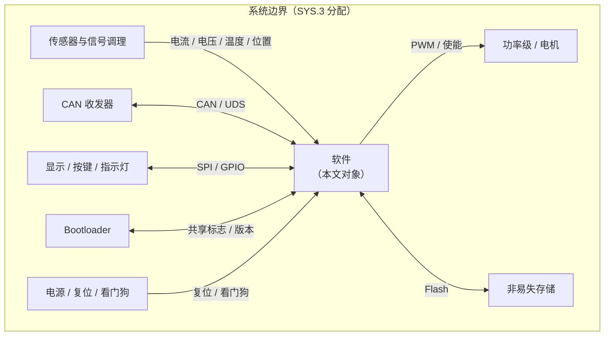
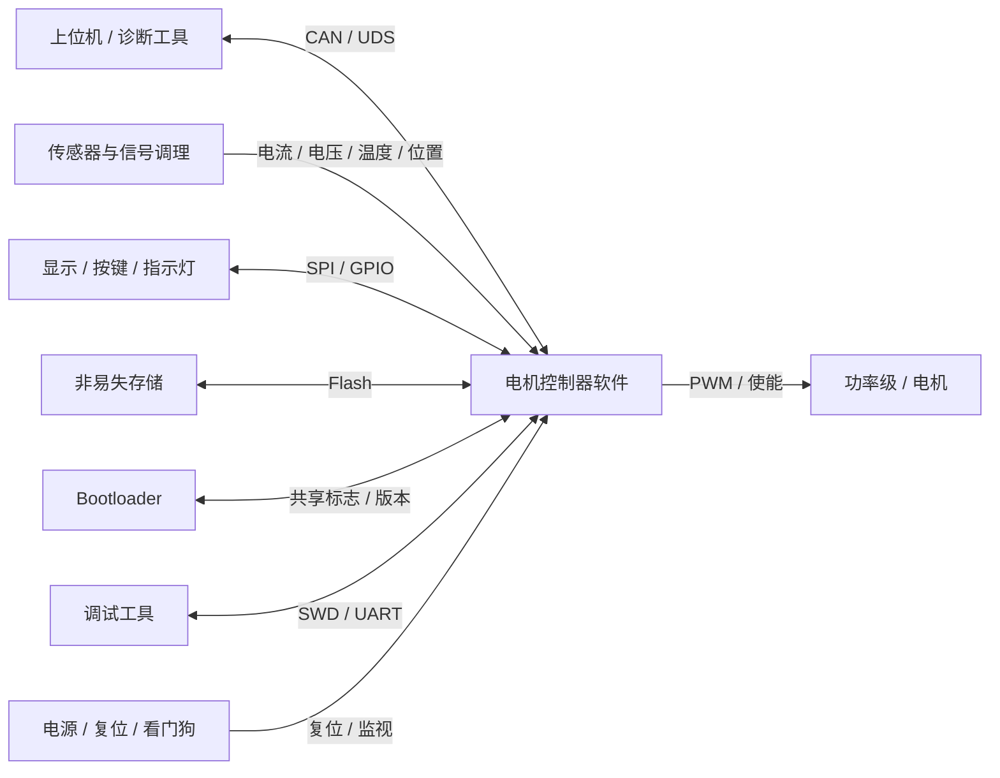
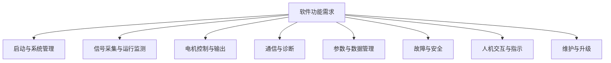
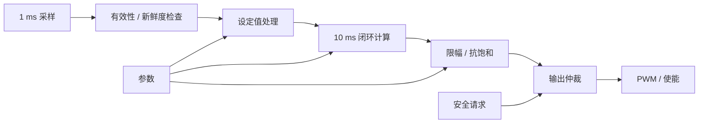
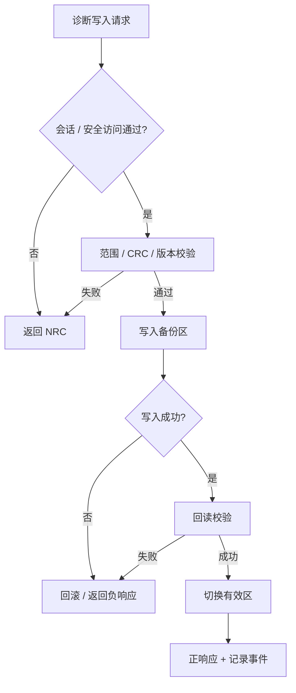
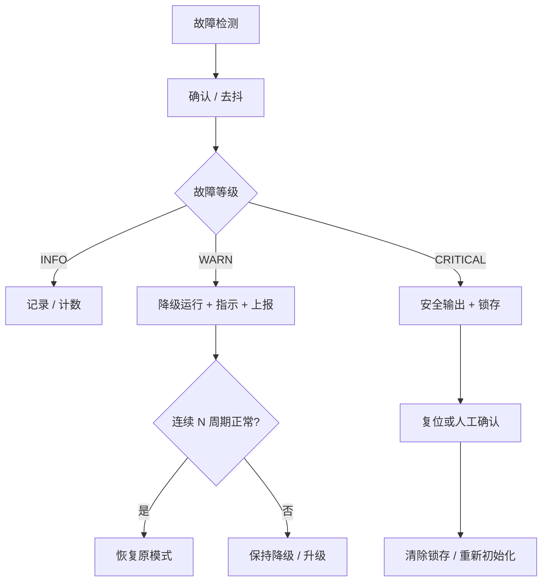
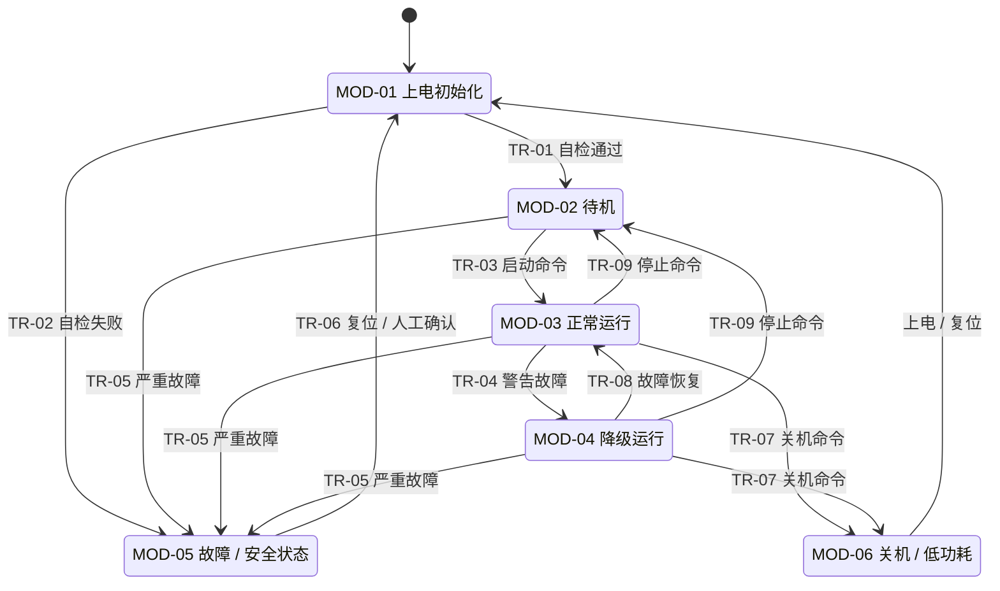
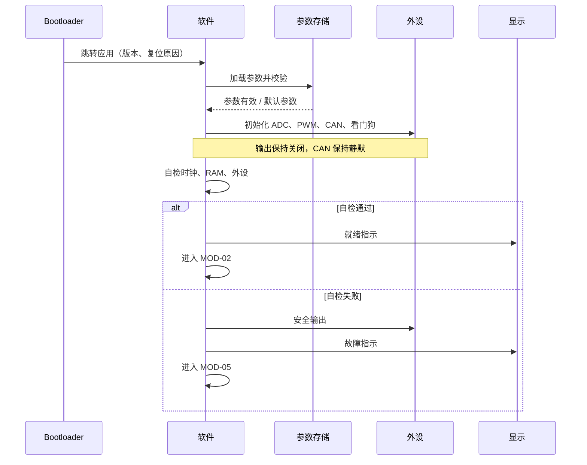
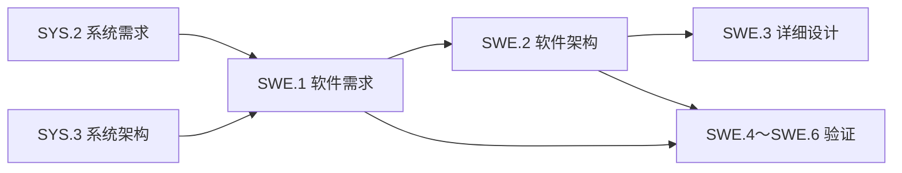
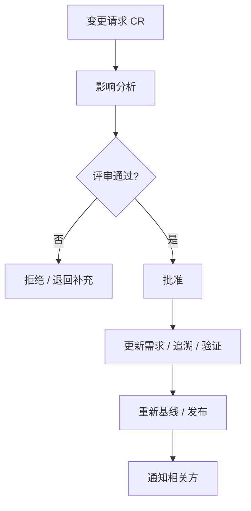

# 软件需求规格说明书（Software Requirements Specification, SWE.1）

## 修订记录

| 版本 | 状态 | 变更内容 | 变更日期            | 更改人 | 批准人 |
| ---- | ---- | -------- | ------------------- | ------ | ------ |
| r1   | 草稿 | 建档     | <YYYY-MM-DD></yyyy> | <名字> | <名字> |

---

> **阅读导航**：第 1～2 章说明文档目的、软件边界和需求来源；第 3～6 章定义软件需求（功能、行为、接口、质量与约束）；第 7 章记录需求分析与可行性结论；第 8 章建立系统需求、系统架构与软件需求之间的追溯；第 9 章记录评审、确认、发布和变更。本文只定义“软件作为整体应做什么”，不定义软件组件、任务、函数和数据结构；这些内容属于 SWE.2 和 SWE.3。

| ASPICE 4.1 实践 | 主要工作                 | 本文对应章节   |
| --------------- | ------------------------ | -------------- |
| SWE.1.BP1       | 定义软件需求             | 第 3～6 章     |
| SWE.1.BP2       | 分析软件需求             | 第 7.1、7.2 章 |
| SWE.1.BP3       | 分析对运行环境的影响     | 第 7.3、7.4 章 |
| SWE.1.BP4       | 确保一致性和建立双向追溯 | 第 8 章        |
| SWE.1.BP5       | 沟通已达成一致的软件需求 | 第 9 章        |

> **与 SWE.2 的边界**：本文描述功能域、外部接口、运行模式、时序、质量和约束；SWE.2 负责把这些需求分配到软件组件，定义组件间接口、任务、调度、并发和数据一致性机制。本文不出现组件名、任务名、函数名和内部消息机制。

---

## 1. 文档概述（Document Overview）

### 1.1 文档目的（Purpose）

本文档把系统/产品层需求中分配给软件的部分，分解为软件可以独立实现、验证和追溯的软件需求，作为以下活动的共同基线：

1. 软件架构设计（SWE.2）的输入；
2. 软件详细设计（SWE.3）和软件单元/集成/合格性验证（SWE.4～SWE.6）的输入；
3. 需求评审、确认、发布和变更影响分析的依据；
4. 与系统、硬件、测试、质量和项目管理相关方沟通软件行为的依据。

本文档回答五个问题：

| 问题                                         | 本文对应内容 |
| -------------------------------------------- | ------------ |
| 软件为哪个对象定义需求，边界在哪里           | 第 2 章      |
| 软件必须实现哪些功能                         | 第 3 章      |
| 软件在什么模式、什么时序和什么异常条件下运行 | 第 4 章      |
| 软件与外部世界交换什么                       | 第 5 章      |
| 软件必须满足哪些质量、资源和平台约束         | 第 6 章      |

本文档不替代系统需求规范、系统架构、接口控制文档、硬件手册和诊断规范；上述文件中的约束通过引用进入本文。

### 1.2 文档适用范围（Scope）

| 项目     | 内容                                                                                             |
| -------- | ------------------------------------------------------------------------------------------------ |
| 产品形态 | 嵌入式电机控制器（STM32G474 + FreeRTOS）                                                         |
| 软件对象 | 应用软件及必要的板级驱动/端口层；负责电机控制、信号采集、CAN/UDS、参数管理、故障安全、显示与人机 |
| 需求基线 | 本文 r1                                                                                          |
| 上游输入 | SYS.2 系统需求、SYS.3 系统架构与 HSI、ICD-CAN、硬件手册、诊断规范                                |
| 下游使用 | SWE.2 软件架构、SWE.3 详细设计、SWE.4～SWE.6 验证                                                |
| 不覆盖   | Bootloader 内部刷写算法、硬件电路与结构、机械/电气保护设计、OTA、生产测试、函数级设计            |
| 适用阶段 | 软件需求分析、架构设计输入、变更影响分析、需求评审与确认                                         |

**范围边界。**

| 范围   | 内容                                                                                                                                                                                            |
| ------ | ----------------------------------------------------------------------------------------------------------------------------------------------------------------------------------------------- |
| 纳入   | 启动与自检、参数加载、信号采集与有效性判断、电机闭环控制、输出使能与安全关断、CAN/UDS 通信、参数写入与掉电保护、故障检测/分级/安全状态、显示/按键/指示、复位原因与诊断计数、Bootloader 交接接口 |
| 不纳入 | 软件组件划分、任务调度、内部接口（SWE.2）；函数、数据结构、算法实现（SWE.3）；硬件保护电路、功率级与结构设计；Bootloader 刷写与回滚内部实现；OTA；整机装配与生产测试工装                        |

**SWE.1 与 SWE.2 的职责边界。**

| 内容     | SWE.1（本文）                          | SWE.2（软件架构）                |
| -------- | -------------------------------------- | -------------------------------- |
| 功能     | 按功能域定义软件应实现的行为           | 把功能分配到软件组件             |
| 运行行为 | 定义模式、转换、时序和异常行为         | 定义组件协作、任务、并发和调度   |
| 接口     | 定义软件与外部对象的接口契约           | 定义组件间内部接口和数据契约     |
| 资源     | 定义预算和约束                         | 分析并分配预算                   |
| 追溯     | 系统需求/系统架构 → 软件需求          | 软件需求 → 软件架构             |
| 示例     | “软件应支持电机启动、停止和转速闭环” | “通过电机控制组件实现闭环控制” |

> 系统架构分配（SYS.3）回答“哪些系统功能分配给软件、硬件等系统元素”；软件架构分解（SWE.2）回答“软件内部如何划分组件”。两者不是同一层次的分解，本文只引用前者。

### 1.3 参考资料（References）

| 编号        | 名称                         | 版本     | 用途                          |
| ----------- | ---------------------------- | -------- | ----------------------------- |
| SYS-REQ     | 系统需求规范（SYS.2）        | 当前基线 | 软件需求的上游来源            |
| SYS-ARC     | 系统架构与 HSI（SYS.3）      | 当前基线 | 系统元素分配、软硬件边界      |
| ICD-CAN     | CAN 通信矩阵与接口控制文档   | 当前基线 | CAN 报文、信号、周期、超时    |
| ICD-HMI     | 显示与按键接口规范           | 当前基线 | OLED、按键、指示灯            |
| HW-G474     | STM32G474 数据手册与参考手册 | 当前版本 | MCU 资源、外设、电气约束      |
| SW-CS       | 软件开发规范                 | 当前版本 | 编码、命名、注释、静态检查    |
| DIAG-SPEC   | 诊断规范（UDS/DTC/DID）      | 当前基线 | 诊断服务、会话、安全访问      |
| BOOT-SPEC   | Bootloader 接口规范          | 当前基线 | 启动/升级交接、版本、共享标志 |
| ISO 11898-1 | 道路车辆 CAN 数据链路层      | 当前版本 | 经典 CAN 协议参考             |
| ISO 14229-1 | 道路车辆 UDS 诊断服务        | 当前版本 | 诊断服务与响应参考            |
| ASPICE      | Automotive SPICE 4.1         | 4.1      | SWE.1 过程结果和基本实践      |
| CM-PROC     | 配置与变更管理程序           | 当前版本 | 基线、变更、发布              |

> 参考资料的版本以项目配置管理基线为准；本文引用编号而不复制其完整内容。若上游文件更新，应按第 9.4 节进行影响分析。

### 1.4 术语与缩略语（Terms and Abbreviations）

| 术语 / 缩略语     | 含义                                                     |
| ----------------- | -------------------------------------------------------- |
| SWE.1             | 软件需求分析过程                                         |
| SWE.2             | 软件架构设计过程                                         |
| SYS.2             | 系统需求分析过程                                         |
| SYS.3             | 系统架构设计过程                                         |
| HSI               | 硬件软件接口（Hardware-Software Interface）              |
| MCU               | 微控制器（Microcontroller Unit）                         |
| FOC               | 磁场定向控制（Field-Oriented Control）                   |
| PWM               | 脉宽调制（Pulse Width Modulation）                       |
| ADC               | 模数转换器（Analog-to-Digital Converter）                |
| CAN               | 控制器局域网（Controller Area Network）                  |
| UDS               | 统一诊断服务（Unified Diagnostic Services）              |
| DID / DTC         | 诊断数据标识符 / 诊断故障码                              |
| NVM               | 非易失存储（Non-Volatile Memory）                        |
| Bootloader        | 负责启动和本地升级的独立程序                             |
| OTA               | 空中升级（Over-the-Air），当前基线不包含                 |
| HMI               | 人机接口（Human-Machine Interface）                      |
| WCET              | 最坏情况执行时间（Worst-Case Execution Time）            |
| 采样周期          | 软件读取输入的固定时间间隔                               |
| 控制周期          | 控制算法执行一次的固定时间间隔                           |
| 端到端延迟        | 从输入事件发生到对应输出完成的时间                       |
| 抖动              | 周期处理实际触发时刻相对理想时刻的偏差                   |
| 安全状态          | PWM 关闭、使能无效、输出处于不会造成伤害或损坏的状态     |
| 降级运行          | 部分资源或功能受限时保留核心功能的运行方式               |
| 故障锁存          | 严重故障保持有效，直到复位或人工确认                     |
| 双区备份          | 参数区使用两个独立区域交替保存，保证掉电或写入失败可回滚 |
| CRC               | 循环冗余校验（Cyclic Redundancy Check）                  |
| 无效值            | 不能代表真实物理量的数据状态；不得用 0 代替              |
| 验收判据          | 判断单条需求是否满足的可测量条件，不等同于详细测试用例   |
| 远程 / 本地控制源 | 通过 CAN 接收的控制源 / 通过 HMI 输入的控制源            |

---

## 2. 软件需求上下文（Software Requirements Context）

**本章回答**：软件为哪个对象定义需求、需求来自哪里、软件处于什么运行环境、与哪些外部实体交互。本章不设计软件内部组件。

### 2.1 软件开发对象与范围（Software Scope）

本软件运行在 STM32G474RET6 单 MCU 上，控制一台三相电机，通过三相 PWM 功率级驱动。软件采集三相电流、母线电压、功率级温度和转子位置/转速，执行转速闭环和转矩限幅；通过 CAN 与上位机/整车控制器交互，支持 UDS 诊断；通过 OLED、按键和指示灯提供本地人机；参数、标定数据和故障记录保存在内部 Flash；通过独立 Bootloader 完成本地升级。

**软件负责：**

- 上电自检、参数加载、外设初始化和就绪判定；
- 传感器采样、工程值转换、有效性判断和运行状态监测；
- 电机启动、停止、闭环控制、限幅、输出使能和安全关断；
- CAN 报文收发、UDS 诊断、参数写入和故障上报；
- 故障检测、分级、降级、锁存、记录和安全状态；
- 显示、按键、指示灯和本地控制源；
- 参数完整性、掉电保护和版本兼容性；
- 与 Bootloader 的交接接口。

**软件不负责：**

- 硬件过流比较器、栅极驱动死区、功率级下拉和电气保护电路的最终保证；
- 机械限位、结构强度、人身安全的最终保证；
- Bootloader 内部刷写算法、回滚策略和升级镜像管理；
- OTA、生产测试工装、整机装配和报废要求；
- 软件组件划分、任务调度和函数级实现。

> 软件安全输出与硬件保护是互补关系：软件必须在 FR-040 规定的时限内关闭输出；硬件保护必须在软件失效时仍能限制危险能量。具体安全目标由系统安全概念定义。

### 2.2 系统需求输入（System Requirements Input）

本节只摘录与软件相关的系统需求，完整语义、验收判据和系统级验证以 SYS.2 为准。系统需求到软件需求的正式追溯见第 8.1 节。

| 系统需求 ID | 系统需求摘要                                                 | 分配给软件的内容                              | 软件需求（见第 3～6 章）                                   |
| ----------- | ------------------------------------------------------------ | --------------------------------------------- | ---------------------------------------------------------- |
| SYS-REQ-001 | 电机运行控制：启动、停止、转速闭环、转矩限幅                 | 控制策略、设定值处理、启动/停止序列、输出限幅 | FR-020～FR-025、FR-052                                     |
| SYS-REQ-002 | 安全与故障保护：故障时进入安全状态，防止过流、过压、过温损坏 | 故障检测、分级、锁存、安全输出、恢复          | FR-024、FR-040、FR-042～FR-046                             |
| SYS-REQ-003 | 状态感知：采集三相电流、母线电压、功率级温度、转子位置/转速  | 采样、转换、有效性、角度/转速计算、标定       | FR-010～FR-015                                             |
| SYS-REQ-004 | 上位机/整车通信：CAN 控制命令和周期状态                      | 报文收发、超时、无效帧、bus-off、状态上报     | FR-030、FR-032～FR-034、FR-036                             |
| SYS-REQ-005 | 诊断与参数：UDS、DID/DTC、参数读写                           | 诊断服务、会话、安全访问、DTC/DID、参数写入   | FR-031、FR-035、FR-037、FR-044                             |
| SYS-REQ-006 | 参数存储：掉电保存参数和标定数据，保证完整性                 | 参数加载、校验、双区写入、回滚、版本兼容      | FR-002、FR-031、FR-070～FR-072                             |
| SYS-REQ-007 | 本地人机：显示、按键、指示灯                                 | 页面、按键、指示、本地设定和使能              | FR-041、FR-050～FR-053                                     |
| SYS-REQ-008 | 启动与自检：上电自检并在规定时间内就绪                       | 自检、初始化、就绪判定、状态维护              | FR-001、FR-003、FR-005                                     |
| SYS-REQ-009 | 升级与维护：通过 Bootloader 本地升级                         | 升级请求、版本兼容、共享标志、复位交接        | FR-006、FR-060                                             |
| SYS-REQ-010 | 实时性：10 ms 控制、30 ms 端到端、100 ms 通信响应、2 s 启动  | 周期、延迟、抖动、响应时间                    | NFR-P-01～NFR-P-07                                         |
| SYS-REQ-011 | 可靠性与恢复：看门狗、复位原因、故障恢复、长时间运行         | 看门狗监督、复位记录、恢复策略、掉电保护      | FR-004、FR-044、FR-045；NFR-A-01～NFR-A-08                 |
| SYS-REQ-012 | 安全与防护：防止非法控制、未授权参数修改和调试接口滥用       | 输入校验、访问控制、安全访问、调试保护        | FR-037；NFR-S-01～NFR-S-06                                 |
| SYS-REQ-013 | 可维护性与诊断：版本、日志、故障计数、诊断接口               | DID/DTC、日志、版本、计数、测试观测点         | FR-005、FR-007、FR-044、FR-060、FR-061；NFR-M-01～NFR-M-07 |
| SYS-REQ-014 | 平台约束：STM32G474 + FreeRTOS + 指定工具链，资源不超预算    | 资源预算、静态分配、编码规范、平台适配        | NFR-R-01～NFR-R-05；CON-01～CON-13                         |
| SYS-REQ-015 | 运行环境：规定供电、温度、CAN 网络环境下运行                 | 欠压/掉电、过温、总线异常、环境适配           | FR-013、FR-045；ASM-01～ASM-05                             |

> 本文当前基线为单电机控制。若后续系统需求扩展为双电机独立控制，应新增软件功能和接口需求，不能仅通过复制单电机需求来覆盖。

### 2.3 系统架构约束与分配（System Architecture Allocation）

SYS.3 把系统功能分配给传感器、功率级、通信、人机、存储、Bootloader、电源/复位等系统元素，并把其中需要软件实现的部分分配给本软件。本节只说明分配结果和对软件的约束，不展开软件内部结构。

| 系统架构元素                  | 类型      | 系统分配职责                     | 软件承担                                 | 软件不承担                           | 相关需求                                         |
| ----------------------------- | --------- | -------------------------------- | ---------------------------------------- | ------------------------------------ | ------------------------------------------------ |
| SYS-ARC-01 传感器与信号调理   | 硬件      | 电流、电压、温度、位置信号调理   | 采样、转换、有效性、角度/转速计算        | 传感器精度、电气保护、断线检测电路   | FR-010～FR-015；IFR-HW-001                       |
| SYS-ARC-02 功率级与电机       | 硬件      | 三相逆变、栅极驱动、电机能量转换 | PWM 输出、使能、安全关断、故障反馈处理   | 功率器件选型、死区电路、硬件过流保护 | FR-020～FR-024、FR-040、FR-046；IFR-HW-002/003   |
| SYS-ARC-03 CAN 收发器与网络   | 硬件/网络 | 物理层、终端、拓扑               | CAN 收发、过滤、协议、超时、bus-off 恢复 | 收发器电气特性、网络终端             | FR-030、FR-032～FR-034、FR-036；IFR-COM-001～005 |
| SYS-ARC-04 显示、按键与指示灯 | 硬件      | OLED、按键、LED                  | 页面、按键、指示、显示失效处理           | 显示模组电气特性、按键机械寿命       | FR-041、FR-050～FR-053；IFR-HMI-001～003         |
| SYS-ARC-05 非易失存储         | 硬件      | 内部 Flash 参数区                | 参数/标定/故障记录读写、CRC、双区、回滚  | Flash 物理寿命、擦写特性             | FR-002、FR-031、FR-070～FR-072；IFR-HW-005       |
| SYS-ARC-06 电源、复位与看门狗 | 硬件      | 供电、复位、独立看门狗           | 欠压/复位原因读取、看门狗刷新、安全输出  | 电源设计、复位电路、硬件欠压保护     | FR-004、FR-045；IFR-HW-006                       |
| SYS-ARC-07 Bootloader         | 软件      | 启动、镜像校验、本地刷写、回滚   | 升级请求、版本检查、共享标志、复位交接   | 刷写算法、镜像管理、回滚实现         | FR-006、FR-060；IFR-SYS-001                      |
| SYS-ARC-08 调试接口           | 工具/接口 | SWD、UART 调试与测量             | 日志、版本、复位原因、测量点             | 调试器、生产测试工装                 | NFR-M-02；IFR-HW-007                             |
| SYS-ARC-09 软件               | 软件      | 本文定义的软件功能               | 全部软件需求                             | 系统/硬件/结构责任                   | 第 3～6 章                                       |

> 本图只表示系统元素与软件的分配关系。软件内部的组件、接口、任务和数据流属于 SWE.2，不在本图展开。

### 2.4 软件运行环境（Operating Environment）

| 项目              | 当前基线                                              | 对软件需求的影响                                |
| ----------------- | ----------------------------------------------------- | ----------------------------------------------- |
| MCU               | STM32G474RET6，Cortex-M4F，170 MHz，带 FPU            | 单核；控制计算需在 10 ms 周期内完成             |
| 片上存储          | 512 KB Flash，128 KB SRAM                             | 应用镜像预算 256 KB；运行 RAM 预算 64 KB        |
| 操作系统          | FreeRTOS 10.3.1，1 kHz tick，抢占式固定优先级         | 周期精度 1 ms；执行上下文、缓冲区、栈需静态分配 |
| 内核配置          | 静态分配；关闭同优先级时间片                          | 运行期无动态内存；缓冲区深度需预先确定          |
| 启动结构          | Bootloader 24 KB，应用入口独立                        | 应用不实现自身刷写；升级由 Bootloader 负责      |
| 编译工具链        | GNU Arm Embedded 10.3，C11，-O2                       | 代码尺寸和 WCET 以该工具链为准                  |
| 基础软件          | STM32CubeG4 HAL 1.27.1；关键路径可用 LL               | 初始化用 HAL；采样/PWM 中断路径需降低开销       |
| CAN               | FDCAN1，按经典 CAN 使用，500 kbit/s，11 位 ID，8 字节 | 报文长度和总线负载受限                          |
| 采样              | ADC1/ADC2，12 位，1 ms 触发                           | 采样与 10 ms 控制需解耦；数据需带时间戳         |
| PWM               | HRTIM，20 kHz，三相互补，死区由硬件保证               | 输出更新需与 PWM 同步；安全状态需快速关断       |
| 显示              | 128×64 OLED，SPI，20 ms 刷新                         | 显示不得阻塞控制；显示失效不影响控制            |
| 参数存储          | 内部 Flash 参数区 2×2 KB，双区备份                   | 写入需回读校验；掉电需可回滚                    |
| 看门狗            | IWDG，100 ms 超时                                     | 仅在关键功能存活时刷新；超时复位                |
| 调试              | SWD + UART 日志                                       | 关键状态可观测；生产件需保护                    |
| 供电 / 温度 / EMC | 由硬件与环境规范定义                                  | 软件需处理欠压、掉电、过温和通信异常            |

**运行环境假设。**

- 传感器输出在标称量程内；越界按无效值处理。
- 供电电压在硬件规范范围内；掉电保护依赖硬件，软件检测欠压并执行安全行为。
- CAN 网络终端、拓扑和波特率符合 ICD-CAN；报文矩阵在基线内。
- Bootloader 版本与当前应用兼容；共享标志和版本接口稳定。
- 硬件引脚与 ICD 一致；驱动配置以硬件/ICD 为准。
- 当前基线不包含 OTA；若后续引入，应新增需求、模式和验证内容。

### 2.5 软件与外部实体关系（External Entities）

| 编号   | 外部实体             | 类型 | 与软件的关系 | 交互内容                              | 责任边界                                                  |
| ------ | -------------------- | ---- | ------------ | ------------------------------------- | --------------------------------------------------------- |
| EXT-01 | 上位机 / 诊断工具    | 系统 | 通信         | CAN 控制报文、状态报文、UDS 请求/响应 | 协议内容由 ICD/诊断规范定义；软件负责响应、超时和错误处理 |
| EXT-02 | 传感器               | 硬件 | 输入         | 电流、电压、温度、位置/转速           | 传感器精度和电气保护由硬件负责；软件负责采样和有效性      |
| EXT-03 | 功率级 / 电机        | 硬件 | 输出         | PWM、使能、故障反馈                   | 软件保证输出契约和安全关断；硬件保证功率级保护            |
| EXT-04 | 显示与按键           | 硬件 | 人机交互     | 显示页面、按键事件、指示灯            | 显示失效不得影响控制；按键/显示电气特性由硬件定义         |
| EXT-05 | 非易失存储           | 硬件 | 存储         | 参数、标定、版本、故障记录            | 软件负责数据完整性、双区和掉电保护                        |
| EXT-06 | Bootloader           | 软件 | 启动 / 升级  | 跳转、版本、共享标志、复位            | 刷写算法和回滚由 Bootloader 负责；应用只请求和交接        |
| EXT-07 | 调试工具             | 工具 | 调试 / 测量  | SWD、UART、GPIO 时间戳                | 生产件关闭或保护调试口；调试不得改变控制行为              |
| EXT-08 | 电源 / 复位 / 看门狗 | 硬件 | 支撑         | 供电、复位原因、看门狗                | 软件读取复位原因并记录；硬件保证复位和看门狗基本功能      |

**边界规则。**

- 硬件保护（过流比较器、栅极驱动死区、功率级下拉）由硬件负责；软件安全输出是第二道防线，不替代硬件保护。
- 软件负责采样、转换、有效性判断和控制决策；传感器精度、断线检测电路和电气保护由硬件负责。
- 上电、复位和掉电瞬间，软件必须保持输出关闭；硬件必须保证复位期间的安全电平。
- 通信断开、传感器失效、显示失效时，软件应进入定义的降级或安全行为；能否本地独立运行由运行模式决定。
- 软件不承担机械限位、结构强度和人身安全的最终保证；这些由系统安全概念和硬件设计负责。
- Bootloader 负责刷写和回滚；应用软件只负责升级请求、版本检查和共享标志交接。

---

## 3. 软件功能需求（Software Functional Requirements）

**本章回答**：软件必须实现哪些功能、这些功能按什么业务域组织、端到端处理链如何约束、异常和故障应如何处理。本章按功能域组织，不按软件组件或任务组织。

### 3.1 功能需求概述（Functional Requirements Overview）

**组织原则。**

- 按业务功能域组织需求，而不是按未来软件模块组织；功能域描述“软件要做什么”，不描述“由哪个组件做”。
- 一条需求只描述一个可验证的行为，使用“软件应……”句式。
- 每条需求有唯一 ID、上游来源、优先级和验收判据；详细验证方法见第 7.6 节。
- 需求中不出现组件名、任务名、函数名、内部队列、回调或消息机制。
- 正常、边界、异常、启动、关闭、掉电和通信中断均需覆盖。

**功能域总览。**

| 功能域             | 目标                                         | 需求 ID                        | 优先级 | 主要外部交互                |
| ------------------ | -------------------------------------------- | ------------------------------ | ------ | --------------------------- |
| 启动与系统管理     | 上电自检、初始化、就绪、模式与状态维护       | FR-001、FR-003～FR-007         | 高     | 复位、Bootloader、显示、CAN |
| 信号采集与运行监测 | 采样、转换、有效性、角度/转速、电压/温度监测 | FR-010～FR-015                 | 高     | 传感器、ADC、GPIO           |
| 电机控制与输出     | 闭环控制、启停、设定值、限幅、输出仲裁       | FR-020～FR-025                 | 高     | 功率级、PWM、HMI、CAN       |
| 通信与诊断         | CAN 收发、超时、无效帧、bus-off、UDS         | FR-030、FR-032～FR-037         | 高/中  | CAN 收发器、诊断工具        |
| 参数与数据管理     | 参数加载、写入、版本、掉电保护、标定         | FR-002、FR-031、FR-070～FR-072 | 高/中  | 非易失存储、诊断工具        |
| 故障与安全         | 故障检测、分级、降级、锁存、记录、安全输出   | FR-040、FR-042～FR-046         | 高     | 传感器、功率级、电源、通信  |
| 人机交互与指示     | 显示、按键、指示灯、本地设定与使能           | FR-041、FR-050～FR-053         | 中/低  | OLED、按键、LED             |
| 维护与升级         | 版本信息、事件日志、Bootloader 交接          | FR-006、FR-060、FR-061         | 中/低  | 诊断工具、Bootloader        |

> 功能域不是软件组件。一个功能域可能由多个组件协作实现，一个组件也可能服务多个功能域；具体分配在 SWE.2 中完成。

**优先级定义。**

| 优先级 | 含义                                 | 处理原则                         |
| ------ | ------------------------------------ | -------------------------------- |
| 高     | 安全、基本控制、启动、通信或资源底线 | 必须进入 r1 基线；未满足不得放行 |
| 中     | 诊断、参数、HMI、可维护性            | 进入 r1 或 r1.1，按项目计划分配  |
| 低     | 增强显示、长期日志、质量提升         | 可进入后续版本，不阻塞基本功能   |

### 3.2 功能域需求（Functional Domain Requirements）

#### 3.2.1 启动与系统管理

| 需求 ID | 需求描述                                                                                                                                         | 输入 → 输出                              | 异常 / 边界                                    | 优先级 | 验收判据                                                                                                                            | 上游来源                 |
| ------- | ------------------------------------------------------------------------------------------------------------------------------------------------ | ----------------------------------------- | ---------------------------------------------- | ------ | ----------------------------------------------------------------------------------------------------------------------------------- | ------------------------ |
| FR-001  | 软件应在每次上电或复位后对时钟、RAM、看门狗、ADC、PWM、CAN、NVM 等关键资源执行自检，并检查显示接口；显示接口失效按 FR-053 处理，不阻止控制就绪。 | 复位、硬件状态 → 自检结果、就绪/故障指示 | 自检失败、外设无响应、看门狗复位               | 高     | 正常上电 500 ms 内完成；注入 RAM/时钟/CAN/NVM 故障时能识别并进入 MOD-05；自检失败不得使能输出；显示接口失效只记录并按 FR-053 降级。 | SYS-REQ-008              |
| FR-003  | 软件应在自检通过且参数通过校验（含安全默认参数）后进入待机就绪状态，并在上电后 2 s 内给出就绪指示；自检失败不得进入就绪状态。                    | 自检结果、参数状态 → 运行模式、就绪指示  | 参数使用默认值、显示失效、自检超时             | 高     | 正常上电 ≤2 s 就绪；自检失败时就绪指示不点亮；默认参数时显示参数告警但允许待机。                                                   | SYS-REQ-008              |
| FR-004  | 软件应读取并记录复位原因，包括上电、看门狗、软件、引脚、欠压和时钟失效，并支持通过诊断接口读取最近一次及历史复位原因。                           | RCC 复位标志 → 复位原因记录、DID         | NVM 写入失败、复位标志多位同时置位、记录区满   | 中     | 每种复位注入后原因正确；掉电重启后最近一次记录仍可读取；多位标志按定义优先级归类。                                                  | SYS-REQ-011              |
| FR-005  | 软件应维护当前运行模式、故障等级、降级状态、参数有效性和运行时间，并在状态变化后 20 ms 内提供给显示、CAN 和诊断使用。                            | 模式/故障/参数事件 → 系统状态快照        | 状态消费者不可用、状态更新与故障同时发生       | 高     | 模式或故障变化后 ≤20 ms 状态更新；显示和 CAN 读取到的状态一致；消费者失效不影响状态维护。                                          | SYS-REQ-008、SYS-REQ-013 |
| FR-006  | 软件应在待机模式接受本地升级请求，校验请求和 Bootloader 版本兼容性，置位共享升级标志并复位进入 Bootloader；应用软件不得擦写自身程序区。          | HMI/CAN/调试升级请求 → 共享标志、复位    | 运行中请求、版本不兼容、标志写入失败、重复请求 | 中     | 待机请求后 ≤200 ms 复位进入 Bootloader；运行中请求被拒绝；版本不兼容有负响应或指示；标志写入失败不复位。                           | SYS-REQ-009              |
| FR-007  | 软件应统计并维护上电次数、运行时间、复位次数、通信错误计数和故障计数，关键计数应掉电保存并可通过诊断接口读取。                                   | 运行事件 → 计数器、DID                   | 计数器溢出、NVM 写入失败、记录区满             | 低     | 计数与注入事件一致；关键计数复位后不丢失；溢出时饱和或回绕并有标志。                                                                | SYS-REQ-013              |

> FR-002（参数加载与校验）在启动流程中被调用，但归属 3.2.5 参数与数据管理，避免重复定义。

#### 3.2.2 信号采集与运行监测

| 需求 ID | 需求描述                                                                                                           | 输入 → 输出                                | 异常 / 边界                              | 优先级 | 验收判据                                                                                                         | 上游来源                 |
| ------- | ------------------------------------------------------------------------------------------------------------------ | ------------------------------------------- | ---------------------------------------- | ------ | ---------------------------------------------------------------------------------------------------------------- | ------------------------ |
| FR-010  | 软件应以 1 ms 周期采集三相电流、母线电压、功率级温度和转子位置/转速信号，转换为工程值并附加采样时间戳。            | ADC/GPIO → 工程值、原始值、时间戳          | 采样未完成、转换错误、通道饱和           | 高     | 采样周期 1 ms ±100 µs；电流/电压转换误差 ≤1% FS，温度误差 ≤2 °C；时间戳能区分采样时刻；异常采样带无效标志。 | SYS-REQ-003              |
| FR-011  | 软件应对每路采样信号执行量程、断线/短路、超时和合理性判断；无效时置无效标志并保持上一有效值，不得用 0 代替无效值。 | 原始/工程值、时间戳 → 有效性标志、故障事件 | 越界、断线、短路、传感器卡滞、采样超时   | 高     | 注入越界/断线/超时，≤10 ms 置无效；连续 5 个有效周期后恢复；无效值不参与控制；故障计数正确。                    | SYS-REQ-003              |
| FR-012  | 软件应根据转子位置信号计算电角度和转速，并进行方向、范围和跳变合理性检查；位置信号无效时应按失效处理。             | 位置信号 → 电角度、转速、有效性            | 位置丢失、角度跳变、方向反转、超速       | 高     | 额定转速范围内稳态转速误差 ≤2%，电角度误差 ≤2°；注入位置丢失/跳变时按失效处理。                               | SYS-REQ-003              |
| FR-013  | 软件应监测母线电压和功率级温度，执行滤波、阈值和迟滞判断，为降额、保护和故障上报提供依据。                         | ADC → 电压、温度、状态                     | 过压、欠压、过温、传感器无效             | 高     | 超过阈值后 ≤100 ms 触发降额或保护；迟滞和阈值可参数化；无效传感器按 FR-011 处理。                               | SYS-REQ-003、SYS-REQ-002 |
| FR-014  | 软件应保证控制使用的采样数据年龄不超过 20 ms；超过时标记 STALE 并触发降级或故障，且多字节采样数据应提供一致快照。  | 时间戳、采样数据 → 新鲜度状态、一致快照    | 连续 3 次 STALE、采样中断、数据撕裂      | 高     | 停止采样后 20 ms 内标记 STALE；连续 3 次失效触发 F-02；控制不使用撕裂数据。                                      | SYS-REQ-003、SYS-REQ-010 |
| FR-015  | 软件应支持电流、电压、温度和位置通道的零偏与增益标定，标定参数应可存储、读取、校验和恢复默认值。                   | 标定命令/参数 → 标定结果、标定参数         | 标定值越界、CRC 错误、写入失败、通道无效 | 中     | 标定后零偏/增益误差满足通道规范；非法标定被拒绝；默认值可恢复；标定参数掉电保存。                                | SYS-REQ-003、SYS-REQ-006 |

#### 3.2.3 电机控制与输出

| 需求 ID | 需求描述                                                                                                                                                 | 输入 → 输出                                     | 异常 / 边界                                    | 优先级 | 验收判据                                                                                              | 上游来源                 |
| ------- | -------------------------------------------------------------------------------------------------------------------------------------------------------- | ------------------------------------------------ | ---------------------------------------------- | ------ | ----------------------------------------------------------------------------------------------------- | ------------------------ |
| FR-020  | 软件应以 10 ms 周期根据设定值和反馈计算控制量，执行电流/转速闭环和转矩限幅，并将控制量输出到功率级。                                                     | 设定值、反馈、参数、安全请求 → PWM 占空比、使能 | 反馈无效、安全请求、输出饱和、参数无效         | 高     | 控制周期 10 ms ±1 ms；阶跃响应超调 ≤10%，稳态误差 ≤2%；输出限幅生效；反馈无效时进入降级/安全状态。 | SYS-REQ-001              |
| FR-021  | 软件应在满足启动条件后按定义时序使能输出；收到停止命令后按定义时序关闭输出，不得直接跳变。                                                               | 启动/停止命令、模式、故障状态 → 使能、PWM       | 故障时启动、重复命令、停止命令丢失、模式不允许 | 高     | 启动命令后 ≤50 ms 进入使能；停止命令后 ≤50 ms 输出关闭；故障时 ≤20 ms 安全关断；非法启动被拒绝。   | SYS-REQ-001、SYS-REQ-002 |
| FR-022  | 软件应接收来自本地 HMI 或 CAN 的转速/转矩设定值，执行来源优先级、范围限制、变化率限制和超时处理。                                                        | HMI/CAN 设定值 → 校验后的设定值                 | 越界、超时、来源冲突、无效来源                 | 高     | 越界设定被限幅；超时后按模式归零或保持安全值；来源切换按定义执行；不产生超出变化率限制的跳变。        | SYS-REQ-001、SYS-REQ-004 |
| FR-023  | 软件应根据参数对电流、转矩、电压、占空比和变化率进行限幅，并防止积分饱和。                                                                               | 控制量、限值 → 限幅后的输出、饱和标志           | 参数无效、限值冲突、长期饱和                   | 高     | 任何工况下输出不超过配置限值；饱和后退出时间满足定义；积分不累积到不可恢复。                          | SYS-REQ-001              |
| FR-024  | 软件应仅在无严重故障、参数可用（通过校验或安全默认参数）、模式允许且安全请求无效时使能输出；收到安全请求或严重故障时，应在 20 ms 内关闭 PWM 并使能无效。 | 安全请求、故障状态、模式 → PWM 使能、故障反馈   | 启动过程中安全请求、输出级故障、使能反馈不一致 | 高     | 安全请求后 ≤20 ms PWM 关闭/EN 无效；使能条件不满足时无法使能；关断后需复位或人工确认才能恢复。       | SYS-REQ-002              |
| FR-025  | 软件应发布电机运行状态，包括实际转速、电流、电压、温度、转矩限幅、运行/降级/故障状态和故障码。                                                           | 控制/采样数据 → 状态快照                        | 数据无效、通信不可用、状态更新延迟             | 中     | 状态更新周期 ≤10 ms；显示和 CAN 状态与内部一致；无效数据带标志；状态不因消费者失效而丢失。           | SYS-REQ-004、SYS-REQ-007 |

#### 3.2.4 通信与诊断

| 需求 ID | 需求描述                                                                                                                 | 输入 → 输出                             | 异常 / 边界                                    | 优先级 | 验收判据                                                                                       | 上游来源                 |
| ------- | ------------------------------------------------------------------------------------------------------------------------ | ---------------------------------------- | ---------------------------------------------- | ------ | ---------------------------------------------------------------------------------------------- | ------------------------ |
| FR-030  | 软件应通过经典 CAN 500 kbit/s 接收控制/配置报文，并按周期发送状态报文；报文 ID、DLC 和信号布局应符合 ICD-CAN。           | CAN 帧 → CAN 帧                         | bus-off、接收溢出、DLC 错误、未知 ID           | 高     | 按 ICD 正确收发；状态帧周期偏差 ≤10%；总线负载 ≤50%；错误帧可计数。                          | SYS-REQ-004              |
| FR-032  | 软件应监测控制报文接收超时；超过 100 ms 未收到有效控制报文时，置通信超时故障，并按当前模式执行保持安全输出、归零或停止。 | CAN RX 时间戳 → 超时标志、安全行为      | 不同模式下超时、恢复、与控制源切换同时发生     | 高     | 停止发送后 100 ms 内检测到超时；按模式执行定义行为；收到有效帧后按迟滞恢复。                   | SYS-REQ-004、SYS-REQ-002 |
| FR-033  | 软件应检查 CAN 报文的 DLC、计数器/校验和、信号范围和更新超时；无效报文应被丢弃并计数，不得用于控制。                     | CAN 帧 → 有效/无效状态、错误计数        | DLC 错误、校验错、计数器跳变、信号越界、帧过期 | 高     | 注入各类无效报文均被拒绝并计数；控制不使用无效数据；错误计数可通过诊断读取。                   | SYS-REQ-004              |
| FR-034  | 软件应检测 CAN bus-off，停止发送并记录故障，按 CAN 规范尝试自动恢复；恢复后重新同步状态。                                | CAN 控制器状态 → bus-off 标志、恢复状态 | 重复 bus-off、恢复失败、恢复期间收到报文       | 中     | bus-off 后 ≤5 ms 检测并停止发送；自动恢复成功后可继续通信；连续失败达到上限后保持故障并上报。 | SYS-REQ-004              |
| FR-035  | 软件应支持诊断会话控制、DID 读写、DTC 读取/清除、例程控制和通信保持等 UDS 服务，响应格式符合诊断规范。                   | UDS 请求 → UDS 响应                     | 不支持的服务、非法会话、安全拒绝、长度错误     | 中     | 支持的服务正响应正确；非法请求返回规定 NRC；响应时间 ≤100 ms。                                | SYS-REQ-005              |
| FR-036  | 软件应在故障确认、状态变化和周期状态帧中上报故障码、等级、计数和当前模式；严重故障应在 20 ms 内发送首帧。                | 故障状态/系统状态 → CAN 状态/故障帧     | bus-off、发送过载、报文丢失                    | 高     | 故障确认后 ≤20 ms 发送首帧；周期状态帧按 ICD 周期发送；bus-off 期间缓存/丢弃策略符合定义。    | SYS-REQ-004、SYS-REQ-002 |
| FR-037  | 软件应管理 UDS 会话超时和安全访问，参数写入和例程控制需满足会话及安全条件。                                              | 会话/安全请求 → 会话状态、访问结果      | S3 超时、密钥错误、尝试次数超限                | 中     | S3 超时后回到默认会话；未解锁时拒绝受保护服务并返回 NRC；错误尝试计数和延迟符合诊断规范。      | SYS-REQ-005、SYS-REQ-012 |

> FR-031（参数写入与持久化）由诊断请求触发，但归属 3.2.5 参数与数据管理。

#### 3.2.5 参数与数据管理

| 需求 ID | 需求描述                                                                                                                   | 输入 → 输出                        | 异常 / 边界                                    | 优先级 | 验收判据                                                                                                     | 上游来源                 |
| ------- | -------------------------------------------------------------------------------------------------------------------------- | ----------------------------------- | ---------------------------------------------- | ------ | ------------------------------------------------------------------------------------------------------------ | ------------------------ |
| FR-002  | 软件应在上电初始化时从非易失存储加载参数，执行 CRC、版本和范围校验；校验失败时使用安全默认参数并标记参数降级状态。         | NVM → 参数集、来源/降级状态        | CRC 错误、版本不匹配、读取失败、掉电中断       | 高     | 有效参数 300 ms 内加载完成；损坏或版本不匹配时使用默认值；不得使用未校验参数控制电机。                       | SYS-REQ-006              |
| FR-031  | 软件应支持通过诊断接口写入参数，执行范围、CRC 和版本校验，采用双区备份写入、回读确认和失败回滚；写入期间不得影响控制安全。 | UDS 写入请求 → 正/负响应、存储参数 | 范围错误、CRC 错误、写入失败、掉电、运行中写入 | 中     | 写入成功回读一致；失败回滚旧参数完整；掉电中断后重启至少有一份有效参数；运行中控制参数写入按定义拒绝或延迟。 | SYS-REQ-005、SYS-REQ-006 |
| FR-070  | 软件应为每个可写参数定义单位、范围、默认值、分辨率和持久化属性；写入值超出范围或格式非法时应拒绝。                         | 参数定义/写入请求 → 校验结果       | 越界、NaN、未知参数 ID、只读参数写入           | 高     | 所有参数有定义；越界/非法值被拒绝；默认值可恢复；只读参数不可写。                                            | SYS-REQ-006              |
| FR-071  | 软件应校验参数版本与软件版本的兼容性；不兼容时使用默认参数或按定义迁移，并记录事件。                                       | 参数版本 → 兼容性结果              | 版本不匹配、迁移失败、版本信息缺失             | 中     | 版本不匹配按定义处理；迁移失败不破坏旧参数；事件可通过诊断读取。                                             | SYS-REQ-006              |
| FR-072  | 软件应在参数写入和关机过程中保证掉电不破坏有效参数；上电后应能识别并回滚到上一有效版本。                                   | 掉电/复位、NVM 状态 → 有效参数集   | 擦写过程中掉电、CRC 错误、双区均无效           | 高     | 在写入各阶段掉电，重启后至少有一份有效参数；不得出现无参数可用；回滚事件被记录。                             | SYS-REQ-006              |

#### 3.2.6 故障与安全

| 需求 ID | 需求描述                                                                                                                  | 输入 → 输出                              | 异常 / 边界                                    | 优先级 | 验收判据                                                                                              | 上游来源                 |
| ------- | ------------------------------------------------------------------------------------------------------------------------- | ----------------------------------------- | ---------------------------------------------- | ------ | ----------------------------------------------------------------------------------------------------- | ------------------------ |
| FR-040  | 软件应检测传感器、通信、电源、时钟、看门狗、输出级、过流、过压和过温故障，按等级处理；严重故障应在 20 ms 内进入安全状态。 | 故障源 → 故障状态、安全输出、故障记录    | 多故障并发、启动过程中故障、参数写入过程中故障 | 高     | 注入 F-01～F-16 均能检测并按规定反应；严重故障 ≤20 ms 安全输出；故障不丢失。                         | SYS-REQ-002              |
| FR-042  | 软件应将故障分为 INFO、WARN 和 CRITICAL，WARN 时按定义降额运行，CRITICAL 时安全停止。                                     | 故障等级 → 降级级别、输出限值            | 多个 WARN 叠加、WARN 升级、恢复抖动            | 高     | WARN 时转矩 ≤50%、转速受限并指示；连续 5 个控制周期正常后恢复；升级为 CRITICAL 时 ≤20 ms 安全停止。 | SYS-REQ-002              |
| FR-043  | 软件应锁存 CRITICAL 故障，只有在故障消失且收到复位或人工确认后才允许清除；清除后应重新初始化并记录事件。                  | 复位/确认命令、故障状态 → 锁存状态、模式 | 故障未消失时复位、重复复位、复位命令无效       | 高     | 故障未消失时复位无效；故障消失后复位可清除；清除事件可追溯；清除后输出保持关闭直到重新启动。          | SYS-REQ-002              |
| FR-044  | 软件应记录故障 ID、等级、发生次数、首次/最近发生时间和复位原因，并支持通过 DTC/DID 读取和清除。                           | 故障事件 → DTC/DID、NVM 记录             | NVM 满、写入失败、活动故障清除                 | 中     | 故障记录与注入一致；掉电后保留；活动故障不可清除或清除后重新出现。                                    | SYS-REQ-005、SYS-REQ-013 |
| FR-045  | 软件应检测欠压/掉电、时钟失效和看门狗超时，执行安全输出、记录原因并复位；看门狗仅在所有关键功能存活时刷新。               | PWR/RCC/IWDG 状态 → 安全输出、复位、记录 | 欠压、时钟失效、看门狗超时、重复复位           | 高     | 注入欠压/时钟/看门狗故障后输出安全、复位原因正确；看门狗超时 ≤100 ms 复位；关键功能失效时停止刷新。  | SYS-REQ-011              |
| FR-046  | 软件应检测过流、过压、输出级故障反馈和驱动饱和，按规定关断输出并锁存；硬件保护与软件保护应保持一致。                      | 比较器/GPIO/ADC → PWM 关闭、故障         | 误触发、重复故障、反馈卡滞                     | 高     | 过流/过压/驱动故障注入后 ≤10 ms 关断；硬件保护 ≤1 ms 不依赖软件；故障锁存。                         | SYS-REQ-002              |

> FR-041（状态指示）属于人机交互与指示，见 3.2.7；故障状态是它的输入之一。

#### 3.2.7 人机交互与指示

| 需求 ID | 需求描述                                                                                                                 | 输入 → 输出                    | 异常 / 边界                          | 优先级 | 验收判据                                                                        | 上游来源                 |
| ------- | ------------------------------------------------------------------------------------------------------------------------ | ------------------------------- | ------------------------------------ | ------ | ------------------------------------------------------------------------------- | ------------------------ |
| FR-041  | 软件应通过 OLED 和指示灯显示运行模式、就绪、降级、故障和安全状态；状态变化后 100 ms 内更新；显示失效不得影响控制。       | 系统状态 → 显示/指示灯         | 显示通信失败、显示卡滞、无效状态     | 低     | 状态与内部一致；显示失效时控制继续并上报 F-13；故障状态优先显示。               | SYS-REQ-007              |
| FR-050  | 软件应扫描按键并去抖，识别短按、长按和组合键，按当前模式执行启动、停止、页面切换和参数调整；非法操作应被忽略并提示。     | GPIO 按键 → 按键事件、操作     | 按键卡滞、抖动、同时按键、模式不允许 | 中     | 去抖时间 20 ms；按键响应 ≤50 ms；非法操作不改变输出；按键失效不影响 CAN 控制。 | SYS-REQ-007              |
| FR-051  | 软件应显示运行状态、设定值、实际转速、电流、电压、温度、故障码和参数页面；页面切换和刷新不应阻塞控制。                   | 状态/参数 → OLED 显示          | 显示失效、数据无效、页面溢出         | 低     | 刷新周期 20 ms；页面数据与内部状态一致；显示刷新不影响控制周期。                | SYS-REQ-007              |
| FR-052  | 软件应允许在待机或允许模式下通过按键设置本地转速/转矩目标并执行本地启动/停止；本地与远程控制源应有明确优先级和切换规则。 | 按键、模式 → 设定值、启动/停止 | 故障时本地启动、源冲突、越界         | 中     | 本地设定范围/变化率受限；故障时本地启动无效；源切换按定义执行且不产生危险跳变。 | SYS-REQ-007、SYS-REQ-001 |
| FR-053  | 软件应检测显示通信或刷新失效，使用指示灯替代关键状态，并继续控制功能；显示故障按 INFO/WARN 处理。                        | 显示状态 → 指示灯、故障        | 显示失效时发生故障、指示灯也失效     | 低     | 显示失效 ≤20 ms 检测；控制不受影响；关键故障仍可通过 LED/CAN 指示。            | SYS-REQ-007、SYS-REQ-011 |

#### 3.2.8 维护与升级

| 需求 ID | 需求描述                                                                                           | 输入 → 输出         | 异常 / 边界                                   | 优先级 | 验收判据                                                    | 上游来源                 |
| ------- | -------------------------------------------------------------------------------------------------- | -------------------- | --------------------------------------------- | ------ | ----------------------------------------------------------- | ------------------------ |
| FR-060  | 软件应提供应用版本、构建信息、参数版本、Bootloader 兼容版本和硬件版本，并支持通过 DID 或显示读取。 | 版本信息 → DID/显示 | 版本读取失败、Bootloader 不兼容、版本信息缺失 | 中     | 版本信息与实际一致；不兼容时启动/升级按定义处理；DID 可读。 | SYS-REQ-009、SYS-REQ-013 |
| FR-061  | 软件应记录启动、模式转换、故障、参数写入和复位等关键事件的时间戳与上下文，并支持通过诊断接口读取。 | 事件 → 日志/DID     | 日志满、NVM 写入失败、时间溢出                | 低     | 关键事件记录完整；日志满时按策略覆盖；掉电后保留关键记录。  | SYS-REQ-013              |

---

### 3.3 功能处理要求（Functional Processing Requirements）

本节描述需求层面的端到端处理链。处理链说明“输入经过哪些行为得到输出”，不规定由哪个组件、任务或函数实现；组件划分和执行上下文属于 SWE.2。

#### 3.3.1 控制处理链

| 步骤 | 处理内容           | 输入                             | 输出                     | 约束                                       | 相关需求           |
| ---- | ------------------ | -------------------------------- | ------------------------ | ------------------------------------------ | ------------------ |
| 1    | 周期采样           | 电流、电压、温度、位置           | 原始值、时间戳           | 1 ms 周期；采样与 10 ms 控制解耦           | FR-010             |
| 2    | 有效性与新鲜度检查 | 原始/工程值、时间戳              | 有效值、无效标志、STALE  | 超过 20 ms 视为失效；连续 3 次失效触发故障 | FR-011、FR-014     |
| 3    | 设定值处理         | 本地/CAN 设定值、模式            | 校验后的设定值           | 来源优先级、范围、变化率、超时             | FR-022             |
| 4    | 闭环计算           | 设定值、反馈、参数、安全请求     | 控制量                   | 10 ms 周期；超调 ≤10%；稳态误差 ≤2%      | FR-020             |
| 5    | 限幅与抗饱和       | 控制量、参数限值                 | 限幅后的控制量、饱和标志 | 电流/转矩/电压/占空比/变化率限幅           | FR-023             |
| 6    | 输出仲裁           | 控制量、安全请求、故障状态、模式 | 最终输出、使能           | 安全请求优先；不满足使能条件不得输出       | FR-024             |
| 7    | PWM 与使能更新     | 最终输出、PWM 配置               | 三相 PWM、EN             | 20 kHz；与 PWM 周期同步；复位/安全状态关闭 | FR-021、IFR-HW-002 |

**控制处理链的边界条件。**

- 采样无效或过期时，控制不得使用 0 代替，应按 FR-011/FR-014 使用上一有效值并标记，必要时降级或停止。
- 设定值超时或来源冲突时，按 FR-022 的定义归零、保持或停止；不得无提示地沿用旧值。
- 安全请求的优先级高于正常控制；安全请求有效时，输出仲裁必须关闭 PWM 并使能无效。
- 输出饱和是正常控制状态，不等于故障；但长期饱和应记录并可通过诊断读取。

#### 3.3.2 命令处理链

| 步骤 | 处理内容         | 输入                     | 输出                     | 约束                                                             | 相关需求                 |
| ---- | ---------------- | ------------------------ | ------------------------ | ---------------------------------------------------------------- | ------------------------ |
| 1    | 接收命令         | HMI、CAN、诊断请求       | 原始命令                 | 不丢失启动、停止和故障相关命令                                   | FR-030、FR-050           |
| 2    | 鉴权与有效性检查 | 命令、会话、校验和、范围 | 有效/无效命令            | 未授权、越界、校验错拒绝并计数                                   | FR-033、FR-037、NFR-S-03 |
| 3    | 模式检查         | 当前模式、命令类型       | 允许/拒绝                | 待机允许启动；故障模式禁止启动；运行中禁止写入影响控制安全的参数 | FR-005、FR-021、FR-031   |
| 4    | 执行命令         | 有效命令、当前状态       | 新状态、输出变化         | 启动/停止时序、设定值变化率、参数写入流程                        | FR-021、FR-022、FR-031   |
| 5    | 状态反馈         | 执行结果、系统状态       | 显示、CAN 状态、UDS 响应 | 状态变化 ≤20 ms；UDS 响应 ≤100 ms                              | FR-005、FR-035、FR-036   |
| 6    | 记录事件         | 命令、结果、时间戳       | 事件日志、故障计数       | 关键命令可追溯；日志满按策略覆盖                                 | FR-044、FR-061           |

> 命令处理链要求“先校验、后执行”。任何未通过校验的命令不得直接改变输出或参数。

#### 3.3.3 参数写入处理链

| 步骤 | 处理内容          | 输入                    | 输出            | 失败行为                     | 相关需求         |
| ---- | ----------------- | ----------------------- | --------------- | ---------------------------- | ---------------- |
| 1    | 接收写入请求      | UDS 请求、参数 ID、数据 | 写入请求        | 长度/格式错误返回 NRC        | FR-031、FR-035   |
| 2    | 会话与安全访问    | 会话状态、安全等级      | 允许/拒绝       | 未解锁返回 NRC；错误尝试计数 | FR-037、NFR-S-04 |
| 3    | 范围/CRC/版本校验 | 参数定义、写入值、版本  | 校验结果        | 越界/CRC/版本错误拒绝        | FR-070、FR-071   |
| 4    | 写入备份区        | 参数数据、NVM 状态      | 写入结果        | 写入失败保持旧区有效         | FR-031、FR-072   |
| 5    | 回读校验          | 备份区数据、CRC         | 校验结果        | 回读失败回滚并返回负响应     | FR-031           |
| 6    | 切换有效区        | 校验通过的备份区        | 新参数集        | 切换需原子性；掉电后仍可回滚 | FR-031、FR-072   |
| 7    | 响应与记录        | 执行结果、事件          | 正/负响应、日志 | 失败不得破坏旧参数；记录事件 | FR-031、FR-061   |

**参数写入的并发约束。**

- 控制参数（影响闭环稳定性、限幅或安全行为的参数）只允许在待机或输出禁用时写入；运行中收到的控制参数写入请求应拒绝或延迟到安全时机。
- 不影响实时控制的状态/诊断参数可以在运行中写入，但必须使用原子切换或双区机制，不得让控制读到半更新数据。
- 参数写入期间不得停止看门狗刷新；长擦写操作应分阶段执行，保证看门狗和关键通信仍可服务。
- 参数写入失败、回读失败或掉电后，旧参数必须保持有效；不得出现“参数区为空”或“使用未校验参数”的状态。

#### 3.3.4 故障处理链

| 步骤 | 处理内容   | 输入                                     | 输出                        | 约束                                     | 相关需求               |
| ---- | ---------- | ---------------------------------------- | --------------------------- | ---------------------------------------- | ---------------------- |
| 1    | 故障检测   | 传感器、通信、电源、时钟、看门狗、输出级 | 故障事件                    | 检测靠近故障源；检测时间满足表 3.4       | FR-040、FR-045、FR-046 |
| 2    | 确认/去抖  | 故障事件、连续周期计数                   | 确认后的故障                | 瞬时抖动不得直接触发严重故障；恢复需迟滞 | FR-011、FR-042         |
| 3    | 分级       | 故障类型、严重度                         | INFO/WARN/CRITICAL          | 分级规则统一；多故障取最高等级           | FR-042                 |
| 4    | 决策       | 故障等级、当前模式、参数状态             | 降级/停止/保持              | 安全优先；严重故障不得被普通命令覆盖     | FR-040、FR-043         |
| 5    | 安全输出   | 决策结果、输出状态                       | PWM 关闭、EN 无效           | 严重故障 ≤20 ms；不依赖软件继续正常调度 | FR-024、NFR-S-01       |
| 6    | 记录与上报 | 故障、时间、上下文                       | NVM 记录、DTC、CAN 帧、显示 | 故障不丢失；首帧 ≤20 ms；掉电保留       | FR-036、FR-044         |
| 7    | 恢复/锁存  | 故障消失、复位/确认                      | 恢复或保持锁存              | CRITICAL 锁存；WARN 连续正常后恢复       | FR-042、FR-043         |

**故障处理原则。**

- 故障检测可以分布在不同的功能行为中，但故障等级、降级级别和安全决策必须一致，不能出现同一故障在不同路径下被赋予不同等级。
- INFO 只记录和计数；WARN 触发降级、指示和上报；CRITICAL 触发安全输出、锁存和记录。
- 瞬时故障（传感器抖动、CAN 超时）可以自动恢复，但必须有连续正常周期计数和迟滞，避免反复切换。
- 严重故障（过流、过压、输出级、看门狗、时钟）必须锁存，复位或人工确认后才能清除。
- 任何故障都不得被静默丢弃；无效数据不得用 0 代替；故障计数和最近故障应可诊断读取。

#### 3.3.5 数据处理要求

| 数据类别        | 单位 / 表示  | 有效范围               | 无效值处理                  | 更新 / 使用约束                 | 相关需求       |
| --------------- | ------------ | ---------------------- | --------------------------- | ------------------------------- | -------------- |
| 三相电流        | A，有符号    | 由传感器量程和参数定义 | 置无效，保留上一有效值      | 1 ms 采样；控制使用前检查有效性 | FR-010、FR-011 |
| 母线电压        | V            | 0～硬件量程            | 置无效；过压/欠压按故障处理 | 1 ms 采样；滤波和迟滞           | FR-013         |
| 功率级温度      | °C          | 由传感器和硬件规范定义 | 置无效；过温按等级处理      | 1 ms 采样；降额/保护            | FR-013         |
| 转子位置        | 电角度（°） | 0～360°               | 置无效；角度跳变按失效处理  | 1 ms 采样；用于角度/转速计算    | FR-012         |
| 转速            | rpm，有符号  | 由电机和参数定义       | 置无效；控制进入降级        | 10 ms 控制周期使用              | FR-012、FR-020 |
| 转速/转矩设定值 | rpm 或 %     | 由参数定义             | 拒绝/归零/保持安全值        | 10 ms 更新；范围/变化率限制     | FR-022         |
| 转矩/电流限值   | % 或 A       | 0～参数上限            | 使用安全默认限值            | 10 ms 更新；不得超出硬件能力    | FR-023         |
| 故障码          | 枚举         | 诊断规范定义           | 未知码记录并上报            | 事件触发；DTC/DID 可读          | FR-044         |
| 参数            | 按参数定义   | 每个参数独立定义       | 拒绝/默认值/回滚            | 启动加载；写入校验；双区        | FR-070、FR-031 |
| 时间戳          | ms 或 tick   | 单调递增               | 回绕时按定义处理            | 每次采样/事件附加               | FR-014、FR-061 |

> 数据表示的统一规则：不得用 0 表示无效值；无效数据必须带状态位；多字节数据在跨上下文使用时必须提供一致快照。具体数据结构、字节序和对齐属于 SWE.3。

### 3.4 功能异常与故障处理要求（Abnormal and Fault Handling Requirements）

| 故障 ID | 故障              | 等级            | 检测条件 / 时间                 | 软件响应                       | 恢复条件             | 相关需求                 |
| ------- | ----------------- | --------------- | ------------------------------- | ------------------------------ | -------------------- | ------------------------ |
| F-01    | 传感器断线 / 短路 | WARN            | 量程/ADC 异常，≤10 ms          | 置无效；按模式降额或停止       | 连续 5 个有效周期    | FR-011、FR-040           |
| F-02    | 采样超时          | WARN            | 时间戳超过 20 ms；连续 3 次     | 使用上一有效值；随后降级       | 采样恢复并连续正常   | FR-014、FR-040           |
| F-03    | 过流              | CRITICAL        | 硬件比较器 ≤1 ms；软件 ≤10 ms | PWM 关闭、锁存、记录           | 复位或人工确认       | FR-046                   |
| F-04    | 过压              | CRITICAL        | ≤10 ms                         | PWM 关闭、锁存、记录           | 复位或人工确认       | FR-046                   |
| F-05    | 过温              | WARN / CRITICAL | ≤100 ms                        | 降额；严重时停止               | 迟滞恢复或复位       | FR-013、FR-042           |
| F-06    | CAN bus-off       | WARN            | ≤5 ms                          | 停止发送、记录、自动恢复       | 恢复成功自动清除     | FR-034                   |
| F-07    | CAN RX 超时       | WARN            | 100 ms 未收到有效控制帧         | 按模式保持安全输出、归零或停止 | 收到有效帧并满足迟滞 | FR-032                   |
| F-08    | 参数 CRC 错误     | WARN            | 启动加载 / 写入回读             | 使用默认参数；记录             | 重新写入或维护       | FR-002、FR-072           |
| F-09    | 栈溢出            | CRITICAL        | 立即                            | 安全复位；记录                 | 复位                 | FR-045、NFR-A-08         |
| F-10    | 看门狗超时        | CRITICAL        | 100 ms                          | 复位；记录复位原因             | 复位                 | FR-045                   |
| F-11    | 时钟失效          | CRITICAL        | 立即                            | 安全输出；复位                 | 复位                 | FR-045                   |
| F-12    | 输出级故障        | CRITICAL        | ≤10 ms                         | PWM 关闭、锁存、记录           | 复位或人工确认       | FR-046                   |
| F-13    | 显示失效          | INFO / WARN     | ≤20 ms                         | 记录；LED 替代；控制继续       | 显示恢复             | FR-053                   |
| F-14    | 非法命令 / 参数   | INFO / WARN     | 接收时                          | 拒绝、计数、返回 NRC 或提示    | 下一条有效命令       | FR-033、FR-070、NFR-S-03 |
| F-15    | NVM 写入失败      | WARN            | 写入 / 回读时                   | 回滚、保持旧参数、记录         | 重试或维护           | FR-031、FR-072           |
| F-16    | 欠压 / 掉电       | CRITICAL        | 硬件检测 + 软件读取             | 安全输出；尽可能保存关键记录   | 上电复位             | FR-045、NFR-A-05         |

> 表中时间是检测/反应的最坏上限，具体阈值、滤波窗口和迟滞参数由参数表/ICD 定义。故障等级和恢复策略不得由各功能自行解释；同一故障在不同场景下必须遵循第 4 章的运行模式约束。

**异常处理的补充要求。**

- 多故障并发时，按最高等级执行；低等级故障仍需记录，不得因为高等级故障而丢失。
- 故障发生在启动、参数写入或关机过程中时，优先保证安全输出和数据完整性；未完成的参数写入按 FR-072 回滚。
- 故障恢复后，软件应重新检查参数、输出条件和模式；不得直接回到故障前的输出值。
- 故障指示、CAN 上报和 DTC 记录应保持一致；显示失效不能阻止故障记录和 CAN 上报。

---

## 4. 软件运行行为需求（Software Behavioral Requirements）

**本章回答**：软件在哪些模式下运行、模式之间如何转换、运行时序和周期/事件要求是什么、启动和关闭必须满足什么行为。本章描述软件作为整体的行为，不定义任务调度和组件协作。

### 4.1 软件运行模式（Operating Modes）

| 模式 ID | 名称            | 进入条件               | 主要行为                                  | 输出状态 | 退出条件                           |
| ------- | --------------- | ---------------------- | ----------------------------------------- | -------- | ---------------------------------- |
| MOD-01  | 上电初始化      | 上电 / 复位            | 自检、加载参数、初始化外设、读取复位原因  | 输出关闭 | 初始化完成或失败                   |
| MOD-02  | 待机            | 初始化完成             | 监测启动命令、保持通信、允许本地/诊断访问 | 输出关闭 | 启动命令、升级请求、严重故障       |
| MOD-03  | 正常运行        | 启动命令且无严重故障   | 采样、闭环控制、通信、状态输出            | 输出使能 | 停止命令、警告/严重故障、关机命令  |
| MOD-04  | 降级运行        | 警告故障或部分资源受限 | 保留核心控制、降额、限幅、报警            | 输出受限 | 故障恢复、升级为严重故障、停止命令 |
| MOD-05  | 故障 / 安全状态 | 严重故障或自检失败     | 输出安全值、关闭执行器、记录和上报故障    | 安全关闭 | 复位或人工确认                     |
| MOD-06  | 关机 / 低功耗   | 关机命令               | 保存状态、关闭输出、进入低功耗            | 关闭     | 上电 / 复位                        |

**模式行为约束。**

- MOD-01、MOD-02、MOD-05、MOD-06 不得使能功率输出。
- MOD-03 和 MOD-04 可以使能输出，但必须满足 FR-024 的使能条件；MOD-04 还必须执行降额/限幅。
- MOD-05 是安全状态，不得被普通启动/停止命令直接覆盖；只能通过复位或人工确认退出。
- MOD-06 不保存危险输出状态；下一次上电必须从 MOD-01 重新初始化。
- 当前基线不包含独立 OTA 模式；升级在 MOD-02 请求，由 Bootloader 执行，应用不进入刷写模式。

### 4.2 模式转换要求（Mode Transition Requirements）

| 转换 ID | 从                       | 到     | 触发条件            | 守卫条件                                                           | 动作                             | 时间约束          | 相关需求               |
| ------- | ------------------------ | ------ | ------------------- | ------------------------------------------------------------------ | -------------------------------- | ----------------- | ---------------------- |
| TR-01   | MOD-01                   | MOD-02 | 自检通过            | 参数通过校验（含安全默认参数）；无严重故障                         | 点亮就绪指示；允许通信和本地操作 | 自检阶段 ≤500 ms | FR-001、FR-002、FR-003 |
| TR-02   | MOD-01                   | MOD-05 | 自检失败            | 无                                                                 | 关闭输出；记录故障；故障指示     | ≤500 ms          | FR-001、FR-024、FR-040 |
| TR-03   | MOD-02                   | MOD-03 | 收到启动命令        | 无严重故障；参数通过校验（含安全默认参数）；模式允许；输出条件满足 | 按启动序列使能输出；发布运行状态 | ≤50 ms           | FR-021、FR-022、FR-024 |
| TR-04   | MOD-03                   | MOD-04 | WARN 故障或资源受限 | 无 CRITICAL 故障                                                   | 降额、限幅、指示、上报           | ≤100 ms          | FR-042                 |
| TR-05   | MOD-02 / MOD-03 / MOD-04 | MOD-05 | CRITICAL 故障       | 无                                                                 | 安全输出；锁存；记录；首帧上报   | ≤20 ms           | FR-024、FR-040、FR-043 |
| TR-06   | MOD-05                   | MOD-01 | 复位或人工确认      | 故障消失；确认命令有效                                             | 清除锁存；重新初始化；记录事件   | 按复位时序        | FR-043、FR-045         |
| TR-07   | MOD-03 / MOD-04          | MOD-06 | 关机命令            | 无 CRITICAL 故障或已安全关闭                                       | 保存状态；关闭输出；进入低功耗   | ≤200 ms          | FR-021、FR-031、FR-072 |
| TR-08   | MOD-04                   | MOD-03 | 警告故障清除        | 连续 5 个控制周期正常；无 CRITICAL 故障                            | 恢复输出限值；更新指示           | ≤100 ms          | FR-042                 |
| TR-09   | MOD-03 / MOD-04          | MOD-02 | 停止命令            | 无                                                                 | 按停止序列关闭输出；清零控制状态 | ≤50 ms           | FR-021、FR-024         |

**禁止的转换和覆盖规则。**

- 不允许 MOD-01 直接进入 MOD-03；必须先完成自检和就绪判定。
- 不允许 MOD-02 在没有启动命令时进入 MOD-03。
- 不允许 MOD-05 在没有复位/人工确认时返回 MOD-03 或 MOD-04。
- 任何模式下检测到 CRITICAL 故障，都必须进入 MOD-05；普通停止/启动命令不得覆盖。
- MOD-06 只能通过上电/复位返回 MOD-01，不得直接进入运行模式。
- 模式转换期间不得出现输出毛刺；从使能到关闭和从关闭到使能的过渡必须满足 FR-021/FR-024。

### 4.3 运行时序要求（Timing Requirements）

| 时序 ID | 路径                 | 要求                                        | 测量点                      | 相关需求            |
| ------- | -------------------- | ------------------------------------------- | --------------------------- | ------------------- |
| TM-01   | 采样周期             | 1 ms ±100 µs                              | 采样触发/时间戳             | FR-010、NFR-P-05    |
| TM-02   | 控制周期             | 10 ms ±1 ms                                | 控制计算开始到下一次开始    | NFR-P-01            |
| TM-03   | 传感器 → PWM 端到端 | ≤30 ms                                     | 采样时刻到 PWM 占空比变化   | NFR-P-02            |
| TM-04   | 故障 → 安全输出     | ≤20 ms                                     | 故障注入到 PWM 关闭/EN 无效 | FR-040、NFR-S-01    |
| TM-05   | CAN 请求 → 响应     | ≤100 ms                                    | 请求帧到响应帧              | NFR-P-04、FR-035    |
| TM-06   | 上电 → 就绪         | ≤2 s                                       | 复位释放到就绪指示          | NFR-P-03            |
| TM-07   | 停止 → 输出关闭     | ≤50 ms                                     | 停止命令到 PWM 关闭         | FR-021、TR-09       |
| TM-08   | 关机                 | ≤200 ms                                    | 关机命令到输出关闭/状态保存 | FR-021、TR-07       |
| TM-09   | 显示刷新             | 20 ms ±5 ms                                | 显示帧时间戳                | NFR-P-07、FR-051    |
| TM-10   | CAN 状态帧周期       | 100 ms ±10%                                | CAN 分析仪时间戳            | FR-030、IFR-COM-003 |
| TM-11   | 控制周期抖动         | ≤200 µs                                   | 连续周期时间戳统计          | NFR-P-05            |
| TM-12   | 参数写入响应         | ≤100 ms（不含 Flash 擦写等待时的进度响应） | UDS 请求到响应              | FR-031、FR-035      |

**时序预算与余量（基于当前平台估算）。**

| 路径             | 组成                                                          | 要求   | 当前最坏估算 | 余量    | 相关需求 |
| ---------------- | ------------------------------------------------------------- | ------ | ------------ | ------- | -------- |
| 传感器 → PWM    | 采样 0.2 + 等待 10 + 采集 0.3 + 控制 2.2 + 输出 0.4 + PWM 0.1 | 30 ms  | 13.2 ms      | 16.8 ms | NFR-P-02 |
| 故障 → 安全输出 | 检测 10 + 决策 0.5 + 请求 0.5 + 输出 0.5 + 余量 0.5           | 20 ms  | 12.0 ms      | 8.0 ms  | FR-040   |
| CAN 请求 → 响应 | 等待 5 + 解析 0.6 + 处理 1.0 + 发送 0.6                       | 100 ms | 7.2 ms       | 92.8 ms | NFR-P-04 |
| 上电 → 就绪     | Boot 200 + 参数 300 + 初始化 400 + 自检 500                   | 2 s    | 1.4 s        | 0.6 s   | NFR-P-03 |
| 停止 → 输出关闭 | 命令识别 10 + 控制停止 20 + 输出关断 10                       | 50 ms  | 40 ms        | 10 ms   | FR-021   |
| 关机             | 停止 40 + 保存 130 + 指示 20                                  | 200 ms | 190 ms       | 10 ms   | TR-07    |

> 上述数值是需求阶段的初步预算，用于判断可行性；最终时序必须在目标板上测量，并在 SWE.4～SWE.6 中记录证据。若实测超出预算，应先分析原因并更新需求/架构，而不是直接放宽验收判据。

### 4.4 周期性与事件触发要求（Periodic and Event-triggered Requirements）

| 类型 | 事件 / 周期     | 周期 / 触发   | 最坏响应            | 处理要求                                         | 相关需求                                |
| ---- | --------------- | ------------- | ------------------- | ------------------------------------------------ | --------------------------------------- |
| 周期 | 传感器采样      | 1 ms          | 1 ms                | 采样、转换、时间戳；不得被显示/日志阻塞          | FR-010                                  |
| 周期 | 闭环控制        | 10 ms         | 10 ms               | 使用最新有效采样；执行限幅和输出仲裁             | FR-020～FR-024                          |
| 事件 | CAN 报文处理    | 接收/发送事件 | ≤5 ms              | 接收解析、无效帧丢弃计数、发送状态、诊断请求处理 | FR-030、FR-033、FR-035；IFR-COM-002/003 |
| 周期 | 状态帧发送      | 100 ms        | 100 ms + 发送时间   | 周期状态、模式、故障摘要                         | FR-030、FR-036；IFR-COM-003             |
| 周期 | 显示刷新        | 20 ms         | 20 ms               | 页面刷新；不得阻塞控制                           | FR-051、NFR-P-07；IFR-HMI-001           |
| 周期 | 按键扫描        | 20 ms         | 20 ms               | 去抖、按键事件                                   | FR-050；IFR-HMI-002                     |
| 周期 | 看门狗刷新      | 100 ms 窗口   | 100 ms              | 仅在关键功能存活时刷新                           | FR-045、NFR-A-01；IFR-HW-006            |
| 事件 | 启动 / 停止命令 | 事件          | ≤50 ms             | 校验模式/故障后执行序列                          | FR-021、TR-03/TR-09                     |
| 事件 | 故障确认        | 事件          | ≤20 ms（CRITICAL） | 分级、安全输出、锁存、上报                       | FR-040、FR-042                          |
| 事件 | 参数写入请求    | 事件          | ≤100 ms            | 会话/安全/校验/双区写入                          | FR-031、FR-037                          |
| 事件 | 模式变化        | 事件          | ≤20 ms             | 更新状态、显示、CAN、诊断                        | FR-005                                  |
| 事件 | 复位            | 事件          | 立即                | 进入 MOD-01；记录复位原因                        | FR-004、TR-06                           |

**周期与事件的处理规则。**

- 启动、停止、故障和复位事件不得丢失；这些事件必须优先于显示、日志和非关键诊断处理。
- 按键事件可以合并/去重，但不得因为事件处理过载导致按键卡死或误触发。
- CAN 接收过载时，只允许丢弃最旧或最新报文（按 ICD 定义），并必须增加溢出计数；不得静默丢弃。
- 参数写入请求必须串行处理；同一时间只允许一个写入事务，避免双区状态冲突。
- 周期性处理不得被非周期日志、显示或诊断请求无限期延迟；非关键工作应在周期余量内完成。
- 事件处理必须有界，不得出现无限等待、无界循环或动态内存分配。

### 4.5 启动、初始化与关闭要求（Startup, Initialization and Shutdown）

#### 4.5.1 启动与初始化

| 阶段               | 主要动作                                    | 输出状态           | 时间预算 | 失败行为                     | 相关需求                |
| ------------------ | ------------------------------------------- | ------------------ | -------- | ---------------------------- | ----------------------- |
| 1. Bootloader 交接 | 读取版本、共享标志、复位原因；跳转应用      | 输出关闭           | 200 ms   | 版本不兼容进入安全状态并记录 | FR-004、FR-006、FR-060  |
| 2. 参数加载        | 从双区加载参数；CRC/版本/范围校验           | 输出关闭           | 300 ms   | 使用安全默认参数并标记       | FR-002、FR-072          |
| 3. 外设初始化      | 时钟、看门狗、ADC、PWM、CAN、显示、GPIO     | 输出关闭；CAN 静默 | 400 ms   | 初始化失败进入 MOD-05        | FR-001、IFR-HW-001～007 |
| 4. 自检            | 时钟、RAM、看门狗、ADC、PWM、CAN、NVM、显示 | 输出关闭           | 500 ms   | 自检失败进入 MOD-05          | FR-001                  |
| 5. 就绪判定        | 汇总自检和参数状态；点亮就绪；进入 MOD-02   | 输出关闭           | ≤20 ms  | 失败保持 MOD-05              | FR-003、FR-005          |

**初始化要求。**

- 在所有输出相关外设初始化完成前，PWM 必须保持关闭、使能必须无效；不得出现上电毛刺。
- 看门狗应在初始化早期启动；各初始化阶段必须在 100 ms 窗口内刷新，长操作应拆分或分阶段刷新，不得通过长期关闭看门狗规避。
- 参数必须在控制使能前完成校验；不得使用未校验参数控制电机。
- CAN 在配置完成前保持静默；配置完成后才能发送状态帧。
- 显示初始化失败不得阻止控制启动；应按 FR-053 记录并继续。
- 自检结果、参数来源（有效/默认）、复位原因应记录并可通过诊断读取。
- 上电后即使参数使用默认值，也只能进入待机；不得自动进入运行模式。

#### 4.5.2 关闭与掉电

| 场景         | 要求                                                             | 时间约束            | 相关需求              |
| ------------ | ---------------------------------------------------------------- | ------------------- | --------------------- |
| 正常关机命令 | 停止控制、关闭输出、保存运行统计和故障记录、更新显示、进入低功耗 | ≤200 ms            | TR-07、FR-031、FR-072 |
| 停止命令     | 关闭输出、清零控制状态、进入待机；不保存完整关机记录             | ≤50 ms             | TR-09、FR-021         |
| 欠压 / 掉电  | 硬件欠压检测优先；软件在可用时间内保存关键记录；输出进入安全状态 | 硬件定义 + 软件尽早 | FR-045、NFR-A-05      |
| 看门狗复位   | 硬件复位；软件启动后读取复位原因并记录                           | 100 ms              | FR-045、NFR-A-01      |
| 软件复位     | 记录原因；重新初始化；不得保留危险输出                           | 按复位时序          | FR-004、TR-06         |

**关闭要求。**

- 关机前必须先关闭输出，再保存状态；不得在输出使能状态下直接断电或进入低功耗。
- 参数写入未完成时收到关机命令，应完成当前事务或回滚；不得留下半写入参数区。
- 关机记录至少包括：关机原因、运行时间、故障计数、参数版本和最近故障。
- 掉电后重新上电必须从 MOD-01 开始，不得根据上次运行状态直接恢复输出。
- 关机/掉电不得改变已保存的有效参数；下一次启动应使用最近一次完整事务的参数。

---

## 5. 软件接口需求（Software Interface Requirements）

**本章回答**：软件与外部对象之间交换什么、接口的协议/时序/失效行为是什么。本章只定义软件侧的外部接口契约；接口的物理层、电气特性和引脚定义以 SYS.3/HSI、ICD 和硬件手册为准。

### 5.1 外部接口概述（External Interface Overview）

| 接口 ID   | 名称             | 类别 | 对端            | 方向      | 介质 / 协议         | 速率 / 周期            | 关键内容                       | 失效行为                                | 相关需求                                   |
| --------- | ---------------- | ---- | --------------- | --------- | ------------------- | ---------------------- | ------------------------------ | --------------------------------------- | ------------------------------------------ |
| EXT-IF-01 | 传感器输入       | 硬件 | 传感器/信号调理 | 输入      | ADC / GPIO          | 1 ms 采样              | 三相电流、母线电压、温度、位置 | 越界/断线置无效；连续失效上报 F-01/F-02 | FR-010～FR-015；IFR-HW-001                 |
| EXT-IF-02 | 功率级输出       | 硬件 | 功率级/电机     | 输出      | PWM / GPIO          | 20 kHz；10 ms 更新     | 三相占空比、使能、故障关断     | 安全输出：PWM 关闭、EN 无效             | FR-020～FR-024；IFR-HW-002/003             |
| EXT-IF-03 | CAN 总线         | 通信 | 上位机/其他 ECU | 双向      | 经典 CAN 500 kbit/s | 事件 + 周期            | 控制、状态、诊断、参数         | 超时/校验错计数；bus-off 自动恢复       | FR-030～FR-037；IFR-COM-001～005           |
| EXT-IF-04 | 调试/诊断串口    | 调试 | 调试工具        | 双向      | UART / SWD          | 按需                   | 日志、版本、复位原因、测量点   | 生产件关闭或保护                        | NFR-M-02；IFR-HW-007                       |
| EXT-IF-05 | 非易失存储       | 存储 | 内部 Flash      | 双向      | Flash 擦写          | 启动/参数变更          | 参数、标定、版本、故障记录     | CRC 失败用默认值；写入失败回滚          | FR-002、FR-031、FR-070～FR-072；IFR-HW-005 |
| EXT-IF-06 | 显示与按键       | 人机 | OLED/按键/LED   | 双向      | SPI / GPIO          | 显示 20 ms；按键 20 ms | 页面、指示、按键事件           | 显示失效上报 F-13；控制继续             | FR-041、FR-050～FR-053；IFR-HMI-001～003   |
| EXT-IF-07 | Bootloader 交接  | 系统 | Bootloader      | 双向      | 共享 RAM + 复位     | 启动/升级              | 版本、升级标志、复位原因       | 版本不兼容进入安全状态并记录            | FR-006、FR-060；IFR-SYS-001                |
| EXT-IF-08 | 电源/复位/看门狗 | 硬件 | 电源/复位/IWDG  | 输入/输出 | RCC/PWR/IWDG        | 复位事件；100 ms 喂狗  | 复位原因、欠压状态、喂狗       | 看门狗超时复位；复位原因记录            | FR-004、FR-045；IFR-HW-006                 |

> 外部接口的引脚、电平、终端电阻、SPI 模式和时序参数由 HSI/ICD 定义；本文只定义软件必须遵守的协议、周期、超时和失效行为。

### 5.2 硬件接口需求（Hardware Interface Requirements）

| 接口 ID    | 接口            | 需求                                                                                                               | 约束                                                                              | 失效行为                                          | 验证方法                                 | 上游来源                 |
| ---------- | --------------- | ------------------------------------------------------------------------------------------------------------------ | --------------------------------------------------------------------------------- | ------------------------------------------------- | ---------------------------------------- | ------------------------ |
| IFR-HW-001 | ADC 采样        | 软件应采集三相电流、母线电压、功率级温度和位置信号，采样周期 1 ms，分辨率不低于 12 位，结果带通道标识和时间戳。    | 输入范围 0～3.3 V（由硬件调理）；精度满足通道标定规范；初始化完成前不使用采样值。 | 通道越界/转换失败置无效；连续失效触发 F-01/F-02。 | 标准源注入；测量周期、精度、有效性。     | SYS-REQ-003              |
| IFR-HW-002 | PWM 输出        | 软件应输出三相互补 PWM，频率 20 kHz；占空比分辨率和死区由定时器/硬件配置保证；复位或安全状态时 PWM 关闭、EN 无效。 | 死区由硬件保证；输出更新与 PWM 周期同步；初始化完成前不得输出。                   | 输出级故障反馈触发 F-12；配置错误进入安全状态。   | 示波器测量频率、死区、占空比、安全关断。 | SYS-REQ-001、SYS-REQ-002 |
| IFR-HW-003 | GPIO 与故障反馈 | 软件应读取使能反馈、故障反馈和按键，驱动指示灯和使能输出；输入应去抖，输出应具有定义的安全电平。                   | 按键去抖 20 ms；故障反馈极性按硬件定义；复位期间输出保持安全。                    | GPIO 失效/按键卡滞按 F-13 或定义处理。            | 按键抖动、故障反馈注入；测量安全电平。   | SYS-REQ-007、SYS-REQ-002 |
| IFR-HW-004 | SPI 显示        | 软件应通过 SPI 驱动 128×64 OLED，刷新周期 20 ms；显示通信失败应可检测，且不得影响控制。                           | SPI 速率/模式按显示规范；显示缓冲固定；刷新不得阻塞控制。                         | 显示失效上报 F-13，使用 LED 替代。                | 显示刷新测试；断线/超时注入。            | SYS-REQ-007              |
| IFR-HW-005 | 非易失存储      | 软件应通过内部 Flash 参数区保存参数、标定和故障记录；参数区 2×2 KB 双区备份，写入前擦除、写入后回读校验。         | 擦写期间不得影响控制；写周期满足寿命要求；掉电保护。                              | CRC/回读失败回滚；双区无效使用默认参数。          | 擦写/掉电/损坏注入；寿命计算。           | SYS-REQ-006              |
| IFR-HW-006 | 看门狗与复位    | 软件应配置独立看门狗，超时 100 ms；仅在关键功能存活时刷新；应读取复位原因并记录。                                  | 初始化早期启动看门狗；长操作分阶段刷新；不得无限关闭。                            | 超时复位；复位原因记录。                          | 停止刷新、注入复位；测量复位时间和原因。 | SYS-REQ-011              |
| IFR-HW-007 | 调试接口        | 软件应提供 SWD 和 UART 调试接口，用于日志、版本、复位原因和测量点；生产件应关闭或保护调试接口。                    | 调试访问不得改变控制行为；生产件按安全要求保护。                                  | 调试接口不可用不影响正常控制。                    | 调试访问测试；生产件保护检查。           | SYS-REQ-013、SYS-REQ-012 |

**硬件接口的共同要求。**

- 所有输出接口在复位、初始化未完成和安全状态下必须处于定义的安全电平；不得因软件配置顺序产生毛刺。
- 所有输入接口在使用前必须检查有效性；硬件故障、断线和超量程不得被当作有效 0 值。
- 硬件保护（过流比较器、死区、下拉）与软件保护必须一致；软件不得假设硬件保护一定动作，硬件也不得依赖软件一定及时响应。
- 硬件接口的时序、引脚和电气参数以 HSI/ICD 为准；软件需求变更若影响硬件接口，必须触发接口评审。

### 5.3 通信接口需求（Communication Interface Requirements）

#### 5.3.1 CAN 接口

| 接口 ID     | 需求                                                                                                                     | 约束                                                          | 失效行为                               | 验证方法                                          | 上游来源                 |
| ----------- | ------------------------------------------------------------------------------------------------------------------------ | ------------------------------------------------------------- | -------------------------------------- | ------------------------------------------------- | ------------------------ |
| IFR-COM-001 | 软件应支持经典 CAN 500 kbit/s、11 位标识符、8 字节数据，符合 ISO 11898-1；总线终端和拓扑由硬件/网络规范定义。            | 总线负载 ≤50%；错误帧可计数。                                | bus-off 按 IFR-COM-005 处理。          | CAN 分析仪；一致性测试。                          | SYS-REQ-004              |
| IFR-COM-002 | 软件应接收 ICD-CAN 定义的控制/配置报文，按 ID 过滤，校验 DLC、计数器/校验和、信号范围和更新超时；控制报文超时 100 ms。   | 无效报文丢弃并计数；不得用于控制。                            | 超时触发 FR-032；无效帧触发 FR-033。   | 发送有效/无效/超时报文；检查响应和计数。          | SYS-REQ-004              |
| IFR-COM-003 | 软件应按 ICD-CAN 周期发送状态报文，并在故障确认/状态变化时发送事件报文；发送过载时应记录丢弃计数，不得阻塞控制。         | 状态帧周期 100 ms ±10%；故障首帧 ≤20 ms；总线负载 ≤50%。   | bus-off 停止发送并恢复。               | CAN 分析仪测量周期、事件延迟、发送过载/丢弃计数。 | SYS-REQ-004              |
| IFR-COM-004 | 软件应支持 UDS 诊断服务，包括 0x10、0x22、0x19、0x14、0x31、0x3E、0x27、0x2E；响应格式和 NRC 符合 ISO 14229-1/诊断规范。 | P2_server ≤100 ms；S3_server=5 s；受保护服务需安全访问。     | 非法请求返回 NRC；会话超时回默认会话。 | 诊断仪测试正/负响应、会话超时、安全访问。         | SYS-REQ-005、SYS-REQ-012 |
| IFR-COM-005 | 软件应检测 CAN bus-off，停止发送并记录故障，按 CAN 规范自动恢复；恢复后重新同步状态。                                    | 检测 ≤5 ms；恢复尝试次数/间隔按 CAN 规范；连续失败保持故障。 | 恢复失败保持 bus-off 故障并上报。      | bus-off 注入；恢复测试。                          | SYS-REQ-004              |

**CAN 报文基线（ID、DLC 和信号布局以 ICD-CAN 为准）。**

| 报文名称     | 方向             | CAN ID     | DLC | 周期 / 触发                     | 关键信号                               | 超时 / 失效                           | 相关需求                       |
| ------------ | ---------------- | ---------- | --- | ------------------------------- | -------------------------------------- | ------------------------------------- | ------------------------------ |
| 控制命令帧   | 上位机 → 软件   | 按 ICD-CAN | 8   | 周期由 ICD-CAN 定义，最大 50 ms | 使能、转速/转矩设定、控制源、计数器    | 100 ms 超时；无效帧丢弃               | FR-022、FR-030、FR-032、FR-033 |
| 状态帧       | 软件 → 上位机   | 按 ICD-CAN | 8   | 100 ms                          | 模式、转速、电流、电压、温度、故障摘要 | 发送失败计数；bus-off 停止            | FR-025、FR-030、FR-036         |
| 故障帧       | 软件 → 上位机   | 按 ICD-CAN | 8   | 事件 + 周期                     | 故障 ID、等级、计数、当前模式          | 首帧 ≤20 ms；bus-off 缓存/丢弃按定义 | FR-036、FR-044                 |
| 诊断物理请求 | 诊断工具 → 软件 | 按 ICD-CAN | 8   | 事件                            | UDS SID、参数、数据                    | P2 ≤100 ms；非法请求 NRC             | FR-031、FR-035、FR-037         |
| 诊断物理响应 | 软件 → 诊断工具 | 按 ICD-CAN | 8   | 事件                            | 正/负响应、数据                        | P2 ≤100 ms；会话超时                 | FR-035、FR-037                 |

> 表中控制命令帧的最大周期为 50 ms，确保 100 ms 超时窗口内至少收到两帧；最终周期由 ICD-CAN 冻结。若 ICD 定义大于 50 ms，必须重新评估 FR-032 的超时阈值，不能直接沿用。

**UDS 服务基线。**

| 服务                       | SID  | 会话要求  | 安全要求 | 用途                       | 响应要求                     |
| -------------------------- | ---- | --------- | -------- | -------------------------- | ---------------------------- |
| DiagnosticSessionControl   | 0x10 | 默认/扩展 | 否       | 切换诊断会话               | 正响应；S3=5 s               |
| ReadDataByIdentifier       | 0x22 | 默认/扩展 | 否       | 读取版本、状态、故障、参数 | ≤100 ms                     |
| ReadDTCInformation         | 0x19 | 默认/扩展 | 否       | 读取 DTC 和状态            | ≤100 ms                     |
| ClearDiagnosticInformation | 0x14 | 扩展      | 是       | 清除 DTC                   | 活动故障不可清除或清除后重现 |
| RoutineControl             | 0x31 | 扩展      | 是       | 自检、标定、测试例程       | 按例程定义；非法状态返回 NRC |
| TesterPresent              | 0x3E | 默认/扩展 | 否       | 保持会话                   | 正响应；超时回默认会话       |
| SecurityAccess             | 0x27 | 扩展      | —       | 解锁受保护服务             | 错误尝试计数/延迟            |
| WriteDataByIdentifier      | 0x2E | 扩展      | 是       | 写参数/配置                | 校验、双区、回读、回滚       |

**通信行为要求。**

- 控制命令帧必须包含计数器或校验机制；接收端应能识别丢失、重复、乱序和过期帧。
- 状态帧和故障帧的发送不得阻塞控制；发送过载时应记录丢弃计数，并按 ICD 定义保留最新状态。
- bus-off 期间不得继续向总线发送；恢复后应重新同步状态，不得直接使用 bus-off 前的控制命令。
- 诊断请求处理不得影响控制周期；长时间参数写入应分阶段执行，并在需要时给诊断仪进度/等待响应。
- 通信超时、无效帧、bus-off 和诊断错误均应可计数、可诊断读取；不得静默忽略。

### 5.4 用户及其他系统接口需求（User and System Interface Requirements）

| 接口 ID     | 接口            | 需求                                                                                                      | 约束                                                             | 失效行为                                 | 验证方法                           | 上游来源    |
| ----------- | --------------- | --------------------------------------------------------------------------------------------------------- | ---------------------------------------------------------------- | ---------------------------------------- | ---------------------------------- | ----------- |
| IFR-HMI-001 | 显示            | 软件应驱动 128×64 OLED，显示状态、参数和故障页面，刷新周期 20 ms；显示内容应与系统状态一致。             | SPI 接口；显示失效不影响控制。                                   | 显示失效上报 F-13，LED 替代。            | 页面/刷新/失效测试。               | SYS-REQ-007 |
| IFR-HMI-002 | 按键            | 软件应扫描本地按键，去抖 20 ms，识别短按/长按/组合键，并按模式执行定义操作；非法操作忽略并提示。          | 按键响应 ≤50 ms；按键失效不影响 CAN 控制。                      | 按键卡滞/抖动按定义处理。                | 按键功能/抖动/卡滞测试。           | SYS-REQ-007 |
| IFR-HMI-003 | 指示灯          | 软件应通过指示灯显示就绪、运行、降级和故障状态；故障状态优先，显示失效时仍可用 LED 指示关键状态。         | LED 刷新 ≤100 ms；状态映射固定。                                | LED 失效按 F-13/INFO 处理。              | 状态映射测试。                     | SYS-REQ-007 |
| IFR-SYS-001 | Bootloader 交接 | 软件应通过共享 RAM 标志、版本信息和复位与 Bootloader 交接；应用不实现刷写算法，升级请求仅在待机模式接受。 | 共享标志格式/版本由 BOOT-SPEC 定义；升级失败由 Bootloader 回滚。 | 版本不兼容拒绝升级；标志写入失败不复位。 | 升级请求/版本不兼容/复位交接测试。 | SYS-REQ-009 |

**显示页面与本地操作基线。**

| 页面 / 操作   | 内容                                   | 允许模式                      | 行为                                   | 相关需求       |
| ------------- | -------------------------------------- | ----------------------------- | -------------------------------------- | -------------- |
| 状态页        | 模式、转速、电流、电压、温度、故障摘要 | 全部                          | 20 ms 刷新；故障优先显示               | FR-041、FR-051 |
| 参数页        | 参数 ID、当前值、单位、范围            | MOD-02、MOD-04 的允许项       | 按键调整；控制参数写入需满足 FR-031    | FR-051、FR-052 |
| 故障页        | 故障码、等级、计数、复位原因           | 全部                          | 只读；可清除已恢复的 DTC（需安全访问） | FR-041、FR-044 |
| 页面切换      | 上/下页、返回                          | 全部                          | 按键去抖；不阻塞控制                   | FR-050、FR-051 |
| 本地启动/停止 | 启动、停止                             | 启动仅 MOD-02；停止 MOD-03/04 | 校验故障/模式；非法操作提示            | FR-021、FR-052 |
| 本地设定      | 转速/转矩目标增减                      | MOD-02、MOD-03/04 的允许项    | 范围/变化率限制；源优先级按 FR-022     | FR-022、FR-052 |

**Bootloader 交接接口。**

| 项目     | 内容                                                                    |
| -------- | ----------------------------------------------------------------------- |
| 共享标志 | 升级请求、请求来源、目标镜像、版本、CRC/状态；具体布局由 BOOT-SPEC 定义 |
| 版本信息 | 应用版本、Bootloader 版本、硬件版本、参数版本                           |
| 复位原因 | 上电、看门狗、软件、引脚、欠压、时钟失效                                |
| 交接时序 | 应用在 MOD-02 校验请求和兼容性 → 置标志 → 复位 → Bootloader 执行     |
| 失败处理 | 版本不兼容/标志写入失败：拒绝升级并记录；刷写失败由 Bootloader 回滚     |
| 边界     | 应用不擦写自身程序区；不实现 OTA；不管理升级镜像                        |

**用户/系统接口的共同要求。**

- 显示和按键失效不得影响电机控制、安全输出和 CAN 通信；关键状态仍应通过 LED/CAN 提供。
- 本地控制与远程控制必须有明确的源优先级和切换规则；切换不得产生危险跳变。
- 调试接口只用于开发、标定和维护；生产件应关闭或保护，且调试访问不得改变控制行为。
- Bootloader 交接必须版本化；应用和 Bootloader 的共享标志/版本不兼容时，应拒绝升级并进入安全状态。

---

## 6. 软件质量属性与约束需求（Software Quality Attributes and Constraints）

**本章回答**：除功能正确性之外，软件还必须满足哪些性能、资源、可靠性、安全、可维护性和平台约束。本章的需求同样需要验收判据和验证方法，不能只写“应满足项目要求”。

### 6.1 性能需求（Performance Requirements）

| 需求 ID  | 指标         | 要求                          | 测量边界                                       | 验证方法                                 | 上游来源                 |
| -------- | ------------ | ----------------------------- | ---------------------------------------------- | ---------------------------------------- | ------------------------ |
| NFR-P-01 | 控制周期     | 10 ms ±1 ms                  | 正常运行模式下，从一次控制计算开始到下一次开始 | 目标板时间戳/GPIO 测量，连续 10,000 周期 | SYS-REQ-010              |
| NFR-P-02 | 端到端延迟   | 传感器采样到 PWM 更新 ≤30 ms | 最坏工况；包含采样等待、控制计算和输出更新     | 注入阶跃/脉冲，示波器测量                | SYS-REQ-010              |
| NFR-P-03 | 启动时间     | 上电/复位到就绪 ≤2 s         | 复位释放到就绪指示                             | 计时/示波器                              | SYS-REQ-010              |
| NFR-P-04 | 通信响应     | CAN 请求到响应 ≤100 ms       | 诊断/控制请求帧到响应帧                        | CAN 分析仪时间戳                         | SYS-REQ-010              |
| NFR-P-05 | 控制抖动     | 控制周期抖动 ≤200 µs        | 相对理想 10 ms 周期的偏差                      | 连续 10,000 周期统计                     | SYS-REQ-010              |
| NFR-P-06 | CAN 总线负载 | 正常运行时 ≤50%              | 500 kbit/s，含周期和事件报文                   | CAN 分析仪/总线负载统计                  | SYS-REQ-004、SYS-REQ-010 |
| NFR-P-07 | 显示刷新     | 20 ms ±5 ms                  | 显示帧时间戳；不得导致控制周期超限             | 显示帧测量 + 控制周期监测                | SYS-REQ-007、SYS-REQ-010 |

**性能要求的测量原则。**

- 所有性能指标在目标板、目标编译配置（GNU Arm 10.3，-O2）下测量；仿真或开发板数据只能作为初步证据。
- 控制周期和抖动应在最坏负载场景下测量：CAN 峰值、显示刷新、参数写入、故障注入同时发生。
- 端到端延迟的起点是传感器采样时刻，终点是 PWM 占空比实际更新；不能用“控制计算开始”代替。
- 启动时间从复位释放开始，到就绪指示/状态可读为止；Bootloader 时间是否计入由系统需求定义，本文当前按包含 Bootloader 交接计算。

### 6.2 资源需求（Resource Requirements）

| 需求 ID  | 资源       | 预算                                                                                         | 测量边界                                                   | 说明                                     | 上游来源                 |
| -------- | ---------- | -------------------------------------------------------------------------------------------- | ---------------------------------------------------------- | ---------------------------------------- | ------------------------ |
| NFR-R-01 | 程序 Flash | 应用镜像 ≤256 KB                                                                            | 不含 24 KB Bootloader；链接后 map/尺寸工具                 | 含应用代码、常量、默认参数和版本字符串   | SYS-REQ-014              |
| NFR-R-02 | RAM        | 应用运行期 ≤64 KB                                                                           | 含静态变量、执行上下文栈、通信/显示缓冲区；不含 Bootloader | 运行期不得使用动态堆；栈和缓冲区静态分配 | SYS-REQ-014              |
| NFR-R-03 | CPU 负载   | 最坏场景 ≤70%                                                                               | 10 ms 窗口，含中断、通信峰值、显示和参数写入               | 峰值场景需实测；平均负载不能代替峰值     | SYS-REQ-014、SYS-REQ-010 |
| NFR-R-04 | 栈余量     | 每个执行上下文栈余量 ≥30%                                                                   | 高水位测量；填充图案/栈检查                                | 低于 30% 应告警并优化                    | SYS-REQ-014              |
| NFR-R-05 | NVM 寿命   | 参数区 ≥10,000 次擦写；故障记录区 ≥100 次故障事件记录（每条含故障 ID、等级、计数和时间戳） | 擦写测试/寿命计算                                          | 双区交替；限制不必要的写入               | SYS-REQ-006、SYS-REQ-014 |

**资源预算的使用规则。**

- Flash/RAM 预算按应用镜像统计，不把 Bootloader 计入；Bootloader 的 24 KB 单独管理。
- RAM 预算必须覆盖最坏栈深度和通信/显示缓冲区；不能用“当前空闲 RAM”代替最坏预算。
- CPU 负载按最坏 10 ms 窗口统计，包含中断和所有周期/事件处理；平均负载低不代表满足峰值要求。
- 资源超预算时，应优先优化代码/缓冲/显示，而不是直接放宽需求；放宽需求需走变更流程。

### 6.3 可靠性与可用性需求（Reliability and Availability Requirements）

| 需求 ID  | 要求                                                                           | 说明                                       | 验证方法                        | 上游来源                 |
| -------- | ------------------------------------------------------------------------------ | ------------------------------------------ | ------------------------------- | ------------------------ |
| NFR-A-01 | 软件应使用独立看门狗，超时 100 ms；仅在所有关键功能存活时刷新。                | 防止执行上下文挂死/调度失效导致输出失控    | 停止刷新/故障注入，测量复位时间 | SYS-REQ-011              |
| NFR-A-02 | 软件应记录并上报复位原因，包括上电、看门狗、软件、引脚、欠压和时钟失效。       | 支撑现场故障分析                           | 复位注入 + DID 读取             | SYS-REQ-011              |
| NFR-A-03 | 瞬时故障恢复应使用连续正常周期计数和迟滞，避免抖动重复切换；恢复条件应可配置。 | 传感器抖动、CAN 超时等不得导致频繁模式切换 | 故障注入/恢复测试               | SYS-REQ-011              |
| NFR-A-04 | 软件应支持连续运行 72 h 无未恢复故障、无看门狗复位、无参数损坏。               | 验证长时间运行稳定性                       | 长时间运行/老化测试             | SYS-REQ-011              |
| NFR-A-05 | 参数写入/关机过程中掉电，重启后至少有一份有效参数，不得出现无参数可用。        | 双区 + CRC + 回读                          | 掉电注入                        | SYS-REQ-006、SYS-REQ-011 |
| NFR-A-06 | CAN bus-off 后应能自动恢复；恢复失败应保持故障并上报。                         | 通信可用性                                 | bus-off 注入                    | SYS-REQ-004、SYS-REQ-011 |
| NFR-A-07 | 显示失效不得影响电机控制和安全输出；应使用 LED/CAN 提供关键状态。              | 人机失效隔离                               | 显示断线/失效注入               | SYS-REQ-007、SYS-REQ-011 |
| NFR-A-08 | 栈溢出应被检测并触发安全复位；不得导致不可控输出。                             | 内存/栈保护                                | 栈溢出注入/填充检查             | SYS-REQ-011              |

**可靠性设计约束（需求层）。**

- 严重故障必须锁存；自动恢复只适用于 WARN/瞬时故障，并且必须有迟滞。
- 复位后必须重新初始化，不得根据 RAM 残留状态直接恢复输出。
- 故障记录、复位原因和关键计数应掉电保存；保存失败不得阻止安全输出。
- 通信恢复后应重新同步控制命令，不得直接沿用超时前的旧命令。

### 6.4 安全与防护需求（Safety and Security Requirements）

| 需求 ID  | 要求                                                                                                                   | 说明                               | 验证方法               | 上游来源                 |
| -------- | ---------------------------------------------------------------------------------------------------------------------- | ---------------------------------- | ---------------------- | ------------------------ |
| NFR-S-01 | 严重故障、复位或看门狗超时后，软件应将 PWM 关闭、使能无效，且安全输出不依赖软件继续正常调度。                          | 软件安全输出是硬件保护的第二道防线 | 故障/复位注入 + 示波器 | SYS-REQ-002、SYS-REQ-012 |
| NFR-S-02 | 输出使能必须同时满足：模式允许、无严重故障、参数可用（通过校验或安全默认参数）、安全请求无效；任何条件不满足不得使能。 | 防止误使能                         | 条件组合测试           | SYS-REQ-002              |
| NFR-S-03 | 软件应拒绝越界、非法格式、CRC 错误、未授权或会话不满足的命令和参数；拒绝不得导致危险输出。                             | 输入防护                           | 非法输入注入           | SYS-REQ-012              |
| NFR-S-04 | UDS 受保护服务应要求安全访问；连续失败应增加延迟/锁定，具体策略符合诊断规范。                                          | 防止未授权参数修改/例程执行        | 安全访问测试           | SYS-REQ-012              |
| NFR-S-05 | 生产件应关闭或保护 SWD/UART 调试接口，防止未授权访问；开发件可保留调试能力。                                           | 调试口防护                         | 生产件检查             | SYS-REQ-012              |
| NFR-S-06 | 软件应校验应用镜像和参数完整性；Bootloader 负责应用镜像校验，应用负责参数 CRC/版本校验。                               | 防止损坏/篡改                      | 损坏注入/升级测试      | SYS-REQ-009、SYS-REQ-012 |

> **安全边界说明**：当前基线未声明功能安全等级（ASIL）。本文的“安全需求”指故障安全、输出防护和访问控制，不构成 ISO 26262 安全论证。若项目适用功能安全，应在安全计划中补充安全目标、安全需求、安全机制和验证证据，并重新评估本文的安全需求。

**信息安全补充要求。**

- 参数写入、例程控制和 DTC 清除必须经过会话/安全访问；只读诊断服务可按诊断规范开放。
- 调试接口在生产件上应关闭或受保护；调试日志不得泄露密钥、凭据或未授权的标定数据。
- 通信校验/计数器用于检测错误和丢失，不替代密码学防护；若后续引入 OTA 或远程控制，应新增信息安全需求。

### 6.5 可维护性与可诊断性需求（Maintainability and Diagnosability Requirements）

| 需求 ID  | 要求                                                                                     | 说明               | 验证方法              | 上游来源                 |
| -------- | ---------------------------------------------------------------------------------------- | ------------------ | --------------------- | ------------------------ |
| NFR-M-01 | 软件应提供 DTC/DID，覆盖版本、参数、故障、复位原因和运行统计。                           | 现场诊断和售后分析 | 诊断读取测试          | SYS-REQ-013              |
| NFR-M-02 | 软件应提供调试日志和测量点，用于启动、控制、通信、故障和资源使用观测；生产件可关闭日志。 | 开发和集成验证     | 调试接口检查          | SYS-REQ-013              |
| NFR-M-03 | 软件版本、构建信息、参数版本和 Bootloader 兼容版本应可读取，并与发布包一致。             | 版本追溯           | 版本一致性检查        | SYS-REQ-013              |
| NFR-M-04 | 参数和标定数据应可独立更新，不需要重新编译应用；更新过程应满足 FR-031/FR-072。           | 标定和现场维护     | 参数更新测试          | SYS-REQ-006              |
| NFR-M-05 | 软件应维护故障计数、复位原因和关键事件日志，支持故障复现和现场分析。                     | 可诊断性           | 诊断读取/日志测试     | SYS-REQ-013              |
| NFR-M-06 | 软件应遵循 SW-CS 编码规范，关键模块应通过静态分析，无严重告警。                          | 可维护性/质量      | 静态分析/代码评审     | SYS-REQ-014              |
| NFR-M-07 | 关键输入/输出应支持测试注入和观测，便于单元、集成和合格性验证。                          | 可测试性           | 测试接口评审/注入测试 | SYS-REQ-013、SYS-REQ-014 |

**可维护性要求。**

- 诊断/日志接口不得改变控制行为；开启日志时仍需满足 NFR-P-01/NFR-R-03。
- 版本信息必须与发布包、Bootloader 和参数版本一致；不允许“软件版本正确但参数版本未知”的发布状态。
- 故障记录应包含规定的上下文（故障 ID、等级、计数、最近发生时间、复位原因、模式），但不得记录敏感数据。
- 关键状态应可通过 SWD/UART/GPIO 测量点观测；生产件可关闭非必要日志。

### 6.6 软件及平台约束（Software and Platform Constraints）

| 编号   | 类型   | 约束                                                                   | 影响                                             | 验证 / 处理                  |
| ------ | ------ | ---------------------------------------------------------------------- | ------------------------------------------------ | ---------------------------- |
| CON-01 | 硬件   | MCU 为 STM32G474RET6（Cortex-M4F，170 MHz，512 KB Flash，128 KB SRAM） | 单核、资源有限；控制计算需在 10 ms 内完成        | 平台检查；链接 map；性能测量 |
| CON-02 | 平台   | 操作系统 FreeRTOS 10.3.1，1 kHz tick，抢占式固定优先级，静态分配       | 执行上下文/缓冲区/栈需预先规划；运行期无动态内存 | 配置审查；运行期堆检查       |
| CON-03 | 工具链 | GNU Arm Embedded 10.3，C11，-O2；HAL 1.27.1，关键路径可用 LL           | 代码尺寸/WCET 以该工具链为准                     | 构建记录；map/反汇编         |
| CON-04 | 启动   | Bootloader 24 KB，独立分区；应用不修改自身 Flash                       | 升级边界清晰；版本兼容需管理                     | BOOT-SPEC 评审；升级测试     |
| CON-05 | 通信   | 经典 CAN 500 kbit/s，11 位 ID，8 字节；报文矩阵由 ICD-CAN 定义         | 总线负载和报文长度受限                           | CAN 矩阵评审；总线负载测试   |
| CON-06 | 实时性 | 控制周期 10 ms；PWM 20 kHz；ADC 1 ms 采样                              | 控制/采样/输出需满足时序预算                     | 时序分析；目标板测量         |
| CON-07 | 内存   | 运行期禁止动态内存分配；通信/显示缓冲区静态分配                        | RAM 预算和缓冲区深度需提前确定                   | 代码审查；链接检查           |
| CON-08 | 升级   | 当前基线不包含 OTA；仅支持 Bootloader 本地升级                         | 无 OTA 模式；刷写/回滚由 Bootloader 负责         | 需求评审；升级测试           |
| CON-09 | 显示   | 128×64 OLED，SPI，20 ms 刷新                                          | 显示不得阻塞控制                                 | 显示刷新测试；CPU 负载测量   |
| CON-10 | 存储   | 参数区内部 Flash 2×2 KB 双区备份                                      | 擦写寿命和写入时间受限                           | 擦写/掉电测试；寿命计算      |
| CON-11 | 隔离   | 单 MCU，无完整 MPU 分区隔离，仅栈保护/看门狗                           | 故障可能影响同域代码                             | 看门狗/栈检查；故障注入      |
| CON-12 | 调试   | 生产件应保护 SWD/UART；开发件保留调试能力                              | 诊断/安全平衡                                    | 生产件检查；安全评审         |
| CON-13 | 过程   | 软件开发和验证遵循 ASPICE 4.1 SWE.1～SWE.6 及项目配置/变更管理         | 需求、追溯、评审和基线需完整                     | ASPICE 评审；配置审核        |

**假设与依赖。**

| 编号   | 类型 | 假设 / 依赖                    | 影响                           | 处理                    |
| ------ | ---- | ------------------------------ | ------------------------------ | ----------------------- |
| ASM-01 | 假设 | 传感器输出在标称量程内         | 越界按无效处理                 | 有效性判断 + 故障降级   |
| ASM-02 | 假设 | 供电电压在硬件规范范围内且稳定 | 掉电保护依赖硬件；软件检测欠压 | 欠压/掉电测试；双区参数 |
| ASM-03 | 假设 | CAN 矩阵在基线内               | 报文变更影响通信需求和测试     | ICD 评审；变更管理      |
| ASM-04 | 假设 | Bootloader 版本与当前应用兼容  | 启动/升级接口稳定              | 版本握手；兼容性测试    |
| ASM-05 | 假设 | 硬件引脚与 ICD 一致            | 驱动配置依赖引脚               | 硬件评审；集成测试      |

> 约束和假设不是“设计自由度”：它们限定了需求可实现的范围。若约束变化（MCU、RTOS、CAN 速率、显示、存储、Bootloader），必须按第 9.4 节做影响分析，并更新相关需求和追溯。

---

## 7. 软件需求分析与评估（Software Requirements Analysis and Evaluation）

**本章回答**：需求是否完整、正确、一致、可行，是否考虑了运行环境，优先级和版本如何安排，每条需求如何验证。本章记录分析结论，不重复第 3～6 章的需求正文。

### 7.1 需求正确性与完整性分析（Correctness and Completeness）

**分析范围。** 本版共 43 条功能需求、16 条接口需求、33 条质量需求和 13 条平台约束/5 条假设。分析采用逐条检查、同行评审、追溯检查和异常场景走查。

| 检查项                 | 方法                 | 结果                                                                           | 证据                          |
| ---------------------- | -------------------- | ------------------------------------------------------------------------------ | ----------------------------- |
| 需求 ID 唯一           | 全量检查             | 通过（43/43 功能、16/16 接口、33/33 质量）                                     | 第 3～6 章需求表              |
| 一条需求只描述一个行为 | 逐条阅读 + 评审      | 通过；未发现“并且/或者”导致的多行为歧义                                      | 评审记录 REV-SWE1-01          |
| 验收判据可测量         | 逐条检查             | 通过；每条需求均有验收判据                                                     | 第 3～6 章“验收判据/要求”列 |
| 无架构/设计泄漏        | 全文检索 + 评审      | 通过；需求正文未引用具体组件名、任务名、函数名或内部接口；边界说明中的术语不计 | 第 3～6 章                    |
| 上游来源完整           | 追溯检查             | 通过；43 条功能需求均有 SYS-REQ 来源                                           | 8.1、8.2                      |
| 异常与边界覆盖         | 故障/边界走查        | 通过；F-01～F-16、启动/关闭/掉电/通信中断均有需求                              | 3.4、4.5                      |
| 接口与 ICD 一致        | 对照 ICD-CAN/ICD-HMI | 有条件通过；报文 ID/矩阵待冻结                                                 | Q-01、8.4                     |
| 术语和单位一致         | 术语表 + 全文检查    | 通过；统一使用 ms、µs、KB、kbit/s、% 等                                       | 1.4、全文                     |
| 需求之间无重复定义     | 需求 ID/语义比对     | 通过；跨域需求采用引用，不重复定义                                             | 3.2、8.2                      |
| 验证方法可执行         | 验证矩阵检查         | 通过；每组需求有测试/分析/评审/演示方法                                        | 7.6                           |

**主要分析结论。**

- 功能需求按业务功能域组织，未按组件组织；需求层不依赖未来软件架构。
- 安全、通信、参数和启动相关的异常路径已覆盖；但 CAN 报文矩阵、Bootloader 接口版本和传感器标定范围仍有待确认项。
- 当前需求可以作为 SWE.2 的输入，但 Q-01～Q-03 关闭前，相关接口需求应标记为“有条件基线”。

**待确认问题。**

| 编号 | 问题                                          | 影响需求                                 | 影响                               | 责任人          | 期限         | 状态 |
| ---- | --------------------------------------------- | ---------------------------------------- | ---------------------------------- | --------------- | ------------ | ---- |
| Q-01 | CAN 报文 ID、DLC、信号布局和周期未冻结        | FR-030、FR-032～FR-036；IFR-COM-001～005 | 通信需求和测试用例无法最终确认     | 系统/通信负责人 | SWE.2 基线前 | 开放 |
| Q-02 | Bootloader 共享标志格式和版本兼容规则未确认   | FR-006、FR-060；IFR-SYS-001              | 升级交接和版本检查存在接口风险     | 软件/系统负责人 | SWE.2 基线前 | 开放 |
| Q-03 | 传感器量程、零偏/增益标定范围和温度阈值未冻结 | FR-010～FR-015                           | 采样精度、故障阈值和验收判据需调整 | 硬件/标定负责人 | SWE.2 基线前 | 开放 |
| Q-04 | CPU 峰值余量仅约 5%                           | NFR-R-03                                 | 高负载场景可能超出 70% 预算        | 软件负责人      | SWE.3 前     | 开放 |
| Q-05 | CAN 总线负载未实测                            | NFR-P-06                                 | 50% 目标可能不满足                 | 系统/通信负责人 | SWE.3 前     | 开放 |

### 7.2 需求一致性与依赖关系分析（Consistency and Dependencies）

**关键依赖关系。**

| 需求                 | 依赖                                   | 关系                                               | 处理                            |
| -------------------- | -------------------------------------- | -------------------------------------------------- | ------------------------------- |
| FR-021 启动/停止序列 | FR-001、FR-002、FR-011、FR-024、FR-040 | 启动前必须完成自检、参数可用、采样有效、无安全请求 | 启动条件在 TR-03 中统一校验     |
| FR-020 闭环控制      | FR-010、FR-012、FR-022、FR-023、FR-070 | 控制依赖采样、角度/转速、设定值、限幅和参数        | 任一输入无效时进入降级/安全状态 |
| FR-024 输出使能      | FR-040、FR-043                         | 严重故障/锁存必须优先于正常使能                    | 安全请求优先级最高              |
| FR-031 参数写入      | FR-037、FR-070、FR-072                 | 写入需会话/安全、范围校验、双区和回滚              | 控制参数写入限制在待机/输出禁用 |
| FR-032 通信超时      | FR-030、FR-033、FR-040                 | 超时依赖报文有效性和故障分级                       | 超时按 WARN 处理，严重时升级    |
| FR-041 状态指示      | FR-005、FR-053                         | 显示依赖系统状态；显示失效需降级                   | 显示失效不影响控制              |
| FR-052 本地设定      | FR-022、FR-050                         | 本地设定是设定值来源之一                           | 源优先级和切换规则统一          |
| FR-045 看门狗        | FR-031、FR-072、NFR-A-01               | 长参数写入不得停止喂狗                             | 分阶段写入/刷新                 |
| FR-006 升级请求      | FR-003、FR-060、IFR-SYS-001            | 升级只在待机接受，且需版本兼容                     | 运行中请求拒绝                  |
| FR-044 故障记录      | FR-040、FR-043、FR-061                 | 记录依赖故障确认和锁存状态                         | 活动故障不可清除                |

**一致性与冲突检查。**

| 需求 A            | 需求 B          | 关系                                | 决策                                                                          |
| ----------------- | --------------- | ----------------------------------- | ----------------------------------------------------------------------------- |
| FR-020 实时控制   | FR-031 参数写入 | 潜在冲突：Flash 擦写可能阻塞控制    | 控制参数只在待机/输出禁用时写入；运行中写入非实时参数需原子切换；长操作分阶段 |
| FR-032 CAN 超时   | FR-021 停止序列 | 潜在冲突：超时是否立即关断          | 超时按 WARN 处理；按模式归零/保持安全输出；CRITICAL 才 ≤20 ms 安全关断       |
| FR-041 显示       | FR-040 故障安全 | 潜在冲突：显示失效是否影响故障处理  | 显示失效为 INFO/WARN；控制继续；故障仍通过 LED/CAN/DTC 上报                   |
| FR-022 设定值来源 | FR-052 本地设定 | 潜在冲突：本地与远程同时有效        | 由运行模式决定优先级；切换在待机或按无扰规则执行                              |
| FR-021 启动       | FR-043 故障锁存 | 潜在冲突：启动命令是否清除故障      | 启动命令不得清除锁存；必须复位/人工确认                                       |
| FR-045 看门狗     | FR-031 参数写入 | 潜在冲突：长擦写导致看门狗复位      | 分阶段擦写/刷新；不得关闭看门狗规避                                           |
| FR-013 过温降额   | FR-042 故障分级 | 潜在冲突：过温是 WARN 还是 CRITICAL | 按温度和持续时间分级；WARN 降额，严重过温 CRITICAL                            |

**一致性结论。**

- 未发现不可解决的逻辑冲突；上述冲突均通过模式、优先级、时序或分级规则解决。
- 需求之间的依赖方向清晰：启动依赖参数/自检；控制依赖采样/设定值/限幅；安全依赖故障检测/输出仲裁；诊断依赖参数/故障记录。
- 跨域需求（FR-002、FR-006、FR-031、FR-041）采用“归属一个域 + 其他域引用”的方式，避免重复定义和版本漂移。

### 7.3 技术可行性分析（Technical Feasibility）

本节使用当前平台预算和初步工程分析结果判断需求是否可实现；最终以目标板实测为准。数值为需求阶段的可行性证据，不是最终测试报告。

| 技术项       | 需求                                                  | 平台能力 / 当前估算                   | 余量             | 结论                                  |
| ------------ | ----------------------------------------------------- | ------------------------------------- | ---------------- | ------------------------------------- |
| CPU 峰值     | NFR-R-03 ≤70%                                        | 估算平均 60%，峰值 65%                | 5%               | 有条件可行；需优化显示/CAN 峰值并实测 |
| 程序 Flash   | NFR-R-01 ≤256 KB                                     | 估算 218 KB                           | 38 KB（14.8%）   | 可行                                  |
| RAM          | NFR-R-02 ≤64 KB                                      | 估算 35.5 KB                          | 28.5 KB（44.5%） | 可行                                  |
| 栈余量       | NFR-R-04 ≥30%                                        | 最小估算 38.8%                        | 8.8 个百分点     | 可行；需高水位实测                    |
| 控制响应     | NFR-P-01 10 ms                                        | 控制链最坏约 3.24 ms                  | 6.76 ms          | 可行                                  |
| 端到端延迟   | NFR-P-02 ≤30 ms                                      | 估算 13.2 ms                          | 16.8 ms          | 可行                                  |
| 故障安全输出 | FR-040 ≤20 ms                                        | 估算 12 ms                            | 8 ms             | 可行                                  |
| CAN 响应     | NFR-P-04 ≤100 ms                                     | 估算 7.2 ms                           | 92.8 ms          | 可行                                  |
| 启动时间     | NFR-P-03 ≤2 s                                        | 估算 1.4 s                            | 0.6 s            | 可行                                  |
| CAN 总线负载 | NFR-P-06 ≤50%                                        | 待 ICD 冻结后测算                     | 未知             | 待确认（Q-05）                        |
| NVM 寿命     | NFR-R-05：参数区 ≥10,000 次擦写；故障记录 ≥100 事件 | 内部 Flash 典型寿命可满足；需限制写入 | 依赖使用策略     | 有条件可行                            |
| 显示刷新     | NFR-P-07 20 ms                                        | SPI + 128×64 显示带宽可满足          | 需实测 CPU 占用  | 可行                                  |

**风险与缓解。**

| 风险 ID | 风险                       | 可能性 | 影响 | 缓解措施                                      | 状态 |
| ------- | -------------------------- | ------ | ---- | --------------------------------------------- | ---- |
| R-01    | CPU 峰值余量仅 5%          | 中     | 高   | 优化显示刷新/CAN 解析；实测跟踪；保留升级空间 | 开放 |
| R-02    | CAN 总线负载超 50%         | 中     | 中   | 优化报文周期；冻结 ICD；总线负载测试          | 开放 |
| R-03    | 参数区擦写寿命不足         | 低     | 中   | 限制写入次数；双区交替；磨损均衡              | 开放 |
| R-04    | 传感器噪声导致误判         | 中     | 中   | 滤波、迟滞、连续周期确认                      | 开放 |
| R-05    | Bootloader 版本/接口不兼容 | 低     | 高   | 版本握手；兼容矩阵；关闭 Q-02                 | 开放 |
| R-06    | 显示驱动兼容性             | 低     | 低   | 驱动抽象；早期集成验证                        | 开放 |

**可行性结论。**

- 在 10 ms 控制周期、1 ms 采样、20 kHz PWM 和当前 MCU 资源下，功能需求总体可行。
- CPU 峰值余量偏小，是当前最主要的实现风险；应在 SWE.3 前完成高负载场景测量和优化。
- CAN 总线负载和报文矩阵必须在 ICD 冻结后重新核算；在此之前，通信需求和测试用例只能作为有条件基线。
- 若后续增加 OTA、双电机、更多诊断服务或更高控制频率，应重新评估资源、时序和接口需求，不能直接沿用本版预算。

---

### 7.4 运行环境影响分析（Operating Environment Impact）

| 环境因素 / 变更             | 对软件的影响                                            | 需求响应                                                 | 验证 / 证据                            |
| --------------------------- | ------------------------------------------------------- | -------------------------------------------------------- | -------------------------------------- |
| 1 ms ADC 采样               | 增加中断/搬运负载；可能与 10 ms 控制、CAN、显示竞争 CPU | FR-010、FR-014、NFR-R-03；采样与控制解耦                 | CPU 负载测量；采样时间戳；控制周期测试 |
| 20 kHz PWM                  | 输出更新频繁；死区、EMC 和功率级故障反馈影响控制        | IFR-HW-002、FR-024、NFR-S-01；输出与 PWM 同步            | 示波器；死区/安全关断测试；EMC 测试    |
| CAN 500 kbit/s + 周期状态帧 | 总线负载增加；错误帧/bus-off 可能影响控制命令           | FR-030、FR-032～FR-034、NFR-P-06；超时/bus-off 处理      | CAN 分析仪；总线负载；bus-off 注入     |
| 20 ms 显示刷新              | SPI/显示处理占用 CPU；显示失效可能误导操作员            | FR-041、FR-051、FR-053、NFR-P-07；显示不得阻塞控制       | 显示刷新测试；CPU 峰值测量             |
| 参数写入/Flash 擦写         | 擦写期间可能增加中断延迟；掉电可能损坏参数              | FR-031、FR-072、NFR-A-05、NFR-P-05；双区 + 回读 + 分阶段 | 掉电注入；中断延迟测量；擦写测试       |
| 环境温度变化                | 传感器零漂、功率级温度保护、降额策略                    | FR-013、FR-015、FR-042；滤波/迟滞/标定                   | 温箱测试；过温降额测试                 |
| 供电波动/欠压               | 可能触发复位、看门狗或参数写入中断                      | FR-045、NFR-A-05；欠压检测、安全输出、双区               | 电源跌落/掉电测试；复位原因读取        |
| EMI/噪声                    | 采样噪声、误故障、通信错误                              | FR-011、FR-033、FR-042；滤波、迟滞、校验                 | EMC 测试；噪声注入；误故障统计         |
| Bootloader 版本变化         | 启动/升级交接不兼容，可能导致无法启动或升级失败         | FR-006、FR-060、IFR-SYS-001；版本检查/拒绝               | 版本兼容矩阵；升级/回滚测试            |
| CAN 网络拓扑/终端变化       | 总线错误、bus-off、通信不稳定                           | IFR-COM-001、FR-034；错误计数/恢复                       | 网络拓扑测试；终端匹配检查             |

**软件对外部环境的要求。**

- 供电电压、复位时序和看门狗时钟必须满足硬件规范；软件不负责电源设计。
- 传感器输出必须在标称量程内；超出量程按无效值处理，不保证越界时的测量精度。
- CAN 网络的终端电阻、拓扑、波特率和报文矩阵必须符合 ICD-CAN；软件不修正物理层错误。
- 显示模组、按键和指示灯的电气特性必须符合 ICD-HMI；显示失效时软件只保证控制继续，不保证显示内容。
- 调试工具仅用于开发、标定和维护；生产件调试接口必须按 NFR-S-05 保护。
- 环境温度、EMC 和防护等级由系统/硬件规范定义；软件通过降额、滤波和故障处理提高适应性，但不替代硬件环境设计。

**运行环境影响结论。**

- 当前软件需求没有引入新的硬件资源需求；主要影响是 CPU 峰值、CAN 负载和 Flash 擦写期间的中断延迟。
- 显示、CAN 和参数写入是控制路径的主要干扰源；需求已通过“显示不阻塞控制”“CAN 发送不阻塞控制”“参数写入分阶段”约束。
- 若运行环境变化（更高温度、更长 CAN 报文、更多显示内容、OTA），必须重新评估 FR-013、FR-031、FR-032、NFR-P-06、NFR-R-03 和 NFR-A-05。

### 7.5 需求优先级与版本规划（Prioritization and Release Allocation）

**优先级分配。**

| 优先级 | 需求范围                                                                                                                                                                                                       | 版本      | 说明                                                 |
| ------ | -------------------------------------------------------------------------------------------------------------------------------------------------------------------------------------------------------------- | --------- | ---------------------------------------------------- |
| 高     | FR-001、FR-002、FR-003、FR-005、FR-010～FR-014、FR-020～FR-024、FR-030、FR-032、FR-033、FR-036、FR-040、FR-042、FR-043、FR-045、FR-046、FR-070、FR-072；NFR-P-01～05、NFR-R-01～04、NFR-A-01～05、NFR-S-01～06 | r1        | 安全、基本控制、启动、通信和资源底线；未满足不得放行 |
| 中     | FR-004、FR-006、FR-015、FR-025、FR-031、FR-034、FR-035、FR-037、FR-044、FR-050、FR-052、FR-060、FR-071；NFR-P-06、NFR-P-07、NFR-R-05、NFR-A-06～08、NFR-M-01～04                                               | r1 / r1.1 | 诊断、参数、HMI 和可维护性；按项目计划分配           |
| 低     | FR-007、FR-041、FR-051、FR-053、FR-061；NFR-M-05～07                                                                                                                                                           | r2        | 增强显示、日志和质量提升；不阻塞基本功能             |

**版本规划。**

| 版本 | 范围                                                                                                        | 目标                                    | 备注                                          |
| ---- | ----------------------------------------------------------------------------------------------------------- | --------------------------------------- | --------------------------------------------- |
| r1   | 高优先级 + 必要的中优先级（FR-006、FR-025、FR-031、FR-034、FR-035、FR-037、FR-044、FR-050、FR-052、FR-060） | 基础控制、安全、CAN/UDS、参数、基本 HMI | 当前基线；Q-01～Q-03 关闭前为有条件基线       |
| r1.1 | 剩余中优先级（FR-004、FR-015、FR-071、NFR-P-06/07、NFR-R-05、NFR-A-06～08、NFR-M-01～04）                   | 完整诊断、标定、可靠性和可维护性增强    | 视项目计划和资源安排                          |
| r2   | 低优先级（FR-007、FR-041、FR-051、FR-053、FR-061、NFR-M-05～07）                                            | 增强显示、长期日志、质量提升            | 不包含 OTA；OTA 需新增需求并重新评估安全/资源 |

> 优先级不等于实现顺序。安全相关需求（FR-024、FR-040、FR-042、FR-043、FR-045、FR-046、NFR-S-01～06）必须优先实现和验证，不能因为版本规划而延后到基本控制之后。

### 7.6 需求验证准则（Verification Criteria）

**验证方法。**

| 代码 | 方法 | 适用                       | 说明                                  |
| ---- | ---- | -------------------------- | ------------------------------------- |
| T    | 测试 | 功能、性能、接口、故障     | 目标板、台架、HIL、CAN 分析仪、示波器 |
| A    | 分析 | 资源、时序、总线负载、寿命 | 静态分析、预算计算、响应时间分析      |
| R    | 评审 | 需求、接口、文档、追溯     | 同行评审、接口评审、ASPICE 评审       |
| D    | 演示 | 使用场景、HMI、模式转换    | 实际操作、显示/按键演示               |

**验证矩阵（按需求组）。**

| 需求组         | 需求 ID                        | 方法    | 验证层级            | 关键激励 / 观察点                                                    |
| -------------- | ------------------------------ | ------- | ------------------- | -------------------------------------------------------------------- |
| 启动与系统管理 | FR-001、FR-003～FR-007         | T、A、R | 软件合格性 / 集成   | 上电/复位、故障注入、Bootloader 交接、计时、复位原因读取             |
| 信号采集与监测 | FR-010～FR-015                 | T、A    | 单元 / 集成         | 标准源、断线/短路、超时、角度/转速、标定、时间戳                     |
| 电机控制与输出 | FR-020～FR-025                 | T、A、D | 集成 / 合格性 / HIL | 阶跃响应、限幅、启停、安全请求、源切换、状态一致性                   |
| 通信与诊断     | FR-030、FR-032～FR-037         | T、A    | 集成 / 合格性       | CAN 分析仪、无效帧、超时、bus-off、UDS 正/负响应、安全访问           |
| 参数与数据管理 | FR-002、FR-031、FR-070～FR-072 | T、A    | 单元 / 集成         | 有效/损坏参数、写入/回读、掉电、CRC、版本不匹配、并发写入            |
| 故障与安全     | FR-040、FR-042～FR-046         | T、A、D | 集成 / 合格性 / HIL | F-01～F-16 注入、安全输出、锁存、复位、降额/恢复                     |
| 人机交互与指示 | FR-041、FR-050～FR-053         | T、D    | 集成 / 合格性       | 页面、按键去抖、显示失效、LED 替代、本地/远程切换                    |
| 维护与升级     | FR-060、FR-061                 | T、R    | 集成 / 评审         | DID/版本读取、日志、事件记录、Bootloader 兼容                        |
| 硬件接口       | IFR-HW-001～007                | T、A、R | 单元 / 集成         | ADC 精度、PWM 频率/死区、GPIO 安全电平、SPI、Flash、看门狗、调试保护 |
| 通信接口       | IFR-COM-001～005               | T、A、R | 集成 / 合格性       | 500 kbit/s、报文周期、超时、UDS、bus-off、总线负载                   |
| 人机/系统接口  | IFR-HMI-001～003、IFR-SYS-001  | T、D、R | 集成 / 评审         | 显示刷新、按键、LED、升级交接、版本兼容                              |
| 性能           | NFR-P-01～07                   | T、A    | 合格性              | 周期、抖动、端到端、启动、CAN 响应、总线负载、显示刷新               |
| 资源           | NFR-R-01～05                   | A、T    | 分析 / 合格性       | map、栈高水位、CPU 峰值、NVM 擦写/寿命                               |
| 可靠性         | NFR-A-01～08                   | T、A    | 合格性 / 长运行     | 看门狗、复位、恢复、72 h、掉电、bus-off、显示失效、栈溢出            |
| 安全/防护      | NFR-S-01～06                   | T、A、R | 合格性 / 评审       | 安全输出、使能条件、非法输入、安全访问、调试保护、完整性             |
| 可维护性       | NFR-M-01～07                   | T、A、R | 集成 / 评审         | DTC/DID、日志、版本、参数更新、静态分析、测试注入                    |
| 平台约束       | CON-01～13、ASM-01～05         | A、R    | 评审 / 分析         | 平台配置、工具链、资源、通信、存储、环境假设                         |

**专项验证。**

| 专项       | 覆盖需求                             | 方法                            | 通过准则                                   |
| ---------- | ------------------------------------ | ------------------------------- | ------------------------------------------ |
| 故障注入   | FR-040、FR-042～FR-046、NFR-A、NFR-S | 注入 F-01～F-16                 | 检测、分级、安全输出、锁存、记录均符合定义 |
| 掉电/复位  | FR-002、FR-031、FR-072、NFR-A-05     | 在参数写入各阶段掉电            | 重启后至少一份有效参数；无危险输出         |
| CAN 异常   | FR-030、FR-032～FR-034、IFR-COM      | 无效帧、超时、bus-off、总线负载 | 拒绝/计数/恢复/上报符合定义                |
| 传感器异常 | FR-011、FR-012、FR-014               | 断线、短路、越界、跳变、超时    | 置无效、降级/停止，不使用 0 代替           |
| 显示失效   | FR-041、FR-053、NFR-A-07             | 断线/刷新停止                   | 控制继续；LED/CAN 仍可指示                 |
| 看门狗/栈  | FR-045、NFR-A-01、NFR-A-08           | 停止刷新、栈溢出注入            | 安全复位；复位原因正确                     |
| 时序/资源  | NFR-P、NFR-R                         | 目标板测量 + 分析               | 满足预算；余量可接受                       |
| 长运行     | NFR-A-04                             | 72 h 连续运行                   | 无未恢复故障、无看门狗复位、无参数损坏     |

> 本章的验证准则是“需求级”通过准则，不是详细测试用例。测试用例、测试步骤、测试数据和判定阈值在 SWE.4～SWE.6 中细化；若测试发现问题需要修改需求，应按第 9.4 节变更流程处理。

---

## 8. 需求追溯与覆盖（Requirements Traceability and Coverage）

**本章回答**：系统需求是否完整分配到软件需求、软件需求是否有合理来源、系统架构中分配给软件的职责是否有需求承接、是否存在未覆盖或孤立需求。本章只建立“系统需求/系统架构 → 软件需求”的追溯；软件需求到软件架构的追溯属于 SWE.2.BP4，不在本章展开。

### 8.1 系统需求到软件需求追溯（System-to-Software Traceability）

| 系统需求 ID | 系统需求摘要     | 软件需求 ID                                                            | 覆盖状态   | 说明                                           |
| ----------- | ---------------- | ---------------------------------------------------------------------- | ---------- | ---------------------------------------------- |
| SYS-REQ-001 | 电机运行控制     | FR-020、FR-021、FR-022、FR-023、FR-024、FR-025、FR-052；IFR-HW-002     | 完全覆盖   | 控制、启停、设定值、限幅、状态和本地控制       |
| SYS-REQ-002 | 安全与故障保护   | FR-024、FR-040、FR-042、FR-043、FR-045、FR-046；IFR-HW-002/003         | 完全覆盖   | 安全输出、分级、锁存、电源/时钟/输出级故障     |
| SYS-REQ-003 | 状态感知         | FR-010、FR-011、FR-012、FR-013、FR-014、FR-015；IFR-HW-001             | 完全覆盖   | 采样、有效性、角度/转速、电压/温度、标定       |
| SYS-REQ-004 | 上位机/整车通信  | FR-030、FR-032、FR-033、FR-034、FR-036；IFR-COM-001～005               | 有条件覆盖 | 报文矩阵未冻结（Q-01）                         |
| SYS-REQ-005 | 诊断与参数       | FR-031、FR-035、FR-037、FR-044；IFR-COM-004                            | 完全覆盖   | UDS、DID/DTC、安全访问、参数写入               |
| SYS-REQ-006 | 参数存储与完整性 | FR-002、FR-031、FR-070、FR-071、FR-072；IFR-HW-005                     | 完全覆盖   | 加载、校验、双区、回滚、版本                   |
| SYS-REQ-007 | 本地人机         | FR-041、FR-050、FR-051、FR-052、FR-053；IFR-HW-003、IFR-HMI-001～003   | 完全覆盖   | 显示、按键、LED、本地设定、失效处理            |
| SYS-REQ-008 | 启动与自检       | FR-001、FR-003、FR-005                                                 | 完全覆盖   | 自检、就绪、状态维护                           |
| SYS-REQ-009 | 升级与维护       | FR-006、FR-060；IFR-SYS-001                                            | 有条件覆盖 | Bootloader 接口版本待确认（Q-02）              |
| SYS-REQ-010 | 实时性           | NFR-P-01～NFR-P-07                                                     | 完全覆盖   | 周期、端到端、启动、响应、抖动、总线负载、显示 |
| SYS-REQ-011 | 可靠性与恢复     | FR-004、FR-044、FR-045；IFR-HW-006；NFR-A-01～NFR-A-08                 | 完全覆盖   | 看门狗、复位原因、恢复、长运行、掉电           |
| SYS-REQ-012 | 安全与防护       | FR-037；NFR-S-01～NFR-S-06                                             | 完全覆盖   | 输入校验、安全访问、调试保护、完整性           |
| SYS-REQ-013 | 可维护性与诊断   | FR-005、FR-007、FR-044、FR-060、FR-061；IFR-HW-007；NFR-M-01～NFR-M-07 | 完全覆盖   | DID/DTC、日志、版本、计数、测试观测            |
| SYS-REQ-014 | 平台约束         | NFR-R-01～NFR-R-05；CON-01～CON-13                                     | 完全覆盖   | MCU、RTOS、工具链、资源、静态分配              |
| SYS-REQ-015 | 运行环境         | FR-013、FR-045；ASM-01～ASM-05                                         | 完全覆盖   | 欠压、过温、CAN 网络、传感器/引脚假设          |

**系统需求覆盖统计。**

| 统计项        | 数量 | 已覆盖 | 有条件覆盖                          | 未覆盖 |
| ------------- | ---- | ------ | ----------------------------------- | ------ |
| 系统需求      | 15   | 13     | 2（SYS-REQ-004、009）               | 0      |
| 功能需求      | 43   | 43     | 0                                   | 0      |
| 接口需求      | 16   | 13     | 3（IFR-COM-001～003，受 Q-01 影响） | 0      |
| 质量需求      | 33   | 33     | 0                                   | 0      |
| 平台约束/假设 | 18   | 18     | 0                                   | 0      |

> “有条件覆盖”表示需求条目已建立，但其关键参数或接口尚未冻结；关闭 Q-01/Q-02 后应重新确认覆盖状态。

### 8.2 软件需求到系统需求反向追溯（Software-to-System Traceability）

下表按功能域汇总反向追溯；每条需求的“上游来源”已在第 3～6 章逐条列出，配置管理工具中的追溯矩阵应与本节保持一致。

| 软件需求组     | 需求 ID                                                | 上游系统需求                                                                              | 追溯说明                                                 |
| -------------- | ------------------------------------------------------ | ----------------------------------------------------------------------------------------- | -------------------------------------------------------- |
| 启动与系统管理 | FR-001、FR-003、FR-004、FR-005、FR-006、FR-007         | SYS-REQ-008、SYS-REQ-009、SYS-REQ-011、SYS-REQ-013                                        | 自检/就绪、升级交接、复位原因、状态维护、诊断计数        |
| 信号采集与监测 | FR-010、FR-011、FR-012、FR-013、FR-014、FR-015         | SYS-REQ-003、SYS-REQ-002、SYS-REQ-010                                                     | 采样、有效性、角度/转速、电压/温度、标定、新鲜度         |
| 电机控制与输出 | FR-020、FR-021、FR-022、FR-023、FR-024、FR-025         | SYS-REQ-001、SYS-REQ-002、SYS-REQ-004、SYS-REQ-007                                        | 闭环、启停、设定值、限幅、安全使能、状态发布             |
| 通信与诊断     | FR-030、FR-032、FR-033、FR-034、FR-035、FR-036、FR-037 | SYS-REQ-004、SYS-REQ-005、SYS-REQ-012                                                     | CAN 收发、超时、无效帧、bus-off、UDS、故障上报、安全访问 |
| 参数与数据管理 | FR-002、FR-031、FR-070、FR-071、FR-072                 | SYS-REQ-005、SYS-REQ-006                                                                  | 参数加载、写入、范围、版本、掉电保护                     |
| 故障与安全     | FR-040、FR-042、FR-043、FR-044、FR-045、FR-046         | SYS-REQ-002、SYS-REQ-005、SYS-REQ-011、SYS-REQ-013                                        | 故障检测、分级、锁存、记录、电源/时钟/输出级             |
| 人机交互与指示 | FR-041、FR-050、FR-051、FR-052、FR-053                 | SYS-REQ-007、SYS-REQ-011、SYS-REQ-001                                                     | 显示、按键、LED、本地设定、显示失效                      |
| 维护与升级     | FR-060、FR-061                                         | SYS-REQ-009、SYS-REQ-013                                                                  | 版本信息、事件日志、Bootloader 兼容                      |
| 硬件接口       | IFR-HW-001～IFR-HW-007                                 | SYS-REQ-001、SYS-REQ-002、SYS-REQ-003、SYS-REQ-006、SYS-REQ-007、SYS-REQ-011、SYS-REQ-013 | ADC、PWM、GPIO、SPI、Flash、看门狗、调试                 |
| 通信接口       | IFR-COM-001～IFR-COM-005                               | SYS-REQ-004、SYS-REQ-005、SYS-REQ-012                                                     | CAN 物理层、收发、UDS、bus-off                           |
| 人机/系统接口  | IFR-HMI-001～IFR-HMI-003、IFR-SYS-001                  | SYS-REQ-007、SYS-REQ-009                                                                  | 显示、按键、LED、Bootloader 交接                         |
| 性能           | NFR-P-01～NFR-P-07                                     | SYS-REQ-010                                                                               | 周期、延迟、启动、响应、抖动、总线负载、显示             |
| 资源           | NFR-R-01～NFR-R-05                                     | SYS-REQ-014、SYS-REQ-006                                                                  | Flash、RAM、CPU、栈、NVM 寿命                            |
| 可靠性         | NFR-A-01～NFR-A-08                                     | SYS-REQ-011、SYS-REQ-006、SYS-REQ-004、SYS-REQ-007                                        | 看门狗、复位、恢复、长运行、掉电、显示/栈                |
| 安全/防护      | NFR-S-01～NFR-S-06                                     | SYS-REQ-002、SYS-REQ-009、SYS-REQ-012                                                     | 安全输出、使能条件、非法输入、安全访问、调试、完整性     |
| 可维护性       | NFR-M-01～NFR-M-07                                     | SYS-REQ-013、SYS-REQ-014、SYS-REQ-006                                                     | DID/DTC、日志、版本、标定、静态分析、测试注入            |
| 平台约束       | CON-01～CON-13                                         | SYS-REQ-014、SYS-REQ-015                                                                  | MCU、RTOS、工具链、通信、存储、环境                      |
| 假设           | ASM-01～ASM-05                                         | SYS-REQ-015、SYS-REQ-011、SYS-REQ-004、SYS-REQ-009                                        | 传感器、供电、CAN 矩阵、Bootloader、引脚                 |

**反向追溯检查。**

- 43/43 功能需求有至少一个 SYS-REQ 来源；没有“无源需求”。
- 16/16 接口需求有系统/硬件/通信/人机来源；没有孤立接口。
- 33/33 质量需求有系统需求或平台约束来源。
- 18/18 平台约束/假设可追溯到 SYS-REQ-014/015 或项目平台规范。
- 没有发现“系统需求已分配但软件需求未承接”的条目；有条件覆盖项已列入 8.4 缺口表。

### 8.3 软件需求与系统架构追溯（Software Requirements-to-System Architecture Traceability）

本节追溯的是 SYS.3 系统架构元素，不是 SWE.2 软件架构。软件组件、组件接口和软件需求到软件架构的追溯属于 SWE.2.BP4，在第 8.4 节只做边界说明，不重复建立。

| 系统架构元素                  | 系统分配职责                   | 承接的软件需求                                   | 说明                                        |
| ----------------------------- | ------------------------------ | ------------------------------------------------ | ------------------------------------------- |
| SYS-ARC-01 传感器与信号调理   | 电流、电压、温度、位置信号调理 | FR-010～FR-015；IFR-HW-001                       | 软件负责采样、转换、有效性、角度/转速和标定 |
| SYS-ARC-02 功率级与电机       | 三相逆变、栅极驱动、电机       | FR-020～FR-024、FR-040、FR-046；IFR-HW-002/003   | 软件负责 PWM、使能、安全关断和故障反馈      |
| SYS-ARC-03 CAN 收发器与网络   | 物理层、终端、拓扑             | FR-030、FR-032～FR-034、FR-036；IFR-COM-001～005 | 软件负责协议、过滤、超时、bus-off 和上报    |
| SYS-ARC-04 显示、按键与指示灯 | OLED、按键、LED                | FR-041、FR-050～FR-053；IFR-HMI-001～003         | 软件负责页面、按键、指示和失效处理          |
| SYS-ARC-05 非易失存储         | 内部 Flash 参数区              | FR-002、FR-031、FR-070～FR-072；IFR-HW-005       | 软件负责 CRC、双区、回读、回滚              |
| SYS-ARC-06 电源、复位与看门狗 | 供电、复位、IWDG               | FR-004、FR-045；IFR-HW-006                       | 软件负责复位原因、看门狗刷新、安全输出      |
| SYS-ARC-07 Bootloader         | 启动、镜像校验、本地刷写、回滚 | FR-006、FR-060；IFR-SYS-001                      | 软件负责升级请求、版本检查、共享标志        |
| SYS-ARC-08 调试接口           | SWD、UART、测量点              | NFR-M-02；IFR-HW-007                             | 软件负责日志、版本、复位原因、测量点        |
| SYS-ARC-09 软件               | 本文定义的软件功能             | 第 3～6 章全部需求                               | 软件是系统分配的实现载体                    |

**边界说明。**

- SYS.3 回答“哪些系统功能分配给软件、硬件等系统元素”；SWE.2 回答“软件内部如何划分组件”。
- 本文第 8.3 节只验证“系统架构分配给软件的职责是否有软件需求承接”。
- 软件需求到软件架构组件的追溯、组件接口和需求分配，应在 SWE.2 第 8 章建立；本文不重复。
- 如果 SYS.3 发生变更，应检查 8.3 的分配关系；如果 SWE.2 发生变更，应检查 SWE.2 的追溯，而不是修改本文的 8.3。

### 8.4 需求覆盖与缺失分析（Requirements Coverage and Gap Analysis）

**覆盖统计。**

| 统计项                              | 总数 | 已建立追溯 | 覆盖率 | 说明                        |
| ----------------------------------- | ---- | ---------- | ------ | --------------------------- |
| 系统需求 → 软件需求                | 15   | 15         | 100%   | 2 项为有条件覆盖            |
| 软件功能需求 → 系统需求            | 43   | 43         | 100%   | 每条有上游来源              |
| 接口需求 → 系统/硬件/通信/人机来源 | 16   | 16         | 100%   | 3 项受 ICD 冻结影响         |
| 质量需求 → 系统需求/平台约束       | 33   | 33         | 100%   | 每条有来源                  |
| 平台约束/假设 → 系统/平台规范      | 18   | 18         | 100%   | 需随平台变更复核            |
| 软件需求 → 验收判据                | 92   | 92         | 100%   | 43 功能 + 16 接口 + 33 质量 |
| 软件需求 → 验证方法                | 92   | 92         | 100%   | 见 7.6                      |

**缺口分析。**

| 缺口 ID | 缺口描述                           | 影响需求                                 | 影响                               | 处理措施                                     | 责任人          | 期限         | 状态 |
| ------- | ---------------------------------- | ---------------------------------------- | ---------------------------------- | -------------------------------------------- | --------------- | ------------ | ---- |
| GAP-01  | CAN 报文 ID/矩阵/周期未冻结        | FR-030、FR-032～FR-036；IFR-COM-001～005 | 通信需求和测试用例无法最终确认     | 冻结 ICD-CAN；更新 5.3/8.1/8.2；复核总线负载 | 系统/通信负责人 | SWE.2 基线前 | 开放 |
| GAP-02  | Bootloader 共享标志/版本兼容未确认 | FR-006、FR-060；IFR-SYS-001              | 升级交接存在接口风险               | 签署 BOOT-SPEC；版本兼容矩阵；升级测试       | 软件/系统负责人 | SWE.2 基线前 | 开放 |
| GAP-03  | 传感器量程/标定范围/温度阈值未冻结 | FR-010～FR-015                           | 采样精度、故障阈值和验收判据需调整 | 提供硬件/标定数据；更新参数表和 3.2.2        | 硬件/标定负责人 | SWE.2 基线前 | 开放 |
| GAP-04  | CPU 峰值余量约 5%                  | NFR-R-03                                 | 高负载场景可能超预算               | 优化显示/CAN；实测峰值；必要时调整实现       | 软件负责人      | SWE.3 前     | 开放 |
| GAP-05  | CAN 总线负载未实测                 | NFR-P-06                                 | 50% 目标可能不满足                 | 总线负载分析；优化报文周期                   | 系统/通信负责人 | SWE.3 前     | 开放 |

**孤立/悬空检查。**

| 检查项                   | 结果 | 说明                                              |
| ------------------------ | ---- | ------------------------------------------------- |
| 无上游来源的软件需求     | 0    | 43/43 功能需求有 SYS-REQ 来源                     |
| 无软件承接的系统需求     | 0    | 15/15 系统需求有软件需求或接口需求                |
| 无系统架构承接的软件需求 | 0    | 8/8 外部分配元素有软件需求；软件自身为 SYS-ARC-09 |
| 无验收判据的需求         | 0    | 92/92 功能/接口/质量需求有验收判据                |
| 无验证方法的需求         | 0    | 92/92 有验证方法                                  |
| 重复需求 ID              | 0    | 全量检查                                          |
| 悬空追溯链接             | 0    | 本文范围内检查；配置管理工具待同步                |

**覆盖结论。**

- 本文建立了系统需求 → 软件需求、软件需求 → 系统需求、系统架构 → 软件需求的双向/分配追溯；没有孤立需求。
- 本文相对上一版 SWE.1 扩展了需求集；现有 SWE.2 只覆盖原 8 条功能需求和 9 条非功能需求。SWE.2 更新时应按本版需求 ID 重新建立组件分配和 8.x 追溯，不能只保留旧映射。
- 5 个缺口均为参数/接口冻结和资源实测问题，不影响需求结构的完整性，但影响“无条件基线”状态。
- 在 GAP-01～GAP-03 关闭前，通信、升级和采样相关需求应标记为“有条件基线”；关闭后应更新本文版本和追溯矩阵。
- 软件需求到软件架构的追溯不在本文建立；应在 SWE.2 中按 SWE.2.BP4 完成，并与本文 8.1/8.2 的需求 ID 保持一致。

---

## 9. 需求评审与确认（Requirements Review and Agreement）

**本章回答**：需求是否经过评审、是否得到相关方确认、是否正式发布、后续如何变更和维护。本章记录 SWE.1 的评审和沟通结果，不重新定义项目变更管理流程。

### 9.1 需求评审（Requirements Review）

**评审安排。**

| 评审 ID     | 范围                             | 参与角色                                      | 方法                         | 日期       | 结论       |
| ----------- | -------------------------------- | --------------------------------------------- | ---------------------------- | ---------- | ---------- |
| REV-SWE1-01 | 本文 r1 全文、追溯矩阵、验证准则 | 系统、软件、硬件、测试、质量/ASPICE、项目管理 | 文档评审 + 检查表 + 追溯抽查 | 2026-11-24 | 有条件通过 |

**评审检查表。**

| 检查项                                 | 结果       | 说明                                                             |
| -------------------------------------- | ---------- | ---------------------------------------------------------------- |
| 需求 ID 唯一、可追溯                   | 通过       | 43 功能 + 16 接口 + 33 质量需求均有 ID                           |
| 一条需求只有一个行为                   | 通过       | 未发现多行为歧义                                                 |
| 验收判据可测量                         | 通过       | 每条需求有验收判据                                               |
| 没有混入架构/详细设计                  | 通过       | 需求正文未混入组件划分、任务调度和函数设计；边界说明中的术语不计 |
| 异常、边界、掉电、复位、通信中断已覆盖 | 通过       | F-01～F-16、启动/关闭/掉电/通信异常                              |
| 与系统需求、系统架构一致               | 通过       | 8.1/8.3 追溯完整                                                 |
| 与 ICD/诊断规范一致                    | 有条件通过 | CAN 矩阵、Bootloader 接口待冻结（Q-01/Q-02）                     |
| 资源/时序可行                          | 有条件通过 | CPU 峰值余量约 5%（Q-04）；CAN 负载待测（Q-05）                  |
| 术语、单位、优先级一致                 | 通过       | 全文统一                                                         |
| 版本、变更、发布规则明确               | 通过       | 第 9.2～9.4 节                                                   |

**评审发现与措施。**

| 编号   | 发现                               | 影响需求                                 | 措施                          | 责任人          | 期限         | 状态 |
| ------ | ---------------------------------- | ---------------------------------------- | ----------------------------- | --------------- | ------------ | ---- |
| REV-01 | CAN 报文 ID/矩阵/周期未冻结        | FR-030、FR-032～FR-036；IFR-COM-001～005 | 冻结 ICD-CAN；更新 5.3 和追溯 | 系统/通信负责人 | SWE.2 基线前 | 开放 |
| REV-02 | Bootloader 共享标志/版本兼容未确认 | FR-006、FR-060；IFR-SYS-001              | 签署 BOOT-SPEC；版本兼容矩阵  | 软件/系统负责人 | SWE.2 基线前 | 开放 |
| REV-03 | 传感器量程/标定范围/温度阈值未冻结 | FR-010～FR-015                           | 提供硬件/标定数据；更新参数表 | 硬件/标定负责人 | SWE.2 基线前 | 开放 |
| REV-04 | CPU 峰值余量偏小                   | NFR-R-03                                 | 优化显示/CAN；目标板实测      | 软件负责人      | SWE.3 前     | 开放 |
| REV-05 | CAN 总线负载未实测                 | NFR-P-06                                 | 总线负载分析；优化报文周期    | 系统/通信负责人 | SWE.3 前     | 开放 |

**评审结论。**

- 本文结构完整，需求组织、边界、异常覆盖和追溯满足 SWE.1 的基线要求。
- 由于 Q-01～Q-05 未关闭，本文 r1 为“有条件通过”，不能作为无条件发布基线。
- 关闭 Q-01～Q-03 后，应更新本文相关章节和追溯矩阵，并进行复审；Q-04/Q-05 可作为 SWE.3 前的开放风险跟踪。

### 9.2 需求确认与批准（Requirements Agreement and Approval）

**相关方确认。**

| 角色          | 姓名 / 部门 | 确认内容                    | 状态   | 日期   |
| ------------- | ----------- | --------------------------- | ------ | ------ |
| 系统工程师    | <待填写>    | 系统需求分配、系统架构追溯  | 待签署 | <待定> |
| 软件负责人    | <待填写>    | 软件需求完整性、可实现性    | 待签署 | <待定> |
| 硬件负责人    | <待填写>    | 传感器/功率级/存储/接口约束 | 待签署 | <待定> |
| 测试负责人    | <待填写>    | 验收判据、验证方法          | 待签署 | <待定> |
| 质量 / ASPICE | <待填写>    | 过程符合性、追溯、评审记录  | 待签署 | <待定> |
| 项目经理      | <待填写>    | 范围、优先级、版本计划      | 待签署 | <待定> |

**批准条件。**

- 高优先级需求（安全、基本控制、启动、通信、资源底线）已确认。
- Q-01～Q-05 均有责任人、期限和关闭准则。
- 系统需求、系统架构和软件需求的追溯完整；没有孤立需求。
- 每条需求有验收判据和验证方法。
- 需求基线、配置管理位置和变更流程已确定。
- 相关方对“有条件通过”的范围和风险有明确记录。

**批准记录。**

| 版本 | 评审结论   | 批准人   | 批准日期 | 备注                                   |
| ---- | ---------- | -------- | -------- | -------------------------------------- |
| r1   | 有条件通过 | <待签署> | <待定>   | 关闭 Q-01～Q-03 并复审后转为已批准基线 |

> 批准不等于所有开放问题已关闭；批准记录必须注明条件、范围和后续动作。未关闭的 Q-04/Q-05 作为风险转入 SWE.2/SWE.3 跟踪。

### 9.3 需求发布与沟通（Requirements Release and Communication）

**发布包。**

| 内容               | 说明                           | 责任人      |
| ------------------ | ------------------------------ | ----------- |
| 软件需求规格说明书 | 本文 r1                        | 软件负责人  |
| 追溯矩阵           | 8.1/8.2/8.3 及配置管理工具链接 | 软件/质量   |
| 评审记录           | 9.1 检查表、发现和结论         | 质量/ASPICE |
| 待确认问题清单     | Q-01～Q-05                     | 各责任人    |
| 验证准则           | 7.6 验证矩阵                   | 测试负责人  |
| 变更记录           | 9.4 变更日志                   | 配置管理员  |

**发布条件。**

- 评审完成并形成结论；批准记录已签署或明确“有条件发布”。
- 需求基线已纳入配置管理；版本号、日期、责任人可追溯。
- 追溯矩阵与本文一致；没有悬空链接。
- 开放问题的责任人、期限和关闭准则已明确。
- 相关方已收到发布通知，并知道变更入口。

**沟通计划。**

| 沟通活动      | 对象                         | 内容                           | 时点         | 负责人          |
| ------------- | ---------------------------- | ------------------------------ | ------------ | --------------- |
| 需求评审      | 系统、软件、硬件、测试、质量 | 需求范围、边界、异常、追溯     | 基线发布前   | 软件负责人      |
| 发布通知      | 项目相关方                   | 版本、范围、开放问题、使用说明 | 基线发布时   | 项目经理        |
| 架构/设计交接 | 软件架构、详细设计人员       | 需求 ID、接口、时序、验证准则  | SWE.2 启动前 | 系统/软件负责人 |
| 测试交接      | 测试人员                     | 验收判据、验证矩阵、故障注入点 | SWE.4 启动前 | 测试负责人      |
| 变更通知      | 所有相关方                   | 变更内容、影响、验证要求       | 变更批准后   | 配置管理员      |

**基线标识。**

| 项目         | 内容                                                              |
| ------------ | ----------------------------------------------------------------- |
| 基线名称     | SRS-SWE1-r1                                                       |
| 配置管理位置 | 项目配置库/版本控制系统（按 CM-PROC）                             |
| 适用产品     | STM32G474 电机控制器当前基线                                      |
| 上游基线     | SYS-REQ、SYS-ARC、ICD-CAN、ICD-HMI、DIAG-SPEC、BOOT-SPEC 当前基线 |
| 下游基线     | SWE.2 软件架构、SWE.3 详细设计、SWE.4～SWE.6 验证                 |
| 变更入口     | 项目变更管理流程（CR）                                            |

### 9.4 需求变更与维护（Requirements Change and Maintenance）

**变更流程。**

**影响分析检查表。**

| 检查项        | 内容                                         | 责任人     |
| ------------- | -------------------------------------------- | ---------- |
| 系统需求      | 是否影响 SYS.2/SYS.3 分配                    | 系统工程师 |
| 软件需求      | 是否新增/修改/删除需求 ID                    | 软件负责人 |
| 软件架构      | 是否影响 SWE.2 组件、接口、任务、资源        | 架构负责人 |
| 详细设计/代码 | 是否影响 SWE.3 单元、函数、数据结构          | 开发负责人 |
| 验证          | 是否影响 SWE.4～SWE.6 测试用例和追溯         | 测试负责人 |
| 安全/防护     | 是否影响安全输出、访问控制、故障处理         | 安全/质量  |
| 资源/时序     | 是否影响 CPU、RAM、Flash、总线负载、响应时间 | 软件/系统  |
| 发布/计划     | 是否影响版本、里程碑、客户交付               | 项目经理   |

**变更记录。**

| CR ID | 变更描述     | 影响需求 | 影响分析 | 状态 | 批准 |
| ----- | ------------ | -------- | -------- | ---- | ---- |
| —    | 暂无变更记录 | —       | —       | —   | —   |

**维护规则。**

- 需求变更必须走项目变更管理流程；本文不另建一套变更机制。
- 变更批准后，必须同步更新需求正文、追溯矩阵、验证方法、版本号和发布记录。
- 不允许只改需求文字而不更新追溯/验证；也不允许只改测试而不更新需求。
- 需求删除或降级必须记录理由、影响和相关方确认；安全相关需求不得静默删除。
- 基线发布后，任何修改都应形成新的版本；旧版本保留可追溯。
- 定期（至少每个项目阶段）检查开放问题、追溯完整性和需求与实现的一致性。

---

## 附录 A 开放问题与关闭准则

| 编号 | 开放问题                                | 影响需求                                 | 关闭准则                                                       | 责任人          | 期限         | 状态 |
| ---- | --------------------------------------- | ---------------------------------------- | -------------------------------------------------------------- | --------------- | ------------ | ---- |
| Q-01 | CAN 报文 ID、DLC、信号布局和周期未冻结  | FR-030、FR-032～FR-036；IFR-COM-001～005 | ICD-CAN 评审通过并纳入基线；5.3 报文表与追溯更新；总线负载复核 | 系统/通信负责人 | SWE.2 基线前 | 开放 |
| Q-02 | Bootloader 共享标志和版本兼容规则未确认 | FR-006、FR-060；IFR-SYS-001              | BOOT-SPEC 签署；共享标志/版本矩阵评审通过；升级/回滚测试通过   | 软件/系统负责人 | SWE.2 基线前 | 开放 |
| Q-03 | 传感器量程、标定范围、温度阈值未冻结    | FR-010～FR-015                           | 硬件/标定数据发布；参数表更新；采样精度和故障阈值验证通过      | 硬件/标定负责人 | SWE.2 基线前 | 开放 |
| Q-04 | CPU 峰值余量约 5%                       | NFR-R-03                                 | 目标板最坏场景实测 ≤70%；或完成优化并更新预算                 | 软件负责人      | SWE.3 前     | 开放 |
| Q-05 | CAN 总线负载未实测                      | NFR-P-06                                 | 总线负载分析/实测 ≤50%；或调整报文周期并更新需求              | 系统/通信负责人 | SWE.3 前     | 开放 |

> 关闭准则必须可验证，不能只写“已确认”。关闭后应更新本文相关章节、追溯矩阵和评审记录，并在变更日志中登记。

## 附录 B 文档边界速查

| 问题                 | 应写在本文（SWE.1）                | 不应写在本文                   | 应写在哪里                   |
| -------------------- | ---------------------------------- | ------------------------------ | ---------------------------- |
| 软件应实现哪些功能   | 功能域需求、行为、异常             | 组件划分、任务分配             | SWE.2                        |
| 软件在什么模式下运行 | 模式、转换、时序、异常行为         | 组件状态机如何协作、任务优先级 | SWE.2                        |
| 软件与外部对象的接口 | 外部接口协议、周期、超时、失效行为 | 内部队列、回调、组件接口       | SWE.2                        |
| 软件内部如何实现     | 不写                               | 函数、数据结构、算法、伪代码   | SWE.3                        |
| 系统功能分配给谁     | 只引用 SYS.3 的分配结果            | 软件组件分解                   | SYS.3 / SWE.2                |
| 需求追溯             | 系统需求/系统架构 → 软件需求      | 软件需求 → 软件组件           | 本文 8.1～8.3；SWE.2 第 8 章 |
| 验证                 | 需求级验收判据和验证方法           | 详细测试用例、测试脚本         | SWE.4～SWE.6                 |

**常见混淆。**

- “软件需求”不是“软件架构”：需求说“软件应支持电机启动/停止”，架构说“由哪个组件、在哪个任务中实现”。
- “系统架构分配”不是“软件架构分解”：SYS.3 把功能分配给软件/硬件等系统元素；SWE.2 把软件功能分配给软件组件。
- “验证准则”不是“测试用例”：本文给出可测量的通过准则；测试步骤、测试数据和判定细节属于 SWE.4～SWE.6。
- “安全输出”不是“功能安全认证”：本文的故障安全需求不替代 ISO 26262 安全论证；如项目适用功能安全，应补充安全计划和安全需求。
- “参数写入成功”不是“参数已生效”：必须经过回读、切换和版本确认；控制参数写入还受运行模式限制。

---

**文档结束。**
