# 软件架构设计

## 修订记录

| 版本 | 状态 | 变更内容 | 变更日期            | 更改人 | 批准人 |
| ---- | ---- | -------- | ------------------- | ------ | ------ |
| r1   | 草稿 | 建档     | <YYYY-MM-DD></yyyy> | <名字> | <名字> |

---

> **阅读导航**：第 2 章说明架构设计的输入和边界；第 3～5 章定义静态架构（组件、职责、接口、数据、需求分配）；第 6 章定义动态架构（模式、场景、状态、任务、并发、异常）；第 7 章记录架构分析和设计决策；第 8 章建立需求与架构的双向追溯；第 9 章记录评审与沟通。本文不展开组件内部的函数、算法和数据结构细节，这些内容属于 SWE.3。

| SWE.2 基本实践 | 核心工作                             | 本文对应章节  |
| -------------- | ------------------------------------ | ------------- |
| SWE.2.BP1      | 定义软件架构的静态方面               | 第 3、4、5 章 |
| SWE.2.BP2      | 定义软件架构的动态方面               | 第 6 章       |
| SWE.2.BP3      | 分析软件架构并记录设计决策依据       | 第 7 章       |
| SWE.2.BP4      | 确保架构与软件需求一致并建立双向追溯 | 第 8 章       |
| SWE.2.BP5      | 沟通已达成一致的软件架构             | 第 9 章       |

---

## 1. 文档概述（Document Overview）

### 1.1 文档目的

本文档把 SWE.1《软件需求规范》中的软件需求转化为可实现的软件架构，作为软件详细设计、集成验证和变更影响分析的共同基线。文档回答五个问题：

1. 软件由哪些组件构成，每个组件承担什么职责；
2. 软件需求如何分配到这些组件；
3. 组件之间通过什么接口和数据进行交互；
4. 软件在运行时如何执行、协作并响应外部事件；
5. 当前架构为什么可行，如何证明它满足需求和设计约束。

本文的主要用途：

| 使用场景              | 本文提供的内容                                   |
| --------------------- | ------------------------------------------------ |
| SWE.3 详细设计        | 组件边界、接口契约、架构级数据、任务与执行上下文 |
| SWE.4～SWE.6 验证策划 | 可测试的接口、状态、故障路径和时序预算           |
| 变更影响分析          | 组件依赖、接口使用关系、需求追溯                 |
| 架构评审与基线        | 分析证据、设计决策、评审检查表和沟通记录         |

### 1.2 文档适用范围

| 项目     | 内容                                                                                                            |
| -------- | --------------------------------------------------------------------------------------------------------------- |
| 产品形态 | 嵌入式电机控制器（STM32G474 + FreeRTOS）                                                                        |
| 软件范围 | 应用软件 CMP-001～CMP-007，以及驱动/端口层 DRV-001～DRV-007                                                     |
| 需求基线 | SWE.1《软件需求规范》r1                                                                                         |
| 文档版本 | r1 草稿                                                                                                         |
| 适用阶段 | SWE.2 架构设计；作为 SWE.3 详细设计的输入；支撑 SWE.4～SWE.6 验证策划                                           |
| 不覆盖   | Bootloader 内部实现、硬件电路与 HSI（SYS.3）、函数级详细设计（SWE.3）、测试用例（SWE.4～SWE.6）、生产与报废要求 |

**与 SWE.3 的边界。** 本文只定义到组件、组件间接口、架构级数据和执行模型；组件内部的单元、函数、变量和算法不在本文展开。

| SWE.2 软件架构设计（本文） | SWE.3 软件详细设计             |
| -------------------------- | ------------------------------ |
| 定义软件组件               | 定义组件内部软件单元           |
| 定义组件职责               | 定义函数职责和内部逻辑         |
| 定义组件间接口             | 定义函数参数、返回值和详细约束 |
| 定义架构级数据             | 定义内部变量和数据结构细节     |
| 定义任务执行模型           | 定义任务内部执行流程           |
| 定义组件运行行为           | 定义具体算法和状态处理逻辑     |

例如，本文说明 Motor Control 由 MotorTask 以 10 ms 周期驱动、如何与 CAN Service 交互、故障时如何进入保护状态；但不描述 FOC 的 Clarke 变换、Park 变换和 PI 控制器内部计算过程，这些属于 SWE.3。

### 1.3 参考资料

| 编号     | 名称                         | 版本     | 用途                                     |
| -------- | ---------------------------- | -------- | ---------------------------------------- |
| SRS-SWE1 | 软件需求规范                 | r1       | 架构设计的直接输入                       |
| SYS-REQ  | 系统需求规范                 | 当前基线 | 软件需求的上游来源                       |
| SYS-ARC  | 系统架构与 HSI               | 当前基线 | 软件在目标设备中的位置、硬件软件接口边界 |
| ICD-CAN  | CAN 通信矩阵与接口控制文档   | 当前基线 | 外部通信接口、报文和信号定义             |
| HW-G474  | STM32G474 数据手册与参考手册 | 当前版本 | MCU 资源、外设和电气约束                 |
| SW-CS    | 软件开发规范                 | 当前版本 | 命名、编码、注释和静态检查要求           |
| ASPICE   | Automotive SPICE 4.1         | 4.1      | SWE.2 过程结果和基本实践                 |
| CM-PROC  | 配置与变更管理程序           | 当前版本 | 基线、变更和评审记录管理                 |

### 1.4 术语与缩略语

| 术语 / 缩略语      | 含义                                                   |
| ------------------ | ------------------------------------------------------ |
| 软件组件（CMP）    | 软件架构中可独立分配需求、定义接口和职责的逻辑结构单元 |
| 驱动/端口（DRV）   | 隔离 MCU 外设与上层组件的硬件访问单元                  |
| 接口（IFC）        | 组件之间约定好的数据、服务或事件交互契约               |
| 架构级数据（DATA） | 跨越组件边界、需要共同理解的数据对象                   |
| 执行上下文         | 代码运行所处的任务、中断或初始化环境                   |
| WCET               | 最坏情况执行时间（Worst-Case Execution Time）          |
| 响应时间           | 从事件到达至对应响应完成的时间                         |
| 抖动               | 周期任务实际触发时刻相对理想时刻的偏差                 |
| 安全输出           | PWM 关闭、使能无效、输出处于不会造成伤害或损坏的状态   |
| 降级运行           | 部分资源或功能受限时保留核心功能的运行方式             |
| 单写者             | 一个数据对象在任一时刻只有一个写入上下文               |
| 只读快照           | 读者获取一份不会被写者中途修改的数据副本               |
| Seqlock            | 通过序号检测读写冲突的无锁或短临界区一致性机制         |
| NVM                | 非易失存储（Non-Volatile Memory）                      |
| UDS                | 统一诊断服务（Unified Diagnostic Services）            |
| DID / DTC          | 诊断数据标识符 / 诊断故障码                            |
| FDCAN              | STM32 的 CAN-FD 外设，本项目按经典 CAN 使用            |
| HSI                | 硬件软件接口（Hardware-Software Interface）            |
| SWE.2 / SWE.3      | 软件架构设计 / 软件详细设计过程                        |

---

## 2. 架构设计输入与上下文（Architecture Context）

**本章回答**：架构设计是在什么条件下进行的？哪些需求和边界条件驱动了架构选择？

### 2.1 软件需求输入

架构设计输入为 SWE.1《软件需求规范》r1。本节只摘录对架构有驱动作用的需求，完整语义、验收判据和验证方法以 SRS 为准。

**功能需求。**

| 需求 ID | 需求摘要                             | 优先级 | 对架构的主要驱动                    |
| ------- | ------------------------------------ | ------ | ----------------------------------- |
| FR-001  | 上电后完成关键资源自检并给出结果     | 高     | 启动时序、自检职责、故障路径        |
| FR-002  | 加载并校验参数，失败时使用安全默认值 | 高     | 参数完整性、默认回退、数据管理职责  |
| FR-010  | 按固定周期采集传感器信号并判断有效性 | 高     | 采样周期、有效性契约、实时 I/O 隔离 |
| FR-020  | 根据设定值与反馈计算控制量           | 高     | 控制周期、限幅、执行上下文          |
| FR-030  | 与上位机交换配置与状态               | 中     | CAN 服务、协议解析、超时与恢复      |
| FR-031  | 支持参数写入并持久化                 | 中     | 双区存储、掉电保护、回读校验        |
| FR-040  | 检测故障并进入安全状态               | 高     | 故障检测、集中决策、安全输出时限    |
| FR-041  | 通过指示器件显示运行、降级和故障状态 | 低     | 显示组件、状态映射、指示失效处理    |

**非功能需求。**

| 需求 ID  | 指标 / 预算                   | 对架构的主要驱动                   |
| -------- | ----------------------------- | ---------------------------------- |
| NFR-P-01 | 控制周期 10 ms ± 1 ms        | 周期任务、优先级、执行时间预算     |
| NFR-P-02 | 输入到输出端到端延迟 ≤ 30 ms | 采样、控制、输出链路和数据传递方式 |
| NFR-P-03 | 上电到就绪 ≤ 2 s             | 启动阶段划分、自检和参数加载       |
| NFR-P-04 | 通信请求到响应 ≤ 100 ms      | CAN 任务周期、协议处理和发送队列   |
| NFR-P-05 | 控制周期抖动 ≤ 200 µs       | 中断干扰、调度策略和临界区长度     |
| NFR-R-01 | 程序存储 ≤ 256 KB            | 组件划分、代码复用、常量与默认参数 |
| NFR-R-02 | RAM ≤ 64 KB                  | 静态分配、栈、队列和缓冲区预算     |
| NFR-R-03 | 最坏场景 CPU 负载 ≤ 70%      | 任务周期、WCET、峰值场景           |
| NFR-R-04 | 栈余量 ≥ 30%                 | 任务栈预算和高水位测量             |

> 需求变更时，必须同步评估第 4、5、6、8 章；不允许只修改追溯表而不修改架构元素。

### 2.2 软件运行环境

本节说明软件运行所依赖的平台和工具链基线；2.3 进一步列出对架构有约束的硬件资源。

| 项目       | 当前基线                                | 对架构的影响                                 |
| ---------- | --------------------------------------- | -------------------------------------------- |
| MCU        | STM32G474RET6，Cortex-M4F，170 MHz      | 单核、带 FPU；控制计算可在任务上下文完成     |
| 片上存储   | 512 KB Flash，128 KB SRAM               | 应用镜像预算 256 KB，RAM 预算 64 KB          |
| 操作系统   | FreeRTOS 10.3.1                         | 抢占式固定优先级调度；任务、队列、信号量     |
| 内核配置   | 1 kHz tick；静态分配；关闭时间片        | 周期精度 1 ms；运行期无动态内存              |
| 启动结构   | Bootloader 24 KB，应用入口独立          | 应用不实现自身刷写；升级由 Bootloader 负责   |
| 编译工具链 | GNU Arm Embedded 10.3，C11，-O2         | 代码尺寸和 WCET 以该工具链为准               |
| 基础软件   | STM32CubeG4 HAL 1.27.1；关键路径使用 LL | 初始化用 HAL，ADC/PWM 中断路径用 LL 降低开销 |
| 调试接口   | SWD + UART 日志                         | 关键状态可观测；调试口在生产件上受保护       |
| 看门狗     | IWDG，100 ms 超时                       | SystemTask 统一喂狗；任务存活监督            |
| 显示       | 128×64 OLED，SPI，20 ms 刷新           | DisplayTask 周期；显示失效不影响控制         |

### 2.3 硬件平台与资源环境

| 资源        | 配置                         | 架构约束 / 预算                  | 架构影响                                 |
| ----------- | ---------------------------- | -------------------------------- | ---------------------------------------- |
| 内核与时钟  | Cortex-M4F，170 MHz，FPU     | 单核；无锁步核                   | 控制计算与通信共享 CPU，需要优先级和预算 |
| Flash       | 512 KB，应用分区 256 KB      | 应用镜像 ≤ 256 KB               | 组件代码和常量需控制尺寸                 |
| SRAM        | 128 KB，应用预算 64 KB       | 静态分配；栈+队列+全局 ≤ 64 KB  | 禁止动态内存；缓冲区固定深度             |
| FDCAN       | FDCAN1，经典 CAN，500 kbit/s | 11 位 ID，8 字节数据             | CAN Service 统一收发；中断只入队         |
| ADC         | ADC1/ADC2，12 位，1 ms 触发  | 3 路电流、1 路母线电压、1 路温度 | 采样与控制在时间上解耦                   |
| PWM         | HRTIM，20 kHz，3 相互补      | 死区、使能、故障关断             | Output 组件统一仲裁和更新                |
| GPIO        | 按键、指示灯、使能、故障输入 | 去抖和失效安全                   | HMI 与 Output 通过 GPIO 驱动访问         |
| DMA         | ADC1/ADC2、SPI               | 降低中断负载                     | 采样和显示使用 DMA                       |
| NVM         | 内部 Flash 参数区 2×2 KB    | 双区备份、CRC                    | Data Manager 负责写入和回滚              |
| 调试 / 跟踪 | SWD、UART、GPIO 测量点       | 时间测量和故障注入               | 支撑 7.3/7.4 的验证证据                  |

> 引脚、电气特性、时序参数和硬件保护电路属于 SYS.3/HSI 与硬件设计文档，本文只引用对软件架构有约束的部分，不重复定义完整 HSI。

### 2.4 外部系统及软件依赖

| 编号   | 外部实体             | 类型 | 与软件的关系 | 交互内容                       | 责任边界                                |
| ------ | -------------------- | ---- | ------------ | ------------------------------ | --------------------------------------- |
| EXT-01 | 上位机 / 诊断工具    | 系统 | 通信         | CAN 报文、UDS 请求、配置和状态 | 协议内容由 ICD 定义；软件负责响应和超时 |
| EXT-02 | 传感器               | 硬件 | 输入         | 电流、电压、温度、位置/转速    | 传感器精度和电气保护由硬件负责          |
| EXT-03 | 功率级 / 电机        | 硬件 | 输出         | PWM、使能、故障反馈            | 软件只保证输出契约和安全关断            |
| EXT-04 | 显示与按键           | 硬件 | 人机交互     | 显示内容、按键事件、指示灯     | 显示失效不得影响控制                    |
| EXT-05 | 非易失存储           | 硬件 | 存储         | 参数、版本、故障记录           | 软件负责数据完整性和掉电保护            |
| EXT-06 | Bootloader           | 软件 | 启动 / 升级  | 跳转、版本、共享标志、复位     | 刷写算法和回滚由 Bootloader 负责        |
| EXT-07 | 调试工具             | 工具 | 调试 / 测量  | SWD、UART、GPIO 时间戳         | 生产件关闭或保护调试口                  |
| EXT-08 | 电源 / 复位 / 看门狗 | 硬件 | 支撑         | 供电、复位原因、看门狗         | 软件读取复位原因并记录                  |

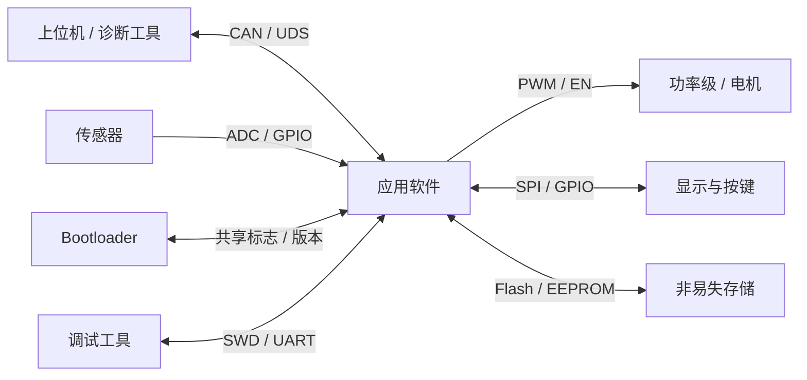

> 本项目当前基线不包含 OTA。Bootloader 仅支持本地升级；若后续引入 OTA，应在 SYS/SWE.1 增加需求，并在第 6 章增加升级模式、完整性校验和失败回滚设计。

### 2.5 架构设计约束与假设

| 编号   | 类型   | 内容                                  | 影响                     | 处理 / 验证                     |
| ------ | ------ | ------------------------------------- | ------------------------ | ------------------------------- |
| CON-01 | 硬件   | 单 MCU，无外部应用处理器              | 所有组件共享 CPU 和内存  | 7.3/7.4 预算分析                |
| CON-02 | 资源   | 应用镜像 ≤ 256 KB                    | 代码和常量受限           | 7.4 Flash 预算；链接后检查 map  |
| CON-03 | 资源   | 应用 RAM ≤ 64 KB                     | 栈、队列和全局受限       | 7.4 RAM/栈预算                  |
| CON-04 | 实时性 | 控制周期 10 ms                        | 控制任务必须可调度       | 7.3 响应时间分析                |
| CON-05 | 实时性 | PWM 20 kHz，死区由硬件保证            | 输出更新必须与 PWM 同步  | Output 组件在 MotorTask 内更新  |
| CON-06 | 通信   | 经典 CAN 500 kbit/s                   | 报文长度和总线负载受限   | CAN 矩阵与 7.4 总线负载分析     |
| CON-07 | 内存   | 禁止运行期动态内存                    | 队列和缓冲区必须静态分配 | 代码审查 + 链接检查             |
| CON-08 | 启动   | Bootloader 独立，应用不修改自身 Flash | 升级边界清晰             | 2.4 / 6.1 说明；接口待确认 Q-01 |
| CON-09 | 采样   | ADC 1 ms 触发                         | 采样与 10 ms 控制解耦    | 双缓冲 + IFC-001                |
| CON-10 | 显示   | 刷新周期 20 ms                        | 显示不得阻塞控制         | DisplayTask 低优先级            |
| CON-11 | 隔离   | 无完整 MPU 分区隔离，仅栈保护         | 故障可能影响同域代码     | 看门狗、栈检查、静态分配        |
| ASM-01 | 假设   | 传感器输出在量程内                    | 越界按无效处理           | 有效性判断 + 故障降级           |
| ASM-02 | 假设   | 供电电压稳定                          | 掉电保护依赖硬件         | 复位/掉电检测 + 参数双区        |
| ASM-03 | 假设   | CAN 矩阵在基线内                      | 报文变更影响 CAN Service | 变更管理 + ICD 评审             |
| ASM-04 | 假设   | Bootloader 版本兼容                   | 启动和升级接口稳定       | 版本握手 + Q-01                 |
| ASM-05 | 假设   | 硬件引脚与 ICD 一致                   | 驱动配置依赖引脚         | 硬件评审 + 集成测试             |

---

## 3. 软件架构概述（Architecture Overview）

**本章回答**：整个软件准备采用什么样的架构？为什么采用这种组织方式？

### 3.1 架构设计目标与原则

**设计目标。**

| 编号 | 目标                       | 衡量方式                               |
| ---- | -------------------------- | -------------------------------------- |
| G-01 | 完整承接 SWE.1 的软件需求  | 8/8 功能需求、9/9 非功能需求有架构落点 |
| G-02 | 关键路径时序确定、可分析   | 控制周期、端到端延迟、抖动满足预算     |
| G-03 | 故障可检测、可隔离、可恢复 | 严重故障 ≤ 20 ms 进入安全输出         |
| G-04 | 组件可独立测试             | 接口可注入、状态可观测                 |
| G-05 | 硬件可替换                 | 应用组件不直接依赖寄存器               |
| G-06 | 变更影响可控               | 组件依赖清晰、无同步调用环             |
| G-07 | 资源使用可预算             | Flash、RAM、CPU、栈均有余量            |

**设计原则。**

| 编号 | 原则                         | 落实方式                                     | 检查点       |
| ---- | ---------------------------- | -------------------------------------------- | ------------ |
| P-01 | 分层单向依赖                 | 应用→服务→驱动→硬件；下层不反向调用上层   | 4.3 依赖表   |
| P-02 | 组件按职责划分，不按任务划分 | 组件是逻辑功能单元；任务只是部署方式         | 6.4 任务映射 |
| P-03 | 接口显式化                   | 组件间只通过 IFC 交互，不访问对方内部数据    | 5.2 接口表   |
| P-04 | 单一写者                     | 每个架构级数据只有一个写入上下文             | 5.3 数据表   |
| P-05 | 状态集中决策                 | 运行模式和故障等级由 System Manager 统一决定 | 6.1 / 6.6    |
| P-06 | 故障就地检测、集中处理       | 检测靠近故障源；安全决策集中                 | 6.6 故障表   |
| P-07 | 静态分配                     | 启动时确定所有队列、缓冲区和栈               | 7.4 资源表   |
| P-08 | 硬件隔离                     | 寄存器访问只出现在驱动/端口层                | 3.3 分层表   |
| P-09 | 无同步调用环                 | 状态通过只读快照发布，事件通过队列解耦       | 4.3 依赖分析 |
| P-10 | 架构级数据最小化             | 只登记跨组件、需要共同理解的数据对象         | 5.3 数据准则 |

### 3.2 软件架构总体视图

自上而下：应用层 → 服务层 → 驱动/端口层 → 硬件层。

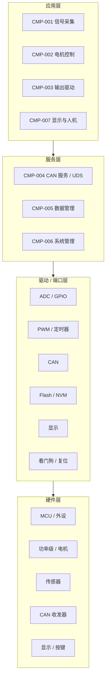

> 本图表示分层和依赖方向：上层使用下层提供的接口，下层不反向调用上层；详细接口见第 5 章，组件级依赖见 4.3。

### 3.3 软件分层结构

| 层          | 职责                             | 包含组件                           | 允许依赖                              | 禁止依赖                                      | 设计理由                 |
| ----------- | -------------------------------- | ---------------------------------- | ------------------------------------- | --------------------------------------------- | ------------------------ |
| 应用层      | 业务功能、控制策略、人机交互     | CMP-001、CMP-002、CMP-003、CMP-007 | 服务层接口；本组件专属的实时 I/O 驱动 | 直接访问 CAN/Flash 驱动；访问其他组件内部数据 | 业务变化与硬件变化隔离   |
| 服务层      | 通信、参数、状态与故障管理       | CMP-004、CMP-005、CMP-006          | 驱动/端口层                           | 反向调用应用层业务函数                        | 协议、存储、故障策略集中 |
| 驱动/端口层 | 外设初始化、寄存器访问、数据搬运 | DRV-001～DRV-007                   | MCU HAL/LL、寄存器                    | 调用服务层或应用层                            | 硬件差异被封装           |
| 硬件层      | MCU、外设、功率级、传感器、存储  | —                                 | —                                    | —                                            | 物理实现                 |

**分层规则。**

- 上层可以调用下层提供的接口；下层不得同步调用上层。
- System Manager 通过只读状态快照读取应用组件状态（IFC-004、IFC-010 等），这是数据依赖，不是反向调用；它不得调用应用组件的业务函数。
- 应用层的实时 I/O 组件（CMP-001、CMP-003、CMP-007）可以直接调用各自专属的 ADC、PWM、GPIO、显示驱动，以避免服务层转发带来抖动；这是本文显式允许的例外。
- CAN 和 Flash 只能通过 CMP-004、CMP-005 访问，应用组件不得直接调用 DRV-004、DRV-005。
- 驱动层不得包含业务判断；所有模式、故障等级和限幅决策都在应用层或服务层完成。

### 3.4 软件组件划分概述

**逻辑组件。**

| 组件 ID | 名称           | 层   | 一句话职责                                 | 主要需求               | 主要执行上下文                        |
| ------- | -------------- | ---- | ------------------------------------------ | ---------------------- | ------------------------------------- |
| CMP-001 | 信号采集       | 应用 | 采样、转换、有效性判断和时间戳             | FR-010、FR-040         | ISR-01 写入；MotorTask 读取           |
| CMP-002 | 电机控制       | 应用 | 根据设定、参数和反馈计算控制量             | FR-020、FR-040         | MotorTask                             |
| CMP-003 | 输出驱动       | 应用 | 正常/安全输出仲裁、PWM 与使能更新          | FR-020、FR-040         | MotorTask                             |
| CMP-004 | CAN 服务 / UDS | 服务 | CAN 收发、路由、UDS 诊断和总线恢复         | FR-030、FR-031         | CanTask；ISR-02 入队                  |
| CMP-005 | 数据管理       | 服务 | 参数加载、校验、双区存储和 DID 数据        | FR-002、FR-031         | 初始化；CanTask 写入；SystemTask 只读 |
| CMP-006 | 系统管理       | 服务 | 模式状态机、故障聚合、安全决策和看门狗监督 | FR-001、FR-040、FR-041 | SystemTask                            |
| CMP-007 | 显示与人机     | 应用 | 按键、显示、指示、本地设定和模式请求       | FR-041、FR-020         | DisplayTask                           |

**驱动/端口组件。**

| 驱动 ID | 名称         | 访问资源       | 一句话职责                       | 主要需求               |
| ------- | ------------ | -------------- | -------------------------------- | ---------------------- |
| DRV-001 | ADC 驱动     | ADC1/ADC2、DMA | 触发采样、搬运结果、提供原始值   | FR-010、NFR-P-02       |
| DRV-002 | PWM 驱动     | HRTIM          | 更新占空比、使能、故障关断       | FR-020、FR-040         |
| DRV-003 | GPIO 驱动    | GPIO           | 按键、指示灯、使能、故障输入     | FR-010、FR-040、FR-041 |
| DRV-004 | CAN 驱动     | FDCAN1         | 报文收发、过滤器、中断和总线状态 | FR-030、NFR-P-04       |
| DRV-005 | Flash 驱动   | 内部 Flash     | 参数区读写、擦除、校验           | FR-002、FR-031         |
| DRV-006 | 显示驱动     | SPI、GPIO      | OLED 初始化、刷屏、背光/对比度   | FR-041                 |
| DRV-007 | 系统监控驱动 | IWDG、RCC、PWR | 看门狗、复位原因、时钟/电源状态  | FR-001、FR-040         |

> 组件是逻辑功能单元，不等同于 RTOS 任务。例如 CMP-002 只由 MotorTask 调用，但 CMP-001 同时涉及 ISR-01 和 MotorTask，CMP-005 同时涉及 CanTask 和 SystemTask；任务映射见 6.4。

### 3.5 架构设计方案概述

本架构采用“两条链路 + 一个中心”的组织方式：

1. **快速控制链路**：ADC 以 1 ms 采样，CMP-001 在 MotorTask 中转换成工程值；CMP-002 以 10 ms 周期计算控制量；CMP-003 完成正常/安全仲裁后更新 PWM。该链路不经过 CAN、Flash 或显示，避免管理活动干扰控制时序。
2. **管理与通信链路**：CMP-004 负责 CAN/UDS，CMP-005 负责参数和 NVM，CMP-007 负责人机；三者通过 CMP-006 发布的系统状态和各自的状态接口协作。
3. **一个中心**：CMP-006 统一维护系统模式、故障等级和安全请求；其他组件只检测和上报，不各自决定系统级安全状态。

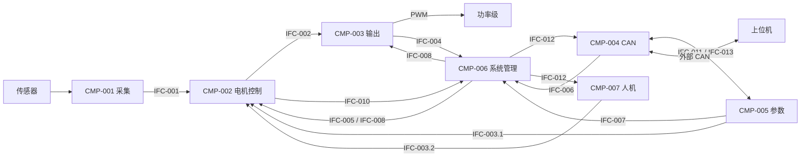

**方案要点。**

- 控制链路和管理链路在任务、接口和数据上分离；CAN/显示故障不会阻塞 MotorTask。
- 状态采用“单一写者 + 只读快照”，避免组件之间形成同步调用环。
- CAN 和 Flash 被封装在服务层，协议或存储介质变化不影响控制组件。
- 参数采用双区 + CRC，掉电或写入失败时可回退到上一份有效参数。
- Bootloader 与应用分离，应用只负责请求和版本信息，不实现刷写算法。

---

## 4. 软件组件架构（Software Component Architecture）

**本章回答**：软件被分解成哪些组件？每个组件负责什么、不负责什么？组件之间如何组织？

### 4.1 软件组件分解

**分解准则。**

- 一个组件只承担一组内聚的职责，能用一句话说明“负责什么”。
- 需求簇、变更频率和实时性相近的功能放在一起；硬件相关访问与业务逻辑分开。
- 组件边界与接口稳定，避免因为一个函数或一个任务反复调整边界。
- 组件可以独立分配需求、独立测试、独立替换实现。
- 组件不等于任务；任务划分见 6.4。

| 组件                   | 子功能                                                                       | 划分依据                                     |
| ---------------------- | ---------------------------------------------------------------------------- | -------------------------------------------- |
| CMP-001 信号采集       | 采样触发、DMA 搬运、工程值转换、量程/断线/超时判断、时间戳、健康状态         | 实时 I/O 与有效性判断内聚；与控制算法解耦    |
| CMP-002 电机控制       | 设定值处理、闭环控制、积分抗饱和、限幅、使能/停止序列、状态发布              | 控制律独立于驱动和通信；可单独测试           |
| CMP-003 输出驱动       | 正常/安全输出仲裁、PWM 占空比更新、使能控制、饱和/驱动故障检测               | 输出安全策略集中；避免控制组件直接操作寄存器 |
| CMP-004 CAN 服务 / UDS | CAN 收发、过滤/路由、信号打包、UDS 会话/DID/DTC/例程、总线关闭恢复、通信超时 | 协议变化隔离；应用组件不直接访问 CAN         |
| CMP-005 数据管理       | 参数加载/CRC/版本校验、默认回退、双区写入/回读、DID 数据、NVM 布局           | 数据完整性集中；存储介质可替换               |
| CMP-006 系统管理       | 模式状态机、故障聚合/分级、安全请求、看门狗监督、复位原因                    | 系统级决策集中；避免各组件各自为政           |
| CMP-007 显示与人机     | 按键扫描/去抖、显示页面、指示模式、本地设定/使能、模式请求、显示健康         | 人机交互独立；显示失效不影响控制             |

### 4.2 组件职责定义

| 组件                   | 负责                                                                                                                | 不负责                                               | 关键输入 / 输出                                                                                               | 分配需求               |
| ---------------------- | ------------------------------------------------------------------------------------------------------------------- | ---------------------------------------------------- | ------------------------------------------------------------------------------------------------------------- | ---------------------- |
| CMP-001 信号采集       | 1 ms 采样触发与 DMA 搬运；原始码值转工程值；量程、断线、超时判断；采样时间戳；发布 signal_sample_t、signal_health_t | 控制算法；故障等级判定；PWM 输出；CAN 上报；参数存储 | 输入：ADC/GPIO；输出：IFC-001、IFC-014                                                                        | FR-010、FR-040         |
| CMP-002 电机控制       | 读取设定值、参数和安全请求；执行闭环控制；积分抗饱和；输出限幅；使能/停止序列；发布 motor_status_t                  | 采样驱动；PWM 寄存器；故障锁存；CAN/UDS；显示        | 输入：IFC-001、IFC-003.1/003.2、IFC-005；输出：IFC-002、IFC-010                                               | FR-020、FR-040         |
| CMP-003 输出驱动       | 正常输出与安全输出仲裁；PWM 占空比/使能更新；饱和、驱动故障、输出超时检测；发布 output_status_t                     | 控制律；模式决策；故障等级；CAN/UDS                  | 输入：IFC-002、IFC-008；输出：IFC-004、PWM/EN                                                                 | FR-020、FR-040         |
| CMP-004 CAN 服务 / UDS | FDCAN 收发；报文过滤/路由；信号打包/解包；UDS 会话、DID、DTC、例程；总线关闭恢复；通信超时监测；发布 com_status_t   | 参数存储；故障决策；电机控制；显示                   | 输入：CAN 帧、IFC-012；输出：IFC-006、IFC-011、IFC-013、IFC-015                                               | FR-030、FR-031、FR-040 |
| CMP-005 数据管理       | 参数加载、CRC/版本校验；默认参数回退；双区写入、回读、切换；DID 数据；NVM 布局；发布 param_status_t                 | UDS 协议；CAN 驱动；控制算法；故障等级               | 输入：IFC-011、IFC-013；输出：IFC-003.1、IFC-007、IFC-013                                                     | FR-002、FR-031、FR-001 |
| CMP-006 系统管理       | 系统模式状态机；故障检测聚合/分级；安全请求；看门狗监督；复位原因；发布 system_state_t                              | 传感器转换；控制计算；PWM 输出；CAN 协议；参数存储   | 输入：IFC-004、IFC-006、IFC-007、IFC-009、IFC-010、IFC-014、IFC-016；输出：IFC-005、IFC-008、IFC-012、IFC-015 | FR-001、FR-040、FR-041 |
| CMP-007 显示与人机     | 按键扫描/去抖；显示页面与指示；本地设定/使能；模式请求；发布 hmi_request_t、display_health_t                        | 系统模式决策；故障检测；电机控制；CAN/UDS；参数存储  | 输入：IFC-010、IFC-012；输出：IFC-003.2、IFC-009、IFC-016                                                     | FR-041、FR-020、FR-040 |

**职责边界说明。**

- **Motor Control 与 Output Driver**：Motor Control 计算“应该输出多少”，Output Driver 决定“当前是否允许输出、正常值还是安全值”，并负责最终写 PWM。这样控制算法不需要知道功率级故障和安全策略。
- **System Manager 与 Data Manager**：System Manager 决定系统模式和故障等级；Data Manager 只保证参数数据的完整性、版本和存储，不判断系统是否安全。
- **CAN Service 与 UDS**：UDS 是 CAN Service 内部的协议子功能，不是独立组件；DID 数据由 Data Manager 提供，CAN Service 不直接读 Flash。
- **Display 与 System Manager**：Display 只负责把系统状态映射为页面和指示；模式切换和故障分级仍由 System Manager 决定。

### 4.3 组件之间的关系与依赖

**控制链路。**

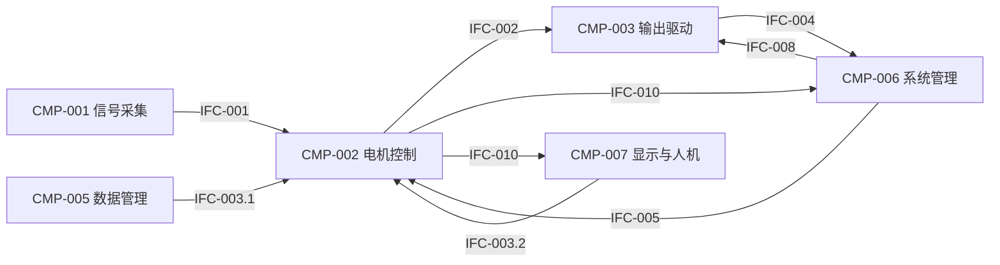

**管理与通信链路。**

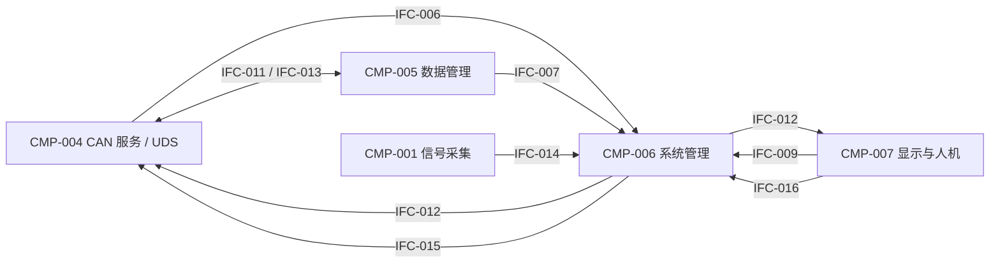

**依赖关系表。**

| 从      | 到               | 接口      | 类型            | 执行上下文                        | 说明                           |
| ------- | ---------------- | --------- | --------------- | --------------------------------- | ------------------------------ |
| CMP-001 | CMP-002          | IFC-001   | 周期数据        | MotorTask 读取                    | 采样工程值、有效性、时间戳     |
| CMP-002 | CMP-003          | IFC-002   | 周期数据        | MotorTask                         | 控制量、限幅状态、使能请求     |
| CMP-005 | CMP-002          | IFC-003.1 | 参数读取        | 初始化 / 参数变更                 | 控制参数、限幅、标定           |
| CMP-007 | CMP-002          | IFC-003.2 | 周期数据        | MotorTask 读取                    | 目标值、使能、来源             |
| CMP-003 | CMP-006          | IFC-004   | 周期数据        | SystemTask 读取                   | 实际输出、饱和、驱动故障       |
| CMP-006 | CMP-002          | IFC-005   | 周期数据        | MotorTask 读取                    | 故障等级、降额系数、安全请求   |
| CMP-004 | CMP-006          | IFC-006   | 周期数据        | SystemTask 读取                   | 总线状态、RX 超时、UDS 会话    |
| CMP-005 | CMP-006          | IFC-007   | 周期数据        | SystemTask 读取                   | 参数有效、CRC、默认回退        |
| CMP-006 | CMP-003          | IFC-008   | 周期数据 / 事件 | MotorTask 读取                    | 安全输出请求、原因             |
| CMP-007 | CMP-006          | IFC-009   | 事件队列        | DisplayTask 生产；SystemTask 消费 | 启动/停止/模式请求             |
| CMP-002 | CMP-006、CMP-007 | IFC-010   | 周期数据        | SystemTask / DisplayTask 读取     | 电机状态、转速、电流、故障标志 |
| CMP-004 | CMP-005          | IFC-011   | 同步调用        | CanTask                           | 参数写入请求                   |
| CMP-006 | CMP-004、CMP-007 | IFC-012   | 周期数据        | CanTask / DisplayTask 读取        | 系统模式、故障等级、降额       |
| CMP-004 | CMP-005          | IFC-013   | 同步调用        | CanTask                           | DID 数据读取                   |
| CMP-001 | CMP-006          | IFC-014   | 周期数据        | SystemTask 读取                   | 传感器健康状态                 |
| CMP-006 | CMP-004          | IFC-015   | 同步调用        | SystemTask                        | 发送故障/状态报文              |
| CMP-007 | CMP-006          | IFC-016   | 周期数据        | SystemTask 读取                   | 显示健康状态                   |

> 依赖表的“从/到”表示交互方向：数据接口为提供者→使用者；同步调用为调用者→提供者。接口的提供者/使用者定义以 5.2 表为准。

**依赖规则。**

- 组件之间不得共享可写全局变量；所有跨组件数据必须通过 5.3 的架构级数据对象。
- 状态接口是只读快照，读者不得通过接口修改提供者状态。
- 同步调用只允许发生在任务上下文；ISR 只入队或置标志，不调用服务。
- 不存在同步调用环：CMP-006 与 CMP-002/CMP-003/CMP-004/CMP-007 之间的双向信息流通过只读快照和事件队列解耦。
- 应用层不得直接访问 DRV-004（CAN）和 DRV-005（Flash）；只能经 CMP-004/CMP-005。

### 4.4 软件需求分配

本节回答“由谁实现、为什么这样分配”，是设计分配；正式的双向追溯记录见第 8 章。

| 需求 ID      | 需求摘要           | 主责组件                | 协作组件                           | 分配理由                                             |
| ------------ | ------------------ | ----------------------- | ---------------------------------- | ---------------------------------------------------- |
| FR-001       | 上电自检           | CMP-006                 | CMP-005、CMP-001、CMP-003、CMP-007 | 系统级自检需要跨组件检查，由 System Manager 统一判定 |
| FR-002       | 参数加载与默认回退 | CMP-005                 | CMP-002、CMP-006                   | 参数完整性属于数据管理；控制组件只消费校验后的参数   |
| FR-010       | 信号采集与有效性   | CMP-001                 | CMP-002、CMP-006                   | 采样和有效性判断内聚；控制和故障管理消费结果         |
| FR-020       | 闭环控制           | CMP-002                 | CMP-003、CMP-005、CMP-007          | 控制律独立；输出仲裁和参数/设定值分离                |
| FR-030       | 通信处理           | CMP-004                 | CMP-005、CMP-006                   | CAN/UDS 协议集中；应用不直接访问 CAN                 |
| FR-031       | 参数写入与持久化   | CMP-005                 | CMP-004                            | 写入完整性和 NVM 管理集中；CAN Service 只转发请求    |
| FR-040       | 故障处理与安全状态 | CMP-006                 | CMP-001、CMP-002、CMP-003、CMP-004 | 故障检测就地、决策集中、输出安全动作在 Output        |
| FR-041       | 状态指示           | CMP-007                 | CMP-006、CMP-002                   | 显示映射与人机交互独立；状态由 System Manager 提供   |
| NFR-P-01～05 | 实时性与性能       | TASK-01～04、ISR-01～03 | 全部组件                           | 由任务周期、优先级、WCET 和接口时序共同保证          |
| NFR-R-01～04 | 资源预算           | 全部组件                | 驱动/端口层                        | 由静态分配、代码尺寸和栈预算保证                     |

**组件-需求分配矩阵（P=主责，S=协作）。**

| 组件    | FR-001 | FR-002 | FR-010 | FR-020 | FR-030 | FR-031 | FR-040 | FR-041 |
| ------- | ------ | ------ | ------ | ------ | ------ | ------ | ------ | ------ |
| CMP-001 | S      |        | P      | S      |        |        | S      |        |
| CMP-002 |        | S      | S      | P      |        |        | S      |        |
| CMP-003 | S      |        |        | S      |        |        | P      |        |
| CMP-004 |        |        |        |        | P      | S      | S      |        |
| CMP-005 | S      | P      |        | S      | S      | P      |        |        |
| CMP-006 | P      | S      |        |        | S      |        | P      | S      |
| CMP-007 | S      |        |        | S      |        |        | S      | P      |

> 矩阵中每个功能需求至少有一个 P；FR-040 由 CMP-006 负决策、CMP-003 负最终安全输出，因此两者都有 P。没有出现“所有组件都负责”的条目，避免职责稀释。

---

## 5. 软件接口与数据架构（Interface and Data Architecture）

**本章回答**：组件之间如何交换信息？它们共同遵循什么样的接口和数据契约？

### 5.1 外部软件接口

外部接口的物理层、电气特性和引脚定义见 SYS.3/HSI 与 ICD；本节定义软件侧的契约、方向、周期和失效行为。

| 接口 ID   | 名称                 | 对端              | 方向        | 介质 / 协议                | 速率 / 周期            | 数据 / 内容                  | 失效行为                                | 责任组件          |
| --------- | -------------------- | ----------------- | ----------- | -------------------------- | ---------------------- | ---------------------------- | --------------------------------------- | ----------------- |
| EXT-IF-01 | 传感器输入           | 传感器            | 输入        | ADC / GPIO                 | 1 ms 采样              | 电流、电压、温度、位置/转速  | 越界/断线置无效；连续失效上报 F-01/F-02 | CMP-001           |
| EXT-IF-02 | 功率级输出           | 功率级 / 电机     | 输出        | PWM / GPIO                 | 20 kHz PWM；10 ms 更新 | 三相占空比、使能、故障关断   | 安全输出：PWM 关闭、EN 无效             | CMP-003           |
| EXT-IF-03 | CAN 总线             | 上位机 / 其他 ECU | 双向        | FDCAN，经典 CAN 500 kbit/s | 事件 + 周期报文        | 配置、状态、诊断、参数       | 超时/校验错计数；bus-off 自动恢复       | CMP-004           |
| EXT-IF-04 | 调试 / 诊断串口      | 调试工具          | 双向        | UART / SWD                 | 按需                   | 日志、版本、复位原因、测量点 | 生产件关闭或保护                        | CMP-006 / CMP-005 |
| EXT-IF-05 | 非易失存储           | 内部 Flash        | 双向        | Flash 擦写                 | 启动 / 参数变更        | 参数、版本、故障记录         | CRC 失败用默认值；写入失败回滚          | CMP-005           |
| EXT-IF-06 | 显示与按键           | OLED / 按键       | 双向        | SPI / GPIO                 | 显示 20 ms；按键 20 ms | 页面、指示、按键事件         | 显示失效上报 F-13；控制继续             | CMP-007           |
| EXT-IF-07 | Bootloader 交接      | Bootloader        | 双向        | 共享 RAM + 复位            | 启动 / 升级            | 版本、升级标志、复位原因     | 版本不兼容进入安全状态并记录            | CMP-006 / CMP-005 |
| EXT-IF-08 | 电源 / 复位 / 看门狗 | 硬件              | 输入 / 输出 | RCC / PWR / IWDG           | 复位事件；100 ms 喂狗  | 复位原因、电压状态、喂狗     | 看门狗超时复位；复位原因记录            | CMP-006           |

### 5.2 内部组件接口

#### 5.2.1 接口契约示例（IFC-001）

| 项目            | 内容                                               |
| --------------- | -------------------------------------------------- |
| 接口 ID / 版本  | IFC-001 / v1.0                                     |
| 名称            | Acq_GetSample                                      |
| 提供者 / 使用者 | CMP-001 / CMP-002                                  |
| 数据            | signal_sample_t（DATA-01）                         |
| 方向            | CMP-001 → CMP-002                                 |
| 更新 / 读取     | ADC ISR 1 ms 更新双缓冲；MotorTask 10 ms 读取      |
| 有效性          | valid 位 + 时间戳；超过 20 ms 未更新视为失效       |
| 一致性          | 双缓冲 + 序号；读者检测序号变化后重读一次          |
| 错误行为        | 使用上一次有效值并置 STALE；连续 3 次失效上报 F-02 |
| 调用上下文      | 只允许 MotorTask 读取；ISR 只写缓冲区              |

#### 5.2.2 数据接口

| 接口 ID   | 名称 / 操作          | 提供者  | 使用者           | 数据             | 周期 / 触发       | 上下文                   | 失效 / 默认              |
| --------- | -------------------- | ------- | ---------------- | ---------------- | ----------------- | ------------------------ | ------------------------ |
| IFC-001   | Acq_GetSample        | CMP-001 | CMP-002          | signal_sample_t  | 10 ms 读取        | MotorTask                | 上次有效值 + STALE       |
| IFC-002   | Ctrl_GetOutput       | CMP-002 | CMP-003          | control_output_t | 10 ms             | MotorTask                | 零输出 + 禁止使能        |
| IFC-003.1 | Data_GetMotorParam   | CMP-005 | CMP-002          | motor_param_t    | 初始化 / 参数变更 | 初始化 / MotorTask       | 安全默认参数             |
| IFC-003.2 | HMI_GetSetpoint      | CMP-007 | CMP-002          | motor_setpoint_t | 10 ms 读取        | MotorTask                | 零目标 + 禁止使能        |
| IFC-004   | Out_GetStatus        | CMP-003 | CMP-006          | output_status_t  | 10 ms 读取        | SystemTask               | 置无效并上报 F-12        |
| IFC-005   | Sys_GetSafetyRequest | CMP-006 | CMP-002          | safety_request_t | 10 ms 读取        | MotorTask                | 默认安全请求（禁止输出） |
| IFC-006   | Can_GetStatus        | CMP-004 | CMP-006          | com_status_t     | 10 ms 读取        | SystemTask               | 置总线故障并降级         |
| IFC-007   | Data_GetStatus       | CMP-005 | CMP-006          | param_status_t   | 20 ms 读取        | SystemTask               | 置参数无效并使用默认值   |
| IFC-008   | Sys_GetSafetyRequest | CMP-006 | CMP-003          | safety_request_t | 10 ms / 事件      | MotorTask                | 安全输出                 |
| IFC-010   | Motor_GetStatus      | CMP-002 | CMP-006、CMP-007 | motor_status_t   | 10 ms / 20 ms     | SystemTask / DisplayTask | 置无效并上报 F-12        |
| IFC-012   | Sys_GetState         | CMP-006 | CMP-004、CMP-007 | system_state_t   | 10 ms / 20 ms     | CanTask / DisplayTask    | 使用初始化状态           |
| IFC-014   | Acq_GetHealth        | CMP-001 | CMP-006          | signal_health_t  | 10 ms             | SystemTask               | 置传感器失效             |
| IFC-016   | Display_GetHealth    | CMP-007 | CMP-006          | display_health_t | 20 ms             | SystemTask               | 置显示失效；控制继续     |

#### 5.2.3 服务调用与事件接口

| 接口 ID | 名称 / 操作     | 提供者  | 使用者  | 数据              | 触发            | 上下文                            | 超时 / 错误                   |
| ------- | --------------- | ------- | ------- | ----------------- | --------------- | --------------------------------- | ----------------------------- |
| IFC-009 | HMI_GetRequest  | CMP-007 | CMP-006 | hmi_request_t     | 按键 / 模式请求 | DisplayTask 生产；SystemTask 消费 | 队列深度 8；满时丢最旧并计数  |
| IFC-011 | Data_WriteParam | CMP-005 | CMP-004 | param_write_req_t | UDS 写入请求    | CanTask                           | ≤ 5 ms；失败返回负响应并回滚 |
| IFC-013 | Data_GetDid     | CMP-005 | CMP-004 | did_value_t       | UDS 读取请求    | CanTask                           | ≤ 2 ms；无数据返回错误码     |
| IFC-015 | Can_SendMessage | CMP-004 | CMP-006 | can_message_t     | 故障 / 状态上报 | SystemTask                        | 队列满返回失败并计数          |

> SWE.3 中引用的 IFC-003 按 IFC-003.1（参数）和 IFC-003.2（设定值）两个子接口理解；IFC-005 与 IFC-008 使用同一 safety_request_t 数据对象，但消费者不同，分别编号以明确使用关系。

### 5.3 架构级数据定义

**纳入准则。** 只有满足以下任一条件的数据对象才列入本节：跨组件边界；被两个及以上组件共同理解；具有一致性、生命周期或所有权要求；属于外部接口契约。函数参数、局部变量和组件私有结构不列入。

| 数据 ID | 名称 / 关键字段                                          | 写者    | 读者             | 大小 | 一致性                      | 生命周期                  |
| ------- | -------------------------------------------------------- | ------- | ---------------- | ---- | --------------------------- | ------------------------- |
| DATA-01 | signal_sample_t：工程值、原始值、有效位、时间戳          | CMP-001 | CMP-002          | 24 B | 双缓冲 + 序号               | 周期更新；保留上一有效值  |
| DATA-02 | signal_health_t：传感器状态、失效计数、最近故障          | CMP-001 | CMP-006          | 8 B  | 原子写                      | 周期更新                  |
| DATA-03 | motor_param_t：Kp、Ki、限幅、偏置、CRC                   | CMP-005 | CMP-002          | 32 B | 双区 + CRC；切换时短临界区  | 启动加载；参数变更时切换  |
| DATA-04 | motor_setpoint_t：目标值、转矩限制、使能、来源           | CMP-007 | CMP-002          | 12 B | 单写者 + 原子写             | 周期更新                  |
| DATA-05 | control_output_t：控制量、使能、限幅标志、时间戳         | CMP-002 | CMP-003          | 16 B | 单写者                      | 周期更新                  |
| DATA-06 | output_status_t：实际占空比、饱和、驱动故障、时间戳      | CMP-003 | CMP-006          | 16 B | 单写者                      | 周期更新                  |
| DATA-07 | motor_status_t：状态、转速、电流、温度、故障标志         | CMP-002 | CMP-006、CMP-007 | 24 B | Seqlock / 只读快照          | 周期更新                  |
| DATA-08 | safety_request_t：故障等级、降额系数、安全输出请求、原因 | CMP-006 | CMP-002、CMP-003 | 8 B  | 原子写                      | 事件/周期更新；锁存到清除 |
| DATA-09 | com_status_t：总线状态、RX 超时、UDS 会话、错误计数      | CMP-004 | CMP-006          | 16 B | 单写者                      | 周期更新                  |
| DATA-10 | param_status_t：有效位、来源、CRC、版本                  | CMP-005 | CMP-006          | 8 B  | 原子写                      | 启动/写入后更新           |
| DATA-11 | param_write_req_t：索引、数据、长度、CRC                 | CMP-004 | CMP-005          | 24 B | 调用内只读                  | 单次请求                  |
| DATA-12 | system_state_t：模式、故障等级、降额、运行时间           | CMP-006 | CMP-004、CMP-007 | 16 B | Seqlock / 只读快照          | 模式变化或周期更新        |
| DATA-13 | can_message_t：ID、DLC、数据、时间戳、方向               | CMP-004 | CMP-006          | 16 B | 队列元素；单生产者/单消费者 | 单次报文                  |
| DATA-14 | did_value_t：DID、长度、数据、结果码                     | CMP-005 | CMP-004          | 24 B | 调用内只读                  | 单次请求                  |
| DATA-15 | hmi_request_t：请求类型、参数、时间戳                    | CMP-007 | CMP-006          | 8 B  | 队列元素                    | 单次事件                  |
| DATA-16 | display_health_t：显示状态、通信错误计数                 | CMP-007 | CMP-006          | 8 B  | 原子写                      | 周期更新                  |

**数据所有权规则。**

- 每个数据对象只有一个写者；读者只能通过接口获取快照，不得直接写。
- 多字节数据在任务与中断之间传递时使用双缓冲、Seqlock 或短临界区；不得依赖“恰好原子”的非原子访问。
- 参数区是唯一允许“整块替换”的数据：写入备份区、校验、回读成功后切换指针。
- safety_request_t 一旦置为严重故障，保持锁存，直到复位或人工确认。
- 数据对象的大小和对齐在 SWE.3 中细化；本文只固定架构级字段和一致性要求。

### 5.4 接口交互约束

| 约束类别   | 规则                                               | 适用接口                                                                          |
| ---------- | -------------------------------------------------- | --------------------------------------------------------------------------------- |
| 调用方向   | 上层调用下层；状态通过提供者→使用者的只读快照发布 | 全部 IFC                                                                          |
| 执行上下文 | ISR 只入队/置标志；同步调用只允许在任务上下文      | IFC-009、IFC-011、IFC-013、IFC-015                                                |
| 周期与超时 | 周期接口最大数据年龄为 2 个周期；超时按失效处理    | IFC-001、IFC-002、IFC-003.2、IFC-004～IFC-008、IFC-010、IFC-012、IFC-014、IFC-016 |
| 阻塞       | 周期读取不得阻塞；同步调用有上限；ISR 不得等待     | 全部 IFC                                                                          |
| 一致性     | 单写者；多字节快照；Seqlock 读者最多重试 2 次      | DATA-01、DATA-03、DATA-07、DATA-12                                                |
| 错误语义   | 无效数据必须带状态位；不得用 0 代替“无效”        | IFC-001、IFC-004、IFC-006、IFC-007、IFC-010、IFC-016                              |
| 队列       | 固定深度；满时丢最旧并计数；控制任务不等待         | IFC-009、IFC-015、CAN RX 队列                                                     |
| 版本       | 接口 ID 和版本写入头文件；变更需影响分析           | 全部 IFC                                                                          |

---

## 6. 软件运行与行为架构（Runtime and Behavioral Architecture）

**本章回答**：组件在实际运行中如何协作、如何响应外部事件、如何从异常中恢复？

### 6.1 软件运行模式

系统级运行模式沿用 SWE.1 的 MOD-01～MOD-06，避免在架构文档中引入与需求不一致的新模式。

| 模式 ID | 名称            | 进入条件                   | 软件行为                         | 输出状态 | 退出条件                 | 主要参与组件                                |
| ------- | --------------- | -------------------------- | -------------------------------- | -------- | ------------------------ | ------------------------------------------- |
| MOD-01  | 上电初始化      | 上电 / 复位                | 自检、加载参数、初始化外设       | 输出关闭 | 初始化完成或失败         | CMP-006、CMP-005、CMP-001、CMP-003、CMP-007 |
| MOD-02  | 待机            | 初始化完成                 | 监测启动命令、保持通信           | 输出关闭 | 启动命令 / 升级请求      | CMP-006、CMP-004、CMP-007                   |
| MOD-03  | 正常运行        | 启动命令且无严重故障       | 采集、控制、通信、状态输出       | 输出使能 | 停止命令或故障           | CMP-001～CMP-007                            |
| MOD-04  | 降级运行        | 部分资源失效但核心功能可用 | 限幅、降额、报警、保留安全输出   | 受限输出 | 故障恢复或升级为严重故障 | CMP-006、CMP-002、CMP-003、CMP-007          |
| MOD-05  | 故障 / 安全状态 | 严重故障                   | 输出安全值、关闭执行器、记录故障 | 安全值   | 复位或人工确认           | CMP-006、CMP-003、CMP-004、CMP-007          |
| MOD-06  | 关机 / 低功耗   | 关机命令                   | 保存状态、关闭输出               | 关闭     | 上电                     | CMP-006、CMP-005、CMP-003                   |

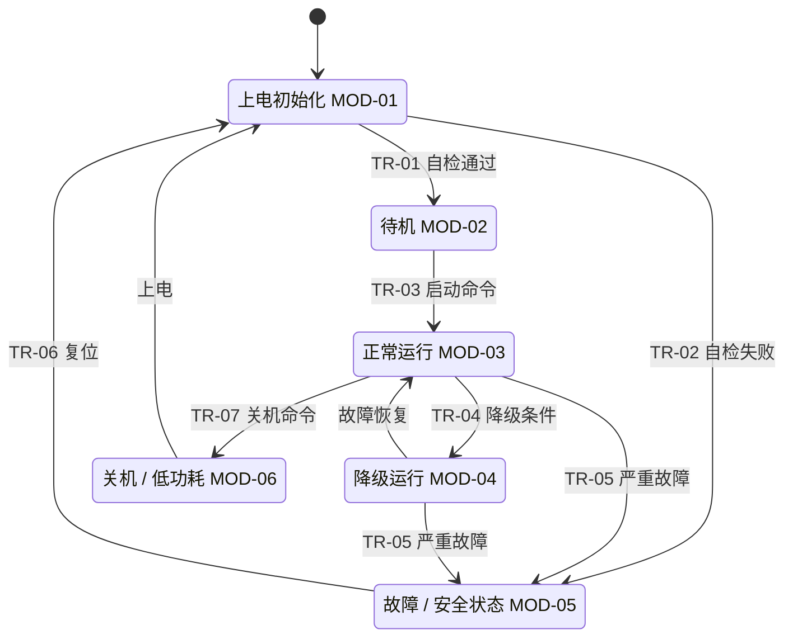

> **升级 / 维护说明**：本项目当前基线不包含 OTA。应用软件在 MOD-02 接受本地升级请求后置位共享标志并复位，由 Bootloader 执行刷写和回滚；应用软件不实现刷写算法，因此不新增独立运行模式。若引入 OTA，应按变更流程增加需求和模式。

**模式转换时序。** TR-03（待机→正常运行）最坏约 20 ms：SystemTask 以 10 ms 周期识别启动命令，MotorTask 在下一个 10 ms 周期使能控制，满足 SWE.1 的 50 ms 约束。TR-04（正常运行→降级）约 12 ms，TR-05（降级/正常→安全状态）约 12 ms，分别满足 100 ms 和 20 ms 约束；TR-07 的关机路径见 6.2.5。

### 6.2 关键场景与组件交互

#### 6.2.1 上电启动与自检（UC-01）

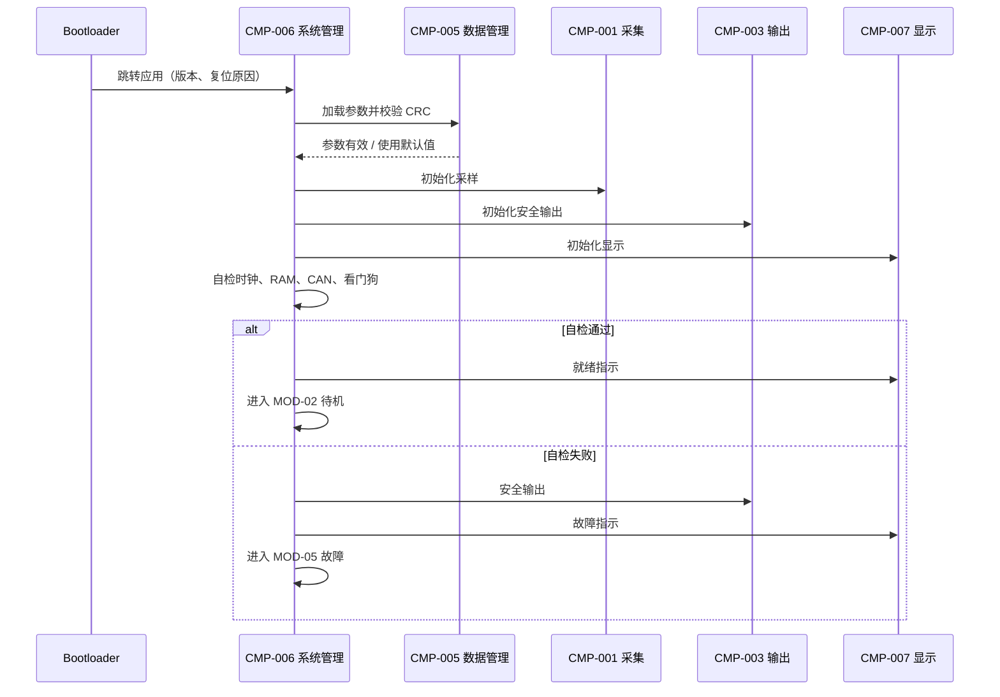

| 阶段            | 预算   | 说明                           |
| --------------- | ------ | ------------------------------ |
| Bootloader 跳转 | 200 ms | 含版本读取和共享标志检查       |
| 参数加载与 CRC  | 300 ms | 双区读取；失败回退默认值       |
| 外设初始化      | 400 ms | ADC、PWM、CAN、显示、看门狗    |
| 自检            | 500 ms | 满足 FR-001 的 500 ms 上限     |
| 合计            | 1.4 s  | ≤ NFR-P-03 的 2 s，余量 0.6 s |

#### 6.2.2 正常控制周期（UC-02）

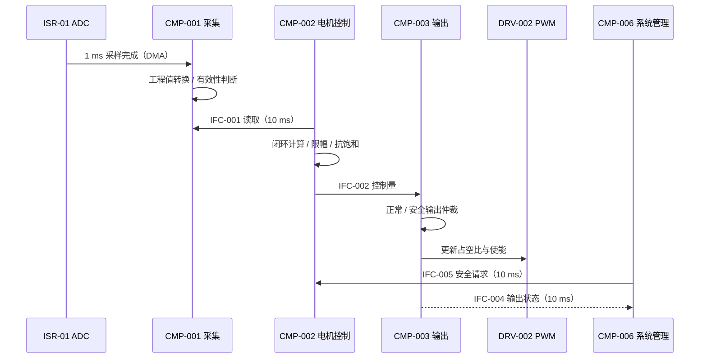

关键约束：MotorTask 周期 10 ms，WCET 预算 3.0 ms；采样到 PWM 的端到端最坏路径约 13.2 ms，满足 NFR-P-02 的 30 ms。

#### 6.2.3 CAN 通信、诊断与参数写入（UC-03 / UC-05）

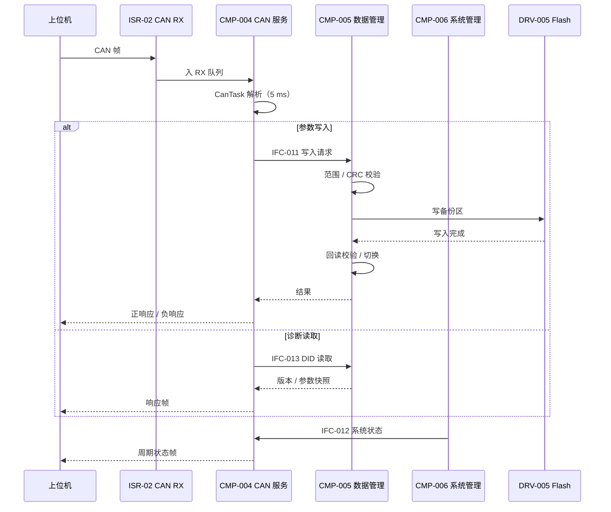

关键约束：CAN 请求到响应最坏约 7.2 ms，满足 NFR-P-04 的 100 ms；参数写入失败必须回滚，旧参数保持有效。

#### 6.2.4 故障检测与安全输出（UC-04）

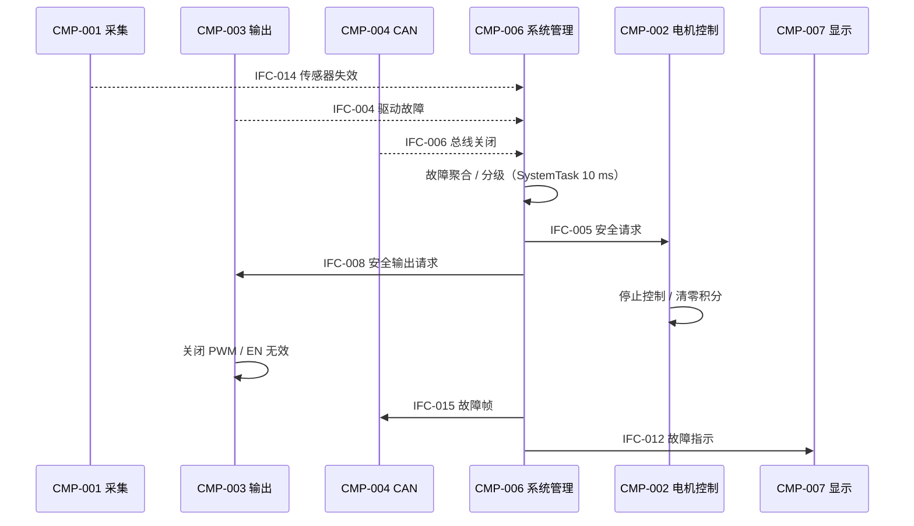

关键约束：从故障发生到安全输出的最坏路径约 12 ms，满足 FR-040 的 20 ms；严重故障锁存，需复位或人工确认。

#### 6.2.5 停止与关机（UC-06）

| 步骤     | 参与组件                     | 行为                                                              | 时间约束  |
| -------- | ---------------------------- | ----------------------------------------------------------------- | --------- |
| 停止命令 | CMP-007 / CMP-004 → CMP-006 | 操作员或上位机发出停止命令；System Manager 校验当前模式和故障状态 | ≤ 10 ms  |
| 停止控制 | CMP-006 → CMP-002           | 安全请求置为停止；Motor Control 清零积分并禁止输出                | ≤ 20 ms  |
| 安全输出 | CMP-003                      | PWM 关闭、EN 无效                                                 | ≤ 10 ms  |
| 状态保存 | CMP-005                      | 关机时保存运行统计、故障记录和参数版本                            | ≤ 150 ms |
| 状态指示 | CMP-007                      | 显示待机或关机状态                                                | ≤ 20 ms  |

停止到输出关闭的最坏路径约 40 ms；关机路径约 190 ms，满足 SWE.1 TR-07 的 200 ms。停止后进入 MOD-02 待机；关机后进入 MOD-06。

> UC-06 是为覆盖停止/关机路径补充的架构场景，不新增软件需求；其模式转换沿用 SWE.1 的 MOD-02、MOD-03、MOD-06，其中关机约束对应 TR-07。

### 6.3 组件状态与状态转换

#### 6.3.1 电机控制状态

| 状态   | 含义     | 进入条件    | 主要动作             | 退出条件                        |
| ------ | -------- | ----------- | -------------------- | ------------------------------- |
| INIT   | 初始化   | 上电 / 复位 | 清零积分、检查参数   | 初始化完成且参数有效            |
| IDLE   | 空闲     | 初始化完成  | 输出禁止、等待启动   | 启动命令且无故障                |
| RUN    | 正常运行 | 启动命令    | 闭环控制、限幅       | 停止命令或故障                  |
| DERATE | 降级运行 | 警告故障    | 降额、限幅、报警     | 连续 N 周期正常或升级为严重故障 |
| FAULT  | 故障     | 严重故障    | 停止控制、输出安全值 | 复位 / 人工确认                 |

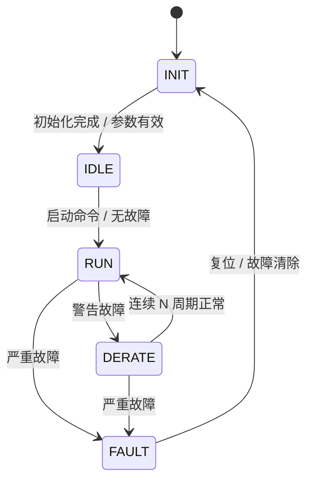

#### 6.3.2 CAN 服务状态

| 状态    | 含义     | 进入条件           | 主要动作               | 退出条件            |
| ------- | -------- | ------------------ | ---------------------- | ------------------- |
| INIT    | 初始化   | 上电 / 复位        | 配置过滤器、启动 FDCAN | 初始化完成          |
| ACTIVE  | 正常通信 | 初始化完成         | 收发、路由、UDS        | bus-off 或致命错误  |
| BUS_OFF | 总线关闭 | 控制器进入 bus-off | 停止发送、计数、告警   | 自动恢复计时到      |
| RECOVER | 恢复中   | 恢复计时到         | 尝试恢复、监测错误     | 恢复成功 / 失败重试 |

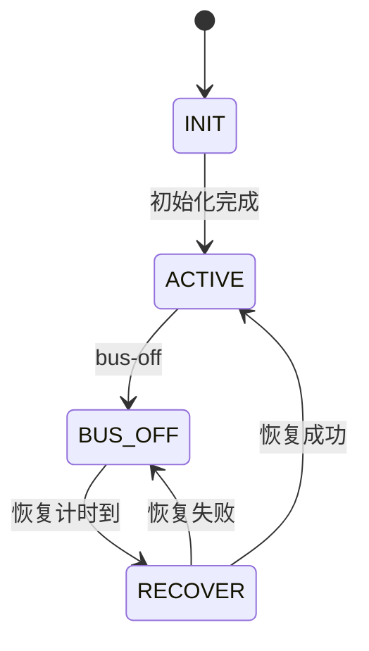

#### 6.3.3 数据管理状态

| 状态    | 含义     | 进入条件            | 主要动作                | 退出条件               |
| ------- | -------- | ------------------- | ----------------------- | ---------------------- |
| INIT    | 初始化   | 上电 / 复位         | 读取双区、CRC、版本检查 | 找到有效参数或确认无效 |
| VALID   | 参数有效 | 校验通过            | 提供参数和 DID          | 参数写入 / 故障        |
| DEFAULT | 默认参数 | 校验失败            | 使用安全默认值、置状态  | 参数修复 / 复位        |
| WRITE   | 写入中   | 收到写入请求        | 写备份区、回读、切换    | 成功 / 失败            |
| ERROR   | 存储错误 | 擦写失败 / 回读失败 | 回滚、置错误、上报      | 复位 / 维护            |

#### 6.3.4 显示状态

| 状态     | 含义     | 进入条件    | 主要动作             | 退出条件    |
| -------- | -------- | ----------- | -------------------- | ----------- |
| INIT     | 初始化   | 上电 / 复位 | 初始化 SPI/OLED      | 初始化完成  |
| NORMAL   | 正常显示 | 系统正常    | 显示运行状态、参数   | 降级 / 故障 |
| DEGRADED | 降级显示 | 系统降级    | 显示报警、限值       | 恢复 / 故障 |
| FAULT    | 故障显示 | 严重故障    | 显示故障码、安全提示 | 复位 / 维护 |

### 6.4 任务、线程与中断执行模型

| ID      | 名称        | 类型     | 周期 / 触发 | 优先级    | WCET 预算 | 截止期 | 栈 / 上下文 | 主要工作                     | 关联组件                  |
| ------- | ----------- | -------- | ----------- | --------- | --------- | ------ | ----------- | ---------------------------- | ------------------------- |
| ISR-01  | ADC 采样    | 中断     | 1 ms        | 0（最高） | 0.05 ms   | 1 ms   | MSP         | 触发/搬运 ADC，写双缓冲      | CMP-001                   |
| ISR-02  | CAN RX      | 中断     | 事件        | 1         | 0.02 ms   | 1 ms   | MSP         | 收帧、入 RX 队列             | CMP-004                   |
| ISR-03  | SysTick     | 中断     | 1 ms        | 2         | 0.01 ms   | 1 ms   | MSP         | RTOS tick、超时计数          | FreeRTOS                  |
| TASK-01 | MotorTask   | 周期任务 | 10 ms       | 5         | 3.0 ms    | 10 ms  | 2048 B      | 采集读取、控制、输出         | CMP-001、CMP-002、CMP-003 |
| TASK-02 | CanTask     | 周期任务 | 5 ms        | 4         | 0.6 ms    | 5 ms   | 1536 B      | CAN 解析、UDS、参数请求      | CMP-004、CMP-005          |
| TASK-03 | SystemTask  | 周期任务 | 10 ms       | 3         | 0.5 ms    | 10 ms  | 1224 B      | 模式、故障、看门狗、状态发布 | CMP-006、CMP-005          |
| TASK-04 | DisplayTask | 周期任务 | 20 ms       | 2         | 1.0 ms    | 20 ms  | 1536 B      | 按键、显示、模式请求         | CMP-007                   |
| IDLE    | 空闲任务    | 背景     | 空闲        | 0（最低） | 剩余时间  | —     | 1024 B      | 栈检查、诊断计数             | 全部                      |

**调度策略。**

- 抢占式固定优先级；任务优先级按 FreeRTOS 规则（数值越大越高），中断优先级按 NVIC 规则（数值越小越高），中断始终高于任务；关闭同优先级时间片。
- 1 kHz tick；中断优先级高于所有任务；ISR 只做最小工作，重活交给任务。
- 任务只在队列/信号量上做有限等待；控制任务不使用会阻塞的同步调用。
- 参数写入路径使用带优先级继承的互斥量；ISR 不使用互斥量。
- SystemTask 统一喂狗；只有所有任务存活计数在窗口内更新时才喂狗。
- 空闲任务执行栈高水位检查和后台诊断，不承担实时功能。

**任务与组件映射。**

| 执行上下文  | 调用/访问的组件                    | 说明                       |
| ----------- | ---------------------------------- | -------------------------- |
| ISR-01      | CMP-001（仅写缓冲区）              | 不转换、不判断、不调用服务 |
| ISR-02      | CMP-004（仅入队）                  | 不解析协议                 |
| MotorTask   | CMP-001、CMP-002、CMP-003          | 控制链路唯一任务上下文     |
| CanTask     | CMP-004、CMP-005（写路径）         | 协议与参数写入             |
| SystemTask  | CMP-006、CMP-005（只读）、状态读取 | 管理与安全决策             |
| DisplayTask | CMP-007、只读状态                  | 人机交互                   |

### 6.5 并发与同步机制

| 共享资源     | 写者             | 读者                  | 保护方式                  | 最大持锁 / 关中断 | 风险与处理                |
| ------------ | ---------------- | --------------------- | ------------------------- | ----------------- | ------------------------- |
| ADC 双缓冲   | ISR-01           | MotorTask             | 双缓冲 + 序号             | 无锁              | 撕裂读：序号变化重读一次  |
| CAN RX 队列  | ISR-02           | CanTask               | 单生产者/单消费者环形队列 | 无锁              | 溢出：丢最旧并计数        |
| 参数影子区   | CanTask          | MotorTask、SystemTask | Seqlock + 短临界区        | ≤ 50 µs         | 半更新：序号校验后重读    |
| 系统状态快照 | SystemTask       | CanTask、DisplayTask  | Seqlock                   | ≤ 20 µs         | 不一致：读者重试最多 2 次 |
| 安全请求     | SystemTask       | MotorTask             | 原子写                    | 无锁              | 严重故障锁存；读取方只读  |
| 故障标志     | ISR / SystemTask | SystemTask、CanTask   | 32 位原子操作             | 无锁              | 丢失：事件计数 + 周期扫描 |
| 显示帧缓冲   | DisplayTask      | DisplayTask           | 单写者                    | 无锁              | 无跨上下文共享            |

| 临界区 | 保护对象     | 最长关闭中断 | 说明                          |
| ------ | ------------ | ------------ | ----------------------------- |
| CR-01  | 参数区切换   | ≤ 10 µs    | 只做指针/序号切换             |
| CR-02  | 故障标志更新 | ≤ 5 µs     | 原子操作优先                  |
| CR-03  | 系统状态发布 | ≤ 20 µs    | 保证多字节一致                |
| CR-04  | CAN 队列索引 | ≤ 5 µs     | 单生产者/单消费者仍需序号保护 |

**并发规则。**

- 任何 ISR 不得阻塞、不得动态分配、不得调用可能睡眠的服务。
- 同一数据对象只有一个写者；读者通过快照/队列获取，不直接写。
- 临界区只做数据拷贝或指针切换，不做计算、不调用函数。
- 所有队列深度在编译期确定；满时丢最旧并增加溢出计数，控制任务不等待。
- 关闭中断总时长 ≤ 50 µs，CPU 占用影响 < 1%；超过预算需拆分或改为无锁。
- 任务栈使用高水位标记和填充图案检查；余量低于 30% 时告警。

### 6.6 异常处理与恢复行为

**故障分类与反应。**

| 故障 ID | 故障              | 检测来源              | 等级            | 检测 / 反应时间             | 反应                       | 恢复                  |
| ------- | ----------------- | --------------------- | --------------- | --------------------------- | -------------------------- | --------------------- |
| F-01    | 传感器断线 / 短路 | CMP-001 量程/ADC 故障 | WARN            | ≤ 10 ms                    | 置无效、降额或停止         | 连续 5 周期正常后恢复 |
| F-02    | 采样超时          | CMP-001 时间戳        | WARN            | ≤ 20 ms                    | 使用上次有效值，随后降级   | 自动恢复              |
| F-03    | 过流              | 硬件比较器 + CMP-003  | CRITICAL        | 硬件 ≤ 1 ms；软件 ≤ 10 ms | PWM 关闭、锁存             | 复位 / 人工确认       |
| F-04    | 过压              | CMP-001 / DRV-001     | CRITICAL        | ≤ 10 ms                    | PWM 关闭、锁存             | 复位 / 人工确认       |
| F-05    | 过温              | CMP-001               | WARN / CRITICAL | ≤ 100 ms                   | 降额；严重时停止           | 迟滞恢复 / 复位       |
| F-06    | CAN bus-off       | CMP-004               | WARN            | ≤ 5 ms                     | 停止发送、自动恢复         | 恢复成功自动清除      |
| F-07    | CAN RX 超时       | CMP-004               | WARN            | ≤ 100 ms                   | 保持安全输出或停止，视模式 | 收到有效帧后恢复      |
| F-08    | 参数 CRC 错误     | CMP-005               | WARN            | 启动时                      | 使用默认参数               | 重新写入 / 维护       |
| F-09    | 栈溢出            | 内核 / MPU            | CRITICAL        | 立即                        | 复位                       | 复位                  |
| F-10    | 看门狗超时        | DRV-007               | CRITICAL        | 100 ms                      | 复位                       | 复位                  |
| F-11    | 时钟失效          | DRV-007               | CRITICAL        | 立即                        | 安全输出 / 复位            | 复位                  |
| F-12    | 输出级故障        | CMP-003               | CRITICAL        | ≤ 10 ms                    | PWM 关闭、锁存             | 复位 / 人工确认       |
| F-13    | 显示失效          | CMP-007               | INFO / WARN     | ≤ 20 ms                    | 记录、指示灯替代           | 自动恢复              |

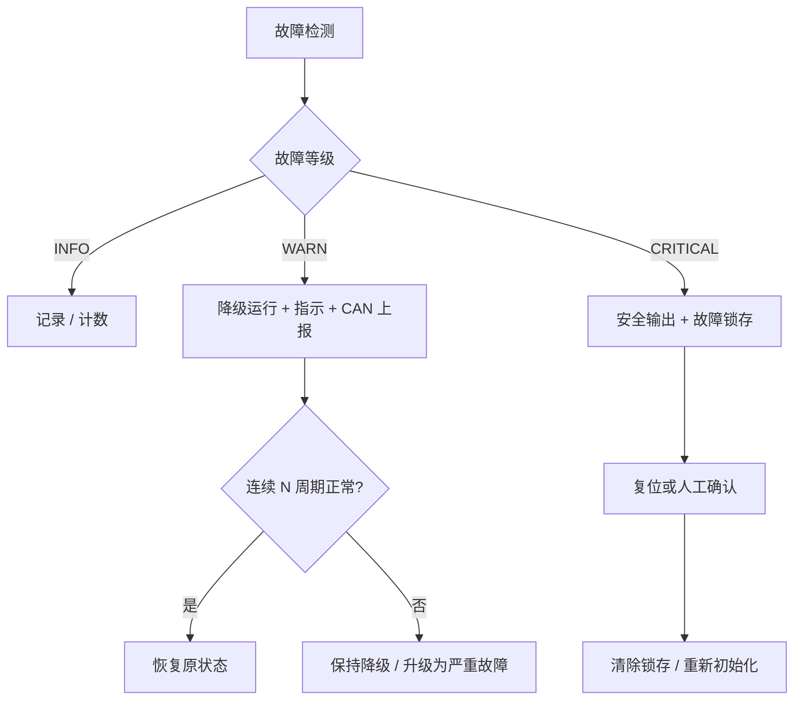

**降级级别。**

| 级别     | 输出限制              | 进入条件     | 退出条件        |
| -------- | --------------------- | ------------ | --------------- |
| 正常     | 全额转矩/转速         | 无故障       | —              |
| 降额     | 转矩 ≤ 50%，转速受限 | 警告故障     | 连续 N 周期正常 |
| 跛行     | 固定低速、低转矩      | 部分资源失效 | 复位 / 维护     |
| 安全停止 | PWM 关闭、EN 无效     | 严重故障     | 复位 / 人工确认 |

**恢复原则。**

- 瞬时故障（传感器抖动、CAN 超时）可自动恢复，但必须有连续正常周期计数和迟滞，避免抖动反复切换。
- 严重故障（过流、过压、输出级、看门狗、时钟）必须锁存，复位或人工确认后才能清除。
- 复位原因、故障码和发生次数写入 NVM；启动时由 CMP-006 读取并上报。
- 看门狗由 SystemTask 统一喂狗；任一关键任务存活计数未更新，停止喂狗并进入复位。
- 安全输出不依赖软件任务继续运行：PWM 使能由硬件下拉/关断路径保证。

---

## 7. 软件架构分析与设计决策（Architecture Analysis and Design Decisions）

**本章回答**：为什么当前架构是合理的？有哪些分析证据支持这个结论？

### 7.1 架构分析准则

| 准则       | 分析问题                                     | 方法                     | 证据     | 通过条件                         |
| ---------- | -------------------------------------------- | ------------------------ | -------- | -------------------------------- |
| 功能完整性 | 每条软件需求是否有组件承载                   | 分配矩阵、评审           | 4.4、8.1 | 无未分配需求                     |
| 接口完整性 | 每个接口是否有提供者、使用者、数据和错误行为 | 接口表检查               | 5.2、5.4 | 17/17 完整（含 IFC-003.1/003.2） |
| 实时性     | 任务和端到端路径是否满足截止期               | RTA、时间戳、GPIO 测量   | 7.3      | 所有响应时间 ≤ 截止期           |
| 资源       | Flash/RAM/CPU/栈是否在预算内                 | map 文件、栈高水位、跟踪 | 7.4      | 满足预算且有余量                 |
| 可靠性     | 故障是否可检测、可隔离、可恢复               | FMEA、故障注入           | 6.6、7.5 | 严重故障 ≤ 20 ms 安全输出       |
| 可维护性   | 依赖是否清晰、变更影响是否可控               | 依赖矩阵、变更场景       | 4.3、7.5 | 无同步调用环；影响范围明确       |
| 可测试性   | 接口和状态是否可注入、可观测                 | 注入点检查               | 7.5      | 关键路径可测                     |
| 可移植性   | 硬件相关代码是否隔离                         | 分层检查                 | 3.3、7.5 | 应用组件不直接访问寄存器         |

分析方法包括预算计算、响应时间分析、静态检查、原型测量和定性评审。本文的 7.3/7.4 以设计和估算为主，实测数据在 SWE.4～SWE.6 中补充并回写到本节。

### 7.2 功能完整性分析

按 4.4 的分配矩阵逐项检查，结果如下。本节只记录分析结论，正式的追溯记录见第 8 章。

| 检查项         | 方法                                | 结果                 | 证据             |
| -------------- | ----------------------------------- | -------------------- | ---------------- |
| 功能需求覆盖   | FR-001～FR-041 逐条对照             | 8/8 已分配           | 4.4 矩阵、8.1    |
| 非功能需求覆盖 | NFR-P-01～05、NFR-R-01～04 逐条对照 | 9/9 有架构落点       | 7.3、7.4、8.1    |
| 组件需求依据   | 每个 CMP 检查“承担需求”           | 7/7 有依据           | 4.2、8.2         |
| 驱动需求依据   | 每个 DRV 检查“主要需求”           | 7/7 有依据           | 3.4、8.2         |
| 孤立组件       | 检查无需求、无接口的组件            | 0 个孤立组件         | 4.2、4.3         |
| 未分配功能     | 检查需求描述中的功能是否有主责      | 0 项未分配           | 4.4              |
| 职责重叠       | 检查“负责/不负责”边界             | 关键边界已明确       | 4.2 职责边界说明 |
| 模式与场景覆盖 | MOD-01～06、UC-01～06 对照          | 6 模式、6 场景有落点 | 6.1、6.2         |

**分析结论。** 功能需求全部有主责组件和协作组件；没有“所有组件都负责”或“没有组件负责”的功能。FR-040 由 CMP-006 负决策、CMP-003 负最终安全输出，职责分离是刻意的：检测、决策、执行不在同一组件内闭环，便于独立验证。

### 7.3 实时性与时序分析

**任务利用率。**

| 执行实体            | C（ms） | T（ms） | U = C/T | 截止期 | 结果               |
| ------------------- | ------- | ------- | ------- | ------ | ------------------ |
| ISR-01/02/03        | 0.08    | 1       | 8%      | 1 ms   | 满足               |
| TASK-01 MotorTask   | 3.0     | 10      | 30%     | 10 ms  | 满足               |
| TASK-02 CanTask     | 0.6     | 5       | 12%     | 5 ms   | 满足               |
| TASK-03 SystemTask  | 0.5     | 10      | 5%      | 10 ms  | 满足               |
| TASK-04 DisplayTask | 1.0     | 20      | 5%      | 20 ms  | 满足               |
| 合计                | —      | —      | 60%     | —     | 预算 70%，余量 10% |

**响应时间分析（固定优先级，含中断干扰）。**

采用固定优先级响应时间分析：R_i = C_i + B_i + Σ ceil(R_i/T_j)·C_j，其中 j 为更高优先级任务。本文 B_i 取 0，ISR 干扰按 0.08 ms/ms 计入。

| 任务        | C（ms） | 高优先级干扰（ms）                          | 响应时间（ms） | 截止期（ms） | 余量（ms） |
| ----------- | ------- | ------------------------------------------- | -------------- | ------------ | ---------- |
| MotorTask   | 3.0     | ISR 0.24                                    | 3.24           | 10           | 6.76       |
| CanTask     | 0.6     | ISR 0.08 + Motor 3.0                        | 3.68           | 5            | 1.32       |
| SystemTask  | 0.5     | ISR 0.08 + Motor 3.0 + CAN 0.6              | 4.18           | 10           | 5.82       |
| DisplayTask | 1.0     | ISR 0.08 + Motor 3.0 + CAN 0.6 + System 0.5 | 5.18           | 20           | 14.82      |

**端到端时序。**

| 路径             | 组成                                                          | 预算   | 最坏估算 | 余量    | 对应需求 |
| ---------------- | ------------------------------------------------------------- | ------ | -------- | ------- | -------- |
| 传感器 → PWM    | 采样 0.2 + 等待 10 + 采集 0.3 + 控制 2.2 + 输出 0.4 + PWM 0.1 | 30 ms  | 13.2 ms  | 16.8 ms | NFR-P-02 |
| 故障 → 安全输出 | 检测 10 + 决策 0.5 + 请求 0.5 + 输出 0.5 + 余量 0.5           | 20 ms  | 12.0 ms  | 8.0 ms  | FR-040   |
| CAN 请求 → 响应 | 等待 5 + 解析 0.6 + 处理 1.0 + 发送 0.6                       | 100 ms | 7.2 ms   | 92.8 ms | NFR-P-04 |
| 上电 → 就绪     | Boot 200 + 参数 300 + 初始化 400 + 自检 500                   | 2 s    | 1.4 s    | 0.6 s   | NFR-P-03 |

**抖动分析。** MotorTask 的抖动主要来自 ISR 干扰和 tick 调度：ISR 总执行 0.08 ms，tick 开销 0.01 ms，调度开销约 0.01 ms，最坏抖动约 0.10 ms，满足 NFR-P-05 的 0.2 ms。

**结论。** 在给定的 WCET 和中断负载下，所有任务满足截止期；控制路径余量最大，CAN 任务余量最小（1.32 ms），但仍满足 5 ms 周期。若后续增加 CAN 负载或显示刷新，必须重新计算并更新 7.4 的峰值 CPU。

### 7.4 资源消耗分析

**Flash 预算（应用镜像）。**

| 项目              | 估算   | 说明                             |
| ----------------- | ------ | -------------------------------- |
| 应用逻辑          | 132 KB | CMP-001～007 业务代码            |
| 服务与协议        | 38 KB  | CAN/UDS、参数、状态机            |
| 驱动 / HAL / RTOS | 42 KB  | ADC、PWM、CAN、Flash、显示、内核 |
| 常量 / 默认参数   | 6 KB   | 标定表、默认参数、版本字符串     |
| 合计              | 218 KB | 预算 256 KB，余量 38 KB（14.8%） |

> Bootloader 24 KB 位于独立分区，不计入应用镜像预算；其大小和分区边界由 Bootloader 规范定义。

**RAM 预算。**

| 项目          | 估算    | 说明                              |
| ------------- | ------- | --------------------------------- |
| FreeRTOS 内核 | 3.5 KB  | 任务控制块、就绪表、定时器        |
| 任务栈        | 7.2 KB  | 见栈预算表                        |
| 队列 / 缓冲区 | 2.8 KB  | CAN RX、参数影子、ADC、显示       |
| 驱动 / HAL    | 4.0 KB  | 外设句柄、DMA 描述符              |
| 应用全局数据  | 14.0 KB | 状态、计数器、诊断                |
| 诊断 / 日志   | 4.0 KB  | 故障记录、复位原因                |
| 合计          | 35.5 KB | 预算 64 KB，余量 28.5 KB（44.5%） |

**栈预算。**

| 任务         | 预算（B） | 实测高水位（B） | 余量（B） | 余量比例 | 结果   |
| ------------ | --------- | --------------- | --------- | -------- | ------ |
| MotorTask    | 2048      | 1120            | 928       | 45.3%    | ≥ 30% |
| CanTask      | 1536      | 860             | 676       | 44.0%    | ≥ 30% |
| SystemTask   | 1224      | 620             | 604       | 49.3%    | ≥ 30% |
| DisplayTask  | 1536      | 940             | 596       | 38.8%    | ≥ 30% |
| Idle / Timer | 1024      | 180             | 844       | 82.4%    | ≥ 30% |

**CPU 预算。**

| 场景 | 负载 | 预算 | 余量 | 说明                |
| ---- | ---- | ---- | ---- | ------------------- |
| 平均 | 60%  | 70%  | 10%  | 7.3 的任务利用率    |
| 峰值 | 65%  | 70%  | 5%   | CAN 突发 + 显示刷新 |

> 峰值余量只有 5%，列为风险 R-01。若实测超过 70%，优先优化显示刷新和 CAN 解析，不通过降低控制周期来换取余量。

### 7.5 可靠性与可维护性分析

**可靠性机制。**

| 机制            | 实现位置             | 保护对象       | 验证方式            |
| --------------- | -------------------- | -------------- | ------------------- |
| 独立看门狗      | DRV-007 + SystemTask | 任务存活、调度 | 故障注入 / 停止喂狗 |
| 栈溢出检查      | 内核 + MPU/填充图案  | 任务栈         | 高水位 / 溢出钩子   |
| 参数 CRC + 双区 | CMP-005 + DRV-005    | 参数完整性     | 掉电 / 损坏注入     |
| 故障锁存        | CMP-006              | 严重故障       | 故障注入 / 复位测试 |
| 安全输出        | CMP-003 + 硬件下拉   | 功率级         | HIL / 示波器        |
| 总线关闭恢复    | CMP-004              | CAN 通信       | bus-off 注入        |
| 数据一致性      | Seqlock / 原子操作   | 共享数据       | 并发压力测试        |
| 复位原因记录    | CMP-006 + NVM        | 故障追溯       | 复位场景测试        |

**可维护性与变更影响。**

| 变更场景         | 影响组件         | 接口是否变化       | 说明                     |
| ---------------- | ---------------- | ------------------ | ------------------------ |
| 更换传感器 / ADC | CMP-001、DRV-001 | 否                 | 工程值和有效性契约不变   |
| 修改 CAN 矩阵    | CMP-004          | 否（对外契约不变） | 只改报文映射和 ICD       |
| 更换显示屏       | CMP-007、DRV-006 | 否                 | 状态接口不变             |
| 调整控制参数     | CMP-005、CMP-002 | 否                 | 参数数据驱动，不重新编译 |
| 更换 MCU         | DRV 层 + HAL     | 否                 | 应用组件不直接访问寄存器 |
| 增加新诊断服务   | CMP-004、CMP-005 | 可能新增 DID       | 需更新 5.2/5.3/8.x       |

**依赖与耦合检查。**

| 组件    | 主要依赖（出）                     | 主要被依赖（入）                   | 同步调用环          |
| ------- | ---------------------------------- | ---------------------------------- | ------------------- |
| CMP-001 | DRV-001、DRV-003                   | CMP-002、CMP-006                   | 无                  |
| CMP-002 | CMP-001、CMP-005、CMP-006、CMP-007 | CMP-003、CMP-006、CMP-007          | 无                  |
| CMP-003 | CMP-002、CMP-006                   | CMP-006                            | 无                  |
| CMP-004 | CMP-005、CMP-006                   | CMP-006                            | 无（数据/事件解耦） |
| CMP-005 | DRV-005                            | CMP-002、CMP-004、CMP-006          | 无                  |
| CMP-006 | CMP-001～CMP-005、CMP-007          | CMP-002、CMP-003、CMP-004、CMP-007 | 无同步环            |
| CMP-007 | CMP-002、CMP-006、DRV-006          | CMP-002、CMP-006                   | 无                  |

**可测试性。**

- 注入点：IFC-001 可注入采样值/失效；IFC-014 可注入传感器健康；IFC-006 可注入 CAN 超时/bus-off；DATA-03 可注入参数损坏；EXT-IF-02 可测量 PWM 安全关断。
- 观测点：系统状态、故障计数、复位原因、栈高水位、CPU 负载 GPIO、CAN 错误计数。
- 单元/集成测试可在不连接真实功率级的条件下替换 DRV-002/DRV-004 的实现。

### 7.6 架构设计决策及依据

| ADR ID | 决策                               | 备选方案                      | 选择理由                                                       | 影响 / 代价                                          |
| ------ | ---------------------------------- | ----------------------------- | -------------------------------------------------------------- | ---------------------------------------------------- |
| ADR-01 | 采用 FreeRTOS 抢占式固定优先级调度 | 裸机超级循环 / 时间触发轮询   | 10 ms 控制、5 ms CAN、20 ms 显示需要确定响应；任务隔离便于测试 | 增加 3.5 KB RAM 和 tick 开销；需要处理并发           |
| ADR-02 | 采用分层架构（应用/服务/驱动）     | 扁平模块 / 全部放在一个应用层 | 硬件、协议、业务变化隔离；可移植性和可测试性更好               | 增加接口转发和一层调用开销                           |
| ADR-03 | 组件按职责划分，不按任务划分       | 一个任务一个组件              | 同一组件可被多个上下文使用；任务调整不影响组件边界             | 需要明确执行上下文和并发规则                         |
| ADR-04 | 系统模式和故障决策集中在 CMP-006   | 各组件自行处理故障            | 单一决策点，安全行为一致；避免遗漏和冲突                       | CMP-006 成为关键组件；用看门狗和冗余检查降低单点风险 |
| ADR-05 | CAN/Flash 通过服务层访问           | 应用组件直接访问驱动          | 协议/存储变化不影响控制；便于统一超时和错误处理                | 增加队列拷贝和一层调用                               |
| ADR-06 | 状态采用只读快照 + 事件队列        | 同步回调 / 组件互相调用       | 避免同步调用环和优先级反转；读写解耦                           | 需要 Seqlock/双缓冲和内存屏障                        |
| ADR-07 | 运行期静态分配                     | malloc/free 或动态队列        | 无碎片、行为确定、易验证                                       | 队列深度必须提前估算                                 |
| ADR-08 | 参数双区 + CRC + 回读              | 单区直接覆盖                  | 掉电/写入失败可回滚；满足 FR-031                               | Flash 占用翻倍；写入时间增加                         |
| ADR-09 | Bootloader 负责升级，应用只请求    | 应用内 OTA                    | 刷写失败隔离；应用不修改自身 Flash                             | 需要共享标志和版本接口（Q-01）                       |
| ADR-10 | 控制周期 10 ms + ADC 1 ms 采样     | 1 ms 控制周期                 | 10 ms 满足 NFR-P-01/02；1 ms 采样提供足够带宽；CPU 余量更合理  | 控制带宽较低；高频扰动需在 SWE.3 处理                |

**风险与缓解。**

| 风险 ID | 风险                       | 可能性 | 影响 | 缓解措施                                      | 状态 |
| ------- | -------------------------- | ------ | ---- | --------------------------------------------- | ---- |
| R-01    | CPU 峰值余量仅 5%          | 中     | 高   | 优化显示刷新/CAN 解析；实测跟踪；保留升级空间 | 开放 |
| R-02    | CAN 总线负载超 50%         | 中     | 中   | 优化报文周期；验收过滤器；总线负载测试        | 开放 |
| R-03    | 参数区擦写寿命不足         | 低     | 中   | 限制写入次数；磨损均衡；双区交替              | 开放 |
| R-04    | 传感器噪声导致误判         | 中     | 中   | 滤波、迟滞、连续周期确认                      | 开放 |
| R-05    | Bootloader 版本/接口不兼容 | 低     | 高   | 版本握手；兼容矩阵；Q-01 关闭                 | 开放 |
| R-06    | 显示驱动兼容性             | 低     | 低   | 驱动抽象；早期集成验证                        | 开放 |

---

## 8. 架构与软件需求追溯（Architecture Traceability）

**本章回答**：软件需求是否被架构完整承接？架构中的组件、接口和数据又分别服务于哪些需求？

### 8.1 软件需求到架构组件的追溯

| 需求 ID  | 需求摘要               | 架构组件                                    | 接口 / 数据                                                  | 运行场景 / 状态                 | 分析证据                       |
| -------- | ---------------------- | ------------------------------------------- | ------------------------------------------------------------ | ------------------------------- | ------------------------------ |
| FR-001   | 上电自检               | CMP-006、CMP-005、CMP-001、CMP-003、CMP-007 | IFC-005、IFC-007、IFC-014、IFC-016；DATA-08/10/12/16         | MOD-01、6.2.1                   | 7.3 启动预算 1.4 s ≤ 2 s      |
| FR-002   | 参数加载与默认回退     | CMP-005、CMP-002                            | IFC-003.1、IFC-007；DATA-03/10                               | MOD-01、6.3.3                   | 7.2、7.4、6.6 F-08             |
| FR-010   | 信号采集与有效性       | CMP-001、CMP-002                            | IFC-001、IFC-014；DATA-01/02                                 | UC-02、6.2.2                    | 7.3 控制路径 13.2 ms           |
| FR-020   | 闭环控制               | CMP-002、CMP-003                            | IFC-002、IFC-003.2、IFC-005；DATA-04/05/08                   | UC-02、6.2.2、6.3.1             | 7.3 MotorTask 3.24 ms ≤ 10 ms |
| FR-030   | 通信处理               | CMP-004、CMP-005、CMP-006                   | EXT-IF-03、IFC-006、IFC-011、IFC-012、IFC-015；DATA-09/13/14 | UC-03、6.2.3                    | 7.3 CAN 响应 7.2 ms ≤ 100 ms  |
| FR-031   | 参数写入与持久化       | CMP-004、CMP-005                            | IFC-011、IFC-013；DATA-11/14                                 | UC-05、6.2.3、6.3.3             | 6.6 F-08；7.4 Flash 余量       |
| FR-040   | 故障处理与安全状态     | CMP-006、CMP-002、CMP-003                   | IFC-005、IFC-008、IFC-014、IFC-015；DATA-06/08/12            | UC-04、UC-06、6.2.4、6.2.5、6.6 | 7.3 故障路径 12 ms ≤ 20 ms    |
| FR-041   | 状态指示               | CMP-007、CMP-006                            | IFC-010、IFC-012、IFC-016；DATA-07/12/16                     | 6.3.4、6.2.4、6.2.5             | 7.2、7.5 显示失效处理          |
| NFR-P-01 | 控制周期 10 ms ± 1 ms | TASK-01、ISR-01                             | IFC-001、IFC-002                                             | 6.4                             | 7.3 利用率/响应时间            |
| NFR-P-02 | 端到端延迟 ≤ 30 ms    | 控制链路                                    | IFC-001、IFC-002                                             | 6.2.2                           | 7.3 13.2 ms                    |
| NFR-P-03 | 启动时间 ≤ 2 s        | CMP-006、CMP-005                            | IFC-007、EXT-IF-07                                           | 6.2.1                           | 7.3 1.4 s                      |
| NFR-P-04 | 通信响应 ≤ 100 ms     | CMP-004、TASK-02                            | EXT-IF-03、IFC-006                                           | 6.2.3                           | 7.3 7.2 ms                     |
| NFR-P-05 | 周期抖动 ≤ 200 µs    | TASK-01、ISR-01～03                         | —                                                           | 6.4、6.5                        | 7.3 约 100 µs                 |
| NFR-R-01 | Flash ≤ 256 KB        | 全部组件                                    | —                                                           | —                              | 7.4 218 KB（85.2%）            |
| NFR-R-02 | RAM ≤ 64 KB           | 全部组件                                    | —                                                           | —                              | 7.4 35.5 KB（55.5%）           |
| NFR-R-03 | CPU 峰值 ≤ 70%        | 全部任务                                    | —                                                           | 6.4                             | 7.4 峰值 65%                   |
| NFR-R-04 | 栈余量 ≥ 30%          | 全部任务                                    | —                                                           | 6.4                             | 7.4 最小 38.8%                 |

> SWE.1 附录 A 中的组件映射为示例行；本文 8.1 是软件架构基线的正式追溯记录，若两者不一致以本文为准，并同步更新 SRS 附录。

### 8.2 架构组件到软件需求的反向追溯

| 架构元素               | 类型 | 承担需求                                     | 设计依据               | 验证方式                  |
| ---------------------- | ---- | -------------------------------------------- | ---------------------- | ------------------------- |
| CMP-001 信号采集       | 组件 | FR-010、FR-001（自检）、FR-040（传感器故障） | 采样与有效性内聚       | 注入测试、时序测量        |
| CMP-002 电机控制       | 组件 | FR-020、FR-010（消费）、FR-040（安全停止）   | 控制律独立、可测试     | 控制响应测试、限幅测试    |
| CMP-003 输出驱动       | 组件 | FR-020（输出）、FR-040（安全输出）           | 输出仲裁和安全策略集中 | HIL、示波器、安全关断测试 |
| CMP-004 CAN 服务 / UDS | 组件 | FR-030、FR-031、FR-040（总线故障）           | 协议隔离、统一超时     | CAN 一致性、bus-off 注入  |
| CMP-005 数据管理       | 组件 | FR-002、FR-031、FR-001（参数自检）           | 数据完整性和存储集中   | 掉电、CRC 损坏、回读测试  |
| CMP-006 系统管理       | 组件 | FR-001、FR-040、FR-041（状态源）、NFR-P-03   | 模式/故障集中决策      | 状态机测试、故障注入      |
| CMP-007 显示与人机     | 组件 | FR-041、FR-020（设定值）、FR-040（故障指示） | 人机交互独立           | 显示/按键测试、失效测试   |
| DRV-001 ADC            | 驱动 | FR-010、NFR-P-02                             | 采样带宽和 DMA         | 采样精度、时序            |
| DRV-002 PWM            | 驱动 | FR-020、FR-040                               | 20 kHz 输出与安全关断  | 波形、死区、关断          |
| DRV-003 GPIO           | 驱动 | FR-010、FR-040、FR-041                       | 按键/指示/使能         | 电气与功能测试            |
| DRV-004 CAN            | 驱动 | FR-030、NFR-P-04                             | 收发、过滤、总线状态   | CAN 收发、错误注入        |
| DRV-005 Flash          | 驱动 | FR-002、FR-031、NFR-R-01                     | 双区读写和校验         | 擦写、掉电、寿命          |
| DRV-006 显示           | 驱动 | FR-041                                       | SPI/OLED 访问          | 显示刷新、失效            |
| DRV-007 系统监控       | 驱动 | FR-001、FR-040、NFR-P-03                     | 看门狗、复位原因       | 看门狗/复位测试           |

### 8.3 需求覆盖与一致性检查

| 检查项                | 方法                       | 结果                         | 证据      |
| --------------------- | -------------------------- | ---------------------------- | --------- |
| 功能需求覆盖          | 逐条对照 8.1               | 8/8（100%）                  | 8.1       |
| 非功能需求覆盖        | 逐条对照 8.1               | 9/9（100%）                  | 8.1       |
| 组件需求依据          | 逐条对照 8.2               | 7/7                          | 8.2       |
| 驱动需求依据          | 逐条对照 8.2               | 7/7                          | 8.2       |
| 接口提供者/使用者完整 | 5.2 表检查                 | 17/17（含 IFC-003.1/003.2）  | 5.2       |
| 数据写者/读者完整     | 5.3 表检查                 | 16/16                        | 5.3       |
| 任务映射完整          | 6.4 表检查                 | 4 任务 + 3 ISR，覆盖全部组件 | 6.4       |
| 模式/转换一致         | 与 SWE.1 MOD/TR 对照       | 6 模式、7 转换一致           | 6.1       |
| 故障时限一致          | 6.6 与 FR-040 对照         | 12 ms ≤ 20 ms               | 6.6、7.3  |
| 周期/抖动一致         | 6.4 与 NFR-P-01/05 对照    | 10 ms、约 100 µs            | 6.4、7.3  |
| 资源预算一致          | 7.4 与 NFR-R 对照          | 全部满足                     | 7.4       |
| SWE.2/SWE.3 边界      | 检查是否出现函数/算法细节  | 未出现                       | 1.2、全文 |
| ID 唯一性             | 检查 CMP/DRV/IFC/DATA 编号 | 无重复                       | 4/5 章    |
| 术语一致性            | 检查术语表与正文           | 一致                         | 1.4       |

**待确认项。**

| 编号 | 问题                                               | 影响                    | 责任人            | 状态 |
| ---- | -------------------------------------------------- | ----------------------- | ----------------- | ---- |
| Q-01 | Bootloader 共享 RAM 标志、版本和升级请求的精确格式 | EXT-IF-07、6.1 升级说明 | 系统 / Bootloader | 开放 |
| Q-02 | CAN 报文矩阵、周期和信号缩放尚未冻结               | EXT-IF-03、CMP-004、7.3 | 系统 / 通信       | 开放 |
| Q-03 | OLED 型号、SPI 时序和显示失效检测方式              | CMP-007、DRV-006、6.3.4 | 硬件 / 软件       | 开放 |
| Q-04 | 项目是否引入 OTA；若引入需增加需求、模式和校验     | 2.4、6.1、9.2           | 项目 / 系统       | 开放 |
| Q-05 | 功能安全/信息安全等级尚未分配；当前按 QM 架构分析  | 全文安全机制范围        | 项目 / 安全       | 开放 |

---

## 9. 架构评审与沟通（Architecture Review and Communication）

**本章回答**：架构是否经过确认？相关人员是否获得了已达成一致的架构信息？

### 9.1 架构评审检查

| 序号 | 检查项                                               | 对应 BP | 章节      | 自检结果     |
| ---- | ---------------------------------------------------- | ------- | --------- | ------------ |
| 1    | 静态架构（组件、职责、接口、数据）已定义             | BP1     | 3、4、5   | 符合（初稿） |
| 2    | 动态架构（模式、场景、状态、任务、并发、异常）已定义 | BP2     | 6         | 符合（初稿） |
| 3    | 架构分析准则明确、可重复                             | BP3     | 7.1       | 符合（初稿） |
| 4    | 功能完整性分析完成                                   | BP3     | 7.2       | 符合（初稿） |
| 5    | 实时性分析有预算和余量                               | BP3     | 7.3       | 符合（初稿） |
| 6    | 资源分析有数据和方法                                 | BP3     | 7.4       | 符合（初稿） |
| 7    | 设计决策有备选方案和理由                             | BP3     | 7.6       | 符合（初稿） |
| 8    | 需求到架构的追溯完整                                 | BP4     | 8.1       | 符合（初稿） |
| 9    | 架构到需求的反向追溯完整                             | BP4     | 8.2       | 符合（初稿） |
| 10   | 覆盖与一致性检查完成                                 | BP4     | 8.3       | 符合（初稿） |
| 11   | 接口有方向、数据、周期、上下文和错误行为             | BP1     | 5.2、5.4  | 符合（初稿） |
| 12   | 数据有唯一写者和一致性策略                           | BP1     | 5.3       | 符合（初稿） |
| 13   | 组件职责无重叠、无同步调用环                         | BP3     | 4.2、4.3  | 符合（初稿） |
| 14   | 任务/中断映射完整                                    | BP2     | 6.4       | 符合（初稿） |
| 15   | 共享资源保护策略明确                                 | BP2     | 6.5       | 符合（初稿） |
| 16   | 故障、降级和恢复行为明确                             | BP2     | 6.6       | 符合（初稿） |
| 17   | 关键场景有时序预算                                   | BP2     | 6.2、7.3  | 符合（初稿） |
| 18   | SWE.2/SWE.3 边界清晰                                 | BP1     | 1.2       | 符合（初稿） |
| 19   | 术语和 ID 一致                                       | BP5     | 1.4、全文 | 待评审       |
| 20   | 评审、问题和沟通记录完成                             | BP5     | 9.2～9.5  | 待评审       |

### 9.2 架构问题与处理记录

| 编号   | 来源     | 问题                               | 影响                              | 责任人            | 期限       | 状态 |
| ------ | -------- | ---------------------------------- | --------------------------------- | ----------------- | ---------- | ---- |
| REV-01 | 初版评审 | 初版评审尚未执行                   | 不具备基线发布条件                | 架构师            | 评审前     | 计划 |
| Q-01   | 架构分析 | Bootloader 共享标志/版本接口未冻结 | 升级和启动接口存在变更风险        | 系统 / Bootloader | 评审前     | 开放 |
| Q-02   | 架构分析 | CAN 矩阵和周期未冻结               | 7.3 通信时序和 7.4 总线负载需复算 | 系统 / 通信       | 评审前     | 开放 |
| Q-03   | 架构分析 | 显示屏型号和时序未确认             | 6.3.4、DRV-006 需调整             | 硬件 / 软件       | 详细设计前 | 开放 |
| Q-04   | 范围     | OTA 是否纳入项目未定               | 若纳入需增加需求和模式            | 项目 / 系统       | 评审前     | 开放 |
| Q-05   | 安全     | 功能安全/信息安全等级未分配        | 安全机制范围待定                  | 项目 / 安全       | 评审前     | 开放 |

### 9.3 架构评审结论

| 结论项                | 状态   | 说明                                     |
| --------------------- | ------ | ---------------------------------------- |
| 静态架构完整性        | 待评审 | 组件、接口、数据已定义；Q-02 关闭后复核  |
| 动态架构完整性        | 待评审 | 模式、场景、状态、任务、并发、异常已定义 |
| 架构分析证据          | 待评审 | 7.3/7.4 为估算值，需实测复核             |
| 需求双向追溯          | 待评审 | 8.1/8.2 已建立；Q-01～Q-03 关闭后确认    |
| 是否可作为 SWE.3 输入 | 待评审 | 建议在评审通过并关闭阻断项后基线化       |

**当前结论。** 本文档为 r1 草稿，已完成 BP1～BP4 的初稿自检；BP5 的评审和沟通记录尚未完成。建议在 Q-01～Q-03 关闭、完成正式评审后，作为 SWE.3 的基线输入。

### 9.4 架构确认与发布记录

| 版本 | 基线 ID | 日期 | 编制   | 评审   | 批准   | 状态         |
| ---- | ------- | ---- | ------ | ------ | ------ | ------------ |
| r1   | —      | —   | <名字> | 待评审 | 待批准 | 草稿，未发布 |

**发布条件。**

- 9.1 检查项全部关闭，9.2 阻断问题关闭或有批准的偏离。
- 8.3 的待确认项完成影响分析并更新对应章节。
- 评审记录、批准记录和沟通记录归档到配置管理系统。

### 9.5 架构沟通记录

| 受众          | 沟通内容                              | 方式              | 日期 | 反馈 / 状态 |
| ------------- | ------------------------------------- | ----------------- | ---- | ----------- |
| 软件开发      | 组件边界、接口、任务与数据契约        | 架构评审会 / 文档 | 待定 | 计划        |
| 测试          | 关键场景、故障路径、可观测点          | 评审会 / 测试策划 | 待定 | 计划        |
| 系统 / 硬件   | HSI 边界、Bootloader、显示与 CAN 接口 | 联合评审          | 待定 | 计划        |
| 质量 / ASPICE | BP1～BP5 证据和追溯                   | 过程评审          | 待定 | 计划        |

> 沟通记录应在每次评审或宣讲后更新；仅发送文档不算完成沟通，需记录受众、内容、反馈和待办。
