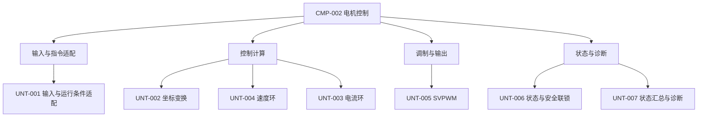
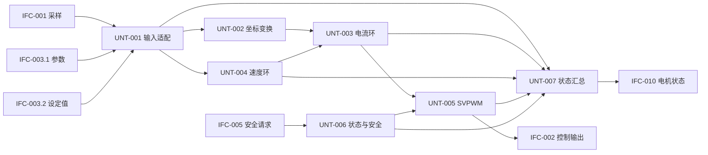
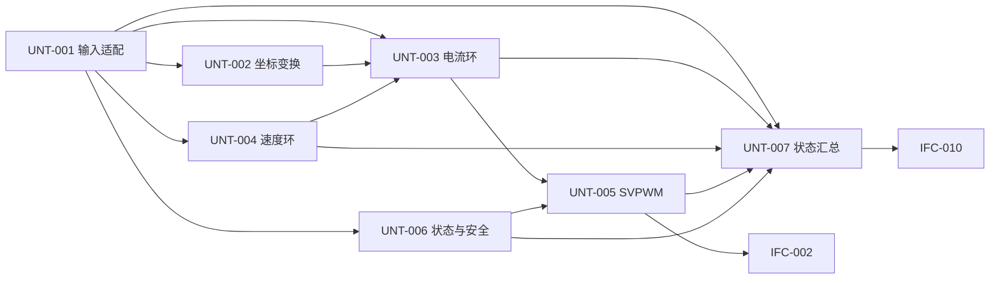
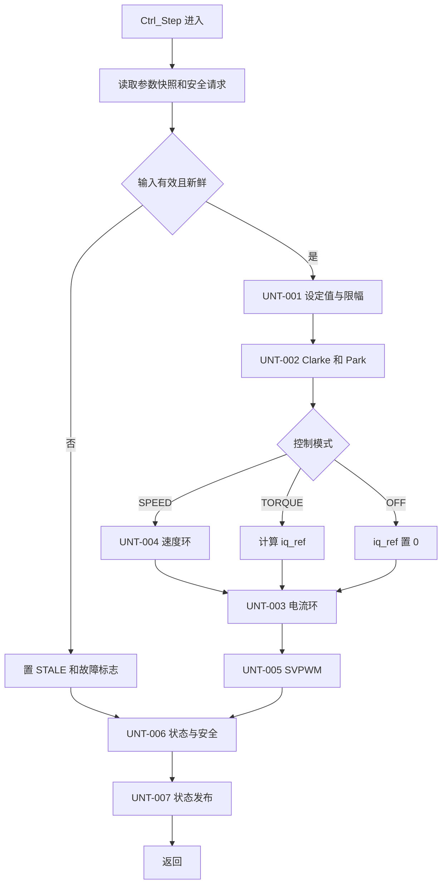
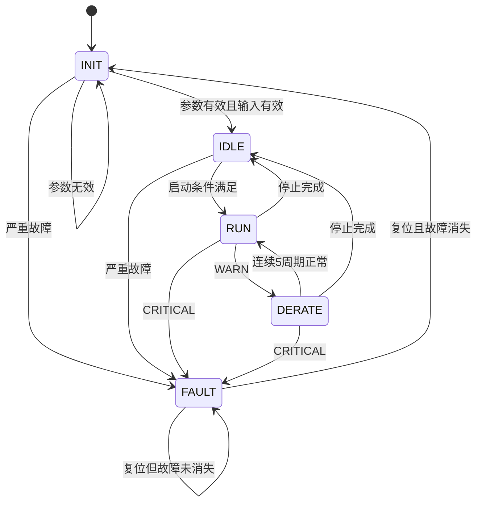
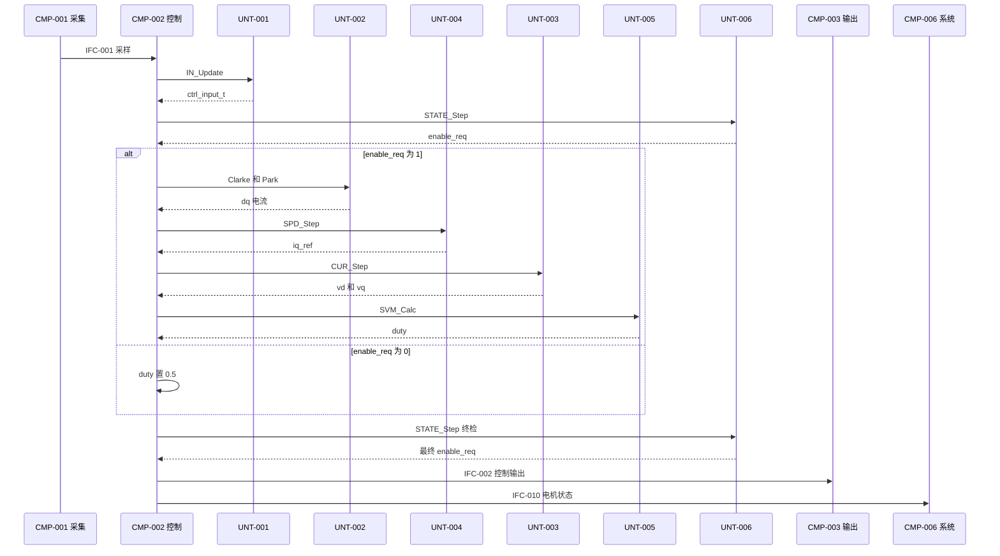
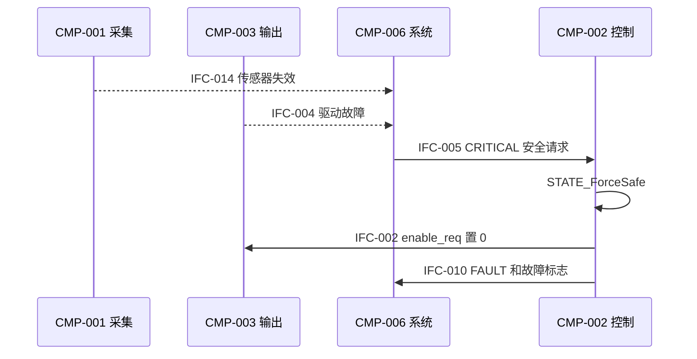
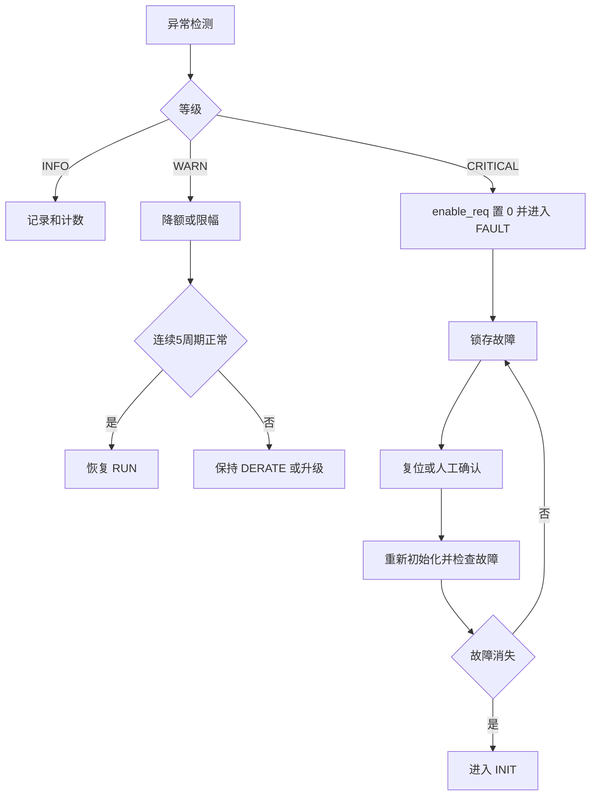

# 软件详细设计

## 修订记录

| 版本 | 状态 | 变更内容 | 变更日期            | 更改人 | 批准人 |
| ---- | ---- | -------- | ------------------- | ------ | ------ |
| r1   | 草稿 | 建档     | <YYYY-MM-DD></yyyy> | <名字> | <名字> |


---

> **阅读导航**：第 1 章说明设计对象、边界和依据；第 2 章锁定 SWE.2 输入、设计约束和设计原则；第 3 章把 CMP-002 分解为软件单元；第 4 章定义单元静态设计（接口、数据、结构、算法）；第 5 章定义单元动态设计（流程、状态、交互、异常）；第 6 章说明单元构建和源代码映射；第 7 章建立需求—架构—设计—代码—单元验证的双向追溯；第 8 章记录评审、问题和沟通。本文不重复 SWE.2 的组件划分和架构级接口，只引用其 ID；不复制源代码，只建立映射。

| SWE.3 基本实践 | 本文关注的结果 | 对应章节 |
| -------------- | -------------- | -------- |
| BP1 静态详细设计 | 单元分解、接口、数据、结构和算法 | 第 3、4 章 |
| BP2 动态详细设计 | 运行流程、状态、交互和异常 | 第 5 章 |
| BP3 软件单元构建 | 实现约束、编码规则、源文件映射和构建结果 | 第 6 章 |
| BP4 一致性与双向追溯 | 需求、架构、设计、代码、单元验证之间可追溯 | 第 7 章 |
| BP5 评审与沟通 | 评审检查、问题闭环、基线和沟通记录 | 第 8 章 |

> 本文按实际详细设计工作的逻辑组织，不按 BP 编号机械分章；BP 映射仅用于评审时快速定位证据。

> BP 名称按本项目评审用的工作包表述；正式评估以 Automotive SPICE PAM 的 SWE.3 基本实践为准。

---

## 1. 文档概述（Document Overview）

### 1.1 文档目的

本文档把 SWE.2《软件架构设计》中 CMP-002 电机控制组件的职责和接口，细化为可以实现、可以评审、可以单元验证的详细设计。文档回答四个问题：

本文档对应 ASPICE SWE.3 Software Detailed Design and Unit Construction，覆盖 CMP-002 的详细设计和单元构建。

1. 组件内部由哪些软件单元组成，每个单元负责什么、不负责什么；
2. 单元之间通过什么接口和数据结构交互；
3. 每个关键算法、状态和异常路径如何执行，边界在哪里；
4. 设计如何追溯到软件需求、软件架构和源代码，并支撑 SWE.4 单元验证。

| 使用场景 | 本文提供的内容 |
| -------- | -------------- |
| 软件开发 | 单元边界、接口签名、数据结构、算法步骤、状态转换和错误处理 |
| 代码评审 | 设计意图、限幅和抗饱和规则、数值边界、禁止实现方式 |
| SWE.4 单元验证 | 每个单元的正常、边界、异常场景和可观测点 |
| SWE.5 集成验证 | 组件对外接口行为、故障路径和时序约束 |
| 变更影响分析 | 需求、架构、单元、接口、函数和测试之间的追溯关系 |

### 1.2 文档适用范围

| 项目 | 内容 |
| ---- | ---- |
| 产品形态 | 嵌入式电机控制器（STM32G474 + FreeRTOS） |
| 设计对象 | CMP-002 电机控制组件 |
| 组件边界 | 设定值适配、坐标变换、速度环、电流环、SVPWM、控制状态与安全联锁、状态发布 |
| 上游基线 | SWE.1《软件需求规范》r1；SWE.2《软件架构设计》r1 |
| 执行上下文 | TASK-01 MotorTask，10 ms 周期，高优先级；不直接在 ISR 中执行 |
| 下游使用 | SWE.4 单元验证、SWE.5 集成验证、代码实现与评审 |
| 不覆盖 | 其他组件的内部设计、整机模式状态机、任务调度实现、寄存器配置、硬件电路、测试用例执行结果 |

**一个组件一份 SWE.3。** 本文只展开 CMP-002；CMP-001、CMP-003、CMP-004、CMP-005、CMP-006、CMP-007 的内部单元和函数不在本文定义。组件之间的接口以 SWE.2 第 5 章为准，本文只引用 IFC 和 DATA 编号，不重新定义架构级契约。

**本文不写**：其他组件的内部结构；整机 MOD-01～MOD-06 的完整状态机；任务优先级和调度器实现；PWM、ADC、CAN、Flash 的寄存器操作；硬件保护电路；源代码全文。

### 1.3 参考资料

| 编号 | 名称 | 版本 | 用途 |
| ---- | ---- | ---- | ---- |
| SRS-SWE1 | 软件需求规范 | r1 | 详细设计的需求输入 |
| ARC-SWE2 | 软件架构设计 | r1 | 组件、接口、数据、任务和状态输入 |
| ICD-CAN | CAN 通信矩阵与接口控制文档 | 当前基线 | 设定值、状态和故障上报的外部约束 |
| HW-G474 | STM32G474 数据手册与参考手册 | 当前版本 | FPU、存储器、外设和时序约束 |
| SW-CS | 软件开发规范 | 当前版本 | 命名、编码、注释和静态检查要求 |
| ASPICE | Automotive SPICE 4.1 | 4.1 | SWE.3 过程结果和基本实践 |
| MISRA | MISRA C:2012 | 当前版本 | 编码约束和静态分析目标 |

### 1.4 术语与缩略语

| 术语 / 缩略语 | 含义 |
| ------------- | ---- |
| 组件（Component） | SWE.2 定义的逻辑功能单元，本文为 CMP-002 |
| 软件单元（Unit） | 组件内部可独立设计、实现和单元测试的最小结构单元 |
| 函数（Function） | 单元对外或对内提供的可调用行为 |
| FOC | Field Oriented Control，磁场定向控制 |
| Clarke 变换 | 三相静止坐标系到两相静止坐标系的变换 |
| Park 变换 | 两相静止坐标系到两相旋转坐标系的变换 |
| SVPWM | Space Vector Pulse Width Modulation，空间矢量脉宽调制 |
| PI 调节器 | 比例积分调节器 |
| 抗饱和（Anti-windup） | 输出受限时防止积分项继续累积的机制 |
| Q15 | 16 位定点格式；有符号范围 -1～1-2⁻¹⁵；本文占空比使用无符号 0～32767 映射 0～1 |
| WCET | Worst-Case Execution Time，最坏执行时间 |
| 快照（Snapshot） | 在某一时刻取得的一致数据副本 |
| Seqlock | 通过序号检测读写冲突的无锁快照机制 |
| 单元验证（UT） | 针对单个软件单元的验证活动，属于 SWE.4 |
| IFC | 架构级接口标识，定义见 SWE.2 第 5 章 |
| DATA | 架构级数据标识，定义见 SWE.2 5.3 节 |
| UIF | 本文定义的单元间接口标识 |
| FUN | 本文定义的函数标识 |

**ID 约定。**

| 前缀 | 含义 | 示例 |
| ---- | ---- | ---- |
| CMP | 软件组件 | CMP-002 |
| IFC | 架构级接口 | IFC-001 |
| DATA | 架构级数据对象 | DATA-05 |
| UNT | 软件单元 | UNT-003 |
| UIF | 单元间接口 | UIF-006 |
| FUN | 函数 | FUN-012 |
| UT | 单元测试用例 | UT-007 |
| CON-D | 详细设计约束 | CON-D-04 |
| P-D | 详细设计原则 | P-D-03 |
| E | 异常 / 错误场景 | E-05 |
| Q | 待确认问题 | Q-02 |

---

## 2. 详细设计输入与约束（Design Input and Constraints）

**本章回答**：详细设计依据什么、受什么限制、哪些内容已经在 SWE.2 中定义而本文只需引用。

### 2.1 软件架构输入

| 输入 | 编号 | 本设计如何使用 |
| ---- | ---- | -------------- |
| 组件定义 | CMP-002 电机控制 | 确定职责边界、输入输出和“不负责”事项 |
| 执行上下文 | TASK-01 MotorTask | 所有单元函数只在 MotorTask 上下文执行；不设计 ISR 入口 |
| 对外接口 | IFC-001、IFC-002、IFC-003.1、IFC-003.2、IFC-005、IFC-010 | 作为组件边界，内部单元不得绕过这些接口直接访问其他组件 |
| 架构数据 | DATA-01、DATA-03、DATA-04、DATA-05、DATA-07、DATA-08 | 作为输入输出结构体的字段来源和大小约束 |
| 组件状态 | INIT、IDLE、RUN、DERATE、FAULT | 作为 UNT-006 状态机的顶层状态，不新增架构级状态 |
| 时序预算 | 10 ms 控制周期、3.0 ms MotorTask WCET | 作为单元 WCET 分配和调用顺序约束 |

#### 2.1.1 组件职责边界

CMP-002 负责：

- 读取采样工程值、控制参数、设定值和安全请求；
- 完成设定值来源选择、范围限制和变化率限制；
- 完成 Clarke 变换、Park 变换、速度环、电流环和 SVPWM；
- 执行启动、停止、降额和安全关断的组件内序列；
- 向 CMP-003 提供三相占空比和使能请求；
- 向 CMP-006、CMP-007 发布电机状态和故障标志。

CMP-002 不负责：

- 传感器采样、滤波和有效性判断（CMP-001）；
- PWM 寄存器写入、功率级故障检测和最终输出仲裁（CMP-003）；
- 系统模式决策、故障等级聚合和锁存策略（CMP-006）；
- 参数存储、CRC 校验和默认参数管理（CMP-005）；
- CAN/UDS 协议、显示页面和按键扫描（CMP-004、CMP-007）；
- 硬件死区、比较器关断和电气保护（HRTIM 与硬件）。

#### 2.1.2 对外接口

| 接口 ID | 提供者 → 使用者 | 数据 | 方向 | 本文使用方式 |
| ------- | --------------- | ---- | ---- | ------------ |
| IFC-001 | CMP-001 → CMP-002 | signal_sample_t | 输入 | 电流、母线电压、温度、电角度、转速、有效性和时间戳 |
| IFC-003.1 | CMP-005 → CMP-002 | motor_param_t | 输入 | 控制增益、限幅、保护阈值和参数序号 |
| IFC-003.2 | CMP-007 → CMP-002 | motor_setpoint_t | 输入 | 目标转速/转矩、使能、来源、模式和超时 |
| IFC-005 | CMP-006 → CMP-002 | safety_request_t | 输入 | 故障等级、降额系数、安全输出请求和原因 |
| IFC-002 | CMP-002 → CMP-003 | control_output_t | 输出 | 三相占空比、使能请求、限幅标志和时间戳 |
| IFC-010 | CMP-002 → CMP-006、CMP-007 | motor_status_t | 输出 | 运行状态、转速、电流、温度、故障和限幅标志 |

> IFC-008 是 CMP-006 → CMP-003 的安全输出请求，不属于 CMP-002 的接口。CMP-002 只通过 IFC-005 接收安全请求，通过 IFC-002 把“是否允许输出”传给 CMP-003；最终关断仍由 CMP-003 执行。

#### 2.1.3 架构数据投影

| 数据 ID | 结构体 | 本文使用的字段 | 大小约束 | 说明 |
| ------- | ------ | -------------- | -------- | ---- |
| DATA-01 | signal_sample_t | 三相电流、母线电压、温度、电角度、转速、valid、timestamp | 24 B | 只读输入，不在本文重新定义 |
| DATA-03 | motor_param_t | 速度/电流环增益、电流和电压限幅、转速范围、变化率、保护阈值、param_seq、CRC | 32 B | 由 CMP-005 校验后提供；本文做本地一致性检查 |
| DATA-04 | motor_setpoint_t | 目标转速、目标转矩、enable、source、mode、timestamp | 12 B | 由 CMP-007 提供；本文做来源、范围、变化率和超时处理 |
| DATA-05 | control_output_t | 三相占空比、enable_req、limit_flags、seq、timestamp | 16 B | 本文定义字段布局，CMP-003 消费 |
| DATA-07 | motor_status_t | 状态、转速、id/iq 给定与反馈、故障/限幅标志、温度、timestamp | 24 B | 本文定义字段布局，CMP-006/007 消费 |
| DATA-08 | safety_request_t | 故障等级、降额系数、safe_output、reason | 8 B | 由 CMP-006 写入；本文只读 |

### 2.2 软件需求输入

**本文直接承担的功能需求。**

| 需求 ID | 需求摘要 | 详细设计落点 |
| ------- | -------- | ------------ |
| FR-020 | 10 ms 周期根据设定值和反馈计算控制量，执行电流/转速闭环和转矩限幅 | UNT-002～UNT-005；4.5 节；5.1 节 |
| FR-021 | 按定义时序使能输出，停止时按定义时序关闭，不得直接跳变 | UNT-006；5.2 节启动/停止序列 |
| FR-022 | 接收本地/CAN 设定值，执行来源优先级、范围、变化率和超时处理 | UNT-001；4.5.1 节 |
| FR-023 | 对电流、转矩、电压、占空比和变化率限幅，并防止积分饱和 | UNT-003、UNT-004、UNT-005；4.5.3～4.5.5 节 |
| FR-024 | 仅在无严重故障、参数可用、模式允许且安全请求无效时使能输出；安全请求后 20 ms 内关断 | UNT-006；5.2、5.4 节 |
| FR-025 | 发布电机运行状态，包括转速、电流、电压、温度、限幅和故障 | UNT-007；4.3、5.1 节 |
| FR-040 | 检测传感器、通信、电源、时钟、看门狗、输出级、过流、过压和过温故障，按等级处理 | UNT-006、UNT-007；5.4 节 |
| FR-042 | 故障分为 INFO、WARN、CRITICAL；WARN 降额，CRITICAL 安全停止 | UNT-004、UNT-006；4.5.3、5.2 节 |
| FR-043 | 锁存 CRITICAL 故障，故障消失且复位/人工确认后才允许清除 | UNT-006；5.2 节 |

> FR-040 是跨组件需求。本文只承担 CMP-002 范围内的本地检测（输入有效性、母线电压、相电流、温度）和控制安全反应；通信、时钟、看门狗故障以及系统级故障聚合由 CMP-006 负责，输出级故障由 CMP-003 负责。

**引用但不直接承担的输入/故障契约。**

| 需求 ID | 与本文的关系 |
| ------- | ------------ |
| FR-010 | 采样由 CMP-001 负责；本文只消费工程值、有效性和时间戳 |
| FR-011 | 有效性判断由 CMP-001 负责；本文对输入做二次合理性检查 |
| FR-012 | 电角度和转速计算由 CMP-001 负责；本文消费结果并检查范围 |
| FR-013 | 母线电压和温度监测由 CMP-001 负责；本文消费结果并执行欠压/过压/过温保护 |
| FR-014 | 数据新鲜度和一致快照由 CMP-001 保证；本文检查数据年龄并置 STALE |
| FR-046 | 过流、过压和输出级保护主要由 CMP-003 与硬件负责；本文接收安全请求并执行本地保护 |

**适用的非功能需求。**

| 需求 ID | 对详细设计的约束 |
| ------- | ---------------- |
| NFR-P-01 | 单元调用链必须在 10 ms 周期内完成，WCET 分配见 5.1 和 6.4 |
| NFR-P-02 | 采样到 PWM 的端到端延迟 ≤30 ms，本文不得引入额外阻塞或长临界区 |
| NFR-P-05 | 控制周期抖动 ≤200 µs，单元函数必须无阻塞、无动态分配、无递归 |
| NFR-R-01 | CMP-002 代码和常量预算 ≤16 KB |
| NFR-R-02 | CMP-002 静态 RAM ≤1.5 KB，不使用堆 |
| NFR-R-04 | MotorTask 栈余量 ≥30%，CMP-002 调用深度受限 |
| NFR-S-01 | 安全输出不依赖软件继续正常运行；组件只请求关断，最终关断由 CMP-003/硬件保证 |
| NFR-S-02 | 输出使能必须同时满足模式允许、无严重故障、参数可用、安全请求无效 |
| NFR-S-03 | 非法输入必须被拒绝并计数，不得导致危险输出 |

### 2.3 设计约束与技术约束

| 编号 | 类型 | 约束 | 对设计的影响 |
| ---- | ---- | ---- | ------------ |
| CON-D-01 | 时序 | 控制周期 10 ms，ADC 采样 1 ms，PWM 20 kHz | 所有单元在 MotorTask 中顺序执行；不设计异步控制路径 |
| CON-D-02 | 时序 | MotorTask WCET 预算 3.0 ms，CMP-002 分配 ≤2.0 ms | 单元 WCET 之和加调用开销必须 ≤2.0 ms |
| CON-D-03 | 平台 | Cortex-M4F，单精度 FPU，无双精度硬件 | 内部计算使用 float32_t；禁止 double |
| CON-D-04 | 平台 | GNU Arm Embedded 10.3，C11，-O2 | 代码尺寸和 WCET 以该工具链为准 |
| CON-D-05 | 内存 | 运行期禁止动态内存；所有状态静态分配 | 上下文结构体在编译期确定；队列和缓冲区不使用 malloc |
| CON-D-06 | 执行 | 禁止递归、阻塞调用、可变参数和未定义行为 | 调用图必须是有向无环图；单元函数不得等待信号量 |
| CON-D-07 | 硬件隔离 | 单元不得直接访问 ADC/PWM/CAN/Flash 寄存器 | 硬件访问只经 CMP-001/CMP-003 和驱动层 |
| CON-D-08 | 接口 | DATA-05 为 16 B，DATA-07 为 24 B | 字段布局和类型固定，见 4.3.2 和 4.3.3 |
| CON-D-09 | 数值 | 占空比对外使用 Q15，0～32767 对应 0～1 | 内部用 float32 计算，输出前饱和并转换 |
| CON-D-10 | 单位 | 电流 A、电压 V、电角度 rad、转速 rpm、温度 °C、时间 ms/s | 接口表必须标注单位，禁止混用 |
| CON-D-11 | 参数 | 参数范围和默认值来自 motor_param_t | 参数非法时禁止运行，不得用任意默认值替代 |
| CON-D-12 | 安全 | 严重故障到安全输出请求 ≤20 ms；停止到输出关闭 ≤50 ms | 状态机必须在当前或下一控制周期完成安全动作 |
| CON-D-13 | 可测试性 | 单元依赖通过参数注入，不直接读取全局硬件 | 每个单元可在主机或目标板上独立测试 |
| CON-D-14 | 编码 | 目标 MISRA C:2012；编译器警告视为错误 | 禁止隐式转换、未初始化变量和魔法数 |
| CON-D-15 | 时间 | 单元不直接调用 OS 时间服务 | 当前时间由 Ctrl_Step 参数传入，便于测试和回绕处理 |

### 2.4 详细设计原则

| 编号 | 原则 | 落实方式 |
| ---- | ---- | -------- |
| P-D-01 | 单元按功能语义划分，不按文件或函数划分 | 一个单元可以包含多个函数；单元 ID 稳定，源文件可调整 |
| P-D-02 | 单元职责单一、边界清晰 | 每个单元用一句话说明“负责什么”，并列出“不负责什么” |
| P-D-03 | 静态设计与动态设计分开 | 第 4 章定义结构、接口、数据和算法；第 5 章定义流程、状态和交互 |
| P-D-04 | 关键算法写到可以直接实现 | PI、坐标变换、SVPWM、限幅和状态转换给出公式、顺序和边界 |
| P-D-05 | 不把 SWE.3 写成函数说明书 | getter/setter、简单转换只列接口和约束；复杂算法和关键流程才展开 |
| P-D-06 | 不复制源代码 | 用 Unit ID、文件路径、函数名和提交号建立映射，源代码由仓库管理 |
| P-D-07 | 每个设计元素可追溯 | 单元、接口、数据、函数、需求、架构元素和 UT 均有唯一 ID |
| P-D-08 | 设计必须支撑 SWE.4 | 每个单元给出正常、边界、异常场景和可观测输出 |
| P-D-09 | 单一写者和只读快照 | 跨单元数据只有一个写者；读者只读；对外状态用 Seqlock/序号发布 |
| P-D-10 | 失败安全、确定性执行 | 参数非法、输入无效、数值异常时默认关闭输出；所有循环有上界 |

### 2.5 与 SWE.2 的设计边界

| 设计内容 | SWE.2 | SWE.3 |
| -------- | ----- | ----- |
| 组件划分 | 负责 | 引用 |
| 组件职责 | 负责 | 引用并细化到单元 |
| 组件之间接口 | 负责 | 引用，不重新定义 |
| 架构级共享数据 | 负责 | 引用并细化本组件使用的字段 |
| 组件运行行为 | 负责 | 细化到单元调用顺序和状态动作 |
| 软件单元划分 | — | 负责 |
| 软件单元接口 | — | 负责 |
| 内部数据结构 | — | 负责 |
| 函数算法与计算逻辑 | — | 负责 |
| 软件单元内部流程 | — | 负责 |
| 软件源代码实现 | — | 负责建立设计到代码的映射，不复制代码 |

**边界示例。**

- SWE.2：电流环由 MotorTask 每 10 ms 执行一次，输入 IFC-001，输出 IFC-002。
- SWE.3：这个 10 ms 周期内如何做设定值限幅、Clarke/Park 变换、速度环、电流环、SVPWM、使能仲裁和状态发布。
- SWE.2：严重故障时 CMP-006 发安全请求，CMP-003 执行安全输出。
- SWE.3：CMP-002 如何在当前周期冻结积分、清零 iq_ref、置 enable_req=0、锁存本地故障并发布状态。

## 3. 软件单元分解（Software Unit Decomposition）

**本章回答**：CMP-002 内部由哪些软件单元组成，每个单元负责什么、依赖谁、映射到哪个架构元素。

### 3.1 软件单元划分原则

| 编号 | 原则 | 说明 | 检查点 |
| ---- | ---- | ---- | ------ |
| UD-01 | 按功能语义划分 | 单元是最小设计单元，不等于一个 .c 文件，也不等于一个函数 | 能否用一句话说明单元职责 |
| UD-02 | 可独立验证 | 单元可以在不启动完整电机控制链的情况下注入输入、观察输出 | 是否有明确的输入、输出和可观测点 |
| UD-03 | 低耦合 | 单元之间只通过显式接口和只读数据交互，不共享可写全局变量 | 是否存在隐式数据依赖 |
| UD-04 | 单一写者 | 每个跨单元数据只有一个写者，读者只读 | 是否存在多个单元写同一数据 |
| UD-05 | 硬件无关 | 单元不直接访问 ADC、PWM、CAN、Flash 寄存器 | 是否出现寄存器或 HAL 调用 |
| UD-06 | 规模可控 | 单文件可读，函数数量和调用深度可控，WCET 可测量 | 是否超过 2.0 ms 的组件预算 |
| UD-07 | 可追溯 | 每个单元至少对应一条需求、一个架构子功能和一个 UT | 是否存在无需求来源的单元 |

> 单元是“设计单元”，不是“代码组织单元”。例如 UNT-002 包含 Clarke、Park、Inverse Park 和角度归一化四个函数，但它们共同完成“坐标变换”这一设计职责，因此作为一个单元；相反，速度环和电流环虽然都是 PI 调节器，但动态特性、限幅对象和测试边界不同，因此拆成 UNT-004 和 UNT-003。

### 3.2 软件单元分解结构



**数据依赖视图。**



> 上图箭头表示数据依赖，不表示同步调用顺序；实际调用顺序见 5.1。UNT-006 对 UNT-005 只提供使能/安全门控，不参与占空比计算；UNT-007 是汇点，不向控制链回写数据。

### 3.3 软件单元定义与职责

| 单元 ID | 单元名称 | 所属组件 | 一句话职责 | 不负责 | 源文件（建议） | 主要需求 |
| ------- | -------- | -------- | ---------- | ------ | -------------- | -------- |
| UNT-001 | 输入与运行条件适配 | CMP-002 | 校验输入、选择设定值来源、执行范围/变化率/超时处理，生成只读输入快照 | 传感器转换、故障分级、PWM 输出 | motor_ctrl_input.c / .h | FR-020、FR-022、FR-023 |
| UNT-002 | 坐标变换 | CMP-002 | 完成 Clarke、Park、Inverse Park 和电角度归一化 | PI 调节、限幅决策、状态机 | foc_transform.c / .h | FR-020、FR-012（引用） |
| UNT-003 | 电流环 | CMP-002 | 对 id/iq 执行 PI 调节、电压限幅和抗饱和，输出 vd/vq | 速度环、SVPWM、使能仲裁 | current_loop.c / .h | FR-020、FR-023 |
| UNT-004 | 速度环 | CMP-002 | 对转速执行 PI 调节，输出 iq 给定并执行转矩/降额限幅 | 电流环、坐标变换、故障锁存 | speed_loop.c / .h | FR-020、FR-023、FR-042 |
| UNT-005 | SVPWM | CMP-002 | 将 vd/vq 转为三相占空比，执行过调制和占空比限幅 | 使能决策、PWM 寄存器写入 | svpwm.c / .h | FR-020、FR-021 |
| UNT-006 | 状态与安全联锁 | CMP-002 | 维护 INIT/IDLE/RUN/DERATE/FAULT，执行启动、停止、降额和安全关断 | 控制律计算、PWM 输出、系统故障聚合 | ctrl_state.c / .h | FR-021、FR-024、FR-040、FR-042、FR-043 |
| UNT-007 | 状态汇总与诊断 | CMP-002 | 汇总运行状态、给定/反馈、限幅和故障标志，发布 motor_status_t | 故障决策、控制计算、输出仲裁 | ctrl_status.c / .h | FR-025、FR-040 |

**单元输入、输出与依赖。**

| 单元 | 主要输入 | 主要输出 | 依赖单元 |
| ---- | -------- | -------- | -------- |
| UNT-001 | signal_sample_t、motor_setpoint_t、motor_param_t、safety_request_t、now_ms | ctrl_input_t | 无 |
| UNT-002 | ctrl_input_t 中的 ia/ib/ic、theta_e_rad | alpha_beta_t、dq_t、反变换 alpha_beta_t | UNT-001 |
| UNT-003 | id/iq 给定与反馈、ctrl_param_t、dt_s、vdc_v | vd/vq、限幅标志 | UNT-001、UNT-002、UNT-004 |
| UNT-004 | 目标转速、反馈转速、ctrl_param_t、derate_factor、dt_s | iq_ref_a、饱和标志 | UNT-001 |
| UNT-005 | vd/vq、theta_e_rad、vdc_v、enable_req | pwm_duty_t、调制限幅标志 | UNT-003、UNT-006 |
| UNT-006 | ctrl_input_t、safety_request_t、now_ms | ctrl_state_t、enable_req、fault_flags | UNT-001 |
| UNT-007 | ctrl_input_t、cascade 中间量、pwm_duty_t、状态和故障 | motor_status_t | 全部单元（只读） |

**单元粒度说明。**

- UNT-001 同时处理采样适配、参数快照和设定值，是因为三者共同决定“本周期是否允许控制、控制目标是多少”，分开会造成多次参数拷贝和不一致。
- UNT-002 不包含 PI，保证坐标变换可以独立用解析值验证。
- UNT-003 与 UNT-004 分开，保证速度环和电流环可以分别做阶跃、限幅和抗饱和测试。
- UNT-005 不决定是否使能，只负责调制；使能和安全门控在 UNT-006，避免“算法单元自己决定安全”。
- UNT-006 把状态机、使能条件、停止序列和故障锁存放在一起，因为它们共享同一组安全不变量。
- UNT-007 只读汇总，不参与控制，保证状态发布不会反向影响控制链。

### 3.4 软件单元与架构组件映射

| 单元 | 所属架构组件 | SWE.2 子功能 | 执行上下文 | 主要外部接口 | 主要架构数据 | 架构状态 |
| ---- | ------------ | ------------ | ---------- | ------------ | ------------ | -------- |
| UNT-001 | CMP-002 | 设定值处理、参数读取、使能/停止序列 | TASK-01 | IFC-001、IFC-003.1、IFC-003.2、IFC-005 | DATA-01、DATA-03、DATA-04、DATA-08 | 全部状态 |
| UNT-002 | CMP-002 | 闭环控制、坐标变换 | TASK-01 | IFC-001 | DATA-01 | RUN、DERATE |
| UNT-003 | CMP-002 | 闭环控制、限幅、抗饱和 | TASK-01 | IFC-003.1 | DATA-03 | RUN、DERATE |
| UNT-004 | CMP-002 | 闭环控制、降额、限幅 | TASK-01 | IFC-003.2、IFC-005 | DATA-04、DATA-08 | RUN、DERATE |
| UNT-005 | CMP-002 | 闭环控制、输出计算 | TASK-01 | IFC-002 | DATA-05 | RUN、DERATE |
| UNT-006 | CMP-002 | 使能/停止序列、故障反应 | TASK-01 | IFC-005、IFC-002 | DATA-08、DATA-05 | 全部状态 |
| UNT-007 | CMP-002 | 状态发布 | TASK-01 | IFC-010 | DATA-07 | 全部状态 |

**映射规则。**

- 7 个单元全部属于 CMP-002，不新增组件，不改变 SWE.2 的组件边界。
- 所有单元只在 TASK-01 MotorTask 上下文执行；ISR 不直接调用任何单元。
- 单元只能通过 IFC-001、IFC-003.1、IFC-003.2、IFC-005 读取外部数据，通过 IFC-002、IFC-010 写出；不得访问 IFC-004、IFC-006、IFC-007、IFC-008、IFC-009、IFC-011～IFC-016。
- UNT-006 的顶层状态必须与 SWE.2 6.3.1 的 INIT/IDLE/RUN/DERATE/FAULT 一致；本文只增加 RUN 内部的 NORMAL/STOPPING 子状态，不新增架构级状态。

---

## 4. 软件单元静态设计（Static Detailed Design）

**本章回答**：每个单元内部由什么结构、接口、数据和算法组成，开发人员依据本章即可实现。

### 4.1 软件单元结构与关系



**依赖规则。**

| 规则 | 内容 | 检查方式 |
| ---- | ---- | -------- |
| DR-01 | 依赖方向只能是“输入适配 → 控制计算 → 调制 → 状态发布” | 静态调用图无反向边 |
| DR-02 | UNT-007 是汇点，不向任何控制单元回写数据 | 代码评审 + 静态分析 |
| DR-03 | UNT-006 只提供使能/安全门控，不修改 vd/vq 或占空比 | 接口检查 |
| DR-04 | 单元之间不共享可写全局变量 | 符号检查；所有状态在上下文中 |
| DR-05 | 不允许循环依赖 | 调用图无环 |
| DR-06 | 纯数学单元不调用状态机，状态机不实现数学公式 | 代码评审 |

**单元依赖矩阵（D=依赖，P=提供）。**

| 单元 | UNT-001 | UNT-002 | UNT-003 | UNT-004 | UNT-005 | UNT-006 | UNT-007 |
| ---- | ------- | ------- | ------- | ------- | ------- | ------- | ------- |
| UNT-001 | — | P | P | P | — | P | P |
| UNT-002 | D | — | P | — | — | — | P |
| UNT-003 | D | D | — | D | P | — | P |
| UNT-004 | D | — | P | — | — | — | P |
| UNT-005 | — | — | D | — | — | D | P |
| UNT-006 | D | — | — | — | — | — | P |
| UNT-007 | D | D | D | D | D | D | — |

> 矩阵中 UNT-003 对 UNT-004 的 D 表示电流环消费速度环给出的 iq 给定；UNT-004 对 UNT-003 的 P 表示提供该给定。两者不是双向调用，静态调用方向仍是 UNT-004 → UNT-003。

### 4.2 软件单元接口定义

#### 4.2.1 接口清单

| 接口 ID | 函数 / 操作 | 提供者 → 使用者 | 数据 | 调用上下文 | 周期 / 触发 |
| ------- | ----------- | --------------- | ---- | ---------- | ----------- |
| UIF-001 | IN_Update | UNT-001 → 组件内 | ctrl_input_t | MotorTask | 10 ms |
| UIF-002 | TRF_Clarke | UNT-002 → UNT-003、UNT-007 | abc_current_t → alpha_beta_t | MotorTask | 10 ms |
| UIF-003 | TRF_Park | UNT-002 → UNT-003、UNT-007 | alpha_beta_t、theta → dq_t | MotorTask | 10 ms |
| UIF-004 | TRF_InversePark | UNT-002 → UNT-005 | dq_t、theta → alpha_beta_t | MotorTask | 10 ms |
| UIF-005 | SPD_Step | UNT-004 → UNT-003 | 速度给定/反馈 → iq_ref_a | MotorTask | 10 ms |
| UIF-006 | CUR_Step | UNT-003 → UNT-005 | dq 给定/反馈 → vd/vq | MotorTask | 10 ms |
| UIF-007 | SVM_Calc | UNT-005 → UNT-007、IFC-002 | alpha_beta、vdc → pwm_duty_t | MotorTask | 10 ms |
| UIF-008 | STATE_Step | UNT-006 → UNT-005、UNT-007 | ctrl_input_t、safety → enable/state | MotorTask | 10 ms |
| UIF-009 | STATUS_Update | UNT-007 → IFC-010 | 全部单元输出 → motor_status_t | MotorTask | 10 ms |

#### 4.2.2 输入适配接口 UIF-001

```text
ctrl_result_t IN_Update(const signal_sample_t *sample,
                        const motor_setpoint_t *setpoint,
                        const motor_param_t *param,
                        const safety_request_t *safety,
                        uint32_t now_ms,
                        ctrl_input_t *out);
```

| 参数 | 类型 | 单位 | 有效范围 | 前置条件 / 说明 |
| ---- | ---- | ---- | -------- | --------------- |
| sample | const signal_sample_t * | 按字段 | 非空 | 三相电流、vdc、温度、电角度、转速、valid、timestamp |
| setpoint | const motor_setpoint_t * | 按字段 | 非空 | 目标转速/转矩、enable、source、mode、timestamp |
| param | const motor_param_t * | 按字段 | 非空 | 增益、限幅、阈值、param_seq、CRC 已由 CMP-005 校验 |
| safety | const safety_request_t * | 按字段 | 非空 | 故障等级、降额系数、safe_output、reason |
| now_ms | uint32_t | ms | 0～2³²-1 | 单调递增；回绕用无符号减法处理 |
| out | ctrl_input_t * | 按字段 | 非空 | 每次调用完整写入；失败时写安全默认值 |

**前置条件。**

- 所有指针非空；`param->param_seq` 在一次调用内保持不变。
- `sample->valid`、`setpoint->valid` 只表示上游数据有效性，本文仍需做二次范围检查。
- `now_ms` 与 `sample->timestamp_ms` 使用同一时间基准。

**后置条件。**

- `out->valid` 仅在采样有效、数据年龄 ≤20 ms、设定值有效、参数一致且安全请求非 CRITICAL 时为 true。
- `out->dt_s` 限制在 0.005～0.02 s；首次调用或时间戳异常时使用 0.01 s。
- `out->target_speed_rpm`、`out->target_torque_pct` 已在参数范围内，并满足变化率限制。
- `out->fault_flags`、`out->limit_flags` 反映本次调用的本地判断；不得用 0 表示“无效”。
- 失败时返回错误码，`out` 仍为完整、可安全消费的结构。

**错误行为。**

| 错误码 | 触发条件 | 输出 |
| ------ | -------- | ---- |
| CTRL_E_PARAM | 指针为空、param_seq 变化、参数范围非法 | `out->valid=false`，目标值归零，置 PARAM_INVALID |
| CTRL_E_INPUT | 采样无效、时间戳过旧、角度/电流非有限值 | `out->valid=false`，目标归零，禁止使能，置 INPUT_INVALID/STALE |
| CTRL_E_TIMEOUT | 设定值超时 | `out->setpoint_valid=false`，目标值归零，置 SETPOINT_TIMEOUT |
| CTRL_OK | 正常 | `out->valid=true`，所有输出在范围内 |

#### 4.2.3 调节器接口 UIF-005 / UIF-006

**速度环 UIF-005。**

```text
ctrl_result_t SPD_Step(pi_state_t *pi,
                       float32_t target_rpm,
                       float32_t feedback_rpm,
                       const ctrl_param_t *param,
                       float32_t derate_factor,
                       float32_t dt_s,
                       float32_t *iq_ref_a);
```

| 参数 | 类型 | 单位 | 范围 | 说明 |
| ---- | ---- | ---- | ---- | ---- |
| pi | pi_state_t * | — | 非空 | 速度环积分和饱和状态，单元私有 |
| target_rpm | float32_t | rpm | ±speed_max_rpm | 已限幅的目标转速 |
| feedback_rpm | float32_t | rpm | ±speed_max_rpm | 来自 IFC-001 的转速 |
| param | const ctrl_param_t * | 按字段 | 非空 | Kp_speed、Ki_speed、iq_max_a 等 |
| derate_factor | float32_t | — | 0～1 | 来自 safety_request_t；1 表示不降额 |
| dt_s | float32_t | s | 0.005～0.02 | 控制周期 |
| iq_ref_a | float32_t * | A | ±iq_max_a × derate | 输出 q 轴电流给定 |

**后置条件。**

- `iq_ref_a` 不超过 `iq_max_a × derate_factor`。
- 积分项不超过 `iq_max_a`；输出饱和且误差同向时，本周期不累加积分。
- 输出为有限值；任何非有限输入返回 `CTRL_E_NUMERIC`，输出 0。

**电流环 UIF-006。**

```text
ctrl_result_t CUR_Step(pi_state_t *pi_d,
                       pi_state_t *pi_q,
                       const dq_t *ref,
                       const dq_t *fb,
                       const ctrl_param_t *param,
                       float32_t vdc_v,
                       float32_t dt_s,
                       dq_t *v_out,
                       uint16_t *limit_flags);
```

| 参数 | 类型 | 单位 | 范围 | 说明 |
| ---- | ---- | ---- | ---- | ---- |
| pi_d、pi_q | pi_state_t * | — | 非空 | d/q 轴积分和饱和状态 |
| ref | const dq_t * | A | ±iq_max_a、±id_max_a | id/iq 给定 |
| fb | const dq_t * | A | ±i_peak_a | id/iq 反馈 |
| param | const ctrl_param_t * | 按字段 | 非空 | Kp_d、Ki_d、Kp_q、Ki_q、v_max_v、modulation_limit |
| vdc_v | float32_t | V | ≥vdc_min_v | 母线电压 |
| dt_s | float32_t | s | 0.005～0.02 | 控制周期 |
| v_out | dq_t * | V | 幅值 ≤v_lim | d/q 电压给定 |
| limit_flags | uint16_t * | — | 位掩码 | 置 LIMIT_CURRENT、LIMIT_VOLTAGE |

**后置条件。**

- `sqrt(vd² + vq²) ≤ v_lim`，其中 `v_lim = modulation_limit × vdc_v / √3`。
- 单轴输出不超过 `±v_max_v`；矢量限幅后保持电压矢量方向不变。
- 积分项被限制在 `±v_lim`；输出饱和且误差同向时冻结积分。
- `vdc_v < vdc_min_v` 时返回 `CTRL_E_STATE`，输出 0，置 VDC_LOW。

#### 4.2.4 状态与安全接口 UIF-008

```text
ctrl_result_t STATE_Step(ctrl_state_ctx_t *ctx,
                         const ctrl_input_t *in,
                         const safety_request_t *safety,
                         uint32_t now_ms,
                         uint16_t *enable_req,
                         ctrl_state_t *state_out,
                         uint16_t *fault_flags);
```

**前置条件。**

- `ctx` 已由 `STATE_Init` 初始化；`in`、`safety` 非空。
- `in->valid`、`in->fault_flags`、`in->limit_flags` 已由 UNT-001 填写。
- `safety->level` 和 `safety->safe_output` 已由 CMP-006 发布。

**后置条件。**

- `enable_req=1` 当且仅当：状态为 RUN 或 DERATE；`in->valid=true`；参数可用；`safety->level != CRITICAL`；`safety->safe_output=false`；无本地 CRITICAL 故障。
- CRITICAL 故障时 `enable_req=0`，状态进入 FAULT，`fault_flags` 锁存，直到复位且故障消失。
- 停止请求时先进入 RUN/STOPPING 子状态，`iq_ref` 归零后再 `enable_req=0`，不得直接跳变。
- `state_out` 只能是 INIT、IDLE、RUN、DERATE、FAULT 之一。

**错误行为。**

| 错误码 | 触发条件 | 输出 |
| ------ | -------- | ---- |
| CTRL_E_STATE | 未初始化、状态非法 | enable_req=0，进入 FAULT 或保持 INIT |
| CTRL_E_SAFETY | 安全请求为 CRITICAL | enable_req=0，进入 FAULT，锁存原因 |
| CTRL_E_PARAM | 参数不可用 | enable_req=0，保持 IDLE/INIT，置 PARAM_INVALID |
| CTRL_OK | 正常 | 状态和 enable_req 按规则更新 |

#### 4.2.5 接口通用规则

- 所有非纯数学接口返回 `ctrl_result_t`；纯数学接口也检查非有限值并返回错误码。
- 输入指针一律 `const`；输出指针在成功路径上必须完整写入，不得留下未定义字段。
- 所有物理量在参数名中带单位后缀：`_a`、`_v`、`_rpm`、`_rad`、`_s`、`_ms`、`_c`、`_pct`。
- 接口不分配内存、不阻塞、不调用 OS、不访问硬件寄存器。
- 浮点输入必须用 `isfinite()` 检查；NaN/Inf 一律按非法输入处理。
- 失败时输出安全值，并置对应错误码/标志；不得用 0 静默代替“无效”。
- 接口版本写入头文件注释；字段顺序、类型和大小变更必须走变更流程并更新追溯表。

### 4.3 软件单元数据定义

**本章回答**：单元内部使用哪些数据、数据归谁所有、范围和初值是什么、如何保持一致。

本节只定义 CMP-002 内部的单元数据和对外输出结构。SWE.2 5.3 已定义的架构级数据对象（DATA-01、DATA-03、DATA-04、DATA-05、DATA-07、DATA-08）不重复定义，只引用其字段投影。

#### 4.3.1 基础数据类型

| 类型 | 字段 | 单位 | 范围 | 说明 |
| ---- | ---- | ---- | ---- | ---- |
| abc_current_t | a、b、c：float32_t；valid：uint8_t | A | ±i_peak_a | 三相电流采样快照；valid=0 表示上游无效 |
| alpha_beta_t | alpha、beta：float32_t | 由上下文决定 | 有限值 | 两相静止坐标系量；电流或电压由调用点决定 |
| dq_t | d、q：float32_t | 由上下文决定 | 有限值 | 两相旋转坐标系量；电流或电压由调用点决定 |
| pi_state_t | integ、err_prev：float32_t；saturated、limit_dir：uint8_t；reserved：uint16_t | 按输出量 | 有限值 | PI 积分、上次误差、饱和方向和保留字段；大小 12 B |
| speed_ramp_t | iq_ramp_a：float32_t；active：uint8_t | A | ±iq_max_a | 启动/停止 iq_ref 斜坡状态 |
| pwm_duty_t | a、b、c：float32_t；sector：uint16_t；limit_flags：uint16_t | — | 0～1 | 三相占空比和调制限幅标志 |
| ctrl_state_t | 枚举 | — | INIT、IDLE、RUN、DERATE、FAULT | 顶层状态；RUN 内部另有 NORMAL/STOPPING 子状态 |
| ctrl_result_t | 枚举 | — | CTRL_OK 及错误码 | 接口返回码，见 4.3.5 |

#### 4.3.2 输入快照 ctrl_input_t

| 字段 | 类型 | 单位 | 范围 | 初值 | 说明 |
| ---- | ---- | ---- | ---- | ---- | ---- |
| sample_ts_ms | uint32_t | ms | 0～2³²-1 | 0 | 采样时间戳；用于数据年龄判断 |
| dt_s | float32_t | s | 0.005～0.02 | 0.01 | 控制周期；由相邻 now_ms 计算并限幅 |
| ia_a、ib_a、ic_a | float32_t | A | ±i_peak_a | 0 | 三相电流；非有限值直接置 invalid |
| vdc_v | float32_t | V | 0～vdc_max_v | 0 | 母线电压；低于 vdc_min_v 禁止运行 |
| temp_c | float32_t | °C | -40～150 | 0 | 功率级温度；用于状态和降额联动 |
| theta_e_rad | float32_t | rad | 0～2π | 0 | 电角度；进入变换前归一化 |
| speed_rpm | float32_t | rpm | ±speed_max_rpm×1.1 | 0 | 反馈转速；超范围按 E-06 处理 |
| target_speed_rpm | float32_t | rpm | speed_min_rpm～speed_max_rpm | 0 | 已限幅、已变化率限制的目标转速 |
| target_torque_pct | float32_t | % | -100～100 | 0 | 转矩模式目标；正负号表示方向 |
| iq_ref_direct_a | float32_t | A | ±iq_max_a | 0 | 转矩模式直接给定；速度模式不使用 |
| id_ref_a | float32_t | A | ±id_max_a | 0 | d 轴给定；基线为 0，弱磁时可由参数给出 |
| kp_speed | float32_t | A/rpm | 0～1.0 | 0.05 | 速度环比例增益 |
| ki_speed | float32_t | A/(rpm·s) | 0～20 | 0.5 | 速度环积分增益 |
| kp_d、kp_q | float32_t | V/A | 0～10 | 0.5 | d/q 轴电流环比例增益 |
| ki_d、ki_q | float32_t | V/(A·s) | 0～5000 | 100 | d/q 轴电流环积分增益 |
| iq_max_a、id_max_a | float32_t | A | 0～30、0～10 | 10、0 | 电流限幅 |
| v_max_v | float32_t | V | 0～vdc_max_v | 30 | 单轴电压限幅 |
| speed_max_rpm、speed_min_rpm | float32_t | rpm | ±6000 | 3000、-3000 | 转速范围 |
| speed_slew_rpm_s | float32_t | rpm/s | 0～20000 | 6000 | 转速目标变化率 |
| torque_slew_pct_s | float32_t | %/s | 0～1000 | 500 | 转矩目标变化率 |
| setpoint_timeout_ms | uint16_t | ms | 100～1000 | 100 | 设定值超时 |
| vdc_min_v、vdc_max_v | float32_t | V | 0～60 | 18、60 | 母线电压窗口 |
| i_peak_a | float32_t | A | 0～40 | 25 | 电流峰值保护阈值 |
| modulation_limit | float32_t | — | 0.8～1.0 | 0.95 | SVPWM 线性区利用率 |
| start_ramp_a_per_s、stop_ramp_a_per_s | float32_t | A/s | 100～5000 | 1000 | 启动/停止电流变化率 |
| setpoint_source | uint16_t | 枚举 | NONE、HMI、CAN | NONE | 设定值来源 |
| setpoint_mode | uint16_t | 枚举 | OFF、SPEED、TORQUE | OFF | 控制模式 |
| sample_valid、setpoint_valid、stale | uint8_t | bool | 0/1 | 0 | 输入有效性、设定值有效性和数据陈旧标志 |
| safety_active、safe_output | uint8_t | bool | 0/1 | 0 | 安全请求有效、要求安全输出 |
| derate_factor | float32_t | — | 0～1 | 1.0 | 降额系数；1 表示不降额 |
| fault_flags、limit_flags | uint16_t | 位掩码 | 见 4.3.5 | 0 | 本地故障和限幅标志 |
| param_seq | uint32_t | — | 0～2³²-1 | 0 | 参数快照序号；用于检测参数切换 |

> `ctrl_input_t` 中的增益和限幅字段是参数快照的扁平化副本，便于单元测试和避免单元重复解引用；生产实现也可以只保留 `ctrl_param_t`，由 `Ctrl_Step` 显式传入，字段语义不变。

#### 4.3.3 对外控制输出 control_output_t

`control_output_t` 对应 DATA-05，固定 16 B。字段顺序和大小不得随意调整。

| 偏移 | 字段 | 类型 | 单位 / 比例 | 范围 | 说明 |
| ---- | ---- | ---- | ----------- | ---- | ---- |
| 0 | duty_a_q15 | uint16_t | 0～32767 对应 0～1 | 0～32767 | A 相占空比 |
| 2 | duty_b_q15 | uint16_t | 0～32767 对应 0～1 | 0～32767 | B 相占空比 |
| 4 | duty_c_q15 | uint16_t | 0～32767 对应 0～1 | 0～32767 | C 相占空比 |
| 6 | enable_req | uint8_t | bool | 0/1 | 1 表示请求 CMP-003 使能 PWM |
| 7 | limit_flags | uint8_t | 位掩码 | 见下表 | 本周期限幅标志 |
| 8 | seq | uint16_t | — | 0～65535 | 发布序号，每周期递增，允许回绕 |
| 10 | reserved | uint16_t | — | 0 | 保留，必须写 0 |
| 12 | timestamp_ms | uint32_t | ms | 0～2³²-1 | 本周期时间戳 |

**limit_flags 位定义。**

| 位 | 名称 | 含义 |
| -- | ---- | ---- |
| 0 | LIMIT_CURRENT | 电流给定或反馈达到限幅 |
| 1 | LIMIT_VOLTAGE | d/q 电压达到单轴或矢量限幅 |
| 2 | LIMIT_DUTY | 占空比被钳位到 0～1 |
| 3 | LIMIT_OVERMOD | 进入过调制区 |
| 4 | LIMIT_DERATE | 因 safety_request 降额 |
| 5 | LIMIT_STALE | 输入数据陈旧 |
| 6 | LIMIT_SPEED | 转速目标达到范围或变化率限制 |
| 7 | LIMIT_TORQUE | 转矩或 iq 给定达到限幅 |

#### 4.3.4 对外状态 motor_status_t

`motor_status_t` 对应 DATA-07，固定 24 B。

| 偏移 | 字段 | 类型 | 单位 / 比例 | 范围 | 说明 |
| ---- | ---- | ---- | ----------- | ---- | ---- |
| 0 | state | uint16_t | 枚举 | 0～4 | 0=INIT，1=IDLE，2=RUN，3=DERATE，4=FAULT |
| 2 | speed_rpm | int16_t | rpm | -32768～32767 | 反馈转速 |
| 4 | iq_ref_ma | int16_t | mA | -32768～32767 | q 轴电流给定 |
| 6 | iq_fb_ma | int16_t | mA | -32768～32767 | q 轴电流反馈 |
| 8 | id_ref_ma | int16_t | mA | -32768～32767 | d 轴电流给定 |
| 10 | id_fb_ma | int16_t | mA | -32768～32767 | d 轴电流反馈 |
| 12 | fault_flags | uint16_t | 位掩码 | 见 4.3.5 | 本地故障标志 |
| 14 | limit_flags | uint16_t | 位掩码 | 见 4.3.3 | 限幅标志 |
| 16 | temperature_dc | int16_t | 0.1 °C | -400～1500 | 功率级温度 |
| 18 | seq | uint16_t | — | 0～65535 | 状态发布序号，每周期递增，允许回绕 |
| 20 | timestamp_ms | uint32_t | ms | 0～2³²-1 | 状态发布时间戳 |

> 发布前换算：`speed_rpm = round(speed_rpm)`，`iq_ref_ma = round(iq_ref_a×1000)`，`temperature_dc = round(temp_c×10)`；所有值先饱和到 int16 范围，再写入结构体。

#### 4.3.5 故障码、错误码与参数

**fault_flags 位定义。**

| 位 | 名称 | 含义 | 锁存 |
| -- | ---- | ---- | ---- |
| 0 | FAULT_INPUT_INVALID | 采样或角度无效 | 否 |
| 1 | FAULT_SETPOINT_TIMEOUT | 设定值超时 | 否 |
| 2 | FAULT_OVERCURRENT | 电流超过 i_peak_a | 是 |
| 3 | FAULT_VDC_LOW | 母线欠压 | 是 |
| 4 | FAULT_VDC_HIGH | 母线过压 | 是 |
| 5 | FAULT_PARAM | 参数非法或不一致 | 否 |
| 6 | FAULT_NUMERIC | 非有限值或数值异常 | 是 |
| 7 | FAULT_SAFETY_REQ | 收到 CRITICAL 安全请求 | 是 |
| 8 | FAULT_STATE | 状态非法或未初始化 | 是 |
| 9 | FAULT_OVERTEMP | 温度超过保护阈值 | 是 |
| 10～15 | 保留 | 必须为 0 | — |

**ctrl_result_t 错误码。**

| 错误码 | 值 | 含义 | 处理 |
| ------ | -- | ---- | ---- |
| CTRL_OK | 0 | 成功 | — |
| CTRL_E_PARAM | 1 | 指针为空、参数非法、param_seq 变化 | 输出安全值，置 FAULT_PARAM |
| CTRL_E_STATE | 2 | 状态不允许或未初始化 | 禁止使能，保持/进入安全状态 |
| CTRL_E_INPUT | 3 | 输入无效、非有限值、角度异常 | 置 FAULT_INPUT_INVALID |
| CTRL_E_TIMEOUT | 4 | 设定值超时 | 目标归零，置 FAULT_SETPOINT_TIMEOUT |
| CTRL_E_NUMERIC | 5 | 数值溢出或非有限结果 | 置 FAULT_NUMERIC，锁存 |
| CTRL_E_SAFETY | 6 | CRITICAL 安全请求 | 立即禁止输出，进入 FAULT |

**参数定义。**

| 参数 | 单位 | 最小值 | 最大值 | 示例默认值 | 分辨率 | 作用 |
| ---- | ---- | ------ | ------ | ---------- | ------ | ---- |
| kp_speed | A/rpm | 0 | 1.0 | 0.05 | 0.001 | 速度环比例 |
| ki_speed | A/(rpm·s) | 0 | 20 | 0.5 | 0.01 | 速度环积分 |
| kp_d、kp_q | V/A | 0 | 10 | 0.5 | 0.01 | 电流环比例 |
| ki_d、ki_q | V/(A·s) | 0 | 5000 | 100 | 1 | 电流环积分 |
| iq_max_a | A | 0 | 30 | 10 | 0.1 | q 轴电流限幅 |
| id_max_a | A | 0 | 10 | 0 | 0.1 | d 轴电流限幅 |
| v_max_v | V | 0 | 60 | 30 | 0.1 | 单轴电压限幅 |
| speed_max_rpm | rpm | 0 | 6000 | 3000 | 1 | 正向转速上限 |
| speed_min_rpm | rpm | -6000 | 0 | -3000 | 1 | 反向转速下限 |
| speed_slew_rpm_s | rpm/s | 0 | 20000 | 6000 | 10 | 转速变化率 |
| torque_slew_pct_s | %/s | 0 | 1000 | 500 | 1 | 转矩变化率 |
| setpoint_timeout_ms | ms | 100 | 1000 | 100 | 1 | 设定值超时 |
| vdc_min_v | V | 0 | 60 | 18 | 0.1 | 欠压阈值 |
| vdc_max_v | V | 0 | 60 | 60 | 0.1 | 过压阈值 |
| i_peak_a | A | 0 | 40 | 25 | 0.1 | 电流峰值 |
| modulation_limit | — | 0.8 | 1.0 | 0.95 | 0.01 | 线性区利用率 |
| start_ramp_a_per_s | A/s | 100 | 5000 | 1000 | 10 | 启动电流变化率 |
| stop_ramp_a_per_s | A/s | 100 | 5000 | 1000 | 10 | 停止电流变化率 |
| param_seq | — | 0 | 2³²-1 | 0 | 1 | 参数快照序号 |
| crc | — | 0 | 2³²-1 | 0 | 1 | 参数 CRC，由 CMP-005 校验 |

> 表中默认值是设计示例，最终值由电机标定和硬件能力冻结（Q-02）。参数越界、最小值大于最大值、增益为负或非有限值时，UNT-001 返回 CTRL_E_PARAM，禁止运行。

#### 4.3.6 数据所有权与一致性

| 数据 | 写者 | 读者 | 保护方式 | 生命周期 |
| ---- | ---- | ---- | -------- | -------- |
| param_snapshot | UNT-001 | UNT-002～UNT-007 | param_seq 校验 + 本地副本 | 每周期开始更新；切换时重读一次 |
| ctrl_input_t | UNT-001 | UNT-002、UNT-003、UNT-004、UNT-006、UNT-007 | 写后只读；单任务上下文 | 每周期重写 |
| pi_state_t speed_pi | UNT-004 | UNT-007 | 单元私有；只在 SPD_Step 内写 | 初始化/复位清零 |
| speed_ramp_t | Ctrl_Step | UNT-007 | 组件上下文私有；启动/停止/复位时写 | 跨周期保持 |
| pi_state_t pi_d、pi_q | UNT-003 | UNT-007 | 单元私有；只在 CUR_Step 内写 | 初始化/复位清零 |
| pwm_duty_t | UNT-005 | UNT-006、UNT-007、Ctrl_Step | 单元私有；写后只读 | 每周期重写 |
| ctrl_state_ctx_t | UNT-006 | UNT-005、UNT-007 | 单元私有；只有 STATE_Step 写 | 跨周期保持 |
| control_output_t | Ctrl_Step | CMP-003 | 单写者；周期末一次性发布 | 每周期重写 |
| motor_status_t | UNT-007 | CMP-006、CMP-007 | seq 快照；跨任务读者重试最多 2 次 | 每周期更新 |
| fault_latch | UNT-006 | UNT-007、Ctrl_Step | 原子写；CRITICAL 锁存 | 复位/人工确认后清除 |

**一致性规则。**

- 单元之间不共享可写全局变量；所有状态由组件上下文持有，单元只写自己的子结构。
- `ctrl_input_t` 在 UNT-001 返回后视为只读；任何单元不得修改输入快照。
- `control_output_t` 和 `motor_status_t` 只在 `Ctrl_Step` 末尾发布一次，避免读者看到半更新结构。
- 跨任务读取 `motor_status_t` 时使用 seq 快照：读前读 seq，读后重读 seq；不一致最多重试 2 次，仍不一致则返回上一有效快照并置 STALE。
- `param_seq` 在一次 `Ctrl_Step` 内变化时，UNT-001 重读一次；仍变化则使用上一有效参数并置 `FAULT_PARAM`。
- 所有结构体在初始化时清零；保留字段必须写 0；结构体大小用静态断言检查（16 B / 24 B）。
- `now_ms` 回绕使用无符号减法：`age = (uint32_t)(now_ms - timestamp_ms)`，不直接比较大小。

### 4.4 软件单元内部结构

#### 4.4.1 函数清单

| FUN ID | 单元 | 函数 | 职责 | 主要输入 | 主要输出 |
| ------ | ---- | ---- | ---- | -------- | -------- |
| FUN-001 | CMP-002 | Ctrl_Init | 初始化组件上下文、清零状态、校验初始参数 | motor_param_t | ctrl_result_t |
| FUN-002 | CMP-002 | Ctrl_Step | 组件周期入口，按顺序调用单元并发布输出 | 外部输入、now_ms | control_output_t、motor_status_t |
| FUN-003 | CMP-002 | Ctrl_GetStatus | 返回状态快照，供诊断或测试使用 | 上下文 | motor_status_t |
| FUN-010 | UNT-001 | IN_Update | 生成只读输入快照 | sample、setpoint、param、safety、now_ms | ctrl_input_t |
| FUN-011 | UNT-001 | IN_SelectSetpoint | 按来源、超时和模式选择目标 | setpoint、now_ms | 目标转速/转矩、source、mode |
| FUN-012 | UNT-001 | IN_ValidateParam | 检查参数范围、顺序和一致性 | motor_param_t | 参数快照、错误码 |
| FUN-020 | UNT-002 | TRF_Clarke | 三相电流到 alpha/beta | abc_current_t | alpha_beta_t |
| FUN-021 | UNT-002 | TRF_Park | alpha/beta 到 d/q | alpha_beta_t、theta、sin/cos | dq_t |
| FUN-022 | UNT-002 | TRF_InversePark | d/q 到 alpha/beta | dq_t、theta、sin/cos | alpha_beta_t |
| FUN-023 | UNT-002 | TRF_NormalizeAngle | 电角度归一化到 0～2π | theta | 归一化角度 |
| FUN-030 | UNT-003 | CUR_Init | 初始化 d/q 电流环状态 | 参数 | ctrl_result_t |
| FUN-031 | UNT-003 | CUR_Step | 执行 d/q 电流环 PI、限幅和抗饱和 | dq 给定/反馈、参数、vdc、dt | vd/vq、限幅标志 |
| FUN-032 | UNT-003 | CUR_Reset | 清零积分和饱和状态 | — | — |
| FUN-040 | UNT-004 | SPD_Init | 初始化速度环状态 | 参数 | ctrl_result_t |
| FUN-041 | UNT-004 | SPD_Step | 执行速度环 PI、转矩模式和降额限幅 | 目标/反馈转速、参数、dt | iq_ref_a、限幅标志 |
| FUN-042 | UNT-004 | SPD_Reset | 清零积分和饱和状态 | — | — |
| FUN-050 | UNT-005 | SVM_Calc | 反变换、共模注入、占空比计算和限幅 | vd/vq、theta、vdc、enable | pwm_duty_t |
| FUN-051 | UNT-005 | SVM_ClampDuty | 占空比钳位、过调制标志和 Q15 转换 | 三相占空比 | 钳位后的占空比、标志 |
| FUN-060 | UNT-006 | STATE_Init | 初始化状态机、故障锁存和子状态 | 参数 | ctrl_result_t |
| FUN-061 | UNT-006 | STATE_Step | 执行状态转换、使能条件、启动/停止序列 | ctrl_input_t、safety、now_ms | state、enable_req、fault_flags |
| FUN-062 | UNT-006 | STATE_ForceSafe | 强制进入安全状态并锁存原因 | reason、now_ms | 更新状态和故障 |
| FUN-063 | UNT-006 | STATE_Get | 读取当前状态和锁存故障 | 上下文 | 状态、故障 |
| FUN-070 | UNT-007 | STATUS_Init | 初始化状态缓冲区和序号 | — | ctrl_result_t |
| FUN-071 | UNT-007 | STATUS_Update | 汇总状态、给定/反馈、限幅和故障 | 全部单元输出 | motor_status_t |
| FUN-072 | UNT-007 | STATUS_Get | 返回一致的状态快照 | 上下文 | motor_status_t |

#### 4.4.2 各单元内部结构

| 单元 | 内部状态 | 关键内部顺序 | 复位条件 |
| ---- | -------- | ------------ | -------- |
| UNT-001 | ctrl_input_t、上一周期目标值、上一周期 now_ms | 拷贝参数 → 检查 sample 年龄/范围 → 选择来源 → 限幅 → 变化率限制 → 填 flags | 初始化；参数序号变化 |
| UNT-002 | 无状态 | 归一化角度 → 计算 sin/cos → Clarke → Park 或 Inverse Park | 无 |
| UNT-003 | pi_state_t pi_d、pi_state_t pi_q | 计算误差 → 条件积分 → 单轴限幅 → 矢量限幅 → 置限幅标志 | IDLE、FAULT、停止完成 |
| UNT-004 | pi_state_t speed_pi | 选择速度/转矩模式 → 计算误差 → 条件积分 → 降额限幅 | IDLE、FAULT、停止完成 |
| UNT-005 | 无状态 | Inverse Park → 相电压 → 共模注入 → 占空比 → 钳位/Q15 | 无 |
| UNT-006 | state、run_substate、fault_latch、fault_flags、last_state | 读取输入/安全请求 → 判断故障 → 评估转换 → 执行进入/退出动作 → 写 enable_req | INIT、复位、人工确认 |
| UNT-007 | status_buffer、seq、last_status | 读取全部单元输出 → 单位换算 → 填结构体 → seq++ → 发布 | 初始化 |

**内部结构约束。**

- 每个单元只写自己的子状态；跨单元数据通过函数参数传递，不使用可写全局变量。
- 所有单元函数都是普通 C 函数，不使用函数指针表、回调或动态分派，保证调用图可静态分析。
- 从 `Ctrl_Step` 到最深层函数的调用深度不超过 4 层。
- `Ctrl_Step` 的调用顺序固定为：输入适配 → 状态与安全 → 控制计算 → 调制 → 状态发布。状态机在控制计算之前运行；控制计算返回错误时，由 `Ctrl_Step` 调用 `STATE_ForceSafe` 进入安全状态。
- 状态机不实现数学公式；数学单元不判断系统故障等级。两者通过 `fault_flags` 和 `safety_request_t` 解耦。
- 简单 getter/setter（`Ctrl_GetStatus`、`STATE_Get`、`STATUS_Get`）只做结构体拷贝和空指针检查，不展开流程图。

#### 4.4.3 组件门面与上下文

```text
ctrl_result_t Ctrl_Init(motor_ctrl_ctx_t *ctx,
                        const motor_param_t *param);

ctrl_result_t Ctrl_Step(motor_ctrl_ctx_t *ctx,
                        const signal_sample_t *sample,
                        const motor_setpoint_t *setpoint,
                        const motor_param_t *param,
                        const safety_request_t *safety,
                        uint32_t now_ms,
                        control_output_t *out,
                        motor_status_t *status);

ctrl_result_t Ctrl_GetStatus(const motor_ctrl_ctx_t *ctx,
                             motor_status_t *status);
```

| 上下文字段 | 类型 | 写者 | 说明 |
| ---------- | ---- | ---- | ---- |
| in | ctrl_input_t | UNT-001 | 本周期输入快照 |
| param | ctrl_param_t | UNT-001 | 参数投影和本地副本 |
| speed_pi | pi_state_t | UNT-004 | 速度环状态 |
| speed_ramp | speed_ramp_t | Ctrl_Step | 启动/停止 iq_ref 斜坡状态 |
| pi_d、pi_q | pi_state_t | UNT-003 | d/q 电流环状态 |
| duty | pwm_duty_t | UNT-005 | 本周期占空比 |
| state | ctrl_state_ctx_t | UNT-006 | 状态机、子状态、故障锁存 |
| status | motor_status_t | UNT-007 | 最近一次发布状态 |
| prev_now_ms | uint32_t | Ctrl_Step | 上一周期时间戳 |
| seq | uint16_t | Ctrl_Step | 控制输出发布序号 |

- `motor_ctrl_ctx_t` 由调用者静态分配，`Ctrl_Init` 负责清零和初始化；组件内部不使用堆。
- `ctrl_param_t` 是 `motor_param_t` 的本组件投影，字段与 4.3.5 参数表一致，不重复定义。
- `Ctrl_Step` 是唯一的周期入口；除初始化、状态查询和测试注入外，其他函数不对外暴露。
- `Ctrl_GetStatus` 使用 seq 快照拷贝，允许 SystemTask/DisplayTask 读取，不阻塞控制任务。

### 4.5 软件单元算法与计算规则

**本章回答**：关键算法怎么算、先算什么后算什么、边界和异常怎么处理。简单函数只给约束，复杂算法给公式和伪代码。

#### 4.5.1 设定值处理与运行条件（UNT-001）

**运行条件与来源优先级。**

| 优先级 | 来源 | 有效条件 | 行为 |
| ------ | ---- | -------- | ---- |
| 1 | SAFETY | safety_request.safe_output=true 或 level=CRITICAL | 目标归零，setpoint_valid=false，禁止使能 |
| 2 | CAN | setpoint.source=CAN 且 age≤setpoint_timeout_ms | 使用 CAN 目标 |
| 3 | HMI | setpoint.source=HMI 且 age≤2×setpoint_timeout_ms | 使用本地目标 |
| 4 | NONE | 无有效来源 | 目标归零，setpoint_valid=false，禁止使能 |

> 优先级只决定“用哪个目标”，不改变安全请求的最高优先级。安全请求有效时，即使 CAN/HMI 目标新鲜，也不得使能输出。

**数据年龄与周期。**

```text
age_ms = (uint32_t)(now_ms - setpoint.timestamp_ms)
dt_s   = (now_ms - prev_now_ms) / 1000.0
dt_s   = clamp(dt_s, 0.005, 0.02)
```

- 首次调用、`now_ms` 回绕或 `dt_s` 异常时，使用 0.01 s。
- 采样年龄超过 20 ms 时置 `stale=1`、`sample_valid=0`。
- 超过 20 ms 的采样不参与闭环控制；上一有效值只用于状态显示和诊断，不进入 Clarke/Park 或 PI 计算。
- 任一相电流绝对值超过 `i_peak_a` 时置 `FAULT_OVERCURRENT`、`sample_valid=0`，禁止使能。
- `vdc_v < vdc_min_v` 时置 `FAULT_VDC_LOW`；`vdc_v > vdc_max_v` 时置 `FAULT_VDC_HIGH`；两种情况都禁止使能。
- 温度超过 `TEMP_MAX_C`（示例 120 °C，定义在 `motor_ctrl_cfg.h`）时置 `FAULT_OVERTEMP`，锁存并禁止使能。
- 设定值超时置 `setpoint_valid=0`、目标归零，并置 `FAULT_SETPOINT_TIMEOUT`。
- 目标归零是“安全命令”，不是用 0 代替无效数据；有效性由 `setpoint_valid` 单独表达。

**范围与变化率。**

```text
target_speed = clamp(target_speed, speed_min_rpm, speed_max_rpm)
target_torque = clamp(target_torque_pct, -100.0, 100.0)

max_dspeed = speed_slew_rpm_s * dt_s
target_speed = clamp(target_speed,
                     prev_target_speed - max_dspeed,
                     prev_target_speed + max_dspeed)

max_dtorque = torque_slew_pct_s * dt_s
target_torque = clamp(target_torque,
                      prev_target_torque - max_dtorque,
                      prev_target_torque + max_dtorque)
```

**模式处理。**

| 模式 | iq 给定来源 | id 给定 | 说明 |
| ---- | ----------- | ------- | ---- |
| OFF | 0 | 0 | 输出禁止，积分清零 |
| SPEED | UNT-004 速度环输出 | 0 | 速度闭环；降额作用于 iq 限幅 |
| TORQUE | target_torque_pct / 100 × iq_max_a × derate_factor | 0 | 转矩开环，速度环不参与 |

**输入适配伪代码。**

```text
IN_Update(sample, setpoint, param, safety, now_ms, out):
  if any pointer is NULL: return CTRL_E_PARAM
  if not IN_ValidateParam(param): fill_safe(out); return CTRL_E_PARAM

  out->dt_s = calc_dt(now_ms, prev_now_ms)
  out->sample_ts_ms = sample->timestamp_ms
  out->sample_valid = sample->valid &&
                      age_ms(sample->timestamp_ms, now_ms) <= 20 &&
                      all_inputs_finite(sample)

  if not out->sample_valid:
      out->stale = 1
      out->fault_flags |= FAULT_INPUT_INVALID
  else:
      copy currents, vdc, temperature, theta, speed into out

  select_source_and_timeout(setpoint, now_ms, out)
  clamp_and_slew(out)
  apply_mode_and_safety(out, safety)
  return CTRL_OK
```

> `IN_SelectSetpoint` 和 `IN_ValidateParam` 只做选择与检查，不计算控制量；它们的结果全部写入 `ctrl_input_t`，后续单元不再直接访问外部结构体。

#### 4.5.2 坐标变换（UNT-002）

**Clarke 变换（幅值不变）。**

$$i_\alpha = \frac{2}{3}\left(i_a - \frac{1}{2}i_b - \frac{1}{2}i_c\right)$$

$$i_\beta = \frac{1}{\sqrt{3}}\left(i_b - i_c\right)$$

**Park 变换。**

$$i_d = i_\alpha\cos\theta + i_\beta\sin\theta$$

$$i_q = -i_\alpha\sin\theta + i_\beta\cos\theta$$

**Inverse Park 变换。**

$$v_\alpha = v_d\cos\theta - v_q\sin\theta$$

$$v_\beta = v_d\sin\theta + v_q\cos\theta$$

**角度归一化。**

```text
theta = fmodf(theta, 2*PI)
if theta < 0: theta += 2*PI
```

**计算规则。**

- Park 和 Inverse Park 各自只计算一次 `sinθ`、`cosθ`；同一函数内不重复调用三角函数，避免在循环中重复计算。
- 所有输入必须有限；任一输入为 NaN/Inf 时返回 `CTRL_E_NUMERIC`，不更新输出。
- 三相电流不平衡检查：`isum = ia + ib + ic`；若 `fabsf(isum) > i_sum_tol_a`（默认 2.0 A，定义在 `motor_ctrl_cfg.h`），返回 `CTRL_E_INPUT` 并置 `FAULT_INPUT_INVALID`；连续 3 个周期超限时由状态机进入 DERATE。
- 变换使用 float32_t；M4F 单精度结果用于 12 位 ADC 和 20 kHz PWM 足够，精度目标为电角度误差 ≤2°、电流误差 ≤1% FS。
- 不对角度做学习或滤波；角度有效性由 CMP-001 保证，本文只做范围和有限性检查。

**伪代码。**

```text
TRF_Clarke(abc, ab):
  if not finite(abc->a,b,c): return CTRL_E_NUMERIC
  if fabsf(abc->a + abc->b + abc->c) > i_sum_tol_a:
      return CTRL_E_INPUT
  ab->alpha = (2.0f/3.0f) * (abc->a - 0.5f*abc->b - 0.5f*abc->c)
  ab->beta  = (abc->b - abc->c) / SQRT3
  return CTRL_OK

TRF_Park(ab, theta, dq):
  s = sinf(theta); c = cosf(theta)
  if not finite(s,c): return CTRL_E_NUMERIC
  dq->d =  ab->alpha*c + ab->beta*s
  dq->q = -ab->alpha*s + ab->beta*c
  return CTRL_OK
```

#### 4.5.3 速度环（UNT-004）

**误差与输出。**

$$e(k) = \omega^*(k) - \omega(k)$$

$$i_q^{raw}(k) = K_{p,\omega}e(k) + I_\omega(k)$$

$$I_\omega(k) = \mathrm{clamp}\left(I_\omega(k-1) + K_{i,\omega}e(k)T_s,\ -i_{q,max}^{eff},\ +i_{q,max}^{eff}\right)$$

$$i_q^*(k) = \mathrm{clamp}\left(i_q^{raw}(k),\ -i_{q,max}^{eff},\ +i_{q,max}^{eff}\right)$$

其中 `i_q,max,eff = iq_max_a × derate_factor`，`T_s = dt_s`。

**条件积分与抗饱和。**

```text
u_max = iq_max_a * derate_factor
u_raw = kp_speed * e + integ

if ((u_raw > u_max && e > 0) || (u_raw < -u_max && e < 0)):
    integ_next = integ
else:
    integ_next = clamp(integ + ki_speed * e * dt_s, -u_max, u_max)

u = clamp(kp_speed * e + integ_next, -u_max, u_max)
```

- 输出饱和且误差同向时冻结积分；误差反向时允许积分立即减小。
- 积分项始终限制在 `±u_max`，防止长时间饱和后无法退出。
- `derate_factor` 取 `safety_request_t.derate_factor` 与本地 WARN 系数（默认 0.5）的较小值；降额只改变限幅，不改变增益。
- 启动/停止时，`Ctrl_Step` 对 `SPD_Step` 输出再施加 `start_ramp_a_per_s` / `stop_ramp_a_per_s` 斜坡限幅，避免比例项造成电流阶跃；斜坡状态放在组件上下文的 `speed_ramp_t` 中。
- 转矩模式下 `SPD_Step` 不运行；`iq_ref` 由 `IN_Update` 直接给出。
- IDLE、FAULT、停止完成时调用 `SPD_Reset` 清零积分和饱和状态。
- 速度环输出作为电流环 q 轴给定；d 轴给定基线为 0。

**伪代码。**

```text
SPD_Step(pi, target_rpm, feedback_rpm, param, derate, dt_s, iq_ref):
  if not finite(target_rpm, feedback_rpm, derate, dt_s): return CTRL_E_NUMERIC
  if dt_s < 0.005 || dt_s > 0.02 || derate < 0 || derate > 1:
      return CTRL_E_PARAM

  e = target_rpm - feedback_rpm
  u_max = param->iq_max_a * derate
  u_raw = param->kp_speed * e + pi->integ

  if saturated_same_direction(u_raw, e, u_max):
      integ_next = pi->integ
  else:
      integ_next = clamp(pi->integ + param->ki_speed * e * dt_s,
                         -u_max, u_max)

  u = clamp(param->kp_speed * e + integ_next, -u_max, u_max)
  pi->integ = integ_next
  pi->err_prev = e
  pi->saturated = (fabsf(u_raw) >= u_max)
  *iq_ref = u
  return CTRL_OK
```

> 速度环的 10 ms 周期和带宽限制见 ADR-10；高频转矩扰动不由速度环抑制，而由电流环、1 ms 采样同步和硬件保护共同处理。

#### 4.5.4 电流环（UNT-003）

**误差与输出。**

$$e_d(k) = i_d^*(k) - i_d(k)$$

$$e_q(k) = i_q^*(k) - i_q(k)$$

$$u_d^{raw}(k) = K_{p,d}e_d(k) + I_d(k)$$

$$u_q^{raw}(k) = K_{p,q}e_q(k) + I_q(k)$$

**积分与抗饱和。**

```text
u_lim = modulation_limit * vdc_v / SQRT3
u_max_axis = min(v_max_v, u_lim)

for axis in {d, q}:
    u_raw = kp[axis] * e[axis] + integ[axis]
    if saturated_same_direction(u_raw, e[axis], u_max_axis):
        integ_next = integ[axis]
    else:
        integ_next = clamp(integ[axis] + ki[axis] * e[axis] * dt_s,
                           -u_lim, u_lim)
    u[axis] = clamp(kp[axis] * e[axis] + integ_next, -u_max_axis, u_max_axis)
```

**矢量限幅。**

```text
mag = sqrtf(u_d*u_d + u_q*u_q)
if mag > u_lim:
    scale = u_lim / mag
    u_d *= scale
    u_q *= scale
    limit_flags |= LIMIT_VOLTAGE
```

- `u_lim` 是 SVPWM 线性区的最大相电压幅值；`v_max_v` 是单轴附加限幅，二者取小。
- 矢量限幅保持电压矢量方向，不改变 d/q 比例；限幅后积分项不回写放大值。
- 输出饱和且误差同向时冻结积分；误差反向时允许积分立即减小。
- 积分项限制在 `±u_lim`；长期饱和时置 `LIMIT_VOLTAGE`，由 UNT-007 计数并上报。
- 基线不启用 d/q 解耦和弱磁；`decouple_enable=false`。若后续启用，需新增参数和 Q-03 的变更记录。
- 10 ms 电流环带宽有限，高频电流纹波不在软件内抑制；依靠 1 ms 同步采样、硬件比较器和 PWM 死区保证。该限制与 ADR-10 一致。

**伪代码。**

```text
CUR_Step(pi_d, pi_q, ref, fb, param, vdc, dt, vout, flags):
  if not finite(ref, fb, vdc, dt): return CTRL_E_NUMERIC
  if vdc < param->vdc_min_v: *vout = {0,0}; return CTRL_E_STATE

  u_lim = param->modulation_limit * vdc / SQRT3
  u_max_axis = min(param->v_max_v, u_lim)

  e_d = ref->d - fb->d
  e_q = ref->q - fb->q
  ud = pi_axis(pi_d, e_d, param->kp_d, param->ki_d, dt, u_max_axis, u_lim)
  uq = pi_axis(pi_q, e_q, param->kp_q, param->ki_q, dt, u_max_axis, u_lim)

  mag = sqrtf(ud*ud + uq*uq)
  if mag > u_lim:
      ud *= u_lim / mag
      uq *= u_lim / mag
      *flags |= LIMIT_VOLTAGE

  vout->d = ud
  vout->q = uq
  return CTRL_OK
```

#### 4.5.5 SVPWM（UNT-005）

**计算步骤。**

1. 用 Inverse Park 把 `vd/vq` 转为 `vα/vβ`。
2. 计算三相电压：
   `va = vα`
   `vb = -0.5 vα + (√3/2) vβ`
   `vc = -0.5 vα - (√3/2) vβ`
3. 计算共模注入：
   `vmax = max(va, vb, vc)`
   `vmin = min(va, vb, vc)`
   `vcm = -(vmax + vmin) / 2`
4. 计算占空比：
   `da = 0.5 + (va + vcm) / vdc`
   `db = 0.5 + (vb + vcm) / vdc`
   `dc = 0.5 + (vc + vcm) / vdc`
5. 钳位到 0～1；越界置 `LIMIT_DUTY`，若钳位前超出线性区置 `LIMIT_OVERMOD`。
6. 转 Q15：`duty_q15 = round(clamp(duty,0,1) * 32767)`。

**使能处理。**

- `enable_req=1` 时输出计算得到的占空比。
- `enable_req=0` 时输出三相 0.5（零矢量），由 CMP-003 关闭 PWM 和 EN；占空比保持中点，避免软件侧突变。
- `vdc_v < VDC_MIN_HARD` 时输出 0.5，置 `LIMIT_STALE`，不进行除法；正常欠压由 STATE_Step 按 `vdc_min_v` 检查并置 `FAULT_VDC_LOW`。
- 过调制时只钳位占空比，不改变电压矢量角度；下一周期由电流环积分退饱和。

> `SQRT3`（1.7320508f）和 `VDC_MIN_HARD`（示例 8.0 V）是 `motor_ctrl_cfg.h` 中的编译期常量。`VDC_MIN_HARD` 只用于防止除零，低于 `vdc_min_v`；正常欠压保护仍由 `vdc_min_v` 触发。

**伪代码。**

```text
SVM_Calc(vd, vq, theta, vdc, enable, duty):
  if not finite(vd, vq, theta, vdc): return CTRL_E_NUMERIC
  if vdc < VDC_MIN_HARD: duty = {0.5,0.5,0.5}; return CTRL_E_STATE

  sin_t = sinf(theta); cos_t = cosf(theta)
  alpha = vd*cos_t - vq*sin_t
  beta  = vd*sin_t + vq*cos_t

  va = alpha
  vb = -0.5f*alpha + (SQRT3/2.0f)*beta
  vc = -0.5f*alpha - (SQRT3/2.0f)*beta

  vmax = max3(va, vb, vc)
  vmin = min3(va, vb, vc)
  vcm  = -0.5f*(vmax + vmin)

  da = 0.5f + (va + vcm)/vdc
  db = 0.5f + (vb + vcm)/vdc
  dc = 0.5f + (vc + vcm)/vdc

  if any_out_of_range(da,db,dc): *flags |= LIMIT_DUTY
  duty->a = clamp01(da)
  duty->b = clamp01(db)
  duty->c = clamp01(dc)
  if enable == 0: duty = {0.5,0.5,0.5}
  return CTRL_OK
```

> 共模注入与扇区法 SVPWM 等价，但不需要查表和扇区判断，代码更短、边界更少。代价是过调制区只能钳位，不能做最小相位误差优化；本项目 10 ms 控制周期下可接受。

#### 4.5.6 启动、停止与安全输出（UNT-006）

**启动条件。**

| 条件 | 要求 | 检查点 |
| ---- | ---- | ------ |
| 状态 | IDLE | state == IDLE |
| 输入 | sample_valid=true，age≤20 ms | 无 STALE |
| 参数 | param_valid=true，范围一致 | 无 FAULT_PARAM |
| 安全 | safety_request 非 CRITICAL，safe_output=false | 无安全请求 |
| 电压 | vdc_min_v≤vdc≤vdc_max_v | 无 VDC_LOW/HIGH |
| 故障 | fault_latch 为空 | 无锁存故障 |
| 模式 | setpoint_mode != OFF | 有明确控制模式 |

**启动序列。**

| 步骤 | 动作 | 时间 |
| ---- | ---- | ---- |
| 1 | 校验启动条件；不满足则保持 IDLE | 当前周期 |
| 2 | 清零速度环、电流环积分和饱和状态 | 当前周期 |
| 3 | `iq_ref=0`、`id_ref=0`，状态置 RUN，子状态 NORMAL | 当前周期 |
| 4 | 置 `enable_req=1`；速度环从 0 开始爬升 | ≤20 ms |
| 5 | 状态发布，记录启动事件 | 当前周期 |

> 启动命令后 ≤50 ms 进入使能，满足 FR-021；本文设计最坏 20 ms，留 30 ms 余量。

**停止序列。**

| 步骤 | 动作 | 时间 |
| ---- | ---- | ---- |
| 1 | 收到停止命令或 `setpoint.enable=false` | 当前周期 |
| 2 | 子状态置 STOPPING，目标转速/转矩归零 | 当前周期 |
| 3 | STOPPING 子状态旁路速度环，`iq_ref` 直接按 `stop_ramp_a_per_s×dt` 降到 0；电流环保持运行 | ≤20 ms |
| 4 | `iq_ref` 接近 0 后置 `enable_req=0` | ≤30 ms |
| 5 | 清零积分，状态置 IDLE，发布状态 | 当前周期 |

> 停止到输出关闭 ≤50 ms，满足 FR-021 和 TR-09；本文设计最坏 30 ms，留 20 ms 余量。

**故障与安全序列。**

| 步骤 | 动作 | 时间 |
| ---- | ---- | ---- |
| 1 | 检测到 CRITICAL 安全请求、过流、过压、欠压、数值异常或状态非法 | 当前周期 |
| 2 | `enable_req=0`，`iq_ref=0`，清零积分 | 当前周期 |
| 3 | 状态置 FAULT，锁存 `fault_flags` 和原因 | 当前周期 |
| 4 | 发布状态；CMP-003 在下一次执行中关闭 PWM/EN | ≤10 ms |
| 5 | 保持 FAULT，直到复位且故障消失 | 锁存 |

> 故障到安全输出请求 ≤20 ms，满足 FR-024、FR-040 和 TR-05；最终关断由 CMP-003 和硬件保证。任何路径都不得在 `enable_req=0` 时继续输出非零占空比。

**安全不变量。**

- `enable_req=1` 的必要条件全部满足才允许置 1；任一条件不满足立即置 0。
- FAULT 状态下不得自动回到 RUN；必须经过 INIT/IDLE 并重新满足启动条件。
- 故障锁存只能由复位或人工确认清除；清除后必须重新初始化，不得沿用故障前积分。
- 状态发布失败不得阻止 `enable_req=0`；安全动作优先于诊断。

#### 4.5.7 数值与边界规则

| 编号 | 场景 | 判断 | 处理 |
| ---- | ---- | ---- | ---- |
| N-01 | NaN/Inf | `isfinite()` 为 false | 返回 CTRL_E_NUMERIC，置 FAULT_NUMERIC，进入 FAULT |
| N-02 | 母线欠压 | `vdc < vdc_min_v` | 禁止使能，置 FAULT_VDC_LOW，锁存 |
| N-03 | 母线过压 | `vdc > vdc_max_v` | 禁止使能，置 FAULT_VDC_HIGH，锁存 |
| N-04 | 过流 | `max(abs(ia), abs(ib), abs(ic)) > i_peak_a` | 置 FAULT_OVERCURRENT，进入 FAULT |
| N-05 | 转速超范围 | `abs(speed) > 1.1×speed_max_rpm` | 置 LIMIT_SPEED；连续 3 周期超限进入 DERATE |
| N-06 | 角度异常 | 角度非有限或归一化后仍异常 | 置 FAULT_INPUT_INVALID，禁止使能 |
| N-07 | dt 异常 | `dt<0.005` 或 `dt>0.02` | 钳位到边界，置 LIMIT_STALE，不改变积分 |
| N-08 | 除零 | `vdc < VDC_MIN_HARD` | 不执行除法，输出 0.5 占空比，置 FAULT_VDC_LOW |
| N-09 | 饱和 | 输出达到限幅 | 置对应 LIMIT 位，冻结积分；不是故障 |
| N-10 | 长期饱和 | 连续 100 周期饱和 | 置诊断计数，状态发布可见；由上层决定降额 |
| N-11 | 时间回绕 | `now_ms < prev_now_ms` | 使用无符号减法；dt 限幅，不判故障 |
| N-12 | 电流不平衡 | `abs(ia+ib+ic) > 2.0 A` | 返回 CTRL_E_INPUT；连续 3 周期进入 DERATE |
| N-13 | 参数非法 | 越界、min>max、增益<0、非有限 | 禁止运行，置 FAULT_PARAM |
| N-14 | 状态非法 | state 不在枚举内或未初始化 | 置 FAULT_STATE，锁存，禁止输出 |
| N-15 | 过温 | `temp > TEMP_MAX_C` | 置 FAULT_OVERTEMP，锁存，禁止输出 |

**精度与实现约定。**

- 内部统一使用 `float32_t`，不使用 `double`；所有比较使用有限值检查。
- 零比较使用 `1e-6f` 量级阈值，不用精确等于 0 判断浮点。
- 三角函数使用 `sinf/cosf`，误差远小于 2° 电角度要求。
- 占空比 Q15 转换使用四舍五入；0 和 32767 为饱和端点。
- 所有输出在返回前检查有限值；非有限输出一律替换为安全值并置故障。

#### 4.5.8 关键设计决策

| 编号 | 决策 | 备选方案 | 选择理由 | 代价 |
| ---- | ---- | -------- | -------- | ---- |
| ADR-D-01 | 内部用 float32，接口用 Q15/整数 | 全定点 Q15 | M4F 有 FPU；公式直观、动态范围大；接口保持紧凑 | 需检查非有限值；Flash 略增 |
| ADR-D-02 | SVPWM 用共模注入 | 扇区查表 | 代码短、边界少、易测试 | 过调制优化能力弱 |
| ADR-D-03 | 速度环 + 电流环串级 | 单环直接转矩 | 电流可控、限幅清晰、便于单元验证 | 参数整定多一层 |
| ADR-D-04 | 组件本地锁存 + 系统级决策 | 只依赖 CMP-006 | 故障反应不依赖通信/调度；满足 20 ms | 需与 CMP-006 去重和一致 |
| ADR-D-05 | 10 ms 电流环 + 1 ms 采样 | 1 ms 电流环 | 与 SWE.2 ADR-10 一致；CPU 余量可控 | 高频扰动抑制有限，依赖硬件 |

---

## 5. 软件单元动态设计（Dynamic Detailed Design）

**本章回答**：单元在 10 ms 周期内如何按顺序执行、状态如何转换、异常如何传播、时序如何满足。

### 5.1 软件单元运行流程

**周期入口。**



**执行顺序。**

| 步骤 | 调用 | 输入 | 输出 | 失败处理 |
| ---- | ---- | ---- | ---- | -------- |
| 1 | 读取参数和安全请求 | IFC-003.1、IFC-005 | param_snapshot、safety | 参数序号变化重读一次 |
| 2 | IN_Update | IFC-001、IFC-003.2、now_ms | ctrl_input_t | 失败置 safe 输入，禁止使能 |
| 3 | STATE_Step | ctrl_input_t、safety | state、enable_req | 失败进入 FAULT |
| 4 | TRF_NormalizeAngle、TRF_Clarke、TRF_Park | 三相电流、theta | dq 电流 | 非有限值转 FAULT |
| 5 | SPD_Step（仅 SPEED） | 目标/反馈转速、参数 | iq_ref | 非有限值转 FAULT |
| 6 | CUR_Step | id/iq 给定/反馈、vdc | vd/vq | 欠压/非有限值转 FAULT |
| 7 | TRF_InversePark、SVM_Calc | vd/vq、theta、vdc、enable | pwm_duty_t | 欠压/非有限值转安全输出 |
| 8 | STATE_Step 终检 | 当前故障/限幅、safety | 最终 enable_req | 任一 CRITICAL 立即清零 |
| 9 | STATUS_Update | 全部单元输出 | motor_status_t | 发布失败不阻止安全动作 |
| 10 | 发布 IFC-002、IFC-010 | duty、state | 外部 | 单写者，周期末发布 |

> STATE_Step 在控制计算前执行一次，用于决定本周期是否允许控制；控制链返回错误或出现 CRITICAL 时，Ctrl_Step 调用 STATE_ForceSafe，再执行一次终检，确保 enable_req 不会停留在 1。

**WCET 分配。**

| 步骤 | 预算 | 说明 |
| ---- | ---- | ---- |
| 参数快照与安全检查 | 0.03 ms | 指针和序号检查，不拷贝大结构 |
| IN_Update | 0.20 ms | 输入校验、来源选择、限幅、变化率 |
| 坐标变换 | 0.15 ms | 一次 sin/cos，Clarke/Park |
| 速度环 | 0.20 ms | 一次 PI、条件积分、限幅 |
| 电流环 | 0.50 ms | 两轴 PI、矢量限幅 |
| SVPWM | 0.30 ms | 反变换、共模注入、Q15 |
| 状态与安全 | 0.08 ms | 状态转换和条件判断 |
| 状态发布 | 0.12 ms | 汇总、单位换算、seq |
| 调用开销 | 0.12 ms | 函数调用、栈和分支 |
| 合计 | 1.70 ms | 预算 2.0 ms，余量 0.30 ms（15%） |

> CMP-002 的 1.70 ms 包含在 MotorTask 3.0 ms 预算内；剩余 1.30 ms 分配给 CMP-001、CMP-003 和任务开销。实际值以目标板 GPIO 测量为准，见 6.4。

**周期内数据流。**

| 生产者 | 数据 | 消费者 | 生命周期 |
| ------ | ---- | ------ | -------- |
| UNT-001 | ctrl_input_t | UNT-002、UNT-003、UNT-004、UNT-006、UNT-007 | 本周期只读 |
| UNT-002 | dq 电流、alpha/beta 电压 | UNT-003、UNT-005 | 本周期 |
| UNT-004 | iq_ref_a | UNT-003 | 本周期 |
| UNT-003 | vd/vq | UNT-005 | 本周期 |
| UNT-005 | pwm_duty_t | UNT-006、UNT-007、Ctrl_Step | 本周期 |
| UNT-006 | state、enable_req、fault_flags | UNT-005、UNT-007、Ctrl_Step | 跨周期保持 |
| UNT-007 | motor_status_t | CMP-006、CMP-007 | 每周期快照 |

### 5.2 软件单元状态与行为

**顶层状态机。**



**状态定义。**

| 状态 | 含义 | 进入动作 | 周期动作 | 退出动作 |
| ---- | ---- | -------- | -------- | -------- |
| INIT | 初始化 | 清零积分、清零输出、校验参数 | 等待参数和输入有效 | 记录初始化结果 |
| IDLE | 空闲 | enable_req=0，积分清零 | 监测启动条件、参数和安全请求 | 记录启动请求 |
| RUN | 正常运行 | 置 enable_req=1，子状态 NORMAL | 速度环、电流环、SVPWM、状态发布 | 停止时进入 STOPPING |
| DERATE | 降额运行 | 应用 min(safety_request.derate_factor, 0.5)，置 LIMIT_DERATE | 限幅运行、监测恢复条件 | 恢复或升级故障 |
| FAULT | 故障安全 | enable_req=0，积分清零，锁存故障 | 保持安全输出、发布状态 | 复位和故障清除后进入 INIT |

**RUN 内部子状态。**

| 子状态 | 含义 | 进入条件 | 行为 | 退出条件 |
| ------ | ---- | -------- | ---- | -------- |
| NORMAL | 正常闭环 | RUN 进入 | 速度/电流环正常运行 | 停止请求或故障 |
| STOPPING | 停止中 | 停止请求 | 目标归零，iq_ref 按斜率降到 0 | iq_ref≈0 后进入 IDLE |

**状态转换表。**

| 当前 | 事件 | 守卫条件 | 动作 | 下一状态 |
| ---- | ---- | -------- | ---- | -------- |
| INIT | 初始化完成 | 参数有效、输入有效 | 清零积分，置 IDLE | IDLE |
| INIT | 参数仍无效 | — | 保持输出关闭，置 FAULT_PARAM | INIT |
| INIT | 严重故障 | safety 或本地 CRITICAL | 置 enable_req=0，锁存 | FAULT |
| IDLE | 启动请求 | 启动条件全部满足 | 清零积分，置 enable_req=1 | RUN |
| IDLE | 启动请求但条件不满足 | — | 拒绝启动，记录原因 | IDLE |
| IDLE | 严重故障 | safety 或本地 CRITICAL | 置 enable_req=0，锁存 | FAULT |
| RUN | WARN 故障 | 无 CRITICAL | 应用降额，置 LIMIT_DERATE | DERATE |
| RUN | 停止请求 | 无 CRITICAL | 子状态 STOPPING，目标归零 | RUN/STOPPING |
| RUN | 停止完成 | iq_ref≈0 | enable_req=0，积分清零 | IDLE |
| RUN | CRITICAL 故障 | safety 或本地 CRITICAL | enable_req=0，锁存 | FAULT |
| DERATE | 连续 5 周期正常 | 无 WARN/CRITICAL | 恢复限幅，清 LIMIT_DERATE | RUN |
| DERATE | 停止请求 | 无 CRITICAL | 子状态 STOPPING | DERATE/STOPPING |
| DERATE | CRITICAL 故障 | safety 或本地 CRITICAL | enable_req=0，锁存 | FAULT |
| FAULT | 复位且故障消失 | 人工确认或复位有效 | 清锁存，重新初始化 | INIT |
| FAULT | 复位但故障未消失 | — | 保持 FAULT，记录重复复位 | FAULT |

**状态不变量。**

- INIT、IDLE、FAULT 状态下 `enable_req` 必须为 0。
- RUN、DERATE 状态下 `enable_req` 也只能在 4.5.6 的启动条件全部满足时为 1。
- FAULT 不得被普通启动/停止命令覆盖；只能通过复位或人工确认退出。
- 任何状态转换都不得产生占空比毛刺；停止和故障路径先置 enable_req=0，再更新占空比。
- 状态发布与内部状态在同一周期完成；不得出现“内部已 FAULT、对外仍 RUN”超过一个周期。

### 5.3 软件单元交互与调用流程

**正常控制周期。**



**启动与使能交互。**

| 步骤 | 发起者 | 接收者 | 内容 | 时间 |
| ---- | ------ | ------ | ---- | ---- |
| 1 | CMP-007 | CMP-002 | IFC-003.2 目标值和 enable=true | 10 ms 周期 |
| 2 | CMP-002 | UNT-001 | 校验来源、范围、变化率、超时 | 当前周期 |
| 3 | CMP-002 | UNT-006 | 评估启动条件 | 当前周期 |
| 4 | CMP-002 | CMP-003 | IFC-002 enable_req=1，duty=0.5 | 当前周期 |
| 5 | CMP-002 | CMP-006 | IFC-010 状态 RUN | 当前周期 |
| 6 | CMP-002 | CMP-003 | 下一周期开始输出闭环占空比 | ≤20 ms |

**故障与安全交互。**



**调用关系与失败路径。**

| 调用者 | 被调用者 | 传递数据 | 失败路径 |
| ------ | -------- | -------- | -------- |
| Ctrl_Step | IN_Update | 外部输入、now_ms | 返回错误 → 禁止使能 → STATE_ForceSafe |
| Ctrl_Step | STATE_Step | ctrl_input_t、safety | 状态非法 → FAULT_STATE |
| Ctrl_Step | TRF_Clarke/Park | 电流、角度 | 非有限值 → FAULT_NUMERIC |
| Ctrl_Step | SPD_Step | 目标/反馈转速 | 非有限值 → FAULT_NUMERIC |
| Ctrl_Step | CUR_Step | dq 给定/反馈、vdc | 欠压/非有限值 → FAULT_VDC_LOW/NUMERIC |
| Ctrl_Step | SVM_Calc | vd/vq、vdc、enable | 欠压/非有限值 → 安全占空比 |
| Ctrl_Step | STATUS_Update | 全部输出 | 发布失败 → 保持安全输出，下周期重试 |

**并发与时序约束。**

- CMP-002 的所有单元只在 TASK-01 MotorTask 执行；ISR 不调用任何单元，因此组件内部不需要互斥量。
- `control_output_t` 由 `Ctrl_Step` 单写者发布；CMP-003 只读，不存在写竞争。
- `motor_status_t` 可能被 SystemTask 和 DisplayTask 读取；使用 seq 快照，读后校验序号，不一致最多重试 2 次。
- 参数快照在周期开始时读取；`param_seq` 变化时重读一次，仍变化则使用上一有效快照并置 FAULT_PARAM。
- 组件内没有阻塞等待、没有动态内存、没有临界区；不会增加中断延迟。
- IFC-001 在周期开始读取，IFC-002 和 IFC-010 在周期末发布；输出时间戳使用本次 `now_ms`。
- 停止到输出关闭的最坏路径约 30 ms；故障到 enable_req=0 在当前周期完成，CMP-003 在下一周期关断，合计 ≤20 ms。

### 5.4 异常处理与边界条件

**异常与故障处理表。**

| 编号 | 条件 | 检测点 | 阈值 / 判据 | 组件反应 | 输出 | 恢复 | 需求 |
| ---- | ---- | ------ | ----------- | -------- | ---- | ---- | ---- |
| E-01 | 采样无效 | UNT-001 | sample.valid=false 或非有限值 | 置 FAULT_INPUT_INVALID，禁止使能 | enable_req=0 | 连续 5 个有效周期 | FR-011、FR-024 |
| E-02 | 采样陈旧 | UNT-001 | age>20 ms | 置 STALE、FAULT_INPUT_INVALID | enable_req=0 | 新数据到达并连续正常 | FR-014 |
| E-03 | 设定值超时 | UNT-001 | CAN>100 ms；HMI>200 ms | 目标归零，置 FAULT_SETPOINT_TIMEOUT | enable_req=0 | 收到新设定值 | FR-022、FR-032 |
| E-04 | 参数非法 | UNT-001 | 越界、min>max、增益<0、非有限 | 置 FAULT_PARAM，禁止运行 | enable_req=0 | 参数修复并重新初始化 | FR-002、FR-023 |
| E-05 | 母线欠压 | UNT-001/003 | vdc<vdc_min_v | 置 FAULT_VDC_LOW，锁存 | enable_req=0 | 复位或人工确认 | FR-045、FR-046 |
| E-06 | 转速超范围 | UNT-001 | abs(speed)>1.1×speed_max_rpm | 置 LIMIT_SPEED | 限幅输出 | 连续 5 周期正常 | FR-020、FR-022 |
| E-07 | 过流 | UNT-001/003 | max(abs(ia), abs(ib), abs(ic))>i_peak_a | 置 FAULT_OVERCURRENT，锁存 | enable_req=0 | 复位或人工确认 | FR-046 |
| E-08 | 角度/数值异常 | UNT-002/003 | 非有限值、归一化失败 | 置 FAULT_NUMERIC/INPUT_INVALID | enable_req=0 | 复位（NUMERIC 锁存） | FR-020、FR-045 |
| E-09 | 输出饱和 | UNT-003/004/005 | 达到限幅 | 置 LIMIT_*，冻结积分 | 限幅输出 | 自动退出 | FR-023 |
| E-10 | CRITICAL 安全请求 | UNT-006 | safety.level=CRITICAL 或 safe_output=true | 置 FAULT_SAFETY_REQ，锁存 | enable_req=0 | 复位且请求撤销 | FR-024、FR-040 |
| E-11 | 状态非法 | UNT-006 | state 越界或未初始化 | 置 FAULT_STATE，锁存 | enable_req=0 | 复位 | FR-021、FR-043 |
| E-12 | 停止超时 | UNT-006 | STOPPING>50 ms | 强制 enable_req=0，进入 FAULT | enable_req=0 | 复位 | FR-021 |
| E-13 | 状态发布失败 | UNT-007 | 快照序号不一致超过 2 次 | 保持上一有效状态，置 STALE | 不影响安全输出 | 下周期重试 | FR-025 |
| E-14 | 运行中参数切换 | UNT-001 | param_seq 变化 | 重读一次；仍变化用旧快照 | 保持当前控制 | 参数稳定后更新 | FR-002、FR-023 |
| E-15 | 过温 | UNT-001 | temp > TEMP_MAX_C | 置 FAULT_OVERTEMP，锁存 | enable_req=0 | 温度回落并复位 | FR-013、FR-042 |

**异常处理流程。**



**边界条件。**

| 场景 | 边界 | 设计行为 |
| ---- | ---- | -------- |
| 零速启动 | target=0，feedback=0 | 允许进入 RUN，iq_ref 从 0 开始；不因零误差报故障 |
| 转速反向 | target 由正变负 | 变化率限制生效；速度环误差连续，iq_ref 平滑过零 |
| 角度回绕 | 2π→0 | 归一化后计算；Park/Inverse Park 使用同一角度，不产生跳变 |
| 时间回绕 | now_ms 从 2³²-1 到 0 | 无符号减法计算 age 和 dt；dt 限幅，不判故障 |
| 母线跌落 | vdc 接近 vdc_min_v | 提前禁止使能；不执行除法；置 VDC_LOW |
| 启动中故障 | INIT/IDLE→RUN 过程中 CRITICAL | 立即取消启动，enable_req=0，进入 FAULT |
| 停止中故障 | RUN/STOPPING 过程中 CRITICAL | 立即跳过斜坡，enable_req=0，进入 FAULT |
| 多故障并发 | WARN+CRITICAL | 按最高等级执行；所有故障都记录，不丢失低等级 |
| 参数写入中运行 | param_seq 变化 | 使用旧快照完成当前周期；下周期切换；非法参数禁止运行 |
| 状态读取竞争 | SystemTask/DisplayTask 读取 | seq 快照，最多重试 2 次；失败返回上一有效状态 |
| 长时间饱和 | 连续 100 周期 | 置诊断计数；不直接判故障；由上层决定降额或标定 |
| 输出级故障 | CMP-003 检测 | CMP-002 通过 safety_request 进入 FAULT；不直接操作 PWM |

**恢复原则。**

- INFO 只记录，不改变控制；WARN 降额或限幅，连续 5 个控制周期正常后自动恢复。
- CRITICAL 必须锁存，只有复位或人工确认且故障消失后才允许清除。
- 恢复后必须重新初始化积分、重新检查参数和启动条件，不得直接回到故障前的输出。
- 多故障并发时按最高等级执行，但所有故障都要记录和上报。
- 任何异常都不得静默丢弃；无效数据不得用 0 代替；故障计数和最近故障必须可诊断读取。

---

## 6. 软件单元构建（Software Unit Construction）

**本章回答**：设计如何落到代码、遵循什么实现约束、源代码在哪里、构建结果如何记录。

### 6.1 软件实现约束

| 编号 | 约束 | 说明 | 验证方式 |
| ---- | ---- | ---- | -------- |
| CON-I-01 | 语言与标准 | C11；GNU Arm Embedded 10.3；-O2 | 构建记录 |
| CON-I-02 | 编译告警 | -Wall -Wextra -Werror；警告视为错误 | CI 构建 |
| CON-I-03 | 浮点 | 仅 float32_t；禁止 double 和 long double | 代码评审 + 静态分析 |
| CON-I-04 | 内存 | 禁止 malloc/free、变长数组、递归 | 静态分析 + 代码评审 |
| CON-I-05 | 执行 | 禁止阻塞调用、睡眠、无限循环 | 代码评审 + WCET 测量 |
| CON-I-06 | 硬件 | 单元不得直接访问寄存器、HAL 或 LL | 符号检查 |
| CON-I-07 | OS | 单元不直接调用 FreeRTOS API；时间由参数传入 | 代码评审 |
| CON-I-08 | 类型 | 使用 stdint.h 固定宽度类型；禁止隐式窄化 | 静态分析 |
| CON-I-09 | 结构体 | 对外结构体固定布局；大小用静态断言检查 | 编译期断言 |
| CON-I-10 | 函数指针 | 不使用函数指针表和动态分派 | 代码评审 |
| CON-I-11 | 内联汇编 | 禁止使用 | 代码评审 |
| CON-I-12 | 编码规范 | 目标 MISRA C:2012；偏差必须记录 | 静态分析报告 |
| CON-I-13 | 可测试性 | 依赖通过参数注入；测试钩子不进入生产构建 | 单元测试构建 |
| CON-I-14 | 资源 | CMP-002 代码和常量 ≤16 KB；静态 RAM ≤1.5 KB | map 文件 |
| CON-I-15 | 栈 | CMP-002 调用栈 ≤512 B；MotorTask 余量 ≥30% | 高水位测量 |
| CON-I-16 | 数学库 | 链接 libm；使用 sinf/cosf/fmodf/sqrtf，不使用 double 版本 | 构建检查和反汇编 |

### 6.2 编码规范与实现规则

**命名。**

| 对象 | 规则 | 示例 |
| ---- | ---- | ---- |
| 组件公共函数 | `Ctrl_` 前缀 + 动作 | `Ctrl_Step` |
| 单元函数 | 模块前缀 + 动作 | `IN_Update`、`CUR_Step` |
| 文件内静态函数 | `s_` 前缀 | `s_pi_axis` |
| 文件内静态变量 | `s_` 前缀 | `s_last_input` |
| 常量 | `k` 前缀或全大写 | `SQRT3`、`TEMP_MAX_C` |
| 宏 | 全大写 + 组件前缀 | `CMP002_ASSERT` |
| 类型 | `_t` 后缀 | `ctrl_input_t` |

**实现规则。**

- 所有函数入口检查指针和范围；外部输入错误返回错误码，内部不变量用断言。
- 所有输出参数在成功路径完整写入；失败路径写安全值，不允许未初始化字段。
- 所有变量在使用前初始化；结构体用 `memset` 或指定初始化器清零。
- 禁止魔法数；限幅、阈值、超时、增益全部来自参数或 `motor_ctrl_cfg.h`。
- 禁止隐式类型转换；float 与整数转换必须显式并检查范围。
- 禁止用 `volatile` 代替同步；共享数据通过快照和序号保护。
- 函数长度控制在可审查范围；复杂函数拆成静态辅助函数，但不跨单元暴露。
- 注释头至少包含：Unit ID、FUN ID、需求 ID、调用上下文、前置/后置条件、错误码。
- 追溯注释格式：`/* REQ: FR-020, FR-023 */`，放在函数头或关键分支前。
- 单元测试钩子通过 `CMP002_TEST` 编译开关启用；生产构建不包含测试注入代码。
- 不复制设计文档中的公式到多个函数；一个公式只在一个单元实现，其他单元调用该单元。

**禁止事项。**

- 禁止动态内存、递归、可变参数、变长数组、未定义行为。
- 禁止在控制路径中使用 `printf`、日志、断言失败死循环。
- 禁止跨单元直接访问对方私有结构体；只能通过 UIF 接口。
- 禁止在单元内直接读取 `now_ms`、寄存器或全局时钟。
- 禁止用 0 表示无效数据；无效状态必须由独立标志表达。

### 6.3 软件单元实现与源代码映射

| 单元 | 源文件 | 公共函数 | 内部函数 | 关键数据 | 需求 | UT |
| ---- | ------ | -------- | -------- | -------- | ---- | -- |
| CMP-002 门面 | motor_ctrl.c / motor_ctrl.h | Ctrl_Init、Ctrl_Step、Ctrl_GetStatus | — | motor_ctrl_ctx_t | FR-020、FR-024、FR-025 | UT-016 |
| UNT-001 | motor_ctrl_input.c / .h | IN_Update | IN_SelectSetpoint、IN_ValidateParam | ctrl_input_t、上一周期目标 | FR-020、FR-022、FR-023 | UT-001～UT-003 |
| UNT-002 | foc_transform.c / .h | TRF_Clarke、TRF_Park、TRF_InversePark | TRF_NormalizeAngle | 无状态 | FR-020 | UT-004、UT-005 |
| UNT-003 | current_loop.c / .h | CUR_Init、CUR_Step、CUR_Reset | pi_axis | pi_state_t pi_d、pi_q | FR-020、FR-023 | UT-006～UT-008 |
| UNT-004 | speed_loop.c / .h | SPD_Init、SPD_Step、SPD_Reset | speed_pi_axis | pi_state_t speed_pi、speed_ramp_t speed_ramp | FR-020、FR-023、FR-042 | UT-009 |
| UNT-005 | svpwm.c / .h | SVM_Calc | SVM_ClampDuty | pwm_duty_t | FR-020、FR-021 | UT-010、UT-011 |
| UNT-006 | ctrl_state.c / .h | STATE_Init、STATE_Step、STATE_ForceSafe、STATE_Get | state_transition、start_sequence、stop_sequence | ctrl_state_ctx_t、fault_latch | FR-021、FR-024、FR-040、FR-042、FR-043 | UT-012～UT-014 |
| UNT-007 | ctrl_status.c / .h | STATUS_Init、STATUS_Update、STATUS_Get | status_to_wire | motor_status_t、seq | FR-025、FR-040 | UT-015 |

> 源代码由代码仓库管理，本文只建立设计到文件的映射。函数签名以头文件为准；若签名变更，必须同步更新 4.2 和 7.3，并触发影响分析。

### 6.4 软件单元构建结果

| 项目 | 目标 / 预算 | 设计分配 | 当前状态 | 证据 |
| ---- | ----------- | -------- | -------- | ---- |
| 编译器 | GNU Arm Embedded 10.3 | C11，-O2 | 待构建 | 构建日志 |
| 告警 | 0 个未处理告警 | -Wall -Wextra -Werror | 待构建 | CI 日志 |
| 静态分析 | 无未关闭严重问题 | MISRA C:2012 目标 | 待执行 | 分析报告 |
| 代码尺寸 | ≤16 KB | 约 12 KB | 待测量 | map 文件 |
| 静态 RAM | ≤1.5 KB | 约 1.1 KB | 待测量 | map 文件 |
| 栈 | ≤512 B | 约 384 B | 待测量 | 高水位 |
| WCET | ≤2.0 ms | 1.70 ms | 待测量 | GPIO 翻转 |
| 单元测试 | 16 个用例 | UT-001～UT-016 | 待执行 | SWE.4 记录 |
| 语句覆盖率 | ≥90% | — | 待执行 | 覆盖率报告 |
| 分支覆盖率 | ≥80% | — | 待执行 | 覆盖率报告 |

**构建输入。**

| 项目 | 内容 |
| ---- | ---- |
| 源代码基线 | Git 提交号（构建时填写） |
| 详细设计基线 | 本文档 r1 |
| 上游基线 | SWE.1 r1、SWE.2 r1 |
| 目标板 | STM32G474RET6 控制板 |
| 构建配置 | Release，-O2，C11 |
| 测试配置 | CMP002_TEST=1，主机或目标板 |

> 表中“待测量/待执行”是当前文档状态，不是通过结论。构建完成后必须用实际 map、GPIO 测量、静态分析报告和 SWE.4 记录替换，不能把设计估算写成实测结果。

### 6.5 单元构建与 SWE.4 的接口

**测试注入点与观测点。**

| 单元 | 注入 | 观测 | 替身 / 说明 |
| ---- | ---- | ---- | ----------- |
| UNT-001 | signal_sample_t、motor_setpoint_t、motor_param_t、now_ms | ctrl_input_t | 不需要硬件；直接构造结构体 |
| UNT-002 | abc_current_t、theta | alpha_beta_t、dq_t | 纯函数；用解析值比较 |
| UNT-003 | dq 给定/反馈、vdc、dt、参数 | vd/vq、limit_flags | 不依赖 PWM；检查限幅和积分 |
| UNT-004 | 目标/反馈转速、derate、dt、参数 | iq_ref、饱和标志 | 转矩模式可旁路 |
| UNT-005 | vd/vq、theta、vdc、enable | pwm_duty_t | 检查占空比范围和共模注入 |
| UNT-006 | ctrl_input_t、safety、now_ms | state、enable_req、fault_flags | 注入故障和启动/停止事件 |
| UNT-007 | 各单元输出 | motor_status_t | 检查单位换算、seq、快照 |

**建议单元用例。**

| UT | 单元 | 场景 | 预期 | 需求 |
| -- | ---- | ---- | ---- | ---- |
| UT-001 | UNT-001 | 正常 CAN 设定值 | 目标在范围内，setpoint_valid=true | FR-022 |
| UT-002 | UNT-001 | 越界和变化率 | 目标被限幅，变化率不超过配置 | FR-022、FR-023 |
| UT-003 | UNT-001 | 设定值超时/采样陈旧 | 目标归零，enable 禁止，置对应标志 | FR-014、FR-032 |
| UT-004 | UNT-002 | 平衡三相电流 | Clarke/Park 结果与解析值一致 | FR-020 |
| UT-005 | UNT-002 | 角度 0/90/180/270 和不平衡 | dq 正确；不平衡返回错误 | FR-020、FR-012 |
| UT-006 | UNT-003 | d/q 阶跃 | 输出收敛，无持续饱和 | FR-020 |
| UT-007 | UNT-003 | 积分饱和 | 饱和时积分冻结，退出后可恢复 | FR-023 |
| UT-008 | UNT-003 | 电压矢量限幅 | abs(v)≤v_lim，方向保持 | FR-023 |
| UT-009 | UNT-004 | 速度阶跃和降额 | iq_ref 受限，超调满足目标 | FR-020、FR-042 |
| UT-010 | UNT-005 | 不同扇区/角度 | 三相占空比在 0～1，共模注入正确 | FR-020 |
| UT-011 | UNT-005 | 过调制 | 占空比钳位，置 LIMIT_DUTY/OVERMOD | FR-021 |
| UT-012 | UNT-006 | 正常启动 | IDLE→RUN，enable_req=1 | FR-021、FR-024 |
| UT-013 | UNT-006 | 正常停止 | RUN→IDLE，enable_req=0，无跳变 | FR-021 |
| UT-014 | UNT-006 | CRITICAL 故障 | 进入 FAULT，enable_req=0，锁存 | FR-040、FR-043 |
| UT-015 | UNT-007 | 状态发布 | 字段单位正确，seq 递增，快照一致 | FR-025 |
| UT-016 | CMP-002 | 组合回归 | 正常/降额/故障路径可复现 | FR-020～FR-025 |

> SWE.4 的通过准则、覆盖率和测试环境在《软件单元验证》中定义；本文只提供注入点、观测点和用例意图，不替代 SWE.4 用例。UT-016 是组件内单元组合回归，用于提前发现单元交互问题；正式的组件集成验证仍属于 SWE.5。

---

## 7. 设计一致性与双向追溯（Consistency and Traceability）

**本章回答**：设计是否覆盖需求、是否与架构一致、是否能落到代码和单元验证。

### 7.1 软件需求与详细设计追溯

| 需求 ID | 需求摘要 | 承担单元 | 设计章节 | 接口 / 函数 | UT |
| ------- | -------- | -------- | -------- | ----------- | -- |
| FR-020 | 10 ms 闭环控制、电流/转速闭环、转矩限幅 | UNT-002、UNT-003、UNT-004、UNT-005 | 4.5.2～4.5.5 | UIF-002～UIF-007；FUN-020～FUN-051 | UT-004～UT-011 |
| FR-021 | 按定义时序使能/停止，不得跳变 | UNT-006 | 4.5.6、5.2 | UIF-008；FUN-061 | UT-012、UT-013 |
| FR-022 | 设定值来源、范围、变化率、超时 | UNT-001 | 4.5.1 | UIF-001；FUN-010、FUN-011 | UT-001～UT-003 |
| FR-023 | 电流/转矩/电压/占空比限幅和抗饱和 | UNT-003、UNT-004、UNT-005 | 4.5.3～4.5.5 | UIF-005～UIF-007；FUN-031、FUN-041、FUN-051 | UT-007～UT-009、UT-011 |
| FR-024 | 使能条件、安全请求 20 ms 内关断 | UNT-006 | 4.5.6、5.2 | UIF-008；FUN-061、FUN-062 | UT-014 |
| FR-025 | 发布电机运行状态 | UNT-007 | 4.3.4、5.1 | UIF-009；FUN-071 | UT-015 |
| FR-040 | 故障检测、分级、安全状态 | UNT-006、UNT-007 | 5.4 | UIF-008、UIF-009；FUN-061、FUN-071 | UT-014、UT-015 |
| FR-042 | WARN 降额、CRITICAL 安全停止 | UNT-004、UNT-006 | 4.5.3、5.2 | UIF-005、UIF-008；FUN-041、FUN-061 | UT-009、UT-014 |
| FR-043 | CRITICAL 锁存、复位/确认后清除 | UNT-006 | 5.2、5.4 | UIF-008；FUN-062 | UT-014 |
| FR-010 | 1 ms 采样（引用） | UNT-001 | 2.2、4.5.1 | IFC-001 | UT-003 |
| FR-011 | 有效性判断（引用） | UNT-001 | 2.2、4.5.1 | IFC-001 | UT-003 |
| FR-012 | 电角度/转速（引用） | UNT-002 | 2.2、4.5.2 | IFC-001 | UT-005 |
| FR-013 | 母线电压/温度监测（引用） | UNT-001 | 2.2、4.5.1、5.4 | IFC-001 | UT-003、UT-015 |
| FR-014 | 数据新鲜度/一致快照（引用） | UNT-001 | 2.2、4.5.1 | IFC-001 | UT-003 |
| FR-046 | 过流/过压/输出级保护（引用） | UNT-006、UNT-007 | 5.4 | IFC-005、IFC-010 | UT-014 |
| NFR-P-01 | 控制周期 10 ms | 全部单元 | 5.1、6.4 | TASK-01 | UT-016 |
| NFR-P-02 | 端到端延迟 ≤30 ms | UNT-002～UNT-005 | 5.1、5.3 | IFC-001、IFC-002 | UT-016 |
| NFR-P-05 | 抖动 ≤200 µs | 全部单元 | 5.1、6.4 | TASK-01 | UT-016 |
| NFR-R-01/02/04 | Flash/RAM/栈预算 | 全部单元 | 6.4 | — | 构建记录 |
| NFR-S-01/02/03 | 安全输出、使能条件、非法输入拒绝 | UNT-006、UNT-001 | 4.5.6、5.2、5.4 | UIF-001、UIF-008 | UT-003、UT-014 |

> 直接承担的需求 9 条（FR-020～FR-025、FR-040、FR-042、FR-043），引用需求 6 条，适用非功能需求 9 条。每条直接需求至少对应一个单元、一个接口/函数和一个 UT。

### 7.2 软件架构与详细设计追溯

| 架构元素 | 类型 | 详细设计元素 | 章节 | 一致性 |
| -------- | ---- | ------------ | ---- | ------ |
| CMP-002 | 组件 | 7 个软件单元 | 3 | 一致 |
| IFC-001 | 接口 | UNT-001、UNT-002 | 2.1、4.2 | 一致 |
| IFC-003.1 | 接口 | UNT-001、UNT-003、UNT-004 | 2.1、4.2 | 一致 |
| IFC-003.2 | 接口 | UNT-001、UNT-004 | 2.1、4.2 | 一致 |
| IFC-005 | 接口 | UNT-006 | 2.1、4.2 | 一致 |
| IFC-002 | 接口 | UNT-005、UNT-006、Ctrl_Step | 2.1、4.2、4.3.3 | 一致 |
| IFC-010 | 接口 | UNT-007 | 2.1、4.2、4.3.4 | 一致 |
| DATA-01 | 数据 | ctrl_input_t 的电流/电压/角度/转速字段 | 4.3.2 | 一致 |
| DATA-03 | 数据 | ctrl_param_t / 参数快照 | 4.3.2、4.3.5 | 一致 |
| DATA-04 | 数据 | 目标转速/转矩、来源、模式 | 4.3.2、4.5.1 | 一致 |
| DATA-05 | 数据 | control_output_t | 4.3.3 | 大小 16 B 一致 |
| DATA-07 | 数据 | motor_status_t | 4.3.4 | 大小 24 B 一致 |
| DATA-08 | 数据 | safety_active、safe_output、derate_factor | 4.3.2、4.5.6 | 一致 |
| TASK-01 | 执行上下文 | 全部单元仅在 MotorTask 执行 | 2.1、5.3 | 一致 |
| MOD-03/04/05 | 状态 | RUN、DERATE、FAULT | 5.2 | 一致 |
| TR-04/05/08/09 | 转换 | 降额、安全、恢复、停止 | 5.2 | 一致 |

**反向追溯。**

| 详细设计元素 | 上游架构元素 | 上游需求 |
| ------------ | ------------ | -------- |
| UNT-001 | CMP-002、IFC-001、IFC-003.1、IFC-003.2 | FR-020、FR-022、FR-023 |
| UNT-002 | CMP-002、IFC-001 | FR-020、FR-012 |
| UNT-003 | CMP-002、IFC-003.1 | FR-020、FR-023 |
| UNT-004 | CMP-002、IFC-003.2、IFC-005 | FR-020、FR-023、FR-042 |
| UNT-005 | CMP-002、IFC-002 | FR-020、FR-021 |
| UNT-006 | CMP-002、IFC-005、IFC-002 | FR-021、FR-024、FR-040、FR-042、FR-043 |
| UNT-007 | CMP-002、IFC-010 | FR-025、FR-040 |

### 7.3 详细设计与源代码追溯

| 单元 | 源文件 | 设计函数 | 代码基线 | 状态 |
| ---- | ------ | -------- | -------- | ---- |
| CMP-002 | motor_ctrl.c / .h | Ctrl_Init、Ctrl_Step、Ctrl_GetStatus | 待填写提交号 | 待实现/待评审 |
| UNT-001 | motor_ctrl_input.c / .h | IN_Update、IN_SelectSetpoint、IN_ValidateParam | 待填写提交号 | 待实现/待评审 |
| UNT-002 | foc_transform.c / .h | TRF_Clarke、TRF_Park、TRF_InversePark、TRF_NormalizeAngle | 待填写提交号 | 待实现/待评审 |
| UNT-003 | current_loop.c / .h | CUR_Init、CUR_Step、CUR_Reset | 待填写提交号 | 待实现/待评审 |
| UNT-004 | speed_loop.c / .h | SPD_Init、SPD_Step、SPD_Reset | 待填写提交号 | 待实现/待评审 |
| UNT-005 | svpwm.c / .h | SVM_Calc、SVM_ClampDuty | 待填写提交号 | 待实现/待评审 |
| UNT-006 | ctrl_state.c / .h | STATE_Init、STATE_Step、STATE_ForceSafe、STATE_Get | 待填写提交号 | 待实现/待评审 |
| UNT-007 | ctrl_status.c / .h | STATUS_Init、STATUS_Update、STATUS_Get | 待填写提交号 | 待实现/待评审 |

> 代码评审时按本表逐项核对：文件是否存在、函数签名是否与 4.2 一致、是否有未映射的函数、是否有设计未覆盖的分支。发现差异必须在 7.4 记录并更新设计或代码。

### 7.4 设计一致性分析

| 编号 | 检查项 | 方法 | 结果 | 证据 |
| ---- | ------ | ---- | ---- | ---- |
| C-01 | 组件边界与 SWE.2 一致 | 对照 SWE.2 4.2、5.2 | 通过 | 1.2、2.1、2.5 |
| C-02 | 单元覆盖组件职责 | 对照 SWE.2 4.1 子功能 | 通过 | 3.3、3.4 |
| C-03 | 单元职责无重叠 | 职责表逐项比对 | 通过 | 3.3 |
| C-04 | 对外接口与 IFC 一致 | 6 个 IFC 逐项核对 | 通过 | 2.1.2、7.2 |
| C-05 | 数据结构大小一致 | DATA-05=16 B、DATA-07=24 B | 通过 | 4.3.3、4.3.4 |
| C-06 | 状态与 SWE.2 一致 | 5 个顶层状态逐项核对 | 通过 | 5.2 |
| C-07 | 转换与 TR 一致 | TR-04/05/08/09 逐项核对 | 通过 | 5.2 |
| C-08 | 时序预算可满足 | 单元 WCET 求和 | 通过（设计值） | 5.1、6.4 |
| C-09 | 故障路径 ≤20 ms | 状态机路径分析 | 通过（设计值） | 5.3、5.4 |
| C-10 | 需求覆盖完整 | 9 条直接需求逐条映射 | 通过 | 7.1 |
| C-11 | 需求反向覆盖 | 每个单元至少一条需求 | 通过 | 7.2 |
| C-12 | 设计可落到代码 | 文件/函数映射 | 通过（待实现） | 6.3、7.3 |
| C-13 | 设计支撑 SWE.4 | 注入点/观测点/UT | 通过（待执行） | 6.5 |
| C-14 | 未复制源代码 | 文档审查 | 通过 | 6.3、7.3 |
| C-15 | 未过度设计 | 简单函数只列接口 | 通过 | 4.4.2、2.4 |

**一致性发现。**

| 编号 | 发现 | 影响 | 处理 | 状态 |
| ---- | ---- | ---- | ---- | ---- |
| F-01 | 10 ms 电流环带宽有限，高频扰动抑制依赖硬件和 1 ms 采样 | 控制性能 | 在 4.5.4、ADR-D-05 记录；必要时后续提高电流环频率 | 已记录 |
| F-02 | 参数默认值和范围未冻结 | 算法和测试 | Q-02 关闭后更新 4.3.5 和 UT | 开放 |
| F-03 | 组件本地锁存与 CMP-006 系统锁存可能重复 | 故障一致性 | 明确 CMP-002 只锁存本地原因，系统锁存由 CMP-006 负责；状态发布带原因 | 已记录 |
| F-04 | 构建、静态分析、UT 尚未执行 | 证据完整性 | 在 6.4 标记待执行；SWE.4 前补齐 | 开放 |
| F-05 | 速度/转矩模式优先级需与 HMI/CAN 需求确认 | 设定值行为 | Q-05 关闭后更新 4.5.1 | 开放 |

**一致性结论。**

本文档在组件边界、接口、数据大小、状态和需求覆盖上与 SWE.1/SWE.2 保持一致；时序和安全路径为设计分析值，需在目标板测量和 SWE.4 验证后确认。Q-02、Q-05 关闭前，不作为最终基线。

### 7.5 需求覆盖与缺口分析

| 覆盖对象 | 计划 | 已覆盖 | 缺口 |
| -------- | ---- | ------ | ---- |
| 直接功能需求 | 9 | 9 | 无 |
| 引用功能需求 | 6 | 6 | 无 |
| 适用非功能需求 | 9 | 9 | 无 |
| 软件单元 | 7 | 7 | 无 |
| 对外接口 | 6 | 6 | 无 |
| 架构数据 | 6 | 6 | 无 |
| 单元用例 | 16 | 16（计划） | 待执行 |

**不承担的需求（由其他组件负责）。**

| 需求范围 | 负责组件 | 本文关系 |
| -------- | -------- | -------- |
| FR-001～FR-007 启动、参数加载、复位原因、升级 | CMP-006、CMP-005 | 只消费参数和安全请求 |
| FR-010～FR-012、FR-014、FR-015 采样、转换、有效性、标定 | CMP-001、CMP-005 | 消费 IFC-001 |
| FR-030～FR-037 CAN/UDS | CMP-004 | 不直接访问 CAN |
| FR-041、FR-050～FR-053 显示、按键、本地设定 | CMP-007 | 消费 IFC-003.2，发布 IFC-010 |
| FR-044、FR-045（系统级复位/看门狗）、FR-060、FR-061 故障记录、复位、版本、日志 | CMP-006、CMP-005 | 提供本地故障标志 |
| FR-070～FR-072 参数存储和掉电保护 | CMP-005 | 消费校验后的参数 |

> 覆盖结论：CMP-002 的直接需求无缺口；开放项集中在参数冻结、模式优先级和测试证据，不影响设计结构，但影响基线发布。

---

## 8. 详细设计评审与沟通（Review and Communication）

**本章回答**：设计如何评审、问题如何闭环、基线如何建立、如何向开发和测试交付。

### 8.1 详细设计评审

**评审输入。**

| 输入 | 版本 | 用途 |
| ---- | ---- | ---- |
| 本文档 | r1 | 被评审对象 |
| SWE.1 软件需求 | r1 | 需求覆盖和验收判据 |
| SWE.2 软件架构 | r1 | 组件边界、接口、数据、状态和时序 |
| 源代码 / 头文件 | 构建基线 | 设计与代码映射 |
| 构建和静态分析记录 | 构建基线 | 资源、告警和规范证据 |
| SWE.4 单元验证计划 | 当前版本 | 设计是否支撑单元验证 |

**评审检查表。**

| 编号 | 检查项 | BP | 章节 | 状态 |
| ---- | ------ | -- | ---- | ---- |
| R-01 | 组件边界与 SWE.2 一致，没有新增职责 | BP1 | 1.2、2.1、2.5 | 待评审 |
| R-02 | 单元划分覆盖组件全部子功能 | BP1 | 3.2、3.3 | 待评审 |
| R-03 | 每个单元职责单一，边界和不负责事项清楚 | BP1 | 3.3 | 待评审 |
| R-04 | 单元接口有类型、单位、范围、前后置条件和错误行为 | BP1 | 4.2 | 待评审 |
| R-05 | 数据结构有范围、初值、所有权和一致性策略 | BP1 | 4.3 | 待评审 |
| R-06 | 关键算法有公式、顺序、限幅、抗饱和和边界 | BP1 | 4.5 | 待评审 |
| R-07 | 动态流程、状态机和状态不变量完整 | BP2 | 5.1、5.2 | 待评审 |
| R-08 | 交互、调用顺序、并发和时序约束清楚 | BP2 | 5.3 | 待评审 |
| R-09 | 异常、故障、边界和恢复路径完整 | BP2 | 5.4 | 待评审 |
| R-10 | 实现约束和编码规则可检查 | BP3 | 6.1、6.2 | 待评审 |
| R-11 | 设计到源文件和函数映射完整 | BP3 | 6.3 | 待评审 |
| R-12 | 构建结果有预算、状态和证据要求 | BP3 | 6.4 | 待评审 |
| R-13 | 需求、架构、设计、代码追溯完整 | BP4 | 7.1～7.3 | 待评审 |
| R-14 | 一致性分析和覆盖缺口已记录 | BP4 | 7.4、7.5 | 待评审 |
| R-15 | 设计能支撑 SWE.4 的注入、观测和用例 | BP4 | 6.5、7.1 | 待评审 |
| R-16 | 评审、问题、基线和沟通记录完整 | BP5 | 8.2～8.4 | 待评审 |
| R-17 | 未复制源代码，未把简单函数写成说明书 | BP5 | 2.4、6.3 | 待评审 |

**评审结论。**

| 结论项 | 状态 | 说明 |
| ------ | ---- | ---- |
| 静态设计完整性 | 待评审 | 单元、接口、数据、算法已定义 |
| 动态设计完整性 | 待评审 | 流程、状态、交互、异常已定义 |
| 需求覆盖 | 待评审 | 9 条直接需求已映射 |
| 架构一致性 | 待评审 | 6 个 IFC、6 个 DATA、5 个状态已核对 |
| 可构建性 | 待评审 | 文件/函数映射已给出，代码待实现 |
| 可验证性 | 待评审 | UT-001～UT-016 已给出意图 |
| 是否可作为 SWE.4 输入 | 待评审 | 建议 Q-01～Q-07 关闭后基线化 |

### 8.2 设计问题与改进记录

| 编号 | 来源 | 问题 | 影响 | 责任人 | 期限 | 状态 |
| ---- | ---- | ---- | ---- | ------ | ---- | ---- |
| Q-01 | 设计分析 | 电流环固定在 10 ms，是否满足目标带宽 | UNT-003、UNT-005、NFR-P-02 | 控制软件 | 评审前 | 开放 |
| Q-02 | 参数标定 | 参数默认值、范围和分辨率未冻结 | 4.3.5、UT-009 | 控制/标定 | 评审前 | 开放 |
| Q-03 | 算法范围 | 是否启用 d/q 解耦或弱磁 | UNT-003、UNT-004 | 控制软件 | 评审前 | 开放 |
| Q-04 | 故障策略 | 组件本地锁存与 CMP-006 系统锁存如何分工 | UNT-006、CMP-006 | 系统/软件 | 评审前 | 开放 |
| Q-05 | 设定值 | CAN 与 HMI 的优先级、超时和切换规则 | UNT-001 | 系统/HMI | 评审前 | 开放 |
| Q-06 | 验证环境 | 单元测试在主机还是目标板执行 | 6.5、SWE.4 | 测试/软件 | SWE.4 前 | 开放 |
| Q-07 | 接口 | control_output_t 字段布局需 CMP-003 确认 | 4.3.3、IFC-002 | 软件/输出 | 评审前 | 开放 |

### 8.3 设计确认与基线管理

| 版本 | 基线 ID | 日期 | 编制 | 评审 | 批准 | 状态 |
| ---- | ------- | ---- | ---- | ---- | ---- | ---- |
| r1 | — | — | <名字> | 待评审 | 待批准 | 草稿，未发布 |

**变更控制规则。**

- 软件需求变化：更新 2.2、3.3、4.5、5.4、7.1，并评估 UT。
- 架构接口或数据变化：更新 2.1、4.2、4.3、7.2，并做接口影响分析。
- 单元或函数签名变化：更新 3.3、4.2、4.4、6.3、7.3。
- 参数默认值或范围变化：更新 4.3.5、4.5、6.5，并更新标定和 UT。
- 状态或故障策略变化：更新 5.2、5.4、7.2，并复核安全时序。
- 任何变更都必须更新追溯表和变更记录；不允许只改代码不改设计。

**发布条件。**

- R-01～R-17 全部关闭，或未关闭项有批准的偏离。
- Q-01～Q-07 关闭，或有批准的临时措施和期限。
- 构建、静态分析和 UT 证据归档；不能用设计估算代替实测。
- 追溯表 7.1～7.3 完整，代码提交号已填写。
- 评审记录、批准记录和沟通记录归档到配置管理系统。

### 8.4 设计与软件单元交付沟通

| 受众 | 沟通内容 | 方式 | 日期 | 状态 |
| ---- | -------- | ---- | ---- | ---- |
| 软件开发 | 单元边界、接口、算法、数据结构和源文件映射 | 设计评审 / 文档 | 待定 | 计划 |
| 测试 | 注入点、观测点、UT 意图、边界和故障场景 | 评审会 / SWE.4 策划 | 待定 | 计划 |
| 系统 / 硬件 | 母线电压/电流阈值、故障路径、20 ms 安全时序 | 联合评审 | 待定 | 计划 |
| 质量 / ASPICE | BP1～BP5 证据、追溯、评审和基线记录 | 过程评审 | 待定 | 计划 |

**沟通记录要求。**

- 仅发送文档不算完成沟通；必须记录受众、内容、反馈、待办和责任人。
- 开发和测试对接口、边界、故障行为有异议时，先记录 Q 项，再更新设计。
- 评审后的修改必须重新走影响分析和必要的复核，不能口头修改后直接发布。

### 8.5 评审记录

| 轮次 | 日期 | 参与人 | 结论 | 待办 |
| ---- | ---- | ------ | ---- | ---- |
| 初稿评审 | 待定 | 软件、测试、系统、质量 | 待评审 | 关闭 Q-01～Q-07；补齐构建和 UT 证据 |

---

## 附录 A 设计边界速查

| 问题 | 归属 | 本文处理 |
| ---- | ---- | -------- |
| 软件整体应实现什么 | SWE.1 软件需求 | 引用需求和验收判据 |
| 组件如何划分、接口和数据契约 | SWE.2 软件架构 | 引用 CMP、IFC、DATA、TASK、MOD/TR |
| 单元如何划分、算法和内部数据 | SWE.3 详细设计 | 负责 |
| 源代码如何实现 | 代码仓库 | 只建立 Unit/文件/函数映射，不复制代码 |
| 单元测试用例和结果 | SWE.4 单元验证 | 提供注入点、观测点和 UT 意图 |
| 组件集成和接口测试 | SWE.5 集成验证 | 不覆盖 |
| 整机功能和合格性 | SWE.6 合格性验证 | 不覆盖 |
| 硬件电路、HSI、引脚和电气特性 | SYS.3 / 硬件设计 | 不覆盖，只引用约束 |
| 任务调度和优先级实现 | SWE.2 运行架构 | 引用，不在本文展开 |
| 参数存储、CRC 和掉电保护 | CMP-005 / SWE.2 | 引用校验后的参数 |

## 附录 B 设计元素索引

| 类型 | ID | 名称 | 章节 |
| ---- | -- | ---- | ---- |
| 单元 | UNT-001 | 输入与运行条件适配 | 3.3、4.5.1 |
| 单元 | UNT-002 | 坐标变换 | 3.3、4.5.2 |
| 单元 | UNT-003 | 电流环 | 3.3、4.5.4 |
| 单元 | UNT-004 | 速度环 | 3.3、4.5.3 |
| 单元 | UNT-005 | SVPWM | 3.3、4.5.5 |
| 单元 | UNT-006 | 状态与安全联锁 | 3.3、5.2 |
| 单元 | UNT-007 | 状态汇总与诊断 | 3.3、4.3.4 |
| 接口 | UIF-001 | IN_Update | 4.2.2 |
| 接口 | UIF-002～UIF-004 | Clarke、Park、Inverse Park | 4.2.1、4.5.2 |
| 接口 | UIF-005 | SPD_Step | 4.2.3、4.5.3 |
| 接口 | UIF-006 | CUR_Step | 4.2.3、4.5.4 |
| 接口 | UIF-007 | SVM_Calc | 4.2.1、4.5.5 |
| 接口 | UIF-008 | STATE_Step | 4.2.4、5.2 |
| 接口 | UIF-009 | STATUS_Update | 4.2.1、4.3.4 |
| 外部接口 | IFC-001 | 采样输入 | 2.1.2 |
| 外部接口 | IFC-003.1 | 参数输入 | 2.1.2 |
| 外部接口 | IFC-003.2 | 设定值输入 | 2.1.2 |
| 外部接口 | IFC-005 | 安全请求 | 2.1.2 |
| 外部接口 | IFC-002 | 控制输出 | 2.1.2、4.3.3 |
| 外部接口 | IFC-010 | 电机状态 | 2.1.2、4.3.4 |
