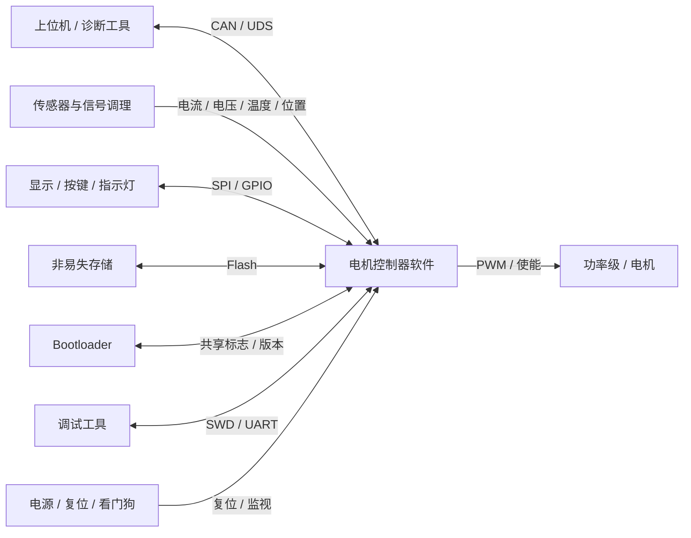
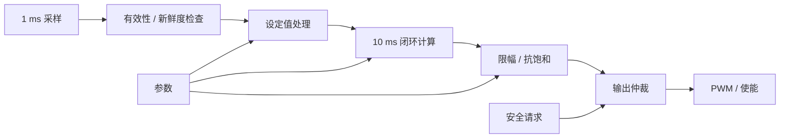
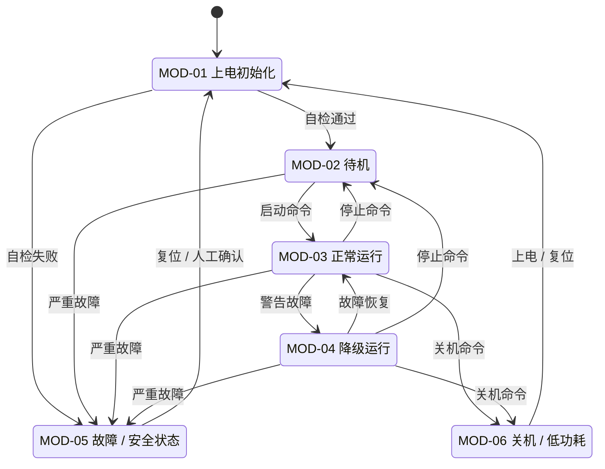
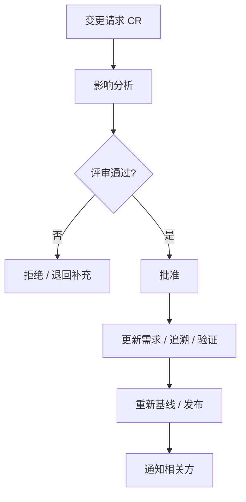

# SWE.1 --- Software Requirements Specification

软件需求规格说明书

> 文档编号：SRS-SWE1-DEMO-r1
> 项目名称：STM32G474 三相电机控制器（示例项目）
> 软件名称/版本：MotorCtrl 应用软件 / r1
> 文档版本：r1
> 状态：草稿（示例）
> 编制日期：2026-11-25
> 编制/评审/批准：示例项目组 / 待评审 / 待批准

> **示例说明**：本文件是 `aspice-docs-from-gpt` 模板的填写示例，项目内容取自 `aspice-docs-demo`。为保持需求、架构、详细设计和验证之间的编号连续，本文沿用 demo 的 FR、NFR、IFR、CON、ASM 等标识，不把标识机械改写为 SWR。本文是可评审的示例基线，不替代真实项目的系统需求、ICD、硬件手册和诊断规范。

---

## 修订记录

| 版本 | 状态 | 变更内容 | 变更日期 | 更改人 | 批准人 |
| --- | --- | --- | --- | --- | --- |
| r1 | 草稿（示例） | 按新模板结构填充电机控制器示例内容 | 2026-11-25 | 示例项目组 | 待批准 |

---

## 1. 文档概述（Document Overview）

### 1.1 文档目的

本文档定义电机控制器软件的源需求，作为软件架构设计、详细设计、实现、集成和合格性验证的正式输入。文档用于回答五个问题：软件为哪个对象定义需求、软件必须实现什么、软件在什么模式和时序下运行、软件与外部交换什么、软件必须满足哪些质量和约束。

本文档的直接使用者包括：软件架构和详细设计人员，用需求 ID 建立组件分配与设计追溯；软件开发和测试人员，用验收判据设计实现、单元测试和集成测试；系统、硬件、诊断、质量和项目管理相关方，用统一基线确认范围、接口和风险；变更影响分析人员，用需求来源和关联关系判断变更范围。

本文档不替代 SYS.2 系统需求、SYS.3 系统架构、ICD-CAN、硬件手册、诊断规范和 Bootloader 规范。上述文件中的约束通过引用进入本文，不在此重复定义。

### 1.2 软件范围

| 项目 | 内容 |
| --- | --- |
| 产品形态 | 嵌入式三相电机控制器（STM32G474 + FreeRTOS） |
| 软件对象 | 应用软件及必要的板级驱动/端口层，负责电机控制、信号采集、CAN/UDS、参数管理、故障安全、显示与人机 |
| 需求基线 | 本文 r1 |
| 上游输入 | SYS.2 系统需求、SYS.3 系统架构与 HSI、ICD-CAN、硬件手册、诊断规范、Bootloader 规范 |
| 下游使用 | SWE.2 软件架构、SWE.3 详细设计、SWE.4～SWE.6 验证 |
| 不覆盖 | Bootloader 内部刷写算法、硬件电路与结构、机械/电气保护设计、OTA、生产测试、函数级设计 |
| 适用阶段 | 软件需求分析、架构设计输入、变更影响分析、需求评审与确认 |

**纳入范围：** 启动与自检、参数加载、信号采集与有效性判断、电机闭环控制、输出使能与安全关断、CAN/UDS 通信、参数写入与掉电保护、故障检测/分级/安全状态、显示/按键/指示、复位原因与诊断计数、Bootloader 交接接口。

**不纳入范围：** 软件组件划分、任务调度、内部接口（SWE.2）；函数、数据结构、算法实现（SWE.3）；硬件保护电路、功率级与结构设计；Bootloader 刷写与回滚内部实现；OTA；整机装配与生产测试工装。

| 内容 | SWE.1（本文） | SWE.2（软件架构） |
| --- | --- | --- |
| 功能 | 按功能域定义软件应实现的行为 | 把功能分配到软件组件 |
| 运行行为 | 定义模式、转换、时序和异常行为 | 定义组件协作、任务、并发和调度 |
| 接口 | 定义软件与外部对象的接口契约 | 定义组件间内部接口和数据契约 |
| 资源 | 定义预算和约束 | 分析并分配预算 |
| 追溯 | 系统需求/系统架构 → 软件需求 | 软件需求 → 软件架构 |

### 1.3 术语与缩略语

| 术语/缩写 | 说明 |
| --- | --- |
| ASPICE | Automotive SPICE，本文按 4.1 版组织过程证据 |
| SWE.1～SWE.6 | 软件需求、架构、详细设计、单元验证、集成验证、合格性验证 |
| FOC | Field Oriented Control，磁场定向控制 |
| SVPWM | 空间矢量脉宽调制 |
| PI | 比例积分调节器 |
| Q15 | 16 位定点格式；占空比 0～32767 映射 0～1 |
| WCET | Worst-Case Execution Time，最坏执行时间 |
| UDS | Unified Diagnostic Services，统一诊断服务 |
| DID/DTC | 诊断数据标识/诊断故障码 |
| NVM | 非易失存储，本文指内部 Flash 参数区 |
| HSI/ICD | 硬件软件接口/接口控制文档 |
| CRITICAL/WARN/INFO | 故障等级：严重/警告/提示 |
| STALE | 数据超过允许年龄，不再用于控制 |

### 1.4 参考资料

| 编号 | 文件/资料名称 | 版本/来源 | 用途 |
| --- | --- | --- | --- |
| REF-001 | SYS.2 系统需求规范 | 当前基线 | 软件需求的上游来源 |
| REF-002 | SYS.3 系统架构与 HSI | 当前基线 | 软件在目标设备中的位置和硬件软件边界 |
| REF-003 | ICD-CAN CAN 通信矩阵与接口控制文档 | 当前基线 | CAN 报文、信号、周期和诊断约束 |
| REF-004 | STM32G474 数据手册与参考手册 | 当前版本 | MCU 资源、外设和电气约束 |
| REF-005 | 软件开发规范 SW-CS | 当前版本 | 命名、编码、注释和静态检查要求 |
| REF-006 | 诊断规范 DIAG-SPEC | 当前版本 | UDS 服务、DID/DTC、会话和安全访问 |
| REF-007 | Bootloader 接口规范 BOOT-SPEC | 当前版本 | 启动交接、共享标志和升级请求 |
| REF-008 | Automotive SPICE 4.1 | 4.1 | SWE.1 过程结果和基本实践 |

## 2. 软件需求上下文（Software Context）

### 2.1 软件功能定位

本软件运行在 STM32G474RET6 单 MCU 上，控制一台三相电机，通过三相 PWM 功率级驱动。软件采集三相电流、母线电压、功率级温度和转子位置/转速，执行转速闭环和转矩限幅；通过 CAN 与上位机/整车控制器交互，支持 UDS 诊断；通过 OLED、按键和指示灯提供本地人机；参数、标定数据和故障记录保存在内部 Flash；通过独立 Bootloader 完成本地升级。

软件在产品中的作用是：把系统层的电机控制、状态感知、通信诊断、参数存储和人机交互职责转化为可验证的软件行为，并在故障、掉电、通信中断和显示失效时保持定义的安全状态。软件不替代硬件保护，也不承担机械、结构和人身安全的最终保证。

### 2.2 软件边界与职责范围

| 范围项 | 描述 | 归属（软件/硬件/外部系统/不在范围内） |
| --- | --- | --- |
| 电机控制与输出 | 设定值处理、闭环控制、限幅、启动/停止序列、PWM 使能请求和安全关断请求 | 软件 |
| 功率级与电气保护 | 三相逆变、栅极驱动、死区、过流比较器、功率级下拉 | 硬件 |
| 信号采集 | 采样触发、工程值转换、有效性判断、角度/转速计算、标定 | 软件 |
| 传感器与信号调理 | 电流/电压/温度/位置传感、断线检测电路、精度 | 硬件 |
| 通信与诊断 | CAN 收发、超时、无效帧、bus-off 恢复、UDS 服务、DID/DTC | 软件 |
| 上位机/整车网络 | 报文定义、网络拓扑、终端电阻、诊断仪 | 外部系统 |
| 参数与数据管理 | 参数加载、CRC/版本/范围校验、双区写入、回读、回滚、默认参数 | 软件 |
| 非易失存储 | 内部 Flash 参数区、擦写寿命和物理特性 | 硬件 |
| 人机交互 | 显示页面、按键扫描/去抖、指示灯、本地设定和使能 | 软件 |
| OLED/按键/LED 模组 | 显示模组、按键机械寿命、LED 电气特性 | 硬件 |
| 升级与维护 | 升级请求、版本检查、共享标志、复位交接 | 软件（应用侧） |
| Bootloader 刷写与回滚 | 镜像校验、擦写、回滚 | 外部系统（Bootloader） |
| 软件组件划分、任务调度、内部接口 | 组件、任务、队列、并发机制 | 不在 SWE.1 范围内（SWE.2） |
| 函数、数据结构、算法实现 | 单元、函数、内部变量、控制算法细节 | 不在 SWE.1 范围内（SWE.3） |
| 机械限位、结构强度、人身安全 | 机械和系统安全概念 | 不在软件范围内 |

**边界规则。** 硬件保护是软件保护之外的第一道防线；软件安全输出是第二道防线，不替代硬件保护。上电、复位和掉电瞬间，软件必须保持输出关闭，硬件必须保证复位期间的安全电平。通信断开、传感器失效、显示失效时，软件应进入定义的降级或安全行为。Bootloader 负责刷写和回滚，应用软件只负责升级请求、版本检查和共享标志交接。

### 2.3 外部交互对象

| 对象 ID | 外部对象 | 类型 | 交互目的 | 相关接口/需求 |
| --- | --- | --- | --- | --- |
| EXT-01 | 上位机/诊断工具 | 系统 | CAN 控制报文、状态报文、UDS 请求/响应 | IFR-COM-001～005；FR-030～037 |
| EXT-02 | 传感器与信号调理 | 硬件 | 三相电流、母线电压、功率级温度、转子位置/转速 | IFR-HW-001；FR-010～015 |
| EXT-03 | 功率级/电机 | 硬件 | PWM、使能、故障反馈 | IFR-HW-002/003；FR-020～024、FR-040、FR-046 |
| EXT-04 | 显示与按键 | 硬件 | 页面显示、按键事件、指示灯 | IFR-HW-003/004、IFR-HMI-001～003；FR-041、FR-050～053 |
| EXT-05 | 非易失存储 | 硬件 | 参数、标定、版本、故障记录 | IFR-HW-005；FR-002、FR-031、FR-070～072 |
| EXT-06 | Bootloader | 软件 | 启动跳转、版本、升级标志、复位交接 | IFR-SYS-001；FR-006、FR-060 |
| EXT-07 | 调试工具 | 工具 | SWD、UART 日志、GPIO 测量点 | IFR-HW-007；NFR-M-02 |
| EXT-08 | 电源/复位/看门狗 | 硬件 | 供电、复位原因、独立看门狗 | IFR-HW-006；FR-004、FR-045 |

### 2.4 运行环境需求

| 需求/环境项 | 要求或边界 | 是否强制 | 来源/依据 | 关联需求 ID |
| --- | --- | --- | --- | --- |
| MCU 与算力 | STM32G474RET6，Cortex-M4F，170 MHz，带单精度 FPU | 是 | SYS-REQ-014、CON-01 | NFR-R-03、NFR-P-01 |
| 片上存储 | 512 KB Flash、128 KB SRAM；应用镜像预算 256 KB，运行 RAM 预算 64 KB | 是 | SYS-REQ-014、CON-01/02 | NFR-R-01、NFR-R-02 |
| 操作系统 | FreeRTOS 10.3.1，1 kHz tick，抢占式固定优先级，静态分配 | 是 | SYS-REQ-014、CON-02 | NFR-P-01、NFR-R-02 |
| 启动结构 | Bootloader 24 KB 独立分区；应用不实现自身刷写 | 是 | SYS-REQ-009、CON-04 | FR-006、FR-060 |
| 编译工具链 | GNU Arm Embedded 10.3，C11，-O2；HAL 1.27.1，关键路径可用 LL | 是 | SYS-REQ-014、CON-03 | NFR-R-01、NFR-P-05 |
| CAN | FDCAN1 按经典 CAN 使用，500 kbit/s，11 位 ID，8 字节 | 是 | SYS-REQ-004、CON-05 | FR-030～037、NFR-P-06 |
| 采样 | ADC1/ADC2，12 位，1 ms 触发，采样与 10 ms 控制解耦 | 是 | SYS-REQ-003、CON-06 | FR-010、FR-014 |
| PWM | HRTIM，20 kHz，三相互补，死区由硬件保证 | 是 | SYS-REQ-001、CON-06 | FR-020～024、FR-046 |
| 显示 | 128×64 OLED，SPI，20 ms 刷新；显示不得阻塞控制 | 是 | SYS-REQ-007、CON-09 | FR-041、FR-051、FR-053 |
| 参数存储 | 内部 Flash 参数区 2×2 KB 双区备份；写入回读校验 | 是 | SYS-REQ-006、CON-10 | FR-002、FR-031、FR-072 |
| 看门狗 | 独立看门狗 IWDG，100 ms 超时；仅在关键功能存活时刷新 | 是 | SYS-REQ-011、CON-06 | FR-045、NFR-A-01 |
| 调试 | SWD + UART 日志；生产件关闭或保护 | 是 | SYS-REQ-012/013、CON-12 | NFR-S-05、NFR-M-02 |
| 供电与温度 | 供电、温度、EMC 范围由硬件/环境规范定义；软件处理欠压、掉电、过温 | 是 | SYS-REQ-015、ASM-02 | FR-013、FR-045 |
| 网络与引脚 | CAN 拓扑、终端、引脚分配符合 ICD/HSI | 是 | ASM-03/05 | FR-030、IFR-HW-001～007 |

**运行环境假设。** 传感器输出在标称量程内，越界按无效值处理；供电电压在硬件规范范围内；CAN 网络终端、拓扑和波特率符合 ICD-CAN；Bootloader 版本与当前应用兼容；硬件引脚与 ICD 一致；当前基线不包含 OTA。

### 2.5 已知项目约束与前提假设

| ID | 类型 | 约束/假设 | 是否已确认 | 来源/依据 | 影响及后续处理 |
| --- | --- | --- | --- | --- | --- |
| CON-01 | 硬件 | MCU 为 STM32G474RET6，单核，512 KB Flash、128 KB SRAM | 是 | SYS-REQ-014 | 控制计算需在 10 ms 内完成；资源预算见 6.2 |
| CON-02 | 平台 | FreeRTOS 10.3.1，1 kHz tick，抢占式固定优先级，静态分配 | 是 | SYS-REQ-014 | 运行期禁止动态内存；栈和缓冲区需提前规划 |
| CON-03 | 工具链 | GNU Arm Embedded 10.3，C11，-O2；HAL 1.27.1 | 是 | SYS-REQ-014 | 代码尺寸和 WCET 以该工具链为准 |
| CON-04 | 启动 | Bootloader 24 KB，独立分区；应用不修改自身 Flash | 是 | SYS-REQ-009 | 升级请求和版本交接需符合 BOOT-SPEC |
| CON-05 | 通信 | 经典 CAN 500 kbit/s，11 位 ID，8 字节；报文矩阵由 ICD-CAN 定义 | 是 | SYS-REQ-004 | 总线负载和报文长度受限 |
| CON-06 | 实时性 | 控制周期 10 ms；PWM 20 kHz；ADC 1 ms 采样 | 是 | SYS-REQ-010 | 控制、采样、输出需满足时序预算 |
| CON-07 | 内存 | 运行期禁止动态内存分配；通信/显示缓冲区静态分配 | 是 | SYS-REQ-014 | RAM 预算和队列深度需提前确定 |
| CON-08 | 升级 | 当前基线不包含 OTA，仅支持 Bootloader 本地升级 | 是 | 项目范围 | 无 OTA 模式；刷写和回滚由 Bootloader 负责 |
| CON-09 | 显示 | 128×64 OLED，SPI，20 ms 刷新 | 是 | SYS-REQ-007 | 显示不得阻塞控制 |
| CON-10 | 存储 | 参数区内部 Flash 2×2 KB 双区备份 | 是 | SYS-REQ-006 | 擦写寿命和写入时间受限；需回读和回滚 |
| CON-11 | 隔离 | 单 MCU，无完整 MPU 分区隔离，仅栈保护和看门狗 | 是 | 平台限制 | 故障可能影响同域代码；需故障注入验证 |
| CON-12 | 调试 | 生产件关闭或保护 SWD/UART；开发件保留调试能力 | 是 | SYS-REQ-012 | 调试访问不得改变控制行为 |
| CON-13 | 过程 | 软件开发和验证遵循 ASPICE 4.1 SWE.1～SWE.6 及项目配置/变更管理 | 是 | 项目质量要求 | 需求、追溯、评审和基线需完整 |

| ID | 假设/依赖 | 影响 | 验证或确认方式 |
| --- | --- | --- | --- |
| ASM-01 | 传感器输出在标称量程内 | 越界按无效处理 | 有效性判断和故障降级测试 |
| ASM-02 | 供电电压在硬件规范范围内且稳定 | 掉电保护依赖硬件；软件检测欠压 | 欠压/掉电测试；双区参数测试 |
| ASM-03 | CAN 矩阵在基线内 | 报文变更影响通信需求和测试 | ICD 评审和变更管理 |
| ASM-04 | Bootloader 版本与当前应用兼容 | 启动/升级接口稳定 | 版本握手和兼容性测试 |
| ASM-05 | 硬件引脚与 ICD 一致 | 驱动配置依赖引脚 | 硬件评审和集成测试 |

## 3. 软件功能需求（Functional Requirements）

### 3.1 功能需求概述

功能需求按业务功能域组织，不按未来软件组件或任务组织。一条需求只描述一个可验证的软件行为，使用“软件应……”句式；每条需求具有唯一 ID、上游来源、优先级和验收判据。需求中不出现组件名、任务名、函数名、内部队列或消息机制；正常、边界、异常、启动、关闭、掉电和通信中断均需覆盖。

| 功能域 | 目标 | 需求 ID | 优先级 | 主要外部交互 |
| --- | --- | --- | --- | --- |
| 启动与系统管理 | 上电自检、初始化、就绪、模式与状态维护 | FR-001、FR-003～FR-007 | 高 | 复位、Bootloader、显示、CAN |
| 信号采集与运行监测 | 采样、转换、有效性、角度/转速、电压/温度监测 | FR-010～FR-015 | 高 | 传感器、ADC、GPIO |
| 电机控制与输出 | 闭环控制、启停、设定值、限幅、输出仲裁 | FR-020～FR-025 | 高 | 功率级、PWM、HMI、CAN |
| 通信与诊断 | CAN 收发、超时、无效帧、bus-off、UDS | FR-030、FR-032～FR-037 | 高/中 | CAN 收发器、诊断工具 |
| 参数与数据管理 | 参数加载、写入、版本、掉电保护、标定 | FR-002、FR-031、FR-070～FR-072 | 高/中 | 非易失存储、诊断工具 |
| 故障与安全 | 故障检测、分级、降级、锁存、记录、安全输出 | FR-040、FR-042～FR-046 | 高 | 传感器、功率级、电源、通信 |
| 人机交互与指示 | 显示、按键、指示灯、本地设定与使能 | FR-041、FR-050～FR-053 | 中/低 | OLED、按键、LED |
| 维护与升级 | 版本信息、事件日志、Bootloader 交接 | FR-006、FR-060、FR-061 | 中/低 | 诊断工具、Bootloader |

**优先级定义。** 高：安全、基本控制、启动、通信或资源底线，必须进入 r1 基线，未满足不得放行。中：诊断、参数、HMI、可维护性，进入 r1 或 r1.1，按项目计划分配。低：增强显示、长期日志、质量提升，可进入后续版本，不阻塞基本功能。

功能域不是软件组件。一个功能域可能由多个组件协作实现，一个组件也可能服务多个功能域；具体分配在 SWE.2 中完成。

### 3.2 功能域需求

#### 3.2.1 启动与系统管理

| 需求 ID | 需求名称 | 需求描述 | 优先级 | 来源/依据 | 验证准则 | 验证方法 | 状态 |
| --- | --- | --- | --- | --- | --- | --- | --- |
| FR-001 | 上电自检 | 软件应在每次上电或复位后对时钟、RAM、看门狗、ADC、PWM、CAN、NVM 等关键资源执行自检，并检查显示接口；显示接口失效按 FR-053 处理，不阻止控制就绪。 | 高 | SYS-REQ-008 | 正常上电 500 ms 内完成；注入 RAM/时钟/CAN/NVM 故障时能识别并进入 MOD-05；自检失败不得使能输出。 | 测试、分析 | 已确认 |
| FR-003 | 待机就绪 | 软件应在自检通过且参数通过校验（含安全默认参数）后进入待机就绪状态，并在上电后 2 s 内给出就绪指示；自检失败不得进入就绪状态。 | 高 | SYS-REQ-008 | 正常上电 ≤2 s 就绪；自检失败时就绪指示不点亮；默认参数时显示参数告警但允许待机。 | 测试 | 已确认 |
| FR-004 | 复位原因记录 | 软件应读取并记录复位原因，包括上电、看门狗、软件、引脚、欠压和时钟失效，并支持通过诊断接口读取最近一次及历史复位原因。 | 中 | SYS-REQ-011 | 每种复位注入后原因正确；掉电重启后最近一次记录仍可读取；多位标志按定义优先级归类。 | 测试、检查 | 已确认 |
| FR-005 | 系统状态维护 | 软件应维护当前运行模式、故障等级、降级状态、参数有效性和运行时间，并在状态变化后 20 ms 内提供给显示、CAN 和诊断使用。 | 高 | SYS-REQ-008、SYS-REQ-013 | 模式或故障变化后 ≤20 ms 状态更新；显示和 CAN 读取到的状态一致；消费者失效不影响状态维护。 | 测试、分析 | 已确认 |
| FR-006 | 升级请求与交接 | 软件应在待机模式接受本地升级请求，校验请求和 Bootloader 版本兼容性，置位共享升级标志并复位进入 Bootloader；应用软件不得擦写自身程序区。 | 中 | SYS-REQ-009 | 待机请求后 ≤200 ms 复位进入 Bootloader；运行中请求被拒绝；版本不兼容有负响应或指示；标志写入失败不复位。 | 测试 | 已确认 |
| FR-007 | 运行统计 | 软件应统计并维护上电次数、运行时间、复位次数、通信错误计数和故障计数，关键计数应掉电保存并可通过诊断接口读取。 | 低 | SYS-REQ-013 | 计数与注入事件一致；关键计数复位后不丢失；溢出时饱和或回绕并有标志。 | 测试、检查 | 已确认 |

#### 3.2.2 信号采集与运行监测

| 需求 ID | 需求名称 | 需求描述 | 优先级 | 来源/依据 | 验证准则 | 验证方法 | 状态 |
| --- | --- | --- | --- | --- | --- | --- | --- |
| FR-010 | 周期采样 | 软件应以 1 ms 周期采集三相电流、母线电压、功率级温度和转子位置/转速信号，转换为工程值并附加采样时间戳。 | 高 | SYS-REQ-003 | 采样周期 1 ms ±100 µs；电流/电压转换误差 ≤1% FS，温度误差 ≤2 °C；异常采样带无效标志。 | 测试 | 已确认 |
| FR-011 | 采样有效性 | 软件应对每路采样信号执行量程、断线/短路、超时和合理性判断；无效时置无效标志并保持上一有效值，不得用 0 代替无效值。 | 高 | SYS-REQ-003 | 注入越界/断线/超时，≤10 ms 置无效；连续 5 个有效周期后恢复；无效值不参与控制。 | 测试、分析 | 已确认 |
| FR-012 | 角度与转速计算 | 软件应根据转子位置信号计算电角度和转速，并进行方向、范围和跳变合理性检查；位置信号无效时应按失效处理。 | 高 | SYS-REQ-003 | 额定转速范围内稳态转速误差 ≤2%，电角度误差 ≤2°；注入位置丢失/跳变时按失效处理。 | 测试 | 已确认 |
| FR-013 | 母线电压与温度监测 | 软件应监测母线电压和功率级温度，执行滤波、阈值和迟滞判断，为降额、保护和故障上报提供依据。 | 高 | SYS-REQ-003、SYS-REQ-002 | 超过阈值后 ≤100 ms 触发降额或保护；迟滞和阈值可参数化；无效传感器按 FR-011 处理。 | 测试、分析 | 已确认 |
| FR-014 | 采样新鲜度与一致性 | 软件应保证控制使用的采样数据年龄不超过 20 ms；超过时标记 STALE 并触发降级或故障，且多字节采样数据应提供一致快照。 | 高 | SYS-REQ-003、SYS-REQ-010 | 停止采样后 20 ms 内标记 STALE；连续 3 次失效触发 F-02；控制不使用撕裂数据。 | 测试 | 已确认 |
| FR-015 | 通道标定 | 软件应支持电流、电压、温度和位置通道的零偏与增益标定，标定参数应可存储、读取、校验和恢复默认值。 | 中 | SYS-REQ-003、SYS-REQ-006 | 标定后零偏/增益误差满足通道规范；非法标定被拒绝；默认值可恢复；标定参数掉电保存。 | 测试、检查 | 已确认 |

#### 3.2.3 电机控制与输出

| 需求 ID | 需求名称 | 需求描述 | 优先级 | 来源/依据 | 验证准则 | 验证方法 | 状态 |
| --- | --- | --- | --- | --- | --- | --- | --- |
| FR-020 | 闭环控制 | 软件应以 10 ms 周期根据设定值和反馈计算控制量，执行电流/转速闭环和转矩限幅，并将控制量输出到功率级。 | 高 | SYS-REQ-001 | 控制周期 10 ms ±1 ms；阶跃响应超调 ≤10%，稳态误差 ≤2%；输出限幅生效；反馈无效时进入降级/安全状态。 | 测试、分析 | 已确认 |
| FR-021 | 启动/停止时序 | 软件应在满足启动条件后按定义时序使能输出；收到停止命令后按定义时序关闭输出，不得直接跳变。 | 高 | SYS-REQ-001、SYS-REQ-002 | 启动命令后 ≤50 ms 进入使能；停止命令后 ≤50 ms 输出关闭；故障时 ≤20 ms 安全关断；非法启动被拒绝。 | 测试 | 已确认 |
| FR-022 | 设定值处理 | 软件应接收来自本地 HMI 或 CAN 的转速/转矩设定值，执行来源优先级、范围限制、变化率限制和超时处理。 | 高 | SYS-REQ-001、SYS-REQ-004 | 越界设定被限幅；超时后按模式归零或保持安全值；来源切换按定义执行；不产生超出变化率限制的跳变。 | 测试 | 已确认 |
| FR-023 | 限幅与抗饱和 | 软件应根据参数对电流、转矩、电压、占空比和变化率进行限幅，并防止积分饱和。 | 高 | SYS-REQ-001 | 任何工况下输出不超过配置限值；饱和后退出时间满足定义；积分不累积到不可恢复。 | 测试、分析 | 已确认 |
| FR-024 | 输出使能与安全关断 | 软件应仅在无严重故障、参数可用（通过校验或安全默认参数）、模式允许且安全请求无效时使能输出；收到安全请求或严重故障时，应在 20 ms 内关闭 PWM 并使能无效。 | 高 | SYS-REQ-002 | 安全请求后 ≤20 ms PWM 关闭/EN 无效；使能条件不满足时无法使能；关断后需复位或人工确认才能恢复。 | 测试 | 已确认 |
| FR-025 | 电机状态发布 | 软件应发布电机运行状态，包括实际转速、电流、电压、温度、转矩限幅、运行/降级/故障状态和故障码。 | 高 | SYS-REQ-004、SYS-REQ-007 | 状态更新周期 ≤10 ms；显示和 CAN 状态与内部一致；无效数据带标志；状态不因消费者失效而丢失。 | 测试 | 已确认 |

#### 3.2.4 通信与诊断

| 需求 ID | 需求名称 | 需求描述 | 优先级 | 来源/依据 | 验证准则 | 验证方法 | 状态 |
| --- | --- | --- | --- | --- | --- | --- | --- |
| FR-030 | CAN 收发 | 软件应通过经典 CAN 500 kbit/s 接收控制/配置报文，并按周期发送状态报文；报文 ID、DLC 和信号布局应符合 ICD-CAN。 | 高 | SYS-REQ-004 | 按 ICD 正确收发；状态帧周期偏差 ≤10%；总线负载 ≤50%；错误帧可计数。 | 测试 | 已确认 |
| FR-032 | CAN 接收超时 | 软件应监测控制报文接收超时；超过 100 ms 未收到有效控制报文时，置通信超时故障，并按当前模式执行保持安全输出、归零或停止。 | 高 | SYS-REQ-004、SYS-REQ-002 | 停止发送后 100 ms 内检测到超时；按模式执行定义行为；收到有效帧后按迟滞恢复。 | 测试 | 已确认 |
| FR-033 | CAN 报文校验 | 软件应检查 CAN 报文的 DLC、计数器/校验和、信号范围和更新超时；无效报文应被丢弃并计数，不得用于控制。 | 高 | SYS-REQ-004 | 注入各类无效报文均被拒绝并计数；控制不使用无效数据；错误计数可通过诊断读取。 | 测试 | 已确认 |
| FR-034 | bus-off 恢复 | 软件应检测 CAN bus-off，停止发送并记录故障，按 CAN 规范尝试自动恢复；恢复后重新同步状态。 | 中 | SYS-REQ-004 | bus-off 后 ≤5 ms 检测并停止发送；自动恢复成功后可继续通信；连续失败达到上限后保持故障并上报。 | 测试 | 已确认 |
| FR-035 | UDS 诊断服务 | 软件应支持诊断会话控制、DID 读写、DTC 读取/清除、例程控制和通信保持等 UDS 服务，响应格式符合诊断规范。 | 中 | SYS-REQ-005 | 支持的服务正响应正确；非法请求返回规定 NRC；响应时间 ≤100 ms。 | 测试 | 已确认 |
| FR-036 | 故障上报 | 软件应在故障确认、状态变化和周期状态帧中上报故障码、等级、计数和当前模式；严重故障应在 20 ms 内发送首帧。 | 高 | SYS-REQ-004、SYS-REQ-002 | 故障确认后 ≤20 ms 发送首帧；周期状态帧按 ICD 周期发送；bus-off 期间缓存/丢弃策略符合定义。 | 测试 | 已确认 |
| FR-037 | 会话与安全访问 | 软件应管理 UDS 会话超时和安全访问，参数写入和例程控制需满足会话及安全条件。 | 中 | SYS-REQ-005、SYS-REQ-012 | S3 超时后回到默认会话；未解锁时拒绝受保护服务并返回 NRC；错误尝试计数和延迟符合诊断规范。 | 测试、检查 | 已确认 |

#### 3.2.5 参数与数据管理

| 需求 ID | 需求名称 | 需求描述 | 优先级 | 来源/依据 | 验证准则 | 验证方法 | 状态 |
| --- | --- | --- | --- | --- | --- | --- | --- |
| FR-002 | 参数加载与默认回退 | 软件应在上电初始化时从非易失存储加载参数，执行 CRC、版本和范围校验；校验失败时使用安全默认参数并标记参数降级状态。 | 高 | SYS-REQ-006 | 有效参数 300 ms 内加载完成；损坏或版本不匹配时使用默认值；不得使用未校验参数控制电机。 | 测试 | 已确认 |
| FR-031 | 参数写入与持久化 | 软件应支持通过诊断接口写入参数，执行范围、CRC 和版本校验，采用双区备份写入、回读确认和失败回滚；写入期间不得影响控制安全。 | 高 | SYS-REQ-005、SYS-REQ-006 | 写入成功回读一致；失败回滚旧参数完整；掉电中断后重启至少有一份有效参数；运行中控制参数写入按定义拒绝或延迟。 | 测试 | 已确认 |
| FR-070 | 参数定义 | 软件应为每个可写参数定义单位、范围、默认值、分辨率和持久化属性；写入值超出范围或格式非法时应拒绝。 | 中 | SYS-REQ-006 | 所有参数有定义；越界/非法值被拒绝；默认值可恢复；只读参数不可写。 | 检查、测试 | 已确认 |
| FR-071 | 参数版本兼容 | 软件应校验参数版本与软件版本的兼容性；不兼容时使用默认参数或按定义迁移，并记录事件。 | 中 | SYS-REQ-006 | 版本不匹配按定义处理；迁移失败不破坏旧参数；事件可通过诊断读取。 | 测试、检查 | 已确认 |
| FR-072 | 掉电保护与回滚 | 软件应在参数写入和关机过程中保证掉电不破坏有效参数；上电后应能识别并回滚到上一有效版本。 | 高 | SYS-REQ-006 | 在写入各阶段掉电，重启后至少有一份有效参数；不得出现无参数可用；回滚事件被记录。 | 测试 | 已确认 |

#### 3.2.6 故障与安全

| 需求 ID | 需求名称 | 需求描述 | 优先级 | 来源/依据 | 验证准则 | 验证方法 | 状态 |
| --- | --- | --- | --- | --- | --- | --- | --- |
| FR-040 | 故障检测与安全状态 | 软件应检测传感器、通信、电源、时钟、看门狗、输出级、过流、过压和过温故障，按等级处理；严重故障应在 20 ms 内进入安全状态。 | 高 | SYS-REQ-002 | 注入 F-01～F-16 均能检测并按规定反应；严重故障 ≤20 ms 安全输出；故障不丢失。 | 测试、分析 | 已确认 |
| FR-042 | 故障分级与降额 | 软件应将故障分为 INFO、WARN 和 CRITICAL，WARN 时按定义降额运行，CRITICAL 时安全停止。 | 高 | SYS-REQ-002 | WARN 时转矩 ≤50%、转速受限并指示；连续 5 个控制周期正常后恢复；升级为 CRITICAL 时 ≤20 ms 安全停止。 | 测试 | 已确认 |
| FR-043 | 严重故障锁存 | 软件应锁存 CRITICAL 故障，只有在故障消失且收到复位或人工确认后才允许清除；清除后应重新初始化并记录事件。 | 高 | SYS-REQ-002 | 故障未消失时复位无效；故障消失后复位可清除；清除事件可追溯；清除后输出保持关闭直到重新启动。 | 测试 | 已确认 |
| FR-044 | 故障记录与诊断 | 软件应记录故障 ID、等级、发生次数、首次/最近发生时间和复位原因，并支持通过 DTC/DID 读取和清除。 | 中 | SYS-REQ-005、SYS-REQ-013 | 故障记录与注入一致；掉电后保留；活动故障不可清除或清除后重新出现。 | 测试、检查 | 已确认 |
| FR-045 | 电源、时钟与看门狗安全 | 软件应检测欠压/掉电、时钟失效和看门狗超时，执行安全输出、记录原因并复位；看门狗仅在所有关键功能存活时刷新。 | 高 | SYS-REQ-011 | 注入欠压/时钟/看门狗故障后输出安全、复位原因正确；看门狗超时 ≤100 ms 复位；关键功能失效时停止刷新。 | 测试 | 已确认 |
| FR-046 | 过流、过压与输出级保护 | 软件应检测过流、过压、输出级故障反馈和驱动饱和，按规定关断输出并锁存；硬件保护与软件保护应保持一致。 | 高 | SYS-REQ-002 | 过流/过压/驱动故障注入后 ≤10 ms 关断；硬件保护 ≤1 ms 不依赖软件；故障锁存。 | 测试、分析 | 已确认 |

#### 3.2.7 人机交互与指示

| 需求 ID | 需求名称 | 需求描述 | 优先级 | 来源/依据 | 验证准则 | 验证方法 | 状态 |
| --- | --- | --- | --- | --- | --- | --- | --- |
| FR-041 | 状态显示与指示 | 软件应通过 OLED 和指示灯显示运行模式、就绪、降级、故障和安全状态；状态变化后 100 ms 内更新；显示失效不得影响控制。 | 低 | SYS-REQ-007 | 状态与内部一致；显示失效时控制继续并上报 F-13；故障状态优先显示。 | 测试、演示 | 已确认 |
| FR-050 | 按键扫描与操作 | 软件应扫描按键并去抖，识别短按、长按和组合键，按当前模式执行启动、停止、页面切换和参数调整；非法操作应被忽略并提示。 | 中 | SYS-REQ-007 | 去抖时间 20 ms；按键响应 ≤50 ms；非法操作不改变输出；按键失效不影响 CAN 控制。 | 测试 | 已确认 |
| FR-051 | 显示页面 | 软件应显示运行状态、设定值、实际转速、电流、电压、温度、故障码和参数页面；页面切换和刷新不应阻塞控制。 | 低 | SYS-REQ-007 | 刷新周期 20 ms；页面数据与内部状态一致；显示刷新不影响控制周期。 | 测试、演示 | 已确认 |
| FR-052 | 本地设定与启停 | 软件应允许在待机或允许模式下通过按键设置本地转速/转矩目标并执行本地启动/停止；本地与远程控制源应有明确优先级和切换规则。 | 中 | SYS-REQ-007、SYS-REQ-001 | 本地设定范围/变化率受限；故障时本地启动无效；源切换按定义执行且不产生危险跳变。 | 测试 | 已确认 |
| FR-053 | 显示失效处理 | 软件应检测显示通信或刷新失效，使用指示灯替代关键状态，并继续控制功能；显示故障按 INFO/WARN 处理。 | 低 | SYS-REQ-007、SYS-REQ-011 | 显示失效 ≤20 ms 检测；控制不受影响；关键故障仍可通过 LED/CAN 指示。 | 测试 | 已确认 |

#### 3.2.8 维护与升级

| 需求 ID | 需求名称 | 需求描述 | 优先级 | 来源/依据 | 验证准则 | 验证方法 | 状态 |
| --- | --- | --- | --- | --- | --- | --- | --- |
| FR-060 | 版本信息 | 软件应提供应用版本、构建信息、参数版本、Bootloader 兼容版本和硬件版本，并支持通过 DID 或显示读取。 | 中 | SYS-REQ-009、SYS-REQ-013 | 版本信息与实际一致；不兼容时启动/升级按定义处理；DID 可读。 | 检查、测试 | 已确认 |
| FR-061 | 关键事件日志 | 软件应记录启动、模式转换、故障、参数写入和复位等关键事件的时间戳与上下文，并支持通过诊断接口读取。 | 低 | SYS-REQ-013 | 关键事件记录完整；日志满时按策略覆盖；掉电后保留关键记录。 | 测试、检查 | 已确认 |

### 3.3 功能处理要求

本节描述需求层面的端到端处理链，只说明“输入经过哪些行为得到输出”，不规定由哪个组件、任务或函数实现。

#### 3.3.1 控制处理链

| 步骤 | 处理内容 | 输入 | 输出 | 约束 | 相关需求 |
| --- | --- | --- | --- | --- | --- |
| 1 | 周期采样 | 电流、电压、温度、位置 | 原始值、时间戳 | 1 ms 周期；采样与 10 ms 控制解耦 | FR-010 |
| 2 | 有效性与新鲜度检查 | 原始/工程值、时间戳 | 有效值、无效标志、STALE | 超过 20 ms 视为失效；连续 3 次失效触发故障 | FR-011、FR-014 |
| 3 | 设定值处理 | 本地/CAN 设定值、模式 | 校验后的设定值 | 来源优先级、范围、变化率、超时 | FR-022 |
| 4 | 闭环计算 | 设定值、反馈、参数、安全请求 | 控制量 | 10 ms 周期；超调 ≤10%；稳态误差 ≤2% | FR-020 |
| 5 | 限幅与抗饱和 | 控制量、参数限值 | 限幅后的控制量、饱和标志 | 电流/转矩/电压/占空比/变化率限幅 | FR-023 |
| 6 | 输出仲裁 | 控制量、安全请求、故障状态、模式 | 最终输出、使能 | 安全请求优先；不满足使能条件不得输出 | FR-024 |
| 7 | PWM 与使能更新 | 最终输出、PWM 配置 | 三相 PWM、EN | 20 kHz；与 PWM 周期同步；复位/安全状态关闭 | FR-021、IFR-HW-002 |

**控制链边界条件。** 采样无效或过期时，控制不得使用 0 代替，应按 FR-011/FR-014 使用上一有效值并标记，必要时降级或停止；设定值超时或来源冲突时，按 FR-022 的定义归零、保持或停止；安全请求的优先级高于正常控制；输出饱和是正常控制状态，不等于故障，但长期饱和应记录并可通过诊断读取。

#### 3.3.2 命令处理链

| 步骤 | 处理内容 | 输入 | 输出 | 约束 | 相关需求 |
| --- | --- | --- | --- | --- | --- |
| 1 | 接收命令 | HMI、CAN、诊断请求 | 原始命令 | 不丢失启动、停止和故障相关命令 | FR-030、FR-050 |
| 2 | 鉴权与有效性检查 | 命令、会话、校验和、范围 | 有效/无效命令 | 未授权、越界、校验错拒绝并计数 | FR-033、FR-037、NFR-S-03 |
| 3 | 模式检查 | 当前模式、命令类型 | 允许/拒绝 | 待机允许启动；故障模式禁止启动；运行中禁止写入影响控制安全的参数 | FR-005、FR-021、FR-031 |
| 4 | 执行命令 | 有效命令、当前状态 | 新状态、输出变化 | 启动/停止时序、设定值变化率、参数写入流程 | FR-021、FR-022、FR-031 |
| 5 | 状态反馈 | 执行结果、系统状态 | 显示、CAN 状态、UDS 响应 | 状态变化 ≤20 ms；UDS 响应 ≤100 ms | FR-005、FR-035、FR-036 |
| 6 | 记录事件 | 命令、结果、时间戳 | 事件日志、故障计数 | 关键命令可追溯；日志满按策略覆盖 | FR-044、FR-061 |

> 命令处理链要求“先校验、后执行”。任何未通过校验的命令不得直接改变输出或参数。

#### 3.3.3 参数写入处理链

| 步骤 | 处理内容 | 输入 | 输出 | 失败行为 | 相关需求 |
| --- | --- | --- | --- | --- | --- |
| 1 | 接收写入请求 | UDS 请求、参数 ID、数据 | 写入请求 | 长度/格式错误返回 NRC | FR-031、FR-035 |
| 2 | 会话与安全访问 | 会话状态、安全等级 | 允许/拒绝 | 未解锁返回 NRC；错误尝试计数 | FR-037、NFR-S-04 |
| 3 | 范围/CRC/版本校验 | 参数定义、写入值、版本 | 校验结果 | 越界/CRC/版本错误拒绝 | FR-070、FR-071 |
| 4 | 写入备份区 | 参数数据、NVM 状态 | 写入结果 | 写入失败保持旧区有效 | FR-031、FR-072 |
| 5 | 回读校验 | 备份区数据、CRC | 校验结果 | 回读失败回滚并返回负响应 | FR-031 |
| 6 | 切换有效区 | 校验通过的备份区 | 新参数集 | 切换需原子性；掉电后仍可回滚 | FR-031、FR-072 |
| 7 | 响应与记录 | 执行结果、事件 | 正/负响应、日志 | 失败不得破坏旧参数；记录事件 | FR-031、FR-061 |

**参数写入并发约束。** 控制参数只允许在待机或输出禁用时写入；不影响实时控制的状态/诊断参数可以在运行中写入，但必须使用原子切换或双区机制；写入期间不得停止看门狗刷新；写入失败、回读失败或掉电后旧参数必须保持有效。

#### 3.3.4 故障处理链

| 步骤 | 处理内容 | 输入 | 输出 | 约束 | 相关需求 |
| --- | --- | --- | --- | --- | --- |
| 1 | 故障检测 | 传感器、通信、电源、时钟、看门狗、输出级 | 故障事件 | 检测靠近故障源；满足 3.4 的检测时间 | FR-040、FR-045、FR-046 |
| 2 | 确认/去抖 | 故障事件、连续周期计数 | 确认后的故障 | 瞬时抖动不得直接触发严重故障；恢复需迟滞 | FR-011、FR-042 |
| 3 | 分级 | 故障类型、严重度 | INFO/WARN/CRITICAL | 分级规则统一；多故障取最高等级 | FR-042 |
| 4 | 决策 | 故障等级、当前模式、参数状态 | 降级/停止/保持 | 安全优先；严重故障不得被普通命令覆盖 | FR-040、FR-043 |
| 5 | 安全输出 | 决策结果、输出状态 | PWM 关闭、EN 无效 | 严重故障 ≤20 ms；不依赖软件继续正常调度 | FR-024、NFR-S-01 |
| 6 | 记录与上报 | 故障、时间、上下文 | NVM 记录、DTC、CAN 帧、显示 | 故障不丢失；首帧 ≤20 ms；掉电保留 | FR-036、FR-044 |
| 7 | 恢复/锁存 | 故障消失、复位/确认 | 恢复或保持锁存 | CRITICAL 锁存；WARN 连续正常后恢复 | FR-042、FR-043 |

**故障处理原则。** INFO 只记录和计数；WARN 触发降级、指示和上报；CRITICAL 触发安全输出、锁存和记录。瞬时故障可以自动恢复，但必须有连续正常周期计数和迟滞；严重故障必须锁存；任何故障都不得被静默丢弃。

#### 3.3.5 数据处理要求

| 数据类别 | 单位/表示 | 有效范围 | 无效值处理 | 更新/使用约束 | 相关需求 |
| --- | --- | --- | --- | --- | --- |
| 三相电流 | A，有符号 | 由传感器量程和参数定义 | 置无效，保留上一有效值 | 1 ms 采样；控制使用前检查有效性 | FR-010、FR-011 |
| 母线电压 | V | 0～硬件量程 | 置无效；过压/欠压按故障处理 | 1 ms 采样；滤波和迟滞 | FR-013 |
| 功率级温度 | °C | 由传感器和硬件规范定义 | 置无效；过温按等级处理 | 1 ms 采样；降额/保护 | FR-013 |
| 转子位置 | 电角度（°） | 0～360° | 置无效；角度跳变按失效处理 | 1 ms 采样；用于角度/转速计算 | FR-012 |
| 转速 | rpm，有符号 | 由电机和参数定义 | 置无效；控制进入降级 | 10 ms 控制周期使用 | FR-012、FR-020 |
| 转速/转矩设定值 | rpm 或 % | 由参数定义 | 拒绝/归零/保持安全值 | 10 ms 更新；范围/变化率限制 | FR-022 |
| 转矩/电流限值 | % 或 A | 0～参数上限 | 使用安全默认限值 | 10 ms 更新；不得超出硬件能力 | FR-023 |
| 故障码 | 枚举 | 诊断规范定义 | 未知码记录并上报 | 事件触发；DTC/DID 可读 | FR-044 |
| 参数 | 按参数定义 | 每个参数独立定义 | 拒绝/默认值/回滚 | 启动加载；写入校验；双区 | FR-070、FR-031 |
| 时间戳 | ms 或 tick | 单调递增 | 回绕时按定义处理 | 每次采样/事件附加 | FR-014、FR-061 |

> 不得用 0 表示无效值；无效数据必须带状态位；多字节数据在跨上下文使用时必须提供一致快照。具体数据结构、字节序和对齐属于 SWE.3。

### 3.4 异常与故障处理要求

| 故障 ID | 故障 | 等级 | 检测条件/时间 | 软件响应 | 恢复条件 | 相关需求 |
| --- | --- | --- | --- | --- | --- | --- |
| F-01 | 传感器断线/短路 | WARN | 量程/ADC 异常，≤10 ms | 置无效；按模式降额或停止 | 连续 5 个有效周期 | FR-011、FR-040 |
| F-02 | 采样超时 | WARN | 时间戳超过 20 ms；连续 3 次 | 使用上一有效值；随后降级 | 采样恢复并连续正常 | FR-014、FR-040 |
| F-03 | 过流 | CRITICAL | 硬件比较器 ≤1 ms；软件 ≤10 ms | PWM 关闭、锁存、记录 | 复位或人工确认 | FR-046 |
| F-04 | 过压 | CRITICAL | ≤10 ms | PWM 关闭、锁存、记录 | 复位或人工确认 | FR-046 |
| F-05 | 过温 | WARN/CRITICAL | ≤100 ms | 降额；严重时停止 | 迟滞恢复或复位 | FR-013、FR-042 |
| F-06 | CAN bus-off | WARN | ≤5 ms | 停止发送、记录、自动恢复 | 恢复成功自动清除 | FR-034 |
| F-07 | CAN RX 超时 | WARN | 100 ms 未收到有效控制帧 | 按模式保持安全输出、归零或停止 | 收到有效帧并满足迟滞 | FR-032 |
| F-08 | 参数 CRC 错误 | WARN | 启动加载/写入回读 | 使用默认参数；记录 | 重新写入或维护 | FR-002、FR-072 |
| F-09 | 栈溢出 | CRITICAL | 立即 | 安全复位；记录 | 复位 | FR-045、NFR-A-08 |
| F-10 | 看门狗超时 | CRITICAL | 100 ms | 复位；记录复位原因 | 复位 | FR-045 |
| F-11 | 时钟失效 | CRITICAL | 立即 | 安全输出；复位 | 复位 | FR-045 |
| F-12 | 输出级故障 | CRITICAL | ≤10 ms | PWM 关闭、锁存、记录 | 复位或人工确认 | FR-046 |
| F-13 | 显示失效 | INFO/WARN | ≤20 ms | 记录；LED 替代；控制继续 | 显示恢复 | FR-053 |
| F-14 | 非法命令/参数 | INFO/WARN | 接收时 | 拒绝、计数、返回 NRC 或提示 | 下一条有效命令 | FR-033、FR-070、NFR-S-03 |
| F-15 | NVM 写入失败 | WARN | 写入/回读时 | 回滚、保持旧参数、记录 | 重试或维护 | FR-031、FR-072 |
| F-16 | 欠压/掉电 | CRITICAL | 硬件检测 + 软件读取 | 安全输出；尽可能保存关键记录 | 上电复位 | FR-045、NFR-A-05 |

> 表中时间是检测/反应的最坏上限。多故障并发时按最高等级执行；低等级故障仍需记录；故障恢复后必须重新检查参数、输出条件和模式，不得直接回到故障前的输出值。

## 4. 软件行为需求（Behavioral Requirements）

### 4.1 运行模式与状态要求

| 模式 ID | 名称 | 进入条件 | 主要行为 | 输出状态 | 退出条件 |
| --- | --- | --- | --- | --- | --- |
| MOD-01 | 上电初始化 | 上电/复位 | 自检、加载参数、初始化外设、读取复位原因 | 输出关闭 | 初始化完成或失败 |
| MOD-02 | 待机 | 初始化完成 | 监测启动命令、保持通信、允许本地/诊断访问 | 输出关闭 | 启动命令、升级请求、严重故障 |
| MOD-03 | 正常运行 | 启动命令且无严重故障 | 采样、闭环控制、通信、状态输出 | 输出使能 | 停止命令、警告/严重故障、关机命令 |
| MOD-04 | 降级运行 | 警告故障或部分资源受限 | 保留核心控制、降额、限幅、报警 | 输出受限 | 故障恢复、升级为严重故障、停止命令 |
| MOD-05 | 故障/安全状态 | 严重故障或自检失败 | 输出安全值、关闭执行器、记录和上报故障 | 安全关闭 | 复位或人工确认 |
| MOD-06 | 关机/低功耗 | 关机命令 | 保存状态、关闭输出、进入低功耗 | 关闭 | 上电/复位 |

**模式行为约束。** MOD-01、MOD-02、MOD-05、MOD-06 不得使能功率输出。MOD-03 和 MOD-04 可以使能输出，但必须满足 FR-024 的使能条件；MOD-04 还必须执行降额/限幅。MOD-05 不得被普通启动/停止命令直接覆盖，只能通过复位或人工确认退出。MOD-06 不保存危险输出状态；下一次上电必须从 MOD-01 重新初始化。

### 4.2 状态转换要求

| 转换 ID | 从 | 到 | 触发条件 | 守卫条件 | 动作 | 时间约束 | 相关需求 |
| --- | --- | --- | --- | --- | --- | --- | --- |
| TR-01 | MOD-01 | MOD-02 | 自检通过 | 参数通过校验；无严重故障 | 点亮就绪指示；允许通信和本地操作 | 自检阶段 ≤500 ms | FR-001、FR-002、FR-003 |
| TR-02 | MOD-01 | MOD-05 | 自检失败 | 无 | 关闭输出；记录故障；故障指示 | ≤500 ms | FR-001、FR-024、FR-040 |
| TR-03 | MOD-02 | MOD-03 | 收到启动命令 | 无严重故障；参数可用；模式允许；输出条件满足 | 按启动序列使能输出；发布运行状态 | ≤50 ms | FR-021、FR-022、FR-024 |
| TR-04 | MOD-03 | MOD-04 | WARN 故障或资源受限 | 无 CRITICAL 故障 | 降额、限幅、指示、上报 | ≤100 ms | FR-042 |
| TR-05 | MOD-02/03/04 | MOD-05 | CRITICAL 故障 | 无 | 安全输出；锁存；记录；首帧上报 | ≤20 ms | FR-024、FR-040、FR-043 |
| TR-06 | MOD-05 | MOD-01 | 复位或人工确认 | 故障消失；确认命令有效 | 清除锁存；重新初始化；记录事件 | 按复位时序 | FR-043、FR-045 |
| TR-07 | MOD-03/04 | MOD-06 | 关机命令 | 无 CRITICAL 故障或已安全关闭 | 保存状态；关闭输出；进入低功耗 | ≤200 ms | FR-021、FR-031、FR-072 |
| TR-08 | MOD-04 | MOD-03 | 警告故障清除 | 连续 5 个控制周期正常；无 CRITICAL 故障 | 恢复输出限值；更新指示 | ≤100 ms | FR-042 |
| TR-09 | MOD-03/04 | MOD-02 | 停止命令 | 无 | 按停止序列关闭输出；清零控制状态 | ≤50 ms | FR-021、FR-024 |

**禁止的转换和覆盖规则。** 不允许 MOD-01 直接进入 MOD-03；不允许 MOD-02 在没有启动命令时进入 MOD-03；不允许 MOD-05 在没有复位/人工确认时返回 MOD-03 或 MOD-04；任何模式下检测到 CRITICAL 故障都必须进入 MOD-05；MOD-06 只能通过上电/复位返回 MOD-01；模式转换期间不得出现输出毛刺。

### 4.3 时序与周期要求

| 时序 ID | 路径 | 要求 | 测量点 | 相关需求 |
| --- | --- | --- | --- | --- |
| TM-01 | 采样周期 | 1 ms ±100 µs | 采样触发/时间戳 | FR-010、NFR-P-05 |
| TM-02 | 控制周期 | 10 ms ±1 ms | 控制计算开始到下一次开始 | NFR-P-01 |
| TM-03 | 传感器 → PWM 端到端 | ≤30 ms | 采样时刻到 PWM 占空比变化 | NFR-P-02 |
| TM-04 | 故障 → 安全输出 | ≤20 ms | 故障注入到 PWM 关闭/EN 无效 | FR-040、NFR-S-01 |
| TM-05 | CAN 请求 → 响应 | ≤100 ms | 请求帧到响应帧 | NFR-P-04、FR-035 |
| TM-06 | 上电 → 就绪 | ≤2 s | 复位释放到就绪指示 | NFR-P-03 |
| TM-07 | 停止 → 输出关闭 | ≤50 ms | 停止命令到 PWM 关闭 | FR-021、TR-09 |
| TM-08 | 关机 | ≤200 ms | 关机命令到输出关闭/状态保存 | FR-021、TR-07 |
| TM-09 | 显示刷新 | 20 ms ±5 ms | 显示帧时间戳 | NFR-P-07、FR-051 |
| TM-10 | CAN 状态帧周期 | 100 ms ±10% | CAN 分析仪时间戳 | FR-030、IFR-COM-003 |
| TM-11 | 控制周期抖动 | ≤200 µs | 连续周期时间戳统计 | NFR-P-05 |
| TM-12 | 参数写入响应 | ≤100 ms（不含 Flash 擦写等待） | UDS 请求到响应 | FR-031、FR-035 |

| 路径 | 组成 | 要求 | 当前最坏估算 | 余量 | 相关需求 |
| --- | --- | --- | --- | --- | --- |
| 传感器 → PWM | 采样 0.2 + 等待 10 + 采集 0.3 + 控制 2.2 + 输出 0.4 + PWM 0.1 | 30 ms | 13.2 ms | 16.8 ms | NFR-P-02 |
| 故障 → 安全输出 | 检测 10 + 决策 0.5 + 请求 0.5 + 输出 0.5 + 余量 0.5 | 20 ms | 12.0 ms | 8.0 ms | FR-040 |
| CAN 请求 → 响应 | 等待 5 + 解析 0.6 + 处理 1.0 + 发送 0.6 | 100 ms | 7.2 ms | 92.8 ms | NFR-P-04 |
| 上电 → 就绪 | Boot 200 + 参数 300 + 初始化 400 + 自检 500 | 2 s | 1.4 s | 0.6 s | NFR-P-03 |
| 停止 → 输出关闭 | 命令识别 10 + 控制停止 20 + 输出关断 10 | 50 ms | 40 ms | 10 ms | FR-021 |
| 关机 | 停止 40 + 保存 130 + 指示 20 | 200 ms | 190 ms | 10 ms | TR-07 |

> 上述数值是需求阶段的初步预算，最终时序必须在目标板上测量，并在 SWE.4～SWE.6 中记录证据。

### 4.4 周期性与事件触发要求

| 类型 | 事件/周期 | 周期/触发 | 最坏响应 | 处理要求 | 相关需求 |
| --- | --- | --- | --- | --- | --- |
| 周期 | 传感器采样 | 1 ms | 1 ms | 采样、转换、时间戳；不得被显示/日志阻塞 | FR-010 |
| 周期 | 闭环控制 | 10 ms | 10 ms | 使用最新有效采样；执行限幅和输出仲裁 | FR-020～FR-024 |
| 事件 | CAN 报文处理 | 接收/发送事件 | ≤5 ms | 接收解析、无效帧丢弃计数、发送状态、诊断请求处理 | FR-030、FR-033、FR-035 |
| 周期 | 状态帧发送 | 100 ms | 100 ms + 发送时间 | 周期状态、模式、故障摘要 | FR-030、FR-036 |
| 周期 | 显示刷新 | 20 ms | 20 ms | 页面刷新；不得阻塞控制 | FR-051、NFR-P-07 |
| 周期 | 按键扫描 | 20 ms | 20 ms | 去抖、按键事件 | FR-050 |
| 周期 | 看门狗刷新 | 100 ms 窗口 | 100 ms | 仅在关键功能存活时刷新 | FR-045、NFR-A-01 |
| 事件 | 启动/停止命令 | 事件 | ≤50 ms | 校验模式/故障后执行序列 | FR-021、TR-03/TR-09 |
| 事件 | 故障确认 | 事件 | ≤20 ms（CRITICAL） | 分级、安全输出、锁存、上报 | FR-040、FR-042 |
| 事件 | 参数写入请求 | 事件 | ≤100 ms | 会话/安全/校验/双区写入 | FR-031、FR-037 |
| 事件 | 模式变化 | 事件 | ≤20 ms | 更新状态、显示、CAN、诊断 | FR-005 |
| 事件 | 复位 | 事件 | 立即 | 进入 MOD-01；记录复位原因 | FR-004、TR-06 |

**周期与事件处理规则。** 启动、停止、故障和复位事件不得丢失，必须优先于显示、日志和非关键诊断处理；CAN 接收过载时只允许按 ICD 丢弃最旧或最新报文并增加溢出计数；参数写入请求必须串行处理；周期性处理不得被非周期工作无限期延迟；事件处理必须有界，不得无限等待、无界循环或动态内存分配。

### 4.5 启动与初始化要求

| 阶段 | 主要动作 | 输出状态 | 时间预算 | 失败行为 | 相关需求 |
| --- | --- | --- | --- | --- | --- |
| 1. Bootloader 交接 | 读取版本、共享标志、复位原因；跳转应用 | 输出关闭 | 200 ms | 版本不兼容进入安全状态并记录 | FR-004、FR-006、FR-060 |
| 2. 参数加载 | 从双区加载参数；CRC/版本/范围校验 | 输出关闭 | 300 ms | 使用安全默认参数并标记 | FR-002、FR-072 |
| 3. 外设初始化 | 时钟、看门狗、ADC、PWM、CAN、显示、GPIO | 输出关闭；CAN 静默 | 400 ms | 初始化失败进入 MOD-05 | FR-001、IFR-HW-001～007 |
| 4. 自检 | 时钟、RAM、看门狗、ADC、PWM、CAN、NVM、显示 | 输出关闭 | 500 ms | 自检失败进入 MOD-05 | FR-001 |
| 5. 就绪判定 | 汇总自检和参数状态；点亮就绪；进入 MOD-02 | 输出关闭 | ≤20 ms | 失败保持 MOD-05 | FR-003、FR-005 |

**初始化要求。** 在所有输出相关外设初始化完成前，PWM 必须保持关闭、使能必须无效；看门狗应在初始化早期启动，长操作应拆分或分阶段刷新；参数必须在控制使能前完成校验；CAN 在配置完成前保持静默；显示初始化失败不得阻止控制启动；上电后即使参数使用默认值，也只能进入待机。

**关闭与掉电要求。** 正常关机命令应在 ≤200 ms 内停止控制、关闭输出、保存运行统计和故障记录；停止命令应在 ≤50 ms 内关闭输出并进入待机；欠压/掉电时硬件欠压检测优先，软件在可用时间内保存关键记录；参数写入未完成时收到关机命令，应完成当前事务或回滚；掉电后重新上电必须从 MOD-01 开始，不得直接恢复输出。

## 5. 软件接口需求（Interface Requirements）

### 5.1 外部接口概述

| 接口 ID | 接口名称 | 对端 | 方向 | 用途 | 相关需求 |
| --- | --- | --- | --- | --- | --- |
| EXT-IF-01 | 传感器输入 | 传感器/信号调理 | 输入 | 三相电流、母线电压、温度、位置/转速 | FR-010～015 |
| EXT-IF-02 | 功率级输出 | 功率级/电机 | 输出 | 三相 PWM、使能、故障关断 | FR-020～024、FR-040 |
| EXT-IF-03 | CAN 总线 | 上位机/其他 ECU | 双向 | 控制、状态、诊断、参数 | FR-030～037 |
| EXT-IF-04 | 调试/诊断串口 | 调试工具 | 双向 | 日志、版本、复位原因、测量点 | NFR-M-02 |
| EXT-IF-05 | 非易失存储 | 内部 Flash | 双向 | 参数、标定、版本、故障记录 | FR-002、FR-031、FR-070～072 |
| EXT-IF-06 | 显示与按键 | OLED/按键/LED | 双向 | 页面、指示、按键事件 | FR-041、FR-050～053 |
| EXT-IF-07 | Bootloader 交接 | Bootloader | 双向 | 版本、升级标志、复位原因 | FR-006、FR-060 |
| EXT-IF-08 | 电源/复位/看门狗 | 电源/复位/IWDG | 输入/输出 | 复位原因、欠压状态、喂狗 | FR-004、FR-045 |

### 5.2 硬件接口需求

| 接口 ID | 接口 | 需求 | 约束 | 失效行为 | 验证方法 | 上游来源 |
| --- | --- | --- | --- | --- | --- | --- |
| IFR-HW-001 | ADC 采样 | 采集三相电流、母线电压、功率级温度和位置信号，采样周期 1 ms，分辨率不低于 12 位，结果带通道标识和时间戳。 | 输入范围 0～3.3 V；精度满足通道标定规范；初始化完成前不使用采样值。 | 通道越界/转换失败置无效；连续失效触发 F-01/F-02。 | 标准源注入；测量周期、精度、有效性。 | SYS-REQ-003 |
| IFR-HW-002 | PWM 输出 | 输出三相互补 PWM，频率 20 kHz；占空比分辨率和死区由定时器/硬件配置保证；复位或安全状态时 PWM 关闭、EN 无效。 | 死区由硬件保证；输出更新与 PWM 周期同步；初始化完成前不得输出。 | 输出级故障反馈触发 F-12；配置错误进入安全状态。 | 示波器测量频率、死区、占空比、安全关断。 | SYS-REQ-001、SYS-REQ-002 |
| IFR-HW-003 | GPIO 与故障反馈 | 读取使能反馈、故障反馈和按键，驱动指示灯和使能输出；输入应去抖，输出应具有定义的安全电平。 | 按键去抖 20 ms；故障反馈极性按硬件定义；复位期间输出保持安全。 | GPIO 失效/按键卡滞按 F-13 或定义处理。 | 按键抖动、故障反馈注入；测量安全电平。 | SYS-REQ-007、SYS-REQ-002 |
| IFR-HW-004 | SPI 显示 | 通过 SPI 驱动 128×64 OLED，刷新周期 20 ms；显示通信失败应可检测，且不得影响控制。 | SPI 速率/模式按显示规范；显示缓冲固定；刷新不得阻塞控制。 | 显示失效上报 F-13，使用 LED 替代。 | 显示刷新测试；断线/超时注入。 | SYS-REQ-007 |
| IFR-HW-005 | 非易失存储 | 通过内部 Flash 参数区保存参数、标定和故障记录；参数区 2×2 KB 双区备份，写入前擦除、写入后回读校验。 | 擦写期间不得影响控制；写周期满足寿命要求；掉电保护。 | CRC/回读失败回滚；双区无效使用默认参数。 | 擦写/掉电/损坏注入；寿命计算。 | SYS-REQ-006 |
| IFR-HW-006 | 看门狗与复位 | 配置独立看门狗，超时 100 ms；仅在关键功能存活时刷新；读取复位原因并记录。 | 初始化早期启动看门狗；长操作分阶段刷新；不得无限关闭。 | 超时复位；复位原因记录。 | 停止刷新、注入复位；测量复位时间和原因。 | SYS-REQ-011 |
| IFR-HW-007 | 调试接口 | 提供 SWD 和 UART 调试接口，用于日志、版本、复位原因和测量点；生产件应关闭或保护调试接口。 | 调试访问不得改变控制行为；生产件按安全要求保护。 | 调试接口不可用不影响正常控制。 | 调试访问测试；生产件保护检查。 | SYS-REQ-013、SYS-REQ-012 |

**硬件接口共同要求。** 所有输出接口在复位、初始化未完成和安全状态下必须处于定义的安全电平；所有输入接口在使用前必须检查有效性，硬件故障、断线和超量程不得被当作有效 0 值；硬件保护与软件保护必须一致；接口时序、引脚和电气参数以 HSI/ICD 为准。

### 5.3 通信接口需求

| 接口 ID | 需求 | 约束 | 失效行为 | 验证方法 | 上游来源 |
| --- | --- | --- | --- | --- | --- |
| IFR-COM-001 | 支持经典 CAN 500 kbit/s、11 位标识符、8 字节数据，符合 ISO 11898-1；总线终端和拓扑由硬件/网络规范定义。 | 总线负载 ≤50%；错误帧可计数。 | bus-off 按 IFR-COM-005 处理。 | CAN 分析仪；一致性测试。 | SYS-REQ-004 |
| IFR-COM-002 | 接收 ICD-CAN 定义的控制/配置报文，按 ID 过滤，校验 DLC、计数器/校验和、信号范围和更新超时；控制报文超时 100 ms。 | 无效报文丢弃并计数；不得用于控制。 | 超时触发 FR-032；无效帧触发 FR-033。 | 发送有效/无效/超时报文；检查响应和计数。 | SYS-REQ-004 |
| IFR-COM-003 | 按 ICD-CAN 周期发送状态报文，并在故障确认/状态变化时发送事件报文；发送过载时应记录丢弃计数，不得阻塞控制。 | 状态帧周期 100 ms ±10%；故障首帧 ≤20 ms；总线负载 ≤50%。 | bus-off 停止发送并恢复。 | CAN 分析仪测量周期、事件延迟、发送过载。 | SYS-REQ-004 |
| IFR-COM-004 | 支持 UDS 诊断服务，包括 0x10、0x22、0x19、0x14、0x31、0x3E、0x27、0x2E；响应格式和 NRC 符合 ISO 14229-1/诊断规范。 | P2_server ≤100 ms；S3_server=5 s；受保护服务需安全访问。 | 非法请求返回 NRC；会话超时回默认会话。 | 诊断仪测试正/负响应、会话超时、安全访问。 | SYS-REQ-005、SYS-REQ-012 |
| IFR-COM-005 | 检测 CAN bus-off，停止发送并记录故障，按 CAN 规范自动恢复；恢复后重新同步状态。 | 检测 ≤5 ms；恢复尝试次数/间隔按 CAN 规范；连续失败保持故障。 | 恢复失败保持 bus-off 故障并上报。 | bus-off 注入；恢复测试。 | SYS-REQ-004 |

**CAN 报文基线。** 控制命令帧与状态帧均为 8 字节，具体 ID 和信号布局以 ICD-CAN 为准；控制命令帧周期最大 50 ms，确保 100 ms 超时窗口内至少收到两帧；状态帧 100 ms；故障帧事件触发并周期发送；诊断请求/响应按 ISO 14229-1。

**UDS 服务基线。** 会话控制 0x10、DID 读取 0x22、DTC 读取 0x19、DTC 清除 0x14、例程控制 0x31、TesterPresent 0x3E、安全访问 0x27、DID 写入 0x2E。受保护服务必须满足扩展会话和安全访问条件；连续失败应增加延迟或锁定。

### 5.4 外部设备交互需求

| 接口 ID | 接口 | 需求 | 约束 | 失效行为 | 验证方法 | 上游来源 |
| --- | --- | --- | --- | --- | --- | --- |
| IFR-HMI-001 | 显示 | 驱动 128×64 OLED，显示状态、参数和故障页面，刷新周期 20 ms；显示内容应与系统状态一致。 | SPI 接口；显示失效不影响控制。 | 显示失效上报 F-13，LED 替代。 | 页面/刷新/失效测试。 | SYS-REQ-007 |
| IFR-HMI-002 | 按键 | 扫描本地按键，去抖 20 ms，识别短按/长按/组合键，并按模式执行定义操作；非法操作忽略并提示。 | 按键响应 ≤50 ms；按键失效不影响 CAN 控制。 | 按键卡滞/抖动按定义处理。 | 按键功能/抖动/卡滞测试。 | SYS-REQ-007 |
| IFR-HMI-003 | 指示灯 | 通过指示灯显示就绪、运行、降级和故障状态；故障状态优先，显示失效时仍可用 LED 指示关键状态。 | LED 刷新 ≤100 ms；状态映射固定。 | LED 失效按 F-13/INFO 处理。 | 状态映射测试。 | SYS-REQ-007 |
| IFR-SYS-001 | Bootloader 交接 | 通过共享 RAM 标志、版本信息和复位与 Bootloader 交接；应用不实现刷写算法，升级请求仅在待机模式接受。 | 共享标志格式/版本由 BOOT-SPEC 定义；升级失败由 Bootloader 回滚。 | 版本不兼容拒绝升级；标志写入失败不复位。 | 升级请求/版本不兼容/复位交接测试。 | SYS-REQ-009 |

**显示页面与本地操作基线。** 状态页显示模式、转速、电流、电压、温度和故障摘要；参数页显示参数 ID、当前值、单位和范围，控制参数写入需满足 FR-031；故障页显示故障码、等级、计数和复位原因；页面切换和本地启停不得阻塞控制；本地与远程控制源必须有明确优先级和切换规则。

**Bootloader 交接边界。** 共享标志包含升级请求、请求来源、目标镜像、版本和 CRC/状态；应用在 MOD-02 校验请求和兼容性后置标志并复位；应用不擦写自身程序区，不实现 OTA，不管理升级镜像。

## 6. 软件质量与约束需求（Quality Attributes and Constraints）

### 6.1 性能需求

| 需求 ID | 性能指标 | 目标/上限/下限 | 测量条件 | 验证准则 |
| --- | --- | --- | --- | --- |
| NFR-P-01 | 控制周期 | 10 ms ±1 ms | 正常运行模式下，从一次控制计算开始到下一次开始 | 目标板时间戳/GPIO 测量，连续 10,000 周期 |
| NFR-P-02 | 端到端延迟 | 传感器采样到 PWM 更新 ≤30 ms | 最坏工况，包含采样等待、控制计算和输出更新 | 注入阶跃/脉冲，示波器测量 |
| NFR-P-03 | 启动时间 | 上电/复位到就绪 ≤2 s | 复位释放到就绪指示 | 计时/示波器 |
| NFR-P-04 | 通信响应 | CAN 请求到响应 ≤100 ms | 诊断/控制请求帧到响应帧 | CAN 分析仪时间戳 |
| NFR-P-05 | 控制抖动 | 控制周期抖动 ≤200 µs | 相对理想 10 ms 周期的偏差 | 连续 10,000 周期统计 |
| NFR-P-06 | CAN 总线负载 | 正常运行时 ≤50% | 500 kbit/s，含周期和事件报文 | CAN 分析仪/总线负载统计 |
| NFR-P-07 | 显示刷新 | 20 ms ±5 ms | 显示帧时间戳；不得导致控制周期超限 | 显示帧测量 + 控制周期监测 |

**测量原则。** 所有性能指标在目标板、目标编译配置（GNU Arm 10.3，-O2）下测量；控制周期和抖动应在 CAN 峰值、显示刷新、参数写入和故障注入同时发生的最坏负载场景下测量；端到端延迟起点是采样时刻，终点是 PWM 占空比实际更新。

### 6.2 资源需求

| 需求 ID | 资源项 | 限制值 | 统计口径 | 测量条件 | 验证准则 |
| --- | --- | --- | --- | --- | --- |
| NFR-R-01 | 程序 Flash | 应用镜像 ≤256 KB | 静态链接尺寸；不含 24 KB Bootloader | 目标构建配置；map/尺寸工具 | 应用代码、常量、默认参数和版本字符串合计 ≤256 KB |
| NFR-R-02 | RAM | 应用运行期 ≤64 KB | 静态变量 + 最坏栈 + 通信/显示缓冲区 | 目标板运行；不使用动态堆 | 总占用 ≤64 KB；栈和缓冲区静态分配 |
| NFR-R-03 | CPU 负载 | 最坏场景 ≤70% | 最坏 10 ms 窗口峰值，含中断和所有周期/事件处理 | CAN 峰值、显示刷新、参数写入、故障注入同时发生 | 峰值 ≤70%；平均负载不能代替峰值 |
| NFR-R-04 | 栈余量 | 每个执行上下文栈余量 ≥30% | 高水位测量；填充图案/栈检查 | 目标板运行 | 所有任务余量 ≥30%，低于时告警并优化 |
| NFR-R-05 | NVM 寿命 | 参数区 ≥10,000 次擦写；故障记录区 ≥100 次故障事件记录 | 擦写次数/故障事件条数 | 双区交替；限制不必要写入 | 满足次数/条数；每条记录含故障 ID、等级、计数和时间戳 |

**资源预算使用规则。** Flash/RAM 预算按应用镜像统计，不把 Bootloader 计入；RAM 预算必须覆盖最坏栈深度和通信/显示缓冲区；CPU 负载按最坏 10 ms 窗口统计；资源超预算时优先优化代码、缓冲和显示，而不是直接放宽需求。

### 6.3 可靠性与可诊断性需求

| 需求 ID | 类别 | 要求 | 验证方法 | 上游来源 |
| --- | --- | --- | --- | --- |
| NFR-A-01 | 看门狗 | 使用独立看门狗，超时 100 ms；仅在所有关键功能存活时刷新。 | 停止刷新/故障注入，测量复位时间 | SYS-REQ-011 |
| NFR-A-02 | 复位记录 | 记录并上报复位原因，包括上电、看门狗、软件、引脚、欠压和时钟失效。 | 复位注入 + DID 读取 | SYS-REQ-011 |
| NFR-A-03 | 故障恢复 | 瞬时故障恢复应使用连续正常周期计数和迟滞，避免抖动重复切换；恢复条件可配置。 | 故障注入/恢复测试 | SYS-REQ-011 |
| NFR-A-04 | 长时运行 | 连续运行 72 h 无未恢复故障、无看门狗复位、无参数损坏。 | 长时间运行/老化测试 | SYS-REQ-011 |
| NFR-A-05 | 掉电参数完整性 | 参数写入/关机过程中掉电，重启后至少有一份有效参数。 | 掉电注入 | SYS-REQ-006、SYS-REQ-011 |
| NFR-A-06 | 总线恢复 | CAN bus-off 后自动恢复；恢复失败保持故障并上报。 | bus-off 注入 | SYS-REQ-004、SYS-REQ-011 |
| NFR-A-07 | 显示隔离 | 显示失效不得影响电机控制和安全输出；应使用 LED/CAN 提供关键状态。 | 显示断线/失效注入 | SYS-REQ-007、SYS-REQ-011 |
| NFR-A-08 | 栈保护 | 栈溢出应被检测并触发安全复位；不得导致不可控输出。 | 栈溢出注入/填充检查 | SYS-REQ-011 |
| NFR-M-01 | 诊断数据 | 提供 DTC/DID，覆盖版本、参数、故障、复位原因和运行统计。 | 诊断读取测试 | SYS-REQ-013 |
| NFR-M-02 | 日志与测量点 | 提供调试日志和测量点，用于启动、控制、通信、故障和资源使用观测；生产件可关闭日志。 | 调试接口检查 | SYS-REQ-013 |
| NFR-M-03 | 版本一致性 | 软件版本、构建信息、参数版本和 Bootloader 兼容版本可读取，并与发布包一致。 | 版本一致性检查 | SYS-REQ-013 |
| NFR-M-04 | 参数独立更新 | 参数和标定数据可独立更新，不需要重新编译应用。 | 参数更新测试 | SYS-REQ-006 |
| NFR-M-05 | 故障追溯 | 维护故障计数、复位原因和关键事件日志，支持故障复现和现场分析。 | 诊断读取/日志测试 | SYS-REQ-013 |
| NFR-M-06 | 编码质量 | 遵循 SW-CS 编码规范，关键模块通过静态分析，无严重告警。 | 静态分析/代码评审 | SYS-REQ-014 |
| NFR-M-07 | 可测试性 | 关键输入/输出支持测试注入和观测，便于单元、集成和合格性验证。 | 测试接口评审/注入测试 | SYS-REQ-013、SYS-REQ-014 |

**可靠性与可诊断性规则。** 严重故障必须锁存；自动恢复只适用于 WARN/瞬时故障，并且必须有迟滞；复位后必须重新初始化，不得根据 RAM 残留状态直接恢复输出；故障记录、复位原因和关键计数应掉电保存；诊断/日志接口不得改变控制行为。

### 6.4 安全与保护需求

| 需求 ID | 要求 | 说明 | 验证方法 | 上游来源 |
| --- | --- | --- | --- | --- |
| NFR-S-01 | 严重故障、复位或看门狗超时后，软件应将 PWM 关闭、使能无效，且安全输出不依赖软件继续正常调度。 | 软件安全输出是硬件保护的第二道防线 | 故障/复位注入 + 示波器 | SYS-REQ-002、SYS-REQ-012 |
| NFR-S-02 | 输出使能必须同时满足：模式允许、无严重故障、参数可用、安全请求无效；任何条件不满足不得使能。 | 防止误使能 | 条件组合测试 | SYS-REQ-002 |
| NFR-S-03 | 拒绝越界、非法格式、CRC 错误、未授权或会话不满足的命令和参数；拒绝不得导致危险输出。 | 输入防护 | 非法输入注入 | SYS-REQ-012 |
| NFR-S-04 | UDS 受保护服务应要求安全访问；连续失败应增加延迟/锁定，具体策略符合诊断规范。 | 防止未授权参数修改/例程执行 | 安全访问测试 | SYS-REQ-012 |
| NFR-S-05 | 生产件应关闭或保护 SWD/UART 调试接口；开发件可保留调试能力。 | 调试口防护 | 生产件检查 | SYS-REQ-012 |
| NFR-S-06 | 校验应用镜像和参数完整性；Bootloader 负责应用镜像校验，应用负责参数 CRC/版本校验。 | 防止损坏/篡改 | 损坏注入/升级测试 | SYS-REQ-009、SYS-REQ-012 |

> **安全边界说明：** 当前基线未声明功能安全等级（ASIL）。本文的“安全需求”指故障安全、输出防护和访问控制，不构成 ISO 26262 安全论证。若项目适用功能安全，应在安全计划中补充安全目标、安全需求、安全机制和验证证据。

### 6.5 标准、法规与强制技术约束

| 标准/规范 | 版本 | 适用内容 | 证据 |
| --- | --- | --- | --- |
| Automotive SPICE | 4.1 | SWE.1～SWE.6 过程结果和基本实践 | 本文、评审记录、追溯矩阵 |
| ISO 11898-1 | 当前版本 | 经典 CAN 数据链路层 | CAN 一致性测试 |
| ISO 14229-1 | 当前版本 | UDS 诊断服务、NRC 和会话 | 诊断测试报告 |
| MISRA C:2012 | 当前版本 | C 编码约束和静态分析目标 | 静态分析报告 |
| C11 | ISO/IEC 9899:2011 | 应用软件编程语言 | 构建记录 |
| SW-CS | 当前版本 | 项目命名、注释、编码规范 | 代码评审/静态检查 |
| ICD-CAN/DIAG-SPEC/BOOT-SPEC | 当前基线 | 通信、诊断和 Bootloader 接口 | 接口评审记录 |

**平台强制约束摘要。** MCU 固定为 STM32G474RET6；RTOS 固定为 FreeRTOS 10.3.1；工具链固定为 GNU Arm Embedded 10.3、C11、-O2；运行期禁止动态内存；经典 CAN 500 kbit/s；控制周期 10 ms、PWM 20 kHz、ADC 1 ms；参数区 2×2 KB 双区；生产件保护调试接口。完整约束和假设见 2.5。

## 7. 需求分析与管理（Requirements Analysis and Management）

### 7.1 需求完整性与一致性分析

本版共 43 条功能需求、16 条接口需求、33 条质量需求和 13 条平台约束/5 条假设。分析采用逐条检查、同行评审、追溯检查和异常场景走查。

| 分析项 | 检查内容 | 结果 | 问题/处理记录 |
| --- | --- | --- | --- |
| 完整性 | 功能、异常、边界条件是否遗漏 | 通过 | F-01～F-16、启动/关闭/掉电/通信中断均有需求 |
| 一致性 | 需求之间是否冲突 | 通过 | 跨域需求采用引用，不重复定义 |
| 可验证性 | 是否有客观验证准则 | 通过 | 每条功能/接口/质量需求有验收判据 |
| 唯一性 | 是否存在重复或歧义 | 通过 | 43/43 功能需求 ID 唯一 |
| 上游来源 | 每条需求是否有 SYS-REQ 来源 | 通过 | 43 条功能需求均有来源 |
| 架构泄漏 | 是否提前规定组件/任务/函数 | 通过 | 需求正文未出现组件名、任务名、函数名 |
| 接口一致性 | 与 ICD-CAN/ICD-HMI 是否一致 | 有条件通过 | 报文 ID/矩阵待冻结（Q-01） |
| 术语与单位 | 单位、优先级、术语是否统一 | 通过 | 统一使用 ms、µs、KB、kbit/s、% |

**待确认问题。**

| 编号 | 问题 | 影响需求 | 影响 | 责任人 | 期限 | 状态 |
| --- | --- | --- | --- | --- | --- | --- |
| Q-01 | CAN 报文 ID、DLC、信号布局和周期未冻结 | FR-030、FR-032～FR-036；IFR-COM-001～005 | 通信需求和测试用例无法最终确认 | 系统/通信负责人 | SWE.2 基线前 | 开放 |
| Q-02 | Bootloader 共享标志格式和版本兼容规则未确认 | FR-006、FR-060；IFR-SYS-001 | 升级交接和版本检查存在接口风险 | 软件/系统负责人 | SWE.2 基线前 | 开放 |
| Q-03 | 传感器量程、零偏/增益标定范围和温度阈值未冻结 | FR-010～FR-015 | 采样精度、故障阈值和验收判据需调整 | 硬件/标定负责人 | SWE.2 基线前 | 开放 |
| Q-04 | CPU 峰值余量仅约 5% | NFR-R-03 | 高负载场景可能超出 70% 预算 | 软件负责人 | SWE.3 前 | 开放 |
| Q-05 | CAN 总线负载未实测 | NFR-P-06 | 50% 目标可能不满足 | 系统/通信负责人 | SWE.3 前 | 开放 |

**主要分析结论。** 功能需求按业务功能域组织，未按组件组织；安全、通信、参数和启动相关的异常路径已覆盖；当前需求可以作为 SWE.2 的输入，但 Q-01～Q-03 关闭前，相关接口需求应标记为“有条件基线”。

### 7.2 技术可行性分析

| 分析对象 | 需求/约束 | 分析方法 | 结论 | 风险及措施 |
| --- | --- | --- | --- | --- |
| CPU 峰值 | NFR-R-03 ≤70% | 估算 + 目标板测量计划 | 有条件可行：估算平均 60%，峰值 65% | 优化显示/CAN 峰值；实测跟踪 |
| 程序 Flash | NFR-R-01 ≤256 KB | 链接 map 估算 | 可行：估算 218 KB，余量 38 KB | 持续检查 map |
| RAM | NFR-R-02 ≤64 KB | 静态分配估算 | 可行：估算 35.5 KB，余量 28.5 KB | 高水位和栈检查 |
| 栈余量 | NFR-R-04 ≥30% | 高水位估算 | 可行：最小估算 38.8% | 目标板实测 |
| 控制响应 | NFR-P-01 10 ms | 控制链 WCET 分析 | 可行：最坏约 3.24 ms | 预留中断和通信干扰 |
| 端到端延迟 | NFR-P-02 ≤30 ms | 时序预算 | 可行：估算 13.2 ms | 目标板测量 |
| 故障安全输出 | FR-040 ≤20 ms | 故障路径分析 | 可行：估算 12 ms | 故障注入验证 |
| CAN 响应 | NFR-P-04 ≤100 ms | 报文处理预算 | 可行：估算 7.2 ms | CAN 分析仪测量 |
| 启动时间 | NFR-P-03 ≤2 s | 启动阶段预算 | 可行：估算 1.4 s | 含 Bootloader 交接测量 |
| CAN 总线负载 | NFR-P-06 ≤50% | ICD 冻结后测算 | 待确认 | 优化报文周期；总线负载测试 |
| NVM 寿命 | NFR-R-05 | 擦写策略分析 | 有条件可行 | 限制写入；双区交替；寿命计算 |
| 显示刷新 | NFR-P-07 20 ms | SPI 带宽和 CPU 估算 | 可行 | 实测 CPU 占用 |

**风险与缓解。**

| 风险 ID | 风险 | 可能性 | 影响 | 缓解措施 | 状态 |
| --- | --- | --- | --- | --- | --- |
| R-01 | CPU 峰值余量仅 5% | 中 | 高 | 优化显示刷新/CAN 解析；实测跟踪；保留升级空间 | 开放 |
| R-02 | CAN 总线负载超 50% | 中 | 中 | 优化报文周期；冻结 ICD；总线负载测试 | 开放 |
| R-03 | 参数区擦写寿命不足 | 低 | 中 | 限制写入次数；双区交替；磨损均衡 | 开放 |
| R-04 | 传感器噪声导致误判 | 中 | 中 | 滤波、迟滞、连续周期确认 | 开放 |
| R-05 | Bootloader 版本/接口不兼容 | 低 | 高 | 版本握手；兼容矩阵；关闭 Q-02 | 开放 |
| R-06 | 显示驱动兼容性 | 低 | 低 | 驱动抽象；早期集成验证 | 开放 |

**可行性结论。** 在 10 ms 控制周期、1 ms 采样、20 kHz PWM 和当前 MCU 资源下，功能需求总体可行。CPU 峰值余量偏小，是当前最主要的实现风险；CAN 总线负载和报文矩阵必须在 ICD 冻结后重新核算；若后续增加 OTA、双电机、更多诊断服务或更高控制频率，应重新评估资源、时序和接口需求。

### 7.3 需求验证准则

| 验证方法 | 适用场景 | 判定依据 |
| --- | --- | --- |
| 测试（T） | 功能、接口、性能、故障注入 | 实测结果满足验收判据和容差 |
| 分析（A） | 资源、时序、安全路径、覆盖分析 | 预算、模型或计算证明满足要求 |
| 检查（I） | 版本、参数定义、编码规范、配置 | 文档/代码/配置与基线一致 |
| 演示（D） | 人机、模式转换、本地操作 | 实际操作结果与定义一致 |

| 需求组 | 需求 ID | 方法 | 验证层级 | 关键激励/观察点 |
| --- | --- | --- | --- | --- |
| 启动与系统管理 | FR-001、FR-003～FR-007 | T、A、I | 软件合格性/集成 | 上电/复位、故障注入、Bootloader 交接、计时、复位原因读取 |
| 信号采集与监测 | FR-010～FR-015 | T、A | 单元/集成 | 标准源、断线/短路、超时、角度/转速、标定、时间戳 |
| 电机控制与输出 | FR-020～FR-025 | T、A、D | 集成/合格性/HIL | 阶跃响应、限幅、启停、安全请求、源切换、状态一致性 |
| 通信与诊断 | FR-030、FR-032～FR-037 | T、A | 集成/合格性 | CAN 分析仪、无效帧、超时、bus-off、UDS 正/负响应、安全访问 |
| 参数与数据管理 | FR-002、FR-031、FR-070～FR-072 | T、A | 单元/集成 | 有效/损坏参数、写入/回读、掉电、CRC、版本不匹配、并发写入 |
| 故障与安全 | FR-040、FR-042～FR-046 | T、A、D | 集成/合格性/HIL | F-01～F-16 注入、安全输出、锁存、复位、降额/恢复 |
| 人机交互与指示 | FR-041、FR-050～FR-053 | T、D | 集成/合格性 | 页面、按键去抖、显示失效、LED 替代、本地/远程切换 |
| 维护与升级 | FR-060、FR-061 | T、I | 集成/评审 | DID/版本读取、日志、事件记录、Bootloader 兼容 |
| 硬件接口 | IFR-HW-001～007 | T、A、I | 单元/集成 | ADC 精度、PWM 频率/死区、GPIO 安全电平、SPI、Flash、看门狗、调试保护 |
| 通信接口 | IFR-COM-001～005 | T、A、I | 集成/合格性 | 500 kbit/s、报文周期、超时、UDS、bus-off、总线负载 |
| 人机/系统接口 | IFR-HMI-001～003、IFR-SYS-001 | T、D、I | 集成/评审 | 显示刷新、按键、LED、升级交接、版本兼容 |
| 性能 | NFR-P-01～07 | T、A | 合格性 | 周期、抖动、端到端、启动、CAN 响应、总线负载、显示刷新 |
| 资源 | NFR-R-01～05 | A、T | 分析/合格性 | map、栈高水位、CPU 峰值、NVM 擦写/寿命 |
| 可靠性 | NFR-A-01～08 | T、A | 合格性/长运行 | 看门狗、复位、恢复、72 h、掉电、bus-off、显示失效、栈溢出 |
| 安全/防护 | NFR-S-01～06 | T、A、I | 合格性/评审 | 安全输出、使能条件、非法输入、安全访问、调试保护、完整性 |
| 可维护性 | NFR-M-01～07 | T、A、I | 集成/评审 | DTC/DID、日志、版本、参数更新、静态分析、测试注入 |
| 平台约束 | CON-01～13、ASM-01～05 | A、I | 评审/分析 | 平台配置、工具链、资源、通信、存储、环境假设 |

**专项验证。** 故障注入覆盖 F-01～F-16；掉电/复位在参数写入各阶段注入；CAN 异常覆盖无效帧、超时、bus-off 和总线负载；传感器异常覆盖断线、短路、越界、跳变和超时；显示失效、看门狗/栈溢出、时序/资源、72 h 长运行均需专项验证。

### 7.4 需求追溯关系

| 软件需求 ID | 来源/依据 | 关联需求 ID | 备注 |
| --- | --- | --- | --- |
| FR-001、FR-003、FR-005 | SYS-REQ-008 | FR-002、FR-004、FR-024 | 自检、就绪、状态维护 |
| FR-002、FR-031、FR-070～FR-072 | SYS-REQ-006 | FR-003、FR-037、NFR-A-05 | 参数加载、写入、版本、掉电保护 |
| FR-004、FR-044、FR-045 | SYS-REQ-011 | NFR-A-01～NFR-A-08 | 复位原因、故障记录、看门狗 |
| FR-006、FR-060 | SYS-REQ-009 | IFR-SYS-001 | Bootloader 交接和版本 |
| FR-007、FR-061 | SYS-REQ-013 | FR-044、NFR-M-01～NFR-M-07 | 统计、日志、诊断 |
| FR-010～FR-015 | SYS-REQ-003 | FR-020、FR-040、IFR-HW-001 | 采样、有效性、角度/转速、标定 |
| FR-020～FR-025 | SYS-REQ-001 | FR-010、FR-022、FR-024、IFR-HW-002 | 闭环控制、启停、设定值、限幅、状态 |
| FR-030、FR-032～FR-037 | SYS-REQ-004 | IFR-COM-001～005、FR-044 | CAN 收发、超时、校验、bus-off、UDS |
| FR-031、FR-035、FR-037 | SYS-REQ-005 | FR-070～FR-072、NFR-S-04 | 诊断服务、参数写入、安全访问 |
| FR-040、FR-042～FR-046 | SYS-REQ-002 | FR-024、NFR-S-01、IFR-HW-002/003 | 故障检测、分级、锁存、安全输出 |
| FR-041、FR-050～FR-053 | SYS-REQ-007 | IFR-HMI-001～003、FR-025 | 显示、按键、LED、本地设定 |
| NFR-P-01～NFR-P-07 | SYS-REQ-010 | FR-010、FR-020、FR-030、FR-051 | 周期、延迟、启动、通信、抖动、总线负载、显示 |
| NFR-R-01～NFR-R-05 | SYS-REQ-014 | CON-01～CON-13 | 资源预算和平台约束 |
| NFR-A-01～NFR-A-08 | SYS-REQ-011 | FR-044、FR-045 | 可靠性、恢复、长运行、掉电、栈保护 |
| NFR-S-01～NFR-S-06 | SYS-REQ-012 | FR-024、FR-037、FR-040 | 安全输出、使能条件、访问控制、调试保护 |
| NFR-M-01～NFR-M-07 | SYS-REQ-013 | FR-005、FR-007、FR-044、FR-060、FR-061 | 诊断、日志、版本、参数更新、可测试性 |
| FR-013、FR-045 | SYS-REQ-015 | ASM-01～ASM-05 | 欠压、过温、CAN 网络、传感器/引脚假设 |

**系统需求覆盖统计。** 系统需求 15 条，已覆盖 15 条；其中 SYS-REQ-004（通信）和 SYS-REQ-009（升级）为有条件覆盖，分别受 Q-01/Q-02 影响；功能需求 43/43 有上游来源；接口需求 16/16 有来源；质量需求 33/33 有来源。

**系统架构分配核对。** SYS-ARC-01 传感器与信号调理、SYS-ARC-02 功率级与电机、SYS-ARC-03 CAN 收发器与网络、SYS-ARC-04 显示/按键/指示灯、SYS-ARC-05 非易失存储、SYS-ARC-06 电源/复位/看门狗、SYS-ARC-07 Bootloader、SYS-ARC-08 调试接口的软件职责均有对应需求承接；SYS-ARC-09 软件自身的需求即本文第 3～6 章。软件需求到软件组件的正式追溯在 SWE.2 中建立，本文不重复。

### 7.5 需求评审与基线管理

| 评审日期 | 评审版本 | 参与者 | 结论 | 未关闭问题 |
| --- | --- | --- | --- | --- |
| 2026-11-25 | r1 | 系统、软件、硬件、测试、质量/ASPICE、项目管理 | 有条件通过 | Q-01～Q-05 |

**评审检查表。** 需求 ID 唯一、可追溯：通过；一条需求只有一个行为：通过；验收判据可测量：通过；没有混入架构/详细设计：通过；异常、边界、掉电、复位、通信中断已覆盖：通过；与系统需求/系统架构一致：通过；与 ICD/诊断规范一致：有条件通过；资源/时序可行：有条件通过；术语、单位、优先级一致：通过；版本、变更、发布规则明确：通过。

**评审结论。** 本文结构完整，需求组织、边界、异常覆盖和追溯满足 SWE.1 基线要求。由于 Q-01～Q-05 未关闭，r1 为“有条件通过”，不能作为无条件发布基线。关闭 Q-01～Q-03 后应更新相关章节和追溯矩阵并复审；Q-04/Q-05 作为 SWE.3 前的开放风险跟踪。

- 基线版本：SRS-SWE1-DEMO-r1
- 批准人：待批准
- 生效日期：待定（评审通过后）
- 配置管理位置：项目配置库/版本控制系统

### 7.6 需求变更管理

| 影响分析项 | 检查内容 | 责任人 |
| --- | --- | --- |
| 系统需求 | 是否影响 SYS.2/SYS.3 分配 | 系统工程师 |
| 软件需求 | 是否新增/修改/删除需求 ID | 软件负责人 |
| 软件架构 | 是否影响 SWE.2 组件、接口、任务、资源 | 架构负责人 |
| 详细设计/代码 | 是否影响 SWE.3 单元、函数、数据结构 | 开发负责人 |
| 验证 | 是否影响 SWE.4～SWE.6 测试用例和追溯 | 测试负责人 |
| 安全/防护 | 是否影响安全输出、访问控制、故障处理 | 安全/质量 |
| 资源/时序 | 是否影响 CPU、RAM、Flash、总线负载、响应时间 | 软件/系统 |
| 发布/计划 | 是否影响版本、里程碑、客户交付 | 项目经理 |

| 变更 ID | 变更内容 | 原因 | 影响范围 | 评估/批准 | 状态 |
| --- | --- | --- | --- | --- | --- |
| — | 暂无变更记录 | — | — | — | — |

**维护规则。** 需求变更必须走项目变更管理流程；变更批准后必须同步更新需求正文、追溯矩阵、验证方法、版本号和发布记录；不允许只改需求文字而不更新追溯/验证；需求删除或降级必须记录理由、影响和相关方确认；安全相关需求不得静默删除；基线发布后任何修改都应形成新版本。

---

## 附录 A：需求编写检查清单

- [x] 每条需求具有唯一 ID。
- [x] 需求描述明确、无歧义。
- [x] 需求具有可验证的验收准则。
- [x] 需求来源或形成依据可说明。
- [x] 已考虑正常、异常和边界条件。
- [x] 时序、精度、范围等指标具有单位和测量条件。
- [x] 没有不必要地引入软件组件、函数或内部数据结构等实现决策。
- [x] 已分析需求之间的冲突、依赖和影响。
- [ ] 已完成评审并建立需求基线（当前为有条件通过，Q-01～Q-05 开放）。
