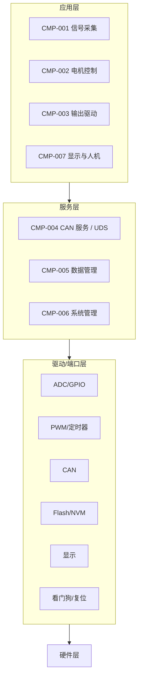
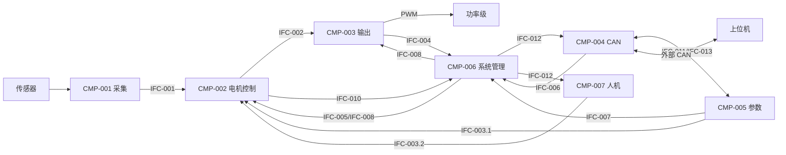
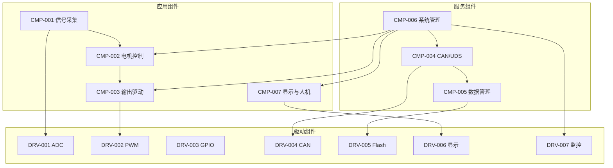
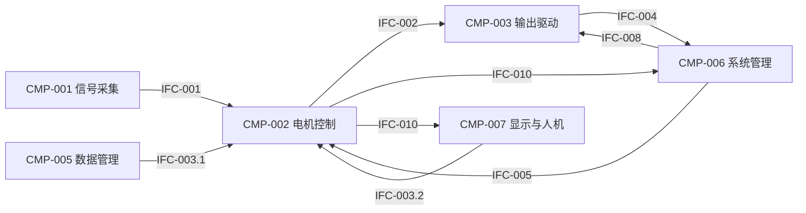
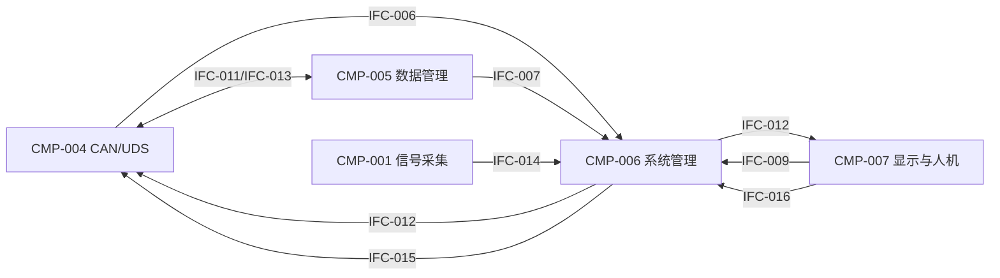
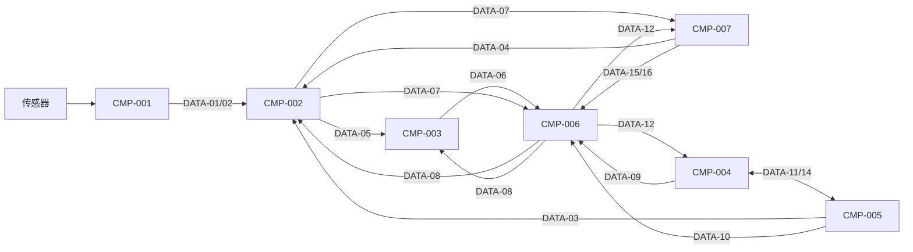
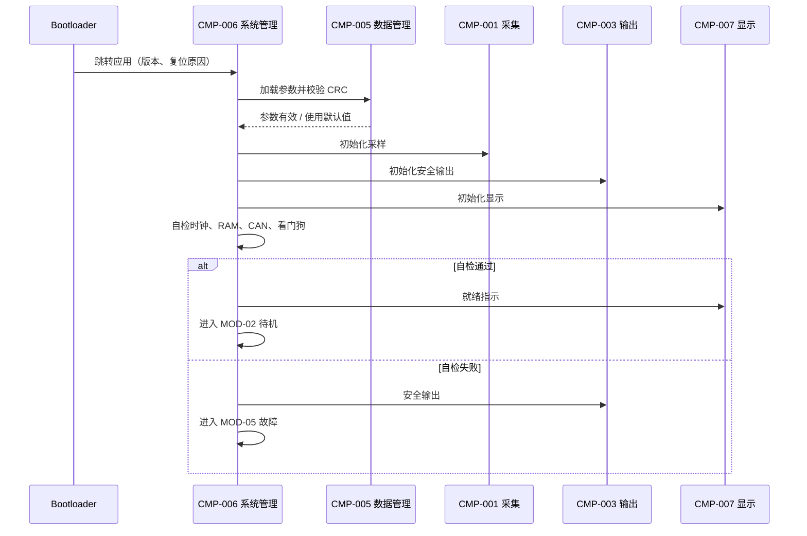
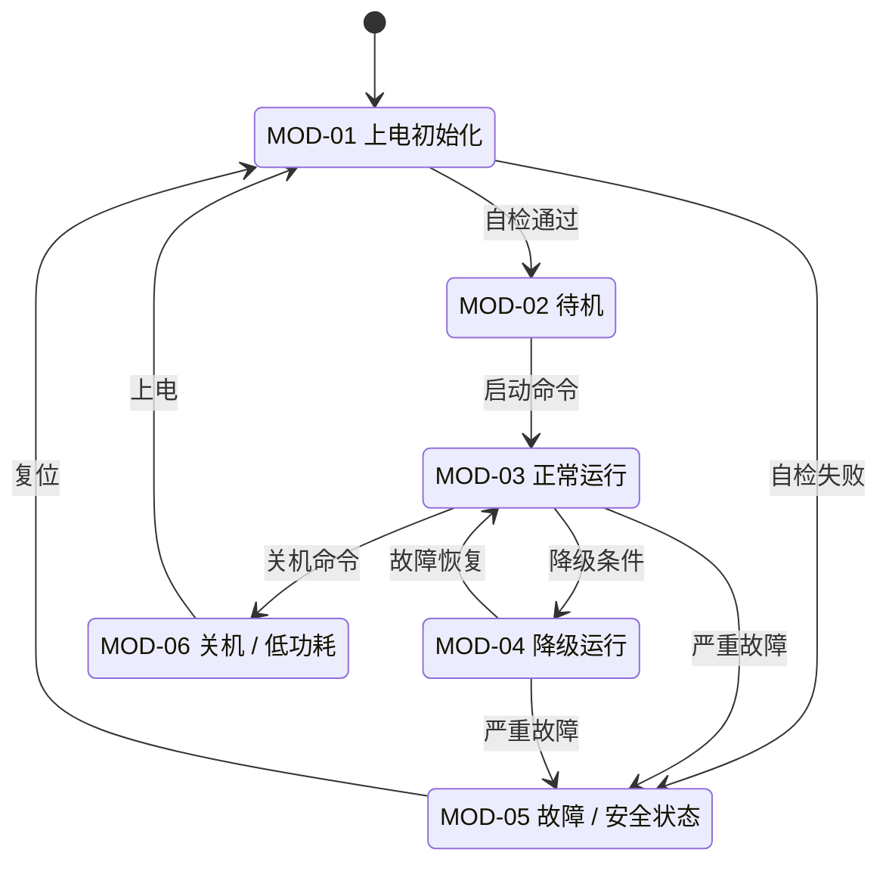
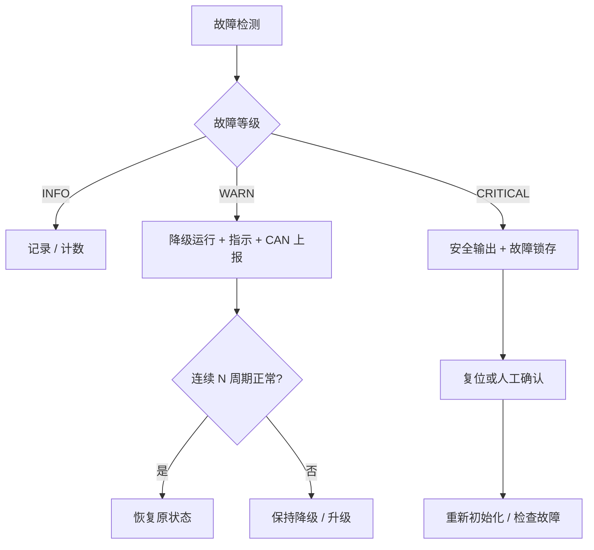

# SWE.2 --- Software Architectural Design

软件架构设计说明书

> 文档编号：ARC-SWE2-DEMO-r1
> 项目名称：STM32G474 三相电机控制器（示例项目）
> 软件名称/版本：MotorCtrl 应用软件 / r1
> 文档版本：r1
> 状态：草稿（示例）
> 编制日期：2026-11-25
> 编制/评审/批准：示例项目组 / 待评审 / 待批准

> **示例说明**：本文件是 `aspice-docs-from-gpt` 的 SWE.2 模板填写示例，内容取自 `aspice-docs-demo` 的软件架构设计。组件、接口、数据、任务、模式和需求 ID 沿用 demo，以便与 SWE.1 和 SWE.3 连续追溯。

---

## 修订记录

| 版本 | 状态 | 变更内容 | 变更日期 | 更改人 | 批准人 |
| --- | --- | --- | --- | --- | --- |
| r1 | 草稿（示例） | 按新模板结构填充电机控制器架构示例 | 2026-11-25 | 示例项目组 | 待批准 |

---

## 1. 文档概述（Document Overview）

### 1.1 文档目的

本文档把 SWE.1 软件需求转化为可实现的软件架构，作为软件详细设计、集成验证和变更影响分析的共同基线。文档回答五个问题：

1. 软件由哪些组件构成，每个组件承担什么职责；
2. 软件需求如何分配到这些组件；
3. 组件之间通过什么接口和数据进行交互；
4. 软件在运行时如何执行、协作并响应外部事件；
5. 当前架构为什么可行，如何证明它满足需求和设计约束。

本文档用于 SWE.3 详细设计、SWE.4～SWE.6 验证策划、变更影响分析和架构评审。本文只定义到组件、组件间接口、架构级数据和执行模型；组件内部的单元、函数、变量和算法在 SWE.3 中展开。

### 1.2 文档范围

| 项目 | 内容 |
| --- | --- |
| 产品形态 | 嵌入式三相电机控制器（STM32G474 + FreeRTOS） |
| 软件范围 | 应用组件 CMP-001～CMP-007，以及驱动/端口层 DRV-001～DRV-007 |
| 需求基线 | SWE.1 软件需求规格说明书 r1 |
| 文档版本 | r1 草稿（示例） |
| 适用阶段 | SWE.2 架构设计；作为 SWE.3 详细设计的输入；支撑 SWE.4～SWE.6 验证策划 |
| 不覆盖 | Bootloader 内部实现、硬件电路与 HSI（SYS.3）、函数级详细设计（SWE.3）、测试用例（SWE.4～SWE.6）、生产与报废要求 |

**与 SWE.3 的边界。** 本文定义组件、职责、组件间接口、架构级数据和执行模型；SWE.3 定义组件内部软件单元、函数、内部数据结构和算法。

| SWE.2 软件架构设计（本文） | SWE.3 软件详细设计 |
| --- | --- |
| 定义软件组件 | 定义组件内部软件单元 |
| 定义组件职责 | 定义函数职责和内部逻辑 |
| 定义组件间接口 | 定义函数参数、返回值和详细约束 |
| 定义架构级数据 | 定义内部变量和数据结构细节 |
| 定义任务执行模型 | 定义任务内部执行流程 |
| 定义组件运行行为 | 定义具体算法和状态处理逻辑 |

例如，本文说明 CMP-002 由 TASK-01 MotorTask 以 10 ms 周期驱动、如何与 CMP-004/CMP-006 交互、故障时如何请求安全输出；但不描述 Clarke/Park 变换、PI 调节器和 SVPWM 的内部计算过程，这些属于 SWE.3。

### 1.3 术语与缩略语

| 术语/缩写 | 说明 |
| --- | --- |
| Component | 逻辑功能单元，不等同于 RTOS 任务；本文用 CMP-xxx 标识 |
| Port/Driver | 封装 MCU 外设和寄存器访问的驱动/端口层；本文用 DRV-xxx 标识 |
| IFC | 组件间架构级接口标识 |
| DATA | 架构级共享数据对象标识 |
| Task/ISR | RTOS 任务/中断服务程序，是执行上下文，不是组件 |
| Seqlock | 通过序号检测读写冲突的无锁快照机制 |
| WCET | Worst-Case Execution Time，最坏执行时间 |
| 单写者 | 每个架构级数据对象只有一个写入上下文 |
| 只读快照 | 读者通过接口获取数据副本，不得修改提供者状态 |
| CMP/DRV | 应用组件/驱动组件前缀 |
| MOD/TR/UC | 运行模式/模式转换/用例场景 |

### 1.4 参考资料

| 编号 | 文件/资料名称 | 版本/来源 | 用途 |
| --- | --- | --- | --- |
| REF-001 | SWE.1 软件需求规格说明书 | r1 | 架构输入 |
| REF-002 | SYS.3 系统架构与 HSI | 当前基线 | 软件位置、硬件软件边界 |
| REF-003 | ICD-CAN CAN 通信矩阵与接口控制文档 | 当前基线 | 外部通信约束 |
| REF-004 | STM32G474 数据手册与参考手册 | 当前版本 | MCU 资源、外设和电气约束 |
| REF-005 | FreeRTOS 10.3.1 文档 | 当前版本 | 任务、队列和调度约束 |
| REF-006 | 软件开发规范 SW-CS | 当前版本 | 命名、编码和静态检查 |
| REF-007 | Automotive SPICE 4.1 | 4.1 | SWE.2 过程结果和基本实践 |

## 2. 架构设计依据与约束（Architecture Design Basis and Constraints）

### 2.1 软件需求输入

- SWE.1 文档编号/版本/基线：SRS-SWE1-DEMO-r1。
- 适用需求范围：43 条功能需求、16 条接口需求、33 条质量需求、13 条平台约束和 5 条假设。
- 未纳入本次架构设计的需求及原因：无功能需求被排除；Bootloader 内部刷写、硬件电路、机械/结构设计不属于软件架构范围。

| 需求组 | 需求 ID | 架构输入 |
| --- | --- | --- |
| 启动与系统管理 | FR-001、FR-003～FR-007 | 自检、就绪、复位原因、升级交接、状态维护 |
| 信号采集与监测 | FR-010～FR-015 | 1 ms 采样、有效性、角度/转速、标定 |
| 电机控制与输出 | FR-020～FR-025 | 10 ms 闭环、启停、设定值、限幅、状态发布 |
| 通信与诊断 | FR-030、FR-032～FR-037 | CAN、超时、无效帧、bus-off、UDS |
| 参数与数据管理 | FR-002、FR-031、FR-070～FR-072 | 参数加载、双区、CRC、回滚、版本 |
| 故障与安全 | FR-040、FR-042～FR-046 | 故障检测、分级、锁存、安全输出 |
| 人机交互 | FR-041、FR-050～FR-053 | 显示、按键、LED、本地设定 |
| 维护与升级 | FR-006、FR-060、FR-061 | 版本、日志、Bootloader 交接 |
| 性能/资源 | NFR-P-01～NFR-P-07、NFR-R-01～NFR-R-05 | 周期、延迟、CPU、Flash、RAM、栈、NVM |
| 可靠/安全/维护 | NFR-A、NFR-S、NFR-M | 看门狗、恢复、安全输出、诊断、可测试性 |

不复制需求正文，使用需求 ID 引用。需求变更或未决事项以 SWE.1 的 Q-01～Q-05 为准。

### 2.2 软件功能与设计范围

| 功能域/范围 | 架构设计范围 | 说明 |
| --- | --- | --- |
| 启动与系统管理 | 包含 | CMP-006 统一模式、自检、故障聚合和看门狗监督 |
| 信号采集与运行监测 | 包含 | CMP-001 负责采样、转换、有效性和时间戳 |
| 电机控制与输出 | 包含 | CMP-002 控制计算，CMP-003 输出仲裁和安全关断 |
| 通信与诊断 | 包含 | CMP-004 负责 CAN/UDS，CMP-005 提供 DID 数据 |
| 参数与数据管理 | 包含 | CMP-005 负责加载、校验、双区写入和回滚 |
| 故障与安全 | 包含 | 故障就地检测，CMP-006 集中决策，CMP-003 执行安全输出 |
| 人机交互与指示 | 包含 | CMP-007 负责按键、显示、LED 和本地请求 |
| 维护与升级 | 应用侧包含 | 应用只负责升级请求、版本和共享标志；刷写由 Bootloader 负责 |
| Bootloader 内部刷写、硬件保护、机械结构 | 不包含 | 由系统/硬件/Bootloader 负责 |

### 2.3 硬件平台约束

| 约束项 | 具体内容 | 对架构的影响 |
| --- | --- | --- |
| MCU/内核 | STM32G474RET6，Cortex-M4F，170 MHz，单精度 FPU | 单核、资源受限；控制计算需在 10 ms 内完成 |
| RAM/Flash | 512 KB Flash、128 KB SRAM；应用镜像 ≤256 KB、运行 RAM ≤64 KB | 代码、常量、栈、队列必须静态预算 |
| ADC | ADC1/ADC2，12 位，1 ms 触发，DMA 搬运 | 采样与 10 ms 控制解耦；使用双缓冲 |
| PWM | HRTIM，20 kHz，三相互补，死区由硬件保证 | 输出更新与 PWM 同步；安全关断由 CMP-003 和硬件保证 |
| CAN | FDCAN1，经典 CAN 500 kbit/s，11 位 ID，8 字节 | 报文长度和总线负载受限 |
| GPIO | 按键、指示灯、使能、故障输入 | 去抖和失效安全由 CMP-007/CMP-003 处理 |
| DMA | ADC1/ADC2、SPI | 降低中断负载；采样和显示使用 DMA |
| NVM | 内部 Flash 参数区 2×2 KB | 双区备份、CRC、回滚由 CMP-005 负责 |
| 调试/跟踪 | SWD、UART、GPIO 测量点 | 支撑时序、资源和故障注入验证 |

引脚、电气特性、时序参数和硬件保护电路属于 SYS.3/HSI 与硬件设计文档，本文只引用对软件架构有约束的部分。

### 2.4 软件运行环境

| 项目 | 选型/配置 | 对架构的影响 |
| --- | --- | --- |
| 运行方式 | FreeRTOS 10.3.1，抢占式固定优先级，1 kHz tick | 任务周期、优先级和栈预算需确定 |
| OS/版本 | FreeRTOS 10.3.1；静态分配，关闭同优先级时间片 | 运行期无动态内存；队列深度编译期固定 |
| 编译器/工具链 | GNU Arm Embedded 10.3，C11，-O2 | 代码尺寸和 WCET 以该工具链为准 |
| 驱动/HAL | STM32CubeG4 HAL 1.27.1；关键路径可用 LL | 硬件访问封装在 DRV 层 |
| 启动结构 | Bootloader 24 KB 独立分区，应用入口独立 | 应用不实现刷写；升级由 Bootloader 执行 |
| 显示 | 128×64 OLED，SPI，20 ms 刷新 | DisplayTask 低优先级，显示不得阻塞控制 |
| 参数存储 | 内部 Flash 参数区 2×2 KB 双区 | 写入需回读校验和掉电回滚 |
| 看门狗 | IWDG 100 ms | SystemTask 统一喂狗；关键任务失活停止刷新 |

| 编号 | 外部实体 | 类型 | 交互内容 | 责任边界 |
| --- | --- | --- | --- | --- |
| EXT-01 | 上位机/诊断工具 | 系统 | CAN 报文、UDS 请求、配置和状态 | 协议由 ICD 定义；软件负责响应和超时 |
| EXT-02 | 传感器 | 硬件 | 电流、电压、温度、位置/转速 | 传感器精度和电气保护由硬件负责 |
| EXT-03 | 功率级/电机 | 硬件 | PWM、使能、故障反馈 | 软件只保证输出契约和安全关断 |
| EXT-04 | 显示与按键 | 硬件 | 显示内容、按键事件、指示灯 | 显示失效不得影响控制 |
| EXT-05 | 非易失存储 | 硬件 | 参数、版本、故障记录 | 软件负责数据完整性和掉电保护 |
| EXT-06 | Bootloader | 软件 | 跳转、版本、共享标志、复位 | 刷写算法和回滚由 Bootloader 负责 |
| EXT-07 | 调试工具 | 工具 | SWD、UART、GPIO 时间戳 | 生产件关闭或保护调试口 |
| EXT-08 | 电源/复位/看门狗 | 硬件 | 供电、复位原因、看门狗 | 软件读取复位原因并记录 |

### 2.5 架构设计原则与约束

| 编号 | 原则 | 落实方式 | 检查点 |
| --- | --- | --- | --- |
| P-01 | 分层单向依赖 | 应用→服务→驱动→硬件；下层不反向调用上层 | 4.3 依赖表 |
| P-02 | 组件按职责划分，不按任务划分 | 组件是逻辑功能单元；任务只是部署方式 | 6.1 任务映射 |
| P-03 | 接口显式化 | 组件间只通过 IFC 交互，不访问对方内部数据 | 5.1 接口表 |
| P-04 | 单一写者 | 每个架构级数据只有一个写入上下文 | 5.3 数据表 |
| P-05 | 状态集中决策 | 运行模式和故障等级由 CMP-006 统一决定 | 6.2/6.6 |
| P-06 | 故障就地检测、集中处理 | 检测靠近故障源；安全决策集中 | 6.6 故障表 |
| P-07 | 静态分配 | 启动时确定所有队列、缓冲区和栈 | 7.3 资源表 |
| P-08 | 硬件隔离 | 寄存器访问只出现在驱动/端口层 | 3.2 分层表 |
| P-09 | 无同步调用环 | 状态通过只读快照发布，事件通过队列解耦 | 4.3 依赖分析 |
| P-10 | 架构级数据最小化 | 只登记跨组件、需要共同理解的数据对象 | 5.3 数据准则 |

**主要约束。** 单 MCU、无外部应用处理器；应用镜像 ≤256 KB、RAM ≤64 KB；控制周期 10 ms；PWM 20 kHz；经典 CAN 500 kbit/s；运行期禁止动态内存；Bootloader 独立，应用不修改自身 Flash；无完整 MPU 分区隔离，仅栈保护和看门狗。假设传感器输出在量程内、供电稳定、CAN 矩阵在基线内、Bootloader 版本兼容、硬件引脚与 ICD 一致。

## 3. 软件架构概述（Software Architecture Overview）

### 3.1 架构总体描述

本架构采用“两条链路 + 一个中心”的组织方式：

1. **快速控制链路**：ADC 以 1 ms 采样，CMP-001 在 MotorTask 中转换成工程值；CMP-002 以 10 ms 周期计算控制量；CMP-003 完成正常/安全仲裁后更新 PWM。该链路不经过 CAN、Flash 或显示，避免管理活动干扰控制时序。
2. **管理与通信链路**：CMP-004 负责 CAN/UDS，CMP-005 负责参数和 NVM，CMP-007 负责人机；三者通过 CMP-006 发布的系统状态和各自的状态接口协作。
3. **一个中心**：CMP-006 统一维护系统模式、故障等级和安全请求；其他组件只检测和上报，不各自决定系统级安全状态。

### 3.2 架构分层与组织

| 层/区域 | 职责 | 包含组件 | 允许依赖 | 禁止依赖/约束 |
| --- | --- | --- | --- | --- |
| 应用层 | 业务功能、控制策略、人机交互 | CMP-001、CMP-002、CMP-003、CMP-007 | 服务层接口；本组件专属实时 I/O 驱动 | 直接访问 CAN/Flash 驱动；访问其他组件内部数据 |
| 服务层 | 通信、参数、状态与故障管理 | CMP-004、CMP-005、CMP-006 | 驱动/端口层 | 反向调用应用层业务函数 |
| 驱动/端口层 | 外设初始化、寄存器访问、数据搬运 | DRV-001～DRV-007 | MCU HAL/LL、寄存器 | 调用服务层或应用层 |
| 硬件层 | MCU、外设、功率级、传感器、存储 | — | — | 物理实现 |

**分层规则。** 上层可以调用下层提供的接口；下层不得同步调用上层。CMP-006 通过只读状态快照读取应用组件状态，这是数据依赖，不是反向调用。CMP-001、CMP-003、CMP-007 可以直接调用各自专属的 ADC、PWM、GPIO、显示驱动，以避免服务层转发带来抖动；这是显式允许的例外。CAN 和 Flash 只能通过 CMP-004、CMP-005 访问。驱动层不得包含业务判断。

### 3.3 架构设计原则

| 原则 ID | 原则 | 具体约束 | 检查方式 |
| --- | --- | --- | --- |
| ARC-PR-001 | 依赖方向 | 应用→服务→驱动；下层不反向调用上层 | 依赖矩阵/静态检查 |
| ARC-PR-002 | 职责内聚 | 一个组件只承担一组内聚职责，能用一句话说明 | 4.2 职责评审 |
| ARC-PR-003 | 接口隔离 | 组件间只通过 IFC 交互，不共享可写全局变量 | 5.1/5.4 检查 |
| ARC-PR-004 | 单一写者 | 每个 DATA 只有一个写者，读者使用快照 | 5.3 所有权检查 |
| ARC-PR-005 | 安全集中 | 系统模式、故障等级和安全请求由 CMP-006 决策 | 6.2/6.6 评审 |
| ARC-PR-006 | 静态分配 | 队列、缓冲区和栈在编译期确定 | 链接 map/代码检查 |
| ARC-PR-007 | 硬件隔离 | 寄存器访问只在 DRV 层 | 符号/分层检查 |
| ARC-PR-008 | 可测试性 | 关键接口可注入、状态可观测 | 测试注入点评审 |

### 3.4 架构整体关系

图中箭头表示数据/调用依赖，不表示所有接口都是同步调用。状态通过只读快照发布，事件通过固定深度队列解耦；详细接口定义见第 5 章，组件级依赖见 4.3。

## 4. 软件组件架构（Software Component Architecture）

### 4.1 组件分解与划分

| 组件 ID | 组件名称 | 所属层/区域 | 组件类型 | 划分理由 |
| --- | --- | --- | --- | --- |
| CMP-001 | 信号采集 | 应用 | 实时 I/O | 采样、转换、有效性判断内聚；与控制算法解耦 |
| CMP-002 | 电机控制 | 应用 | 业务 | 控制律独立于驱动和通信；可单独测试 |
| CMP-003 | 输出驱动 | 应用 | 实时 I/O | 正常/安全输出仲裁和 PWM 更新集中 |
| CMP-004 | CAN 服务/UDS | 服务 | 通信服务 | 协议变化隔离；应用不直接访问 CAN |
| CMP-005 | 数据管理 | 服务 | 存储服务 | 参数完整性和 NVM 管理集中 |
| CMP-006 | 系统管理 | 服务 | 状态/安全服务 | 模式、故障和安全决策集中 |
| CMP-007 | 显示与人机 | 应用 | 人机 | 人机交互独立；显示失效不影响控制 |
| DRV-001 | ADC 驱动 | 驱动/端口 | 驱动 | 触发采样、DMA 搬运、提供原始值 |
| DRV-002 | PWM 驱动 | 驱动/端口 | 驱动 | 更新占空比、使能、故障关断 |
| DRV-003 | GPIO 驱动 | 驱动/端口 | 驱动 | 按键、指示灯、使能、故障输入 |
| DRV-004 | CAN 驱动 | 驱动/端口 | 驱动 | 报文收发、过滤器、中断和总线状态 |
| DRV-005 | Flash 驱动 | 驱动/端口 | 驱动 | 参数区读写、擦除、校验 |
| DRV-006 | 显示驱动 | 驱动/端口 | 驱动 | OLED 初始化、刷屏、背光/对比度 |
| DRV-007 | 系统监控驱动 | 驱动/端口 | 驱动 | 看门狗、复位原因、时钟/电源状态 |

### 4.2 组件职责与边界

| 组件 ID | 主要职责 | 输入 | 输出 | 不负责的事项 |
| --- | --- | --- | --- | --- |
| CMP-001 | 1 ms 采样触发与 DMA 搬运；原始码值转工程值；量程、断线、超时判断；采样时间戳；发布 signal_sample_t、signal_health_t | ADC/GPIO | IFC-001、IFC-014 | 控制算法；故障等级判定；PWM 输出；CAN 上报；参数存储 |
| CMP-002 | 读取设定值、参数和安全请求；执行闭环控制；积分抗饱和；输出限幅；使能/停止序列；发布 motor_status_t | IFC-001、IFC-003.1、IFC-003.2、IFC-005 | IFC-002、IFC-010 | 采样驱动；PWM 寄存器；故障锁存；CAN/UDS；显示 |
| CMP-003 | 正常输出与安全输出仲裁；PWM 占空比/使能更新；饱和、驱动故障、输出超时检测；发布 output_status_t | IFC-002、IFC-008 | IFC-004、PWM/EN | 控制律；模式决策；故障等级；CAN/UDS |
| CMP-004 | FDCAN 收发；报文过滤/路由；信号打包/解包；UDS 会话、DID、DTC、例程；总线关闭恢复；通信超时监测；发布 com_status_t | CAN 帧、IFC-012 | IFC-006、IFC-011、IFC-013、IFC-015 | 参数存储；故障决策；电机控制；显示 |
| CMP-005 | 参数加载、CRC/版本校验；默认参数回退；双区写入、回读、切换；DID 数据；NVM 布局；发布 param_status_t | IFC-011、IFC-013 | IFC-003.1、IFC-007、IFC-013 | UDS 协议；CAN 驱动；控制算法；故障等级 |
| CMP-006 | 系统模式状态机；故障检测聚合/分级；安全请求；看门狗监督；复位原因；发布 system_state_t | IFC-004、IFC-006、IFC-007、IFC-009、IFC-010、IFC-014、IFC-016 | IFC-005、IFC-008、IFC-012、IFC-015 | 传感器转换；控制计算；PWM 输出；CAN 协议；参数存储 |
| CMP-007 | 按键扫描/去抖；显示页面与指示；本地设定/使能；模式请求；发布 hmi_request_t、display_health_t | IFC-010、IFC-012 | IFC-003.2、IFC-009、IFC-016 | 系统模式决策；故障检测；电机控制；CAN/UDS；参数存储 |

**关键边界。** CMP-002 计算“应该输出多少”，CMP-003 决定“当前是否允许输出、正常值还是安全值”，并负责最终写 PWM；CMP-006 决定系统模式和故障等级；CMP-005 只保证参数数据的完整性、版本和存储，不判断系统是否安全；UDS 是 CMP-004 内部的协议子功能，DID 数据由 CMP-005 提供；CMP-007 只负责把系统状态映射为页面和指示。

### 4.3 组件依赖关系

| 依赖 ID | 提供方组件 | 使用方组件 | 依赖内容 | 依赖方向/约束 |
| --- | --- | --- | --- | --- |
| IFC-001 | CMP-001 | CMP-002 | signal_sample_t | 周期数据；MotorTask 读取 |
| IFC-002 | CMP-002 | CMP-003 | control_output_t | 周期数据；MotorTask |
| IFC-003.1 | CMP-005 | CMP-002 | motor_param_t | 初始化/参数变更；安全默认参数 |
| IFC-003.2 | CMP-007 | CMP-002 | motor_setpoint_t | 周期数据；MotorTask 读取 |
| IFC-004 | CMP-003 | CMP-006 | output_status_t | 周期数据；SystemTask 读取 |
| IFC-005 | CMP-006 | CMP-002 | safety_request_t | 周期数据；MotorTask 读取 |
| IFC-006 | CMP-004 | CMP-006 | com_status_t | 周期数据；SystemTask 读取 |
| IFC-007 | CMP-005 | CMP-006 | param_status_t | 周期数据；SystemTask 读取 |
| IFC-008 | CMP-006 | CMP-003 | safety_request_t | 周期数据/事件；MotorTask 读取 |
| IFC-009 | CMP-007 | CMP-006 | hmi_request_t | 事件队列；DisplayTask 生产，SystemTask 消费 |
| IFC-010 | CMP-002 | CMP-006、CMP-007 | motor_status_t | 周期数据；SystemTask/DisplayTask 读取 |
| IFC-011 | CMP-004 | CMP-005 | param_write_req_t | 同步调用；CanTask |
| IFC-012 | CMP-006 | CMP-004、CMP-007 | system_state_t | 周期数据；CanTask/DisplayTask 读取 |
| IFC-013 | CMP-004 | CMP-005 | did_value_t | 同步调用；CanTask |
| IFC-014 | CMP-001 | CMP-006 | signal_health_t | 周期数据；SystemTask 读取 |
| IFC-015 | CMP-006 | CMP-004 | can_message_t | 同步调用；SystemTask |
| IFC-016 | CMP-007 | CMP-006 | display_health_t | 周期数据；SystemTask 读取 |

**依赖规则。** 组件之间不得共享可写全局变量；状态接口是只读快照；同步调用只允许发生在任务上下文，ISR 只入队或置标志；不存在同步调用环；应用层不得直接访问 DRV-004（CAN）和 DRV-005（Flash），只能经 CMP-004/CMP-005。

### 4.4 软件需求分配

| 软件需求 ID/组 | 需求摘要 | 责任组件 | 协作组件 | 分配说明 |
| --- | --- | --- | --- | --- |
| FR-001、FR-003～FR-007 | 自检、就绪、复位、升级、状态、统计 | CMP-006 | CMP-005、CMP-001、CMP-003、CMP-007 | 系统级自检和模式由 CMP-006 统一判定 |
| FR-002、FR-031、FR-070～FR-072 | 参数加载、写入、版本、掉电保护 | CMP-005 | CMP-002、CMP-004、CMP-006 | 参数完整性属于数据管理；控制只消费校验后的参数 |
| FR-010～FR-015 | 采样、有效性、角度/转速、标定 | CMP-001 | CMP-002、CMP-005、CMP-006 | 采样和有效性内聚；标定数据由 CMP-005 提供 |
| FR-020～FR-025 | 闭环控制、启停、设定值、限幅、状态 | CMP-002 | CMP-001、CMP-003、CMP-005、CMP-006、CMP-007 | 控制律独立；输出仲裁和参数/设定值分离 |
| FR-030、FR-032～FR-037 | CAN 收发、超时、校验、bus-off、UDS | CMP-004 | CMP-005、CMP-006 | CAN/UDS 协议集中；应用不直接访问 CAN |
| FR-040、FR-042～FR-046 | 故障检测、分级、锁存、安全输出 | CMP-006 | CMP-001、CMP-002、CMP-003、CMP-004、CMP-007 | 检测就地、决策集中、安全动作在 CMP-003 |
| FR-041、FR-050～FR-053 | 显示、按键、LED、本地设定 | CMP-007 | CMP-002、CMP-006 | 人机交互独立；显示失效不影响控制 |
| FR-060、FR-061 | 版本、日志、Bootloader 交接 | CMP-006 | CMP-004、CMP-005 | 版本和事件由 CMP-006 汇总，DID 由 CMP-004/005 提供 |
| NFR-P-01～NFR-P-07 | 周期、延迟、抖动、启动、通信、总线负载、显示 | TASK-01～04、ISR-01～03 | 全部组件 | 由任务周期、优先级、WCET 和接口时序共同保证 |
| NFR-R-01～NFR-R-05 | Flash、RAM、CPU、栈、NVM 寿命 | 全部组件 | DRV 层 | 由静态分配、代码尺寸和栈预算保证 |
| NFR-A-01～NFR-A-08 | 看门狗、复位、恢复、长运行、掉电、栈保护 | CMP-006 | CMP-003、CMP-004、CMP-005、CMP-007 | 安全监督和恢复策略集中在 CMP-006 |
| NFR-S-01～NFR-S-06 | 安全输出、使能条件、访问控制、调试保护 | CMP-006 | CMP-003、CMP-004、CMP-005 | 安全决策与执行分离 |
| NFR-M-01～NFR-M-07 | DID/DTC、日志、版本、参数更新、可测试性 | CMP-004 | CMP-005、CMP-006 | 诊断接口和数据源分离 |
| IFR-HW-001～007 | ADC、PWM、GPIO、SPI、Flash、看门狗、调试 | CMP-001/003/007 | DRV-001～007 | 硬件访问封装在驱动层 |
| IFR-COM-001～005 | CAN、UDS、bus-off | CMP-004 | CMP-005、CMP-006 | 协议和驱动分离 |
| IFR-HMI-001～003、IFR-SYS-001 | 显示、按键、LED、Bootloader 交接 | CMP-007 | CMP-006、CMP-005 | 人机和系统交接独立 |

> 上表按需求组覆盖 SWE.1 的全部需求范围；逐条 ID 的正式双向追溯见第 8 章。每个功能需求至少有一个主责组件；FR-040 由 CMP-006 负决策、CMP-003 负最终安全输出，职责分离是刻意的。

## 5. 接口与数据架构（Interface and Data Architecture）

### 5.1 组件接口定义

#### 5.1.1 外部软件接口

| 接口 ID | 接口名称 | 对端 | 方向 | 介质/协议 | 速率/周期 | 数据/内容 | 失效行为 | 责任组件 |
| --- | --- | --- | --- | --- | --- | --- | --- | --- |
| EXT-IF-01 | 传感器输入 | 传感器 | 输入 | ADC/GPIO | 1 ms 采样 | 电流、电压、温度、位置/转速 | 越界/断线置无效；连续失效上报 F-01/F-02 | CMP-001 |
| EXT-IF-02 | 功率级输出 | 功率级/电机 | 输出 | PWM/GPIO | 20 kHz；10 ms 更新 | 三相占空比、使能、故障关断 | 安全输出：PWM 关闭、EN 无效 | CMP-003 |
| EXT-IF-03 | CAN 总线 | 上位机/其他 ECU | 双向 | FDCAN，经典 CAN 500 kbit/s | 事件 + 周期 | 配置、状态、诊断、参数 | 超时/校验错计数；bus-off 自动恢复 | CMP-004 |
| EXT-IF-04 | 调试/诊断串口 | 调试工具 | 双向 | UART/SWD | 按需 | 日志、版本、复位原因、测量点 | 生产件关闭或保护 | CMP-006/CMP-005 |
| EXT-IF-05 | 非易失存储 | 内部 Flash | 双向 | Flash 擦写 | 启动/参数变更 | 参数、版本、故障记录 | CRC 失败用默认值；写入失败回滚 | CMP-005 |
| EXT-IF-06 | 显示与按键 | OLED/按键 | 双向 | SPI/GPIO | 显示 20 ms；按键 20 ms | 页面、指示、按键事件 | 显示失效上报 F-13；控制继续 | CMP-007 |
| EXT-IF-07 | Bootloader 交接 | Bootloader | 双向 | 共享 RAM + 复位 | 启动/升级 | 版本、升级标志、复位原因 | 版本不兼容进入安全状态并记录 | CMP-006/CMP-005 |
| EXT-IF-08 | 电源/复位/看门狗 | 硬件 | 输入/输出 | RCC/PWR/IWDG | 复位事件；100 ms 喂狗 | 复位原因、电压状态、喂狗 | 看门狗超时复位；复位原因记录 | CMP-006 |

#### 5.1.2 内部组件接口

| 接口 ID | 接口名称 | 提供组件 | 使用组件 | 接口类型 | 功能/语义 |
| --- | --- | --- | --- | --- | --- |
| IFC-001 | Acq_GetSample | CMP-001 | CMP-002 | 周期数据 | 采样工程值、有效性、时间戳 |
| IFC-002 | Ctrl_GetOutput | CMP-002 | CMP-003 | 周期数据 | 控制量、使能请求、限幅标志 |
| IFC-003.1 | Data_GetMotorParam | CMP-005 | CMP-002 | 参数读取 | 控制增益、限幅、保护阈值、参数序号 |
| IFC-003.2 | HMI_GetSetpoint | CMP-007 | CMP-002 | 周期数据 | 目标值、使能、来源、模式、超时 |
| IFC-004 | Out_GetStatus | CMP-003 | CMP-006 | 周期数据 | 实际占空比、饱和、驱动故障、时间戳 |
| IFC-005 | Sys_GetSafetyRequest | CMP-006 | CMP-002 | 周期数据 | 故障等级、降额系数、安全输出请求、原因 |
| IFC-006 | Can_GetStatus | CMP-004 | CMP-006 | 周期数据 | 总线状态、RX 超时、UDS 会话、错误计数 |
| IFC-007 | Data_GetStatus | CMP-005 | CMP-006 | 周期数据 | 参数有效位、来源、CRC、版本 |
| IFC-008 | Sys_GetSafetyRequest | CMP-006 | CMP-003 | 周期数据/事件 | 安全输出请求、原因 |
| IFC-009 | HMI_GetRequest | CMP-007 | CMP-006 | 事件队列 | 启动/停止/模式请求 |
| IFC-010 | Motor_GetStatus | CMP-002 | CMP-006、CMP-007 | 周期数据 | 电机状态、转速、电流、故障标志 |
| IFC-011 | Data_WriteParam | CMP-004 | CMP-005 | 同步调用 | 参数写入请求 |
| IFC-012 | Sys_GetState | CMP-006 | CMP-004、CMP-007 | 周期数据 | 系统模式、故障等级、降额 |
| IFC-013 | Data_GetDid | CMP-004 | CMP-005 | 同步调用 | DID 数据读取 |
| IFC-014 | Acq_GetHealth | CMP-001 | CMP-006 | 周期数据 | 传感器健康状态 |
| IFC-015 | Can_SendMessage | CMP-006 | CMP-004 | 同步调用 | 发送故障/状态报文 |
| IFC-016 | Display_GetHealth | CMP-007 | CMP-006 | 周期数据 | 显示健康状态 |

#### 5.1.3 接口契约示例 IFC-001

| 项目 | 内容 |
| --- | --- |
| 接口 ID/版本 | IFC-001/v1.0 |
| 名称 | Acq_GetSample |
| 提供者/使用者 | CMP-001/CMP-002 |
| 数据 | signal_sample_t（DATA-01） |
| 方向 | CMP-001 → CMP-002 |
| 更新/读取 | ADC ISR 1 ms 更新双缓冲；MotorTask 10 ms 读取 |
| 有效性 | valid 位 + 时间戳；超过 20 ms 未更新视为失效 |
| 一致性 | 双缓冲 + 序号；读者检测序号变化后重读一次 |
| 错误行为 | 使用上一次有效值并置 STALE；连续 3 次失效上报 F-02 |
| 调用上下文 | 只允许 MotorTask 读取；ISR 只写缓冲区 |

**接口通用规则。** 所有 IFC 定义提供者、使用者、数据、周期/触发、上下文、失效/默认行为；输入参数在接口层只读，输出在成功路径完整写入；错误语义使用状态位/错误码，不用 0 表示无效；接口 ID 和版本写入头文件，字段顺序、类型和大小变更必须走影响分析；周期接口最大数据年龄为 2 个周期，超时按失效处理。

### 5.2 接口交互关系

**控制链路。**

**管理与通信链路。**

**关键交互约束。** 状态通过提供者→使用者的只读快照发布；事件通过固定深度队列传递；同步调用只允许在任务上下文；CMP-006 与 CMP-002/CMP-003/CMP-004/CMP-007 之间的双向信息流通过快照和队列解耦，不形成同步调用环；调度和并发约束见 6.5。

### 5.3 架构数据定义

| 数据 ID | 数据名称 | 语义 | 数据类型/格式 | 单位/范围 | 生产组件 | 使用组件 | 更新特性 |
| --- | --- | --- | --- | --- | --- | --- | --- |
| DATA-01 | signal_sample_t | 工程值、原始值、有效位、时间戳 | 结构体 | 按字段 | CMP-001 | CMP-002 | 周期更新；保留上一有效值 |
| DATA-02 | signal_health_t | 传感器状态、失效计数、最近故障 | 结构体 | 按字段 | CMP-001 | CMP-006 | 周期更新 |
| DATA-03 | motor_param_t | Kp、Ki、限幅、偏置、CRC | 结构体 | 按字段 | CMP-005 | CMP-002 | 启动加载；参数变更时切换 |
| DATA-04 | motor_setpoint_t | 目标值、转矩限制、使能、来源 | 结构体 | 按字段 | CMP-007 | CMP-002 | 周期更新 |
| DATA-05 | control_output_t | 控制量、使能、限幅标志、时间戳 | 16 B | 按字段 | CMP-002 | CMP-003 | 周期更新 |
| DATA-06 | output_status_t | 实际占空比、饱和、驱动故障、时间戳 | 16 B | 按字段 | CMP-003 | CMP-006 | 周期更新 |
| DATA-07 | motor_status_t | 状态、转速、电流、温度、故障标志 | 24 B | 按字段 | CMP-002 | CMP-006、CMP-007 | 周期更新；只读快照 |
| DATA-08 | safety_request_t | 故障等级、降额系数、安全输出请求、原因 | 8 B | 按字段 | CMP-006 | CMP-002、CMP-003 | 事件/周期更新；锁存到清除 |
| DATA-09 | com_status_t | 总线状态、RX 超时、UDS 会话、错误计数 | 16 B | 按字段 | CMP-004 | CMP-006 | 周期更新 |
| DATA-10 | param_status_t | 有效位、来源、CRC、版本 | 8 B | 按字段 | CMP-005 | CMP-006 | 启动/写入后更新 |
| DATA-11 | param_write_req_t | 索引、数据、长度、CRC | 24 B | 按字段 | CMP-004 | CMP-005 | 单次请求 |
| DATA-12 | system_state_t | 模式、故障等级、降额、运行时间 | 16 B | 按字段 | CMP-006 | CMP-004、CMP-007 | 模式变化或周期更新 |
| DATA-13 | can_message_t | ID、DLC、数据、时间戳、方向 | 16 B | 按字段 | CMP-004 | CMP-006 | 单次报文 |
| DATA-14 | did_value_t | DID、长度、数据、结果码 | 24 B | 按字段 | CMP-005 | CMP-004 | 单次请求 |
| DATA-15 | hmi_request_t | 请求类型、参数、时间戳 | 8 B | 按字段 | CMP-007 | CMP-006 | 单次事件 |
| DATA-16 | display_health_t | 显示状态、通信错误计数 | 8 B | 按字段 | CMP-007 | CMP-006 | 周期更新 |

**数据所有权规则。** 每个数据对象只有一个写者；读者只能通过接口获取快照，不得直接写；多字节数据在任务与中断之间传递时使用双缓冲、Seqlock 或短临界区；参数区是唯一允许“整块替换”的数据；safety_request_t 一旦置为严重故障，保持锁存直到复位或人工确认；数据对象大小和对齐在 SWE.3 中细化。

### 5.4 数据流与数据共享关系

**数据流规则。** 控制链数据只在 MotorTask 内消费；CAN/参数/显示数据不进入快速控制链；状态发布是周期末的单向快照；CMP-006 只读各组件状态，不直接修改其内部数据；CAN 和 Flash 的数据流只经过服务层；任何跨上下文共享都必须有明确写者、读者和同步方式，见 6.5。

## 6. 运行与行为架构（Runtime and Behavioral Architecture）

### 6.1 软件执行模型

| 执行实体 ID | 执行实体 | 周期/触发方式 | 优先级/中断级别 | 主要职责 | 关联组件 |
| --- | --- | --- | --- | --- | --- |
| ISR-01 | ADC 采样 | 1 ms | 0（最高） | 触发/搬运 ADC，写双缓冲 | CMP-001 |
| ISR-02 | CAN RX | 事件 | 1 | 收帧、入 RX 队列 | CMP-004 |
| ISR-03 | SysTick | 1 ms | 2 | RTOS tick、超时计数 | FreeRTOS |
| TASK-01 | MotorTask | 10 ms | 5 | 采集读取、控制、输出 | CMP-001、CMP-002、CMP-003 |
| TASK-02 | CanTask | 5 ms | 4 | CAN 解析、UDS、参数请求 | CMP-004、CMP-005 |
| TASK-03 | SystemTask | 10 ms | 3 | 模式、故障、看门狗、状态发布 | CMP-006、CMP-005 |
| TASK-04 | DisplayTask | 20 ms | 2 | 按键、显示、模式请求 | CMP-007 |
| IDLE | 空闲任务 | 空闲 | 0（最低） | 栈检查、诊断计数 | 全部 |

**调度策略。** 抢占式固定优先级；任务优先级按 FreeRTOS 规则（数值越大越高），中断优先级按 NVIC 规则（数值越小越高）；1 kHz tick；ISR 只做最小工作，重活交给任务；任务只在队列/信号量上做有限等待；控制任务不使用会阻塞的同步调用；参数写路径使用带优先级继承的互斥量；SystemTask 统一喂狗，只有所有任务存活计数在窗口内更新时才喂狗。

**任务与组件映射。** ISR-01 只写 CMP-001 缓冲区；ISR-02 只入队；MotorTask 调用 CMP-001、CMP-002、CMP-003；CanTask 调用 CMP-004 和 CMP-005 写路径；SystemTask 调用 CMP-006 并只读 CMP-005 和状态；DisplayTask 调用 CMP-007 并只读状态。

### 6.2 组件运行行为

| 模式 | 主要参与组件 | 运行时行为 | 输出状态 |
| --- | --- | --- | --- |
| MOD-01 上电初始化 | CMP-006、CMP-005、CMP-001、CMP-003、CMP-007 | CMP-006 协调自检、参数加载和外设初始化；CMP-005 校验参数；CMP-003 保持安全输出 | 关闭 |
| MOD-02 待机 | CMP-006、CMP-004、CMP-007 | CMP-006 监测启动命令和故障；CMP-004 保持通信；CMP-007 显示和本地操作 | 关闭 |
| MOD-03 正常运行 | CMP-001～CMP-007 | MotorTask 执行控制链；CanTask 处理通信；SystemTask 维护状态；DisplayTask 刷新显示 | 使能 |
| MOD-04 降级运行 | CMP-006、CMP-002、CMP-003、CMP-007 | CMP-006 发布降额系数和安全请求；CMP-002 限幅；CMP-003 受限输出；CMP-007 报警 | 受限 |
| MOD-05 故障/安全 | CMP-006、CMP-003、CMP-004、CMP-007 | CMP-006 锁存故障并请求安全输出；CMP-003 关闭 PWM/EN；CMP-004 上报；CMP-007 指示 | 安全关闭 |
| MOD-06 关机/低功耗 | CMP-006、CMP-005、CMP-003 | CMP-006 协调关机；CMP-005 保存状态；CMP-003 先关闭输出 | 关闭 |

CMP-001 在 ISR-01 中只写缓冲区，在 MotorTask 中完成转换和有效性判断；CMP-002 只在 MotorTask 中执行；CMP-003 在 MotorTask 中更新 PWM；CMP-004 在 CanTask 中解析协议，ISR-02 只入队；CMP-005 在初始化、CanTask 写入和 SystemTask 只读路径中运行；CMP-006 在 SystemTask 中执行模式、故障和看门狗逻辑；CMP-007 在 DisplayTask 中执行。

### 6.3 组件交互场景

| 场景 ID | 场景名称 | 触发条件 | 参与组件 | 主要交互 | 结束条件 |
| --- | --- | --- | --- | --- | --- |
| UC-01 | 上电启动与自检 | 上电/复位 | CMP-006、CMP-005、CMP-001、CMP-003、CMP-007 | 参数加载、外设初始化、自检、就绪/故障 | 进入 MOD-02 或 MOD-05 |
| UC-02 | 正常控制周期 | 10 ms 周期 | CMP-001、CMP-002、CMP-003、CMP-006 | 采样读取、闭环、限幅、输出仲裁、状态发布 | 周期结束 |
| UC-03 | CAN 通信与诊断 | CAN 帧/诊断请求 | CMP-004、CMP-005、CMP-006 | 解析、路由、UDS、状态上报 | 请求完成/周期结束 |
| UC-04 | 故障检测与安全输出 | 故障事件 | CMP-001、CMP-003、CMP-004、CMP-006、CMP-002、CMP-007 | 检测、聚合、决策、安全输出、上报 | 进入 MOD-05 并锁存 |
| UC-05 | 参数写入 | UDS 写入请求 | CMP-004、CMP-005、CMP-002、CMP-006 | 会话/安全、校验、双区写入、回读、切换 | 正/负响应 |
| UC-06 | 停止与关机 | 停止/关机命令 | CMP-007/CMP-004、CMP-006、CMP-002、CMP-003、CMP-005 | 停止控制、关闭输出、保存状态 | 进入 MOD-02 或 MOD-06 |

**场景时序预算。** 启动阶段 Bootloader 200 ms、参数 300 ms、外设 400 ms、自检 500 ms，合计 1.4 s ≤2 s；控制周期 MotorTask 3.0 ms 预算，CMP-002 约 1.70 ms；CAN 请求到响应约 7.2 ms ≤100 ms；故障到安全输出约 12 ms ≤20 ms；停止到输出关闭约 30 ms ≤50 ms。

### 6.4 状态与状态转换

| 状态机 ID | 所属对象/组件 | 状态 | 进入条件 | 状态行为 | 退出条件 |
| --- | --- | --- | --- | --- | --- |
| STM-01 | 系统/ CMP-006 | MOD-01～MOD-06 | 见 6.2 | 模式行为、组件协作 | 见 6.4 转换 |
| STM-02 | CMP-002 电机控制 | INIT、IDLE、RUN、DERATE、FAULT | 初始化、启动、故障 | 清零积分、闭环、降额、安全停止 | 复位/停止/故障清除 |
| STM-03 | CMP-004 CAN 服务 | INIT、ACTIVE、BUS_OFF、RECOVER | 初始化、bus-off、恢复计时 | 配置、收发、停止发送、恢复 | 恢复成功/失败 |
| STM-04 | CMP-005 数据管理 | INIT、VALID、DEFAULT、WRITE、ERROR | 加载、校验、写入、失败 | 读取双区、默认回退、写入回读、回滚 | 完成/失败/复位 |
| STM-05 | CMP-007 显示 | INIT、NORMAL、DEGRADED、FAULT | 初始化、系统状态 | 显示页面、报警、故障提示 | 状态恢复/复位 |

| 转换 ID | 从 | 到 | 触发 | 守卫 | 动作/时间 |
| --- | --- | --- | --- | --- | --- |
| TR-01 | MOD-01 | MOD-02 | 自检通过 | 参数有效；无严重故障 | 点亮就绪；允许通信和本地操作；≤500 ms |
| TR-02 | MOD-01 | MOD-05 | 自检失败 | 无 | 关闭输出；记录故障；≤500 ms |
| TR-03 | MOD-02 | MOD-03 | 启动命令 | 无严重故障；参数可用；模式允许；输出条件满足 | 按启动序列使能；≤50 ms |
| TR-04 | MOD-03 | MOD-04 | WARN 故障/资源受限 | 无 CRITICAL | 降额、限幅、指示、上报；≤100 ms |
| TR-05 | MOD-02/03/04 | MOD-05 | CRITICAL 故障 | 无 | 安全输出、锁存、记录、首帧上报；≤20 ms |
| TR-06 | MOD-05 | MOD-01 | 复位/人工确认 | 故障消失；确认有效 | 清除锁存；重新初始化 |
| TR-07 | MOD-03/04 | MOD-06 | 关机命令 | 无 CRITICAL 或已安全关闭 | 保存状态；关闭输出；≤200 ms |
| TR-08 | MOD-04 | MOD-03 | 警告故障清除 | 连续 5 个控制周期正常；无 CRITICAL | 恢复输出限值；≤100 ms |
| TR-09 | MOD-03/04 | MOD-02 | 停止命令 | 无 | 关闭输出；清零控制状态；≤50 ms |

> 内部组件状态必须与 SWE.1 的外部模式约束一致。CMP-002 的 RUN 内部可有 NORMAL/STOPPING 子状态，但不新增架构级模式；CMP-004/CMP-005 的状态用于故障隔离和恢复，不改变系统 MOD 定义。

### 6.5 并发与同步机制

| 资源/数据 | 访问者 | 并发风险 | 同步/保护机制 | 约束 |
| --- | --- | --- | --- | --- |
| ADC 双缓冲 | ISR-01 写；MotorTask 读 | 撕裂读 | 双缓冲 + 序号 | 序号变化重读一次 |
| CAN RX 队列 | ISR-02 写；CanTask 读 | 溢出 | 单生产者/单消费者环形队列 | 满时丢最旧并计数 |
| 参数影子区 | CanTask 写；MotorTask/SystemTask 读 | 半更新 | Seqlock + 短临界区 | 关闭中断 ≤50 µs |
| 系统状态快照 | SystemTask 写；CanTask/DisplayTask 读 | 不一致 | Seqlock | 最多重试 2 次 |
| 安全请求 | SystemTask 写；MotorTask 读 | 竞争 | 原子写 | 严重故障锁存；只读消费 |
| 故障标志 | ISR/SystemTask 写；SystemTask/CanTask 读 | 丢失 | 32 位原子操作 | 事件计数 + 周期扫描 |
| 显示帧缓冲 | DisplayTask 写/读 | 无跨上下文共享 | 单写者 | 不影响控制 |

| 临界区 | 保护对象 | 最长关闭中断 | 说明 |
| --- | --- | --- | --- |
| CR-01 | 参数区切换 | ≤10 µs | 只做指针/序号切换 |
| CR-02 | 故障标志更新 | ≤5 µs | 原子操作优先 |
| CR-03 | 系统状态发布 | ≤20 µs | 保证多字节一致 |
| CR-04 | CAN 队列索引 | ≤5 µs | 单生产者/单消费者仍需序号保护 |

**并发规则。** ISR 不得阻塞、动态分配或调用可能睡眠的服务；同一数据对象只有一个写者；临界区只做数据拷贝或指针切换；所有队列深度编译期确定；关闭中断总时长 ≤50 µs；任务栈使用高水位和填充图案检查，余量低于 30% 告警。

### 6.6 异常处理与恢复机制

| 异常 ID | 检测方 | 处理/决策方 | 受影响组件 | 处理协作 | 恢复条件 |
| --- | --- | --- | --- | --- | --- |
| F-01 | CMP-001 | CMP-006 | CMP-002、CMP-007 | 置无效、降额或停止；上报 | 连续 5 周期正常 |
| F-02 | CMP-001 | CMP-006 | CMP-002 | 使用上次有效值；随后降级 | 新数据到达并连续正常 |
| F-03 | 硬件/CMP-003 | CMP-006 | CMP-002、CMP-003 | PWM 关闭、锁存、记录 | 复位/人工确认 |
| F-04 | CMP-001/DRV-001 | CMP-006 | CMP-002、CMP-003 | PWM 关闭、锁存 | 复位/人工确认 |
| F-05 | CMP-001 | CMP-006 | CMP-002、CMP-003 | 降额；严重时停止 | 迟滞恢复/复位 |
| F-06 | CMP-004 | CMP-006 | CMP-004 | 停止发送、自动恢复 | 恢复成功 |
| F-07 | CMP-004 | CMP-006 | CMP-002、CMP-003 | 按模式保持安全输出或停止 | 收到有效帧 |
| F-08 | CMP-005 | CMP-006 | CMP-002 | 默认参数、记录 | 重新写入/维护 |
| F-09 | 内核/MPU | CMP-006 | 全部 | 复位 | 复位 |
| F-10 | DRV-007 | CMP-006 | 全部 | 复位、记录原因 | 复位 |
| F-11 | DRV-007 | CMP-006 | CMP-002、CMP-003 | 安全输出/复位 | 复位 |
| F-12 | CMP-003 | CMP-006 | CMP-002、CMP-003 | PWM 关闭、锁存 | 复位/人工确认 |
| F-13 | CMP-007 | CMP-006 | CMP-007 | 记录、LED 替代 | 自动恢复 |

**降级级别。** 正常：全额转矩/转速；降额：转矩 ≤50%、转速受限，警告故障；跛行：固定低速、低转矩，部分资源失效；安全停止：PWM 关闭、EN 无效，严重故障。**恢复原则：** 瞬时故障可自动恢复，但必须有连续正常周期计数和迟滞；严重故障必须锁存；复位后重新初始化，不得沿用故障前输出；安全输出不依赖软件任务继续运行。

## 7. 架构分析与设计决策（Architecture Analysis and Design Decisions）

### 7.1 需求覆盖分析

| 需求 ID/组 | 责任组件/接口 | 架构实现思路 | 覆盖状态 | 未覆盖原因/措施 |
| --- | --- | --- | --- | --- |
| FR-001、FR-003～FR-007 | CMP-006、CMP-005、CMP-001、CMP-003、CMP-007 | SystemTask 统一自检、模式、故障和状态；CMP-005 参数校验 | 完整 | — |
| FR-002、FR-031、FR-070～FR-072 | CMP-005、DRV-005 | 双区、CRC、回读、回滚；DID 由 CMP-004 转发 | 完整 | Q-02 待关闭 |
| FR-010～FR-015 | CMP-001、DRV-001/003 | ADC 双缓冲、有效性判断、时间戳、标定 | 完整 | Q-03 待关闭 |
| FR-020～FR-025 | CMP-002、CMP-003、CMP-005、CMP-007 | MotorTask 控制链；CMP-003 输出仲裁；参数/设定值分离 | 完整 | — |
| FR-030、FR-032～FR-037 | CMP-004、DRV-004、CMP-005 | CAN 服务集中；UDS/DID/DTC；bus-off 状态机 | 完整（有条件） | Q-01 待关闭 |
| FR-040、FR-042～FR-046 | CMP-006、CMP-001、CMP-002、CMP-003、CMP-004、CMP-007 | 检测就地、决策集中、安全输出在 CMP-003 | 完整 | — |
| FR-041、FR-050～FR-053 | CMP-007、DRV-003/006 | DisplayTask 人机；显示失效隔离 | 完整 | Q-03 显示时序待确认 |
| FR-060、FR-061 | CMP-006、CMP-004、CMP-005 | 版本/DID/日志；Bootloader 交接 | 完整 | Q-02 待关闭 |
| NFR-P-01～NFR-P-07 | TASK/ISR、全部组件 | 任务周期、WCET、接口时序和预算 | 完整 | 估算待实测 |
| NFR-R-01～NFR-R-05 | 全部组件、DRV 层 | 静态分配、代码尺寸、栈预算、NVM 策略 | 完整 | CPU 峰值风险 R-01 |
| NFR-A/S/M | CMP-006、CMP-003、CMP-004、CMP-005、CMP-007 | 看门狗、锁存、安全输出、诊断、可测试性 | 完整 | 见 7.5 风险 |

**覆盖结论。** 功能需求全部有主责组件和协作组件；没有“所有组件都负责”或“没有组件负责”的功能。FR-040 的检测、决策、执行分散在 CMP-001/CMP-006/CMP-003，是刻意的安全职责分离。Q-01/Q-02/Q-03 关闭前，通信、升级和采样相关覆盖为有条件完整。

### 7.2 架构合理性与可行性分析

**功能完整性。** 8 个功能域、43 条功能需求均有组件承载；7 个应用组件和 7 个驱动组件均有需求依据；无孤立组件；6 个模式、6 个关键场景均有落点。

**职责与耦合。** 控制链 CMP-001→CMP-002→CMP-003 单向；管理链 CMP-004/CMP-005/CMP-007→CMP-006 通过接口和快照协作；CMP-006 不反向调用应用业务函数；不存在同步调用环。组件之间不共享可写全局变量。

**可测试性。** IFC-001 可注入采样值和失效；IFC-014 可注入传感器健康；IFC-006 可注入 CAN 超时/bus-off；DATA-03 可注入参数损坏；EXT-IF-02 可测量 PWM 安全关断。观测点包括系统状态、故障计数、复位原因、栈高水位、CPU 负载 GPIO 和 CAN 错误计数。

**可移植性。** 应用组件不直接访问寄存器；ADC/PWM/CAN/Flash/显示/监控访问封装在 DRV-001～007；更换传感器、CAN 矩阵、显示屏或 MCU 时，主要影响驱动层和映射，不改变应用接口契约。

**可行性与代价。** 10 ms 控制 + 1 ms 采样 + 20 kHz PWM 在当前 MCU 上可行；代价是 FreeRTOS 约 3.5 KB RAM、任务栈约 7.2 KB、队列/缓冲约 2.8 KB，并需要处理并发和优先级反转。分层和接口化增加少量调用开销，但换来了硬件隔离和可测试性。

### 7.3 性能与资源分析

**任务利用率。**

| 执行实体 | C（ms） | T（ms） | U=C/T | 截止期 | 结果 |
| --- | --- | --- | --- | --- | --- |
| ISR-01/02/03 | 0.08 | 1 | 8% | 1 ms | 满足 |
| TASK-01 MotorTask | 3.0 | 10 | 30% | 10 ms | 满足 |
| TASK-02 CanTask | 0.6 | 5 | 12% | 5 ms | 满足 |
| TASK-03 SystemTask | 0.5 | 10 | 5% | 10 ms | 满足 |
| TASK-04 DisplayTask | 1.0 | 20 | 5% | 20 ms | 满足 |
| 合计 | — | — | 60% | 预算 70% | 余量 10% |

**响应时间。** MotorTask 3.24 ms ≤10 ms；CanTask 3.68 ms ≤5 ms；SystemTask 4.18 ms ≤10 ms；DisplayTask 5.18 ms ≤20 ms。端到端：传感器→PWM 13.2 ms ≤30 ms；故障→安全输出 12 ms ≤20 ms；CAN 请求→响应 7.2 ms ≤100 ms；上电→就绪 1.4 s ≤2 s。

**Flash 预算。** 应用逻辑 132 KB、服务与协议 38 KB、驱动/HAL/RTOS 42 KB、常量/默认参数 6 KB，合计 218 KB；预算 256 KB，余量 38 KB（14.8%）。Bootloader 24 KB 独立分区，不计入应用镜像。

**RAM 预算。** FreeRTOS 内核 3.5 KB、任务栈 7.2 KB、队列/缓冲 2.8 KB、驱动/HAL 4.0 KB、应用全局 14.0 KB、诊断/日志 4.0 KB，合计 35.5 KB；预算 64 KB，余量 28.5 KB（44.5%）。

**栈预算。** MotorTask 2048 B、CanTask 1536 B、SystemTask 1224 B、DisplayTask 1536 B、Idle/Timer 1024 B；实测高水位余量分别约 45.3%、44.0%、49.3%、38.8%、82.4%，均 ≥30%。

**CPU 负载。** 平均 60%，峰值 65%，预算 70%；峰值余量 5%，列为风险 R-01。若实测超过 70%，优先优化显示刷新和 CAN 解析，不通过降低控制周期来换取余量。

### 7.4 架构设计决策

| 决策 ID | 决策主题 | 候选方案 | 选择方案 | 选择理由 | 影响/代价 |
| --- | --- | --- | --- | --- | --- |
| ADR-01 | 调度方式 | 裸机超级循环/时间触发轮询/FreeRTOS | FreeRTOS 抢占式固定优先级 | 10 ms 控制、5 ms CAN、20 ms 显示需要确定响应；任务隔离便于测试 | 增加约 3.5 KB RAM 和 tick 开销；需处理并发 |
| ADR-02 | 架构风格 | 扁平模块/全部应用层/分层 | 应用/服务/驱动分层 | 硬件、协议、业务变化隔离；可移植性和可测试性更好 | 增加接口转发和一层调用开销 |
| ADR-03 | 组件划分 | 一个任务一个组件/按职责 | 按职责划分，组件不等于任务 | 同一组件可被多个上下文使用；任务调整不影响组件边界 | 需明确执行上下文和并发规则 |
| ADR-04 | 故障决策 | 各组件自行处理/集中决策 | CMP-006 集中决策 | 单一决策点，安全行为一致，避免遗漏和冲突 | CMP-006 是关键组件；用看门狗和冗余检查降低单点风险 |
| ADR-05 | CAN/Flash 访问 | 应用直接访问/服务层封装 | 通过 CMP-004/CMP-005 访问 | 协议/存储变化不影响控制；统一超时和错误处理 | 增加队列拷贝和一层调用 |
| ADR-06 | 状态共享 | 同步回调/组件互相调用/只读快照 | 只读快照 + 事件队列 | 避免同步调用环和优先级反转；读写解耦 | 需要 Seqlock/双缓冲和内存屏障 |
| ADR-07 | 内存 | 动态分配/静态分配 | 运行期静态分配 | 无碎片、行为确定、易验证 | 队列深度必须提前估算 |
| ADR-08 | 参数存储 | 单区覆盖/双区+CRC | 双区 + CRC + 回读 | 掉电/写入失败可回滚；满足 FR-031 | Flash 占用翻倍；写入时间增加 |
| ADR-09 | 升级 | 应用内 OTA/Bootloader | Bootloader 负责升级，应用只请求 | 刷写失败隔离；应用不修改自身 Flash | 需要共享标志和版本接口（Q-02） |
| ADR-10 | 控制周期 | 1 ms 控制/10 ms 控制 | 10 ms 控制 + 1 ms 采样 | 满足 NFR-P-01/02；CPU 余量更合理 | 控制带宽较低；高频扰动需在 SWE.3 处理 |

### 7.5 技术风险与限制

| 风险 ID | 风险描述 | 影响 | 可能性 | 缓解措施 | 状态 |
| --- | --- | --- | --- | --- | --- |
| R-01 | CPU 峰值余量仅 5% | 高 | 中 | 优化显示刷新/CAN 解析；实测跟踪；保留升级空间 | 开放 |
| R-02 | CAN 总线负载超 50% | 中 | 中 | 优化报文周期；冻结 ICD；总线负载测试 | 开放 |
| R-03 | 参数区擦写寿命不足 | 中 | 低 | 限制写入次数；磨损均衡；双区交替 | 开放 |
| R-04 | 传感器噪声导致误判 | 中 | 中 | 滤波、迟滞、连续周期确认 | 开放 |
| R-05 | Bootloader 版本/接口不兼容 | 高 | 低 | 版本握手；兼容矩阵；关闭 Q-02 | 开放 |
| R-06 | 显示驱动兼容性 | 低 | 低 | 驱动抽象；早期集成验证 | 开放 |

## 8. 架构追溯与评审（Architecture Traceability and Review）

### 8.1 软件需求与架构追溯

| 软件需求 ID/组 | 组件 ID | 接口/数据/行为设计 ID | 覆盖说明 |
| --- | --- | --- | --- |
| FR-001、FR-003～FR-007 | CMP-006、CMP-005、CMP-001、CMP-003、CMP-007 | MOD-01、TR-01/02、IFC-007/014/016、DATA-10/12/16 | 自检、就绪、复位、升级、状态、统计 |
| FR-002、FR-031、FR-070～FR-072 | CMP-005、CMP-002 | IFC-003.1/007/011/013、DATA-03/10/11/14、STM-04 | 参数加载、写入、版本、回滚 |
| FR-010～FR-015 | CMP-001、CMP-002 | IFC-001/014、DATA-01/02、UC-02 | 采样、有效性、角度/转速、标定 |
| FR-020～FR-025 | CMP-002、CMP-003、CMP-005、CMP-007 | IFC-002/003.2/005、DATA-04/05/08、UC-02、STM-02 | 控制、启停、设定值、限幅、状态 |
| FR-030、FR-032～FR-037 | CMP-004、CMP-005、CMP-006 | EXT-IF-03、IFC-006/011/012/013/015、DATA-09/11/13/14、STM-03 | CAN、UDS、超时、bus-off |
| FR-040、FR-042～FR-046 | CMP-006、CMP-001、CMP-002、CMP-003、CMP-004、CMP-007 | IFC-004/005/008/014、DATA-06/08、UC-04、STM-01/02 | 故障检测、分级、锁存、安全输出 |
| FR-041、FR-050～FR-053 | CMP-007、CMP-006、CMP-002 | IFC-003.2/009/010/012/016、DATA-04/07/12/15/16、STM-05 | 显示、按键、LED、本地设定 |
| FR-060、FR-061 | CMP-006、CMP-004、CMP-005 | EXT-IF-07、IFC-006/012/013/015 | 版本、日志、Bootloader 交接 |
| NFR-P-01～NFR-P-07 | TASK-01～04、ISR-01～03、全部组件 | 6.1 执行模型、7.3 时序分析 | 周期、延迟、抖动、启动、通信、总线负载、显示 |
| NFR-R-01～NFR-R-05 | 全部组件、DRV 层 | 7.3 资源分析、6.5 同步 | Flash、RAM、CPU、栈、NVM 寿命 |
| NFR-A-01～NFR-A-08 | CMP-006、CMP-003、CMP-004、CMP-005、CMP-007 | 6.6 异常处理、7.5 风险 | 看门狗、复位、恢复、长运行、掉电、栈保护 |
| NFR-S-01～NFR-S-06 | CMP-006、CMP-003、CMP-004、CMP-005 | IFC-005/008、6.6、7.5 | 安全输出、使能条件、访问控制、调试保护 |
| NFR-M-01～NFR-M-07 | CMP-004、CMP-005、CMP-006 | EXT-IF-04、IFC-006/007/013/015、7.3/7.5 | DID/DTC、日志、版本、参数更新、可测试性 |
| IFR-HW-001～007 | CMP-001/003/007、DRV-001～007 | EXT-IF-01/02/04/05/06/08 | ADC、PWM、GPIO、SPI、Flash、看门狗、调试 |
| IFR-COM-001～005 | CMP-004、DRV-004 | EXT-IF-03、IFC-006/011/013/015 | CAN、UDS、bus-off |
| IFR-HMI-001～003、IFR-SYS-001 | CMP-007、CMP-006 | EXT-IF-06/07、IFC-009/012/016 | 显示、按键、LED、Bootloader 交接 |

> 本表按需求组覆盖全部软件需求范围。逐条 ID 的配置管理追溯矩阵应与本表一致；Q-01/Q-02/Q-03 关闭后需复核通信、升级和采样相关行。

### 8.2 架构完整性与一致性

| 检查项 | 方法 | 结果 | 证据 |
| --- | --- | --- | --- |
| 需求覆盖 | 4.4/8.1 对照 SWE.1 需求组 | 功能需求 43/43 有落点 | 4.4、8.1 |
| 组件职责完整性 | 每个 CMP/DRV 检查职责、输入、输出、不负责事项 | 14/14 有定义 | 4.1、4.2 |
| 接口匹配 | 每个 IFC 检查提供者、使用者、数据、周期、错误行为 | 17/17 完整（含 IFC-003.1/003.2） | 5.1、5.2 |
| 依赖方向 | 检查应用→服务→驱动单向依赖 | 无反向调用；无同步调用环 | 3.2、4.3 |
| 数据所有权 | 每个 DATA 检查唯一写者和读者 | 16/16 有写者/读者 | 5.3 |
| 动态行为一致性 | MOD/TR/UC/STM 与静态组件对照 | 6 模式、6 场景、5 状态机有落点 | 6.1～6.6 |
| 执行模型 | Task/ISR 与组件映射 | 8 个执行实体均有映射 | 6.1 |
| 并发保护 | 共享资源检查同步机制 | 7 类共享资源有保护 | 6.5 |
| 异常处理 | F-01～F-13 检查检测/决策/执行 | 13/13 有协作路径 | 6.6 |
| 资源/时序 | 任务利用率、响应时间、Flash/RAM/栈/CPU | 满足预算，峰值余量偏小 | 7.3 |

**一致性结论。** 组件边界、接口、数据所有权、任务映射和故障路径在静态与动态架构之间一致；没有孤立组件、未分配功能或同步调用环。CPU 峰值余量和 ICD/Bootloader 冻结是当前主要限制，转入风险跟踪。

### 8.3 组件职责与接口一致性

| 检查项 | 检查结果 | 问题 ID | 处理状态 |
| --- | --- | --- | --- |
| 组件职责无冲突/无明显遗漏 | 通过；关键边界见 4.2 | — | 已记录 |
| 接口提供方与使用方一致 | 通过；16 个 IFC 逐项核对 | Q-01（CAN 矩阵） | 开放 |
| 数据定义与接口使用一致 | 通过；DATA-01～16 有写者/读者 | — | 已记录 |
| 执行模型与并发约束一致 | 通过；ISR 只入队/写缓冲，任务消费 | — | 已记录 |
| 任务与组件映射无遗漏 | 通过；8 个执行实体覆盖 7 个 CMP | — | 已记录 |
| 故障决策与安全输出分离 | 通过；CMP-006 决策、CMP-003 执行 | — | 已记录 |
| 参数读写不影响控制安全 | 通过；双区 + 回读 + 回滚 | Q-02 | 开放 |
| 显示/通信失效不阻塞控制 | 通过；独立任务和只读快照 | Q-03（显示时序） | 开放 |

### 8.4 架构评审与发布

| 评审日期 | 版本 | 参与者 | 结论 | 未关闭问题 |
| --- | --- | --- | --- | --- |
| 2026-11-25 | r1 | 系统、软件、硬件、测试、质量/ASPICE | 有条件通过 | Q-01～Q-05 |

**评审检查摘要。** 静态架构（组件、职责、接口、数据）已定义；动态架构（模式、场景、状态、任务、并发、异常）已定义；架构分析有预算和余量；设计决策有备选方案和理由；需求追溯完整；接口有方向、数据、周期、上下文和错误行为；数据有唯一写者和一致性策略；任务/中断映射完整；并发保护明确；故障、降级和恢复行为明确；关键场景有时序预算。待评审项主要集中在 ICD/Bootloader/显示冻结和实测数据。

**待确认问题。** Q-01 Bootloader 共享标志/版本接口未冻结；Q-02 CAN 矩阵和周期未冻结；Q-03 显示屏型号和时序未确认；Q-04 OTA 是否纳入项目未定；Q-05 功能安全/信息安全等级未分配。

- 架构基线：ARC-SWE2-DEMO-r1
- 批准人：待批准
- 生效日期：待定（评审通过后）
- 发布条件：Q-01～Q-03 关闭或有批准的偏离；8.2/8.3 待确认项完成影响分析；评审、批准和沟通记录归档。

---

## 附录 A：架构设计检查清单

- [x] 所有适用软件需求均已分配到组件，或有明确未分配原因。
- [x] 每个组件具有明确职责、边界和依赖关系。
- [x] 组件接口具有提供方、使用方和明确语义。
- [x] 跨组件数据具有定义、所有者和访问约束。
- [x] 关键运行场景和组件交互已描述。
- [x] Task、ISR、主循环与组件的映射已明确。
- [x] 并发访问和共享资源保护已分析。
- [x] 异常处理与恢复协作已定义。
- [x] 性能和资源约束已分析并记录假设。
- [x] 架构设计决策及风险已记录。
- [x] 架构与 SWE.1 需求之间可双向追溯。
- [ ] 已完成评审并建立架构基线（当前为有条件通过，Q-01～Q-05 开放）。
