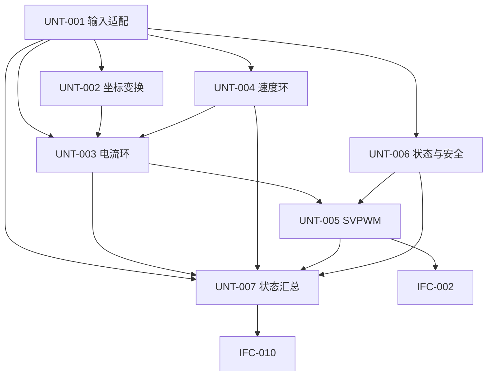
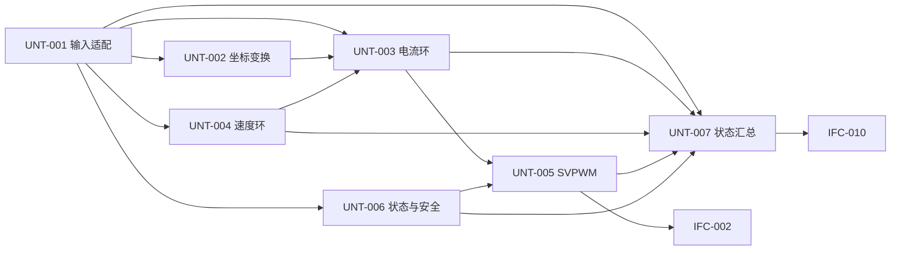
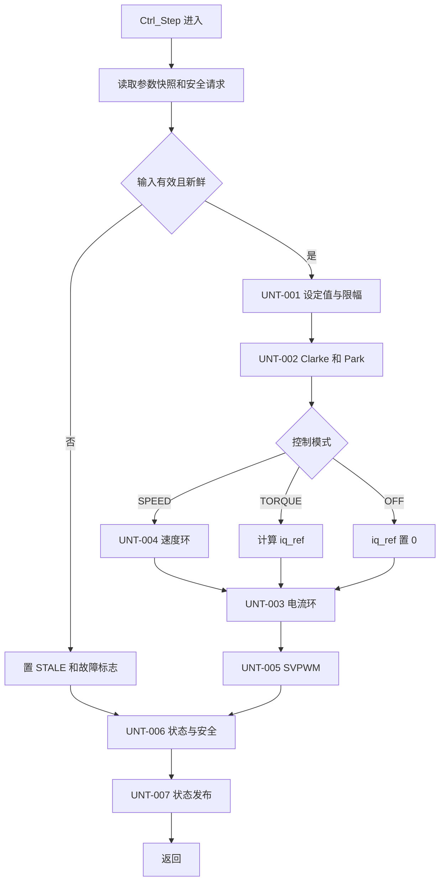
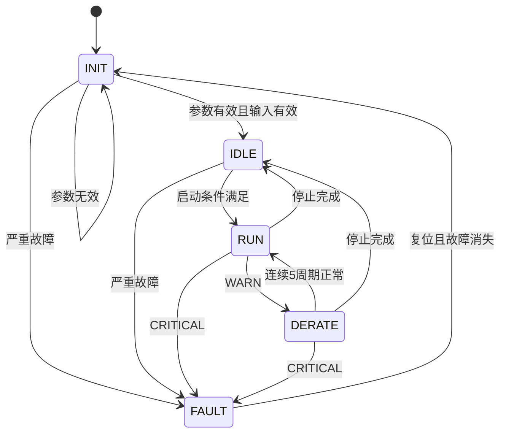
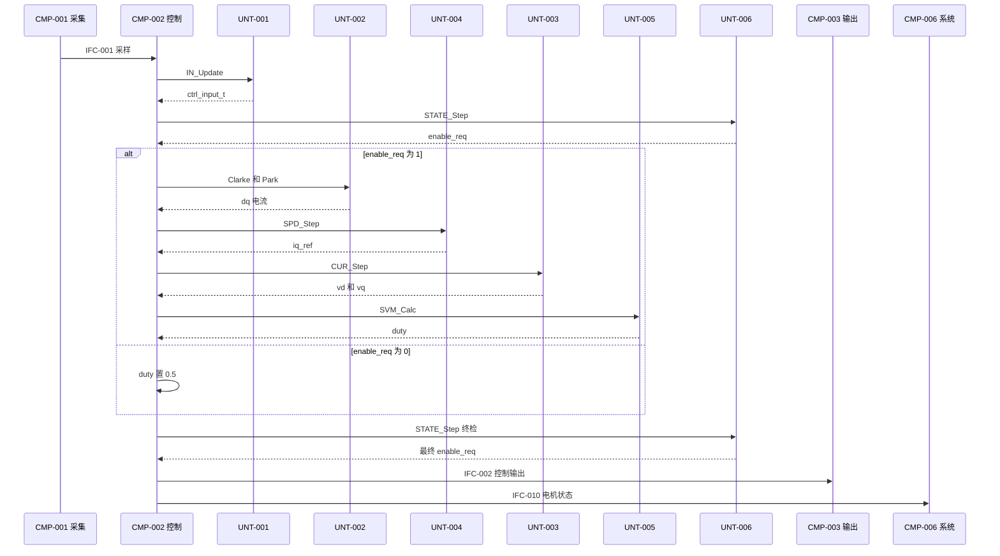

# SWE.3 --- Software Detailed Design and Unit Construction

软件详细设计与单元构建说明书

> 文档编号：DDD-SWE3-DEMO-r1
> 项目名称：STM32G474 三相电机控制器（示例项目）
> 软件名称/版本：MotorCtrl 应用软件 / r1
> 文档版本：r1
> 状态：草稿（示例）
> 编制日期：2026-11-25
> 编制/评审/批准：示例项目组 / 待评审 / 待批准

> **示例说明**：本文件是 `aspice-docs-from-gpt` 的 SWE.3 模板填写示例，内容取自 `aspice-docs-demo`，设计对象为 CMP-002 电机控制组件。组件、接口、数据、单元和函数 ID 沿用 demo，以保持与 SWE.1/SWE.2 的追溯连续。构建和测试结果未实际执行，文中以“待实现/待测量/待执行”标注。

---

## 修订记录

| 版本 | 状态 | 变更内容 | 变更日期 | 更改人 | 批准人 |
| --- | --- | --- | --- | --- | --- |
| r1 | 草稿（示例） | 按新模板结构填充 CMP-002 详细设计与单元构建示例 | 2026-11-25 | 示例项目组 | 待批准 |

---

## 1. 文档概述（Document Overview）

### 1.1 文档目的

本文档把 SWE.2 中 CMP-002 电机控制组件的职责和接口，细化为可以实现、可以评审、可以单元验证的详细设计。文档回答四个问题：

1. 组件内部由哪些软件单元组成，每个单元负责什么、不负责什么；
2. 单元之间通过什么接口和数据结构交互；
3. 每个关键算法、状态和异常路径如何执行，边界在哪里；
4. 设计如何追溯到软件需求、软件架构和源代码，并支撑 SWE.4 单元验证。

本文档用于软件开发、代码评审、SWE.4 单元验证、SWE.5 集成验证和变更影响分析。

### 1.2 文档范围

| 项目 | 内容 |
| --- | --- |
| 产品形态 | 嵌入式三相电机控制器（STM32G474 + FreeRTOS） |
| 设计对象 | CMP-002 电机控制组件 |
| 组件边界 | 设定值适配、坐标变换、速度环、电流环、SVPWM、控制状态与安全联锁、状态发布 |
| 上游基线 | SWE.1 软件需求规格说明书 r1；SWE.2 软件架构设计说明书 r1 |
| 执行上下文 | TASK-01 MotorTask，10 ms 周期，高优先级；不直接在 ISR 中执行 |
| 下游使用 | SWE.4 单元验证、SWE.5 集成验证、代码实现与评审 |
| 不覆盖 | 其他组件的内部设计、整机模式状态机、任务调度实现、寄存器配置、硬件电路、测试用例执行结果 |

**一个组件一份 SWE.3。** 本文只展开 CMP-002；CMP-001、CMP-003、CMP-004、CMP-005、CMP-006、CMP-007 的内部单元和函数不在本文定义。组件之间的接口以 SWE.2 第 5 章为准，本文只引用 IFC 和 DATA 编号，不重新定义架构级契约。

### 1.3 术语与缩略语

| 术语/缩写 | 说明 |
| --- | --- |
| 软件单元（Unit） | 组件内部可独立设计、实现和单元测试的最小结构单元 |
| 函数（Function） | 单元对外或对内提供的可调用行为 |
| FOC | Field Oriented Control，磁场定向控制 |
| Clarke 变换 | 三相静止坐标系到两相静止坐标系的变换 |
| Park 变换 | 两相静止坐标系到两相旋转坐标系的变换 |
| SVPWM | 空间矢量脉宽调制 |
| PI 调节器 | 比例积分调节器 |
| 抗饱和 | 输出受限时防止积分项继续累积的机制 |
| Q15 | 16 位定点格式；占空比 0～32767 映射 0～1 |
| WCET | Worst-Case Execution Time，最坏执行时间 |
| 快照/Seqlock | 一致数据副本/通过序号检测读写冲突的无锁快照机制 |
| UIF/FUN/UNT | 单元间接口/函数/软件单元标识 |
| UT | 单元测试用例 |

### 1.4 参考资料

| 编号 | 名称 | 版本 | 用途 |
| --- | --- | --- | --- |
| REF-001 | SWE.1 软件需求规格说明书 | r1 | 详细设计的需求输入 |
| REF-002 | SWE.2 软件架构设计说明书 | r1 | 组件、接口、数据、任务和状态输入 |
| REF-003 | ICD-CAN CAN 通信矩阵与接口控制文档 | 当前基线 | 设定值、状态和故障上报的外部约束 |
| REF-004 | STM32G474 数据手册与参考手册 | 当前版本 | FPU、存储器、外设和时序约束 |
| REF-005 | 软件开发规范 SW-CS | 当前版本 | 命名、编码、注释和静态检查要求 |
| REF-006 | MISRA C:2012 | 当前版本 | 编码约束和静态分析目标 |
| REF-007 | Automotive SPICE 4.1 | 4.1 | SWE.3 过程结果和基本实践 |

## 2. 详细设计依据与约束（Detailed Design Basis and Constraints）

### 2.1 软件架构输入

| 输入 | 编号 | 本设计如何使用 |
| --- | --- | --- |
| 组件定义 | CMP-002 电机控制 | 确定职责边界、输入输出和“不负责”事项 |
| 执行上下文 | TASK-01 MotorTask | 所有单元函数只在 MotorTask 上下文执行；不设计 ISR 入口 |
| 对外接口 | IFC-001、IFC-002、IFC-003.1、IFC-003.2、IFC-005、IFC-010 | 作为组件边界，内部单元不得绕过这些接口访问其他组件 |
| 架构数据 | DATA-01、DATA-03、DATA-04、DATA-05、DATA-07、DATA-08 | 作为输入输出结构体的字段来源和大小约束 |
| 组件状态 | INIT、IDLE、RUN、DERATE、FAULT | 作为状态机顶层状态，不新增架构级状态 |
| 时序预算 | 10 ms 控制周期、3.0 ms MotorTask WCET | 作为单元 WCET 分配和调用顺序约束 |

#### 2.1.1 组件职责边界

CMP-002 负责：读取采样工程值、控制参数、设定值和安全请求；完成设定值来源选择、范围限制和变化率限制；完成 Clarke/Park 变换、速度环、电流环和 SVPWM；执行启动、停止、降额和安全关断的组件内序列；向 CMP-003 提供三相占空比和使能请求；向 CMP-006、CMP-007 发布电机状态和故障标志。

CMP-002 不负责：传感器采样、滤波和有效性判断（CMP-001）；PWM 寄存器写入、功率级故障检测和最终输出仲裁（CMP-003）；系统模式决策、故障等级聚合和锁存策略（CMP-006）；参数存储、CRC 校验和默认参数管理（CMP-005）；CAN/UDS 协议、显示页面和按键扫描（CMP-004、CMP-007）；硬件死区、比较器关断和电气保护（HRTIM 与硬件）。

#### 2.1.2 对外接口

| 接口 ID | 提供者 → 使用者 | 数据 | 方向 | 本文使用方式 |
| --- | --- | --- | --- | --- |
| IFC-001 | CMP-001 → CMP-002 | signal_sample_t | 输入 | 电流、母线电压、温度、电角度、转速、有效性和时间戳 |
| IFC-003.1 | CMP-005 → CMP-002 | motor_param_t | 输入 | 控制增益、限幅、保护阈值和参数序号 |
| IFC-003.2 | CMP-007 → CMP-002 | motor_setpoint_t | 输入 | 目标转速/转矩、使能、来源、模式和超时 |
| IFC-005 | CMP-006 → CMP-002 | safety_request_t | 输入 | 故障等级、降额系数、安全输出请求和原因 |
| IFC-002 | CMP-002 → CMP-003 | control_output_t | 输出 | 三相占空比、使能请求、限幅标志和时间戳 |
| IFC-010 | CMP-002 → CMP-006、CMP-007 | motor_status_t | 输出 | 运行状态、转速、电流、温度、故障和限幅标志 |

IFC-008 是 CMP-006 → CMP-003 的安全输出请求，不属于 CMP-002 的接口。CMP-002 只通过 IFC-005 接收安全请求，通过 IFC-002 把“是否允许输出”传给 CMP-003；最终关断仍由 CMP-003 执行。

#### 2.1.3 架构数据投影

| 数据 ID | 结构体 | 本文使用的字段 | 大小约束 | 说明 |
| --- | --- | --- | --- | --- |
| DATA-01 | signal_sample_t | 三相电流、母线电压、温度、电角度、转速、valid、timestamp | 24 B | 只读输入，不在本文重新定义 |
| DATA-03 | motor_param_t | 速度/电流环增益、电流和电压限幅、转速范围、变化率、保护阈值、param_seq、CRC | 32 B | 由 CMP-005 校验后提供；本文做本地一致性检查 |
| DATA-04 | motor_setpoint_t | 目标转速、目标转矩、enable、source、mode、timestamp | 12 B | 由 CMP-007 提供；本文做来源、范围、变化率和超时处理 |
| DATA-05 | control_output_t | 三相占空比、enable_req、limit_flags、seq、timestamp | 16 B | 本文定义字段布局，CMP-003 消费 |
| DATA-07 | motor_status_t | 状态、转速、id/iq 给定与反馈、故障码/故障标志/限幅标志、温度、timestamp | 24 B | 本文定义字段布局，CMP-006/007 消费 |
| DATA-08 | safety_request_t | 故障等级、降额系数、safe_output、reason | 8 B | 由 CMP-006 写入；本文只读 |

### 2.2 软件需求输入

**本文直接承担的功能需求。**

| 需求 ID | 需求摘要 | 详细设计落点 |
| --- | --- | --- |
| FR-020 | 10 ms 周期根据设定值和反馈计算控制量，执行电流/转速闭环和转矩限幅 | UNT-002～UNT-005；5.1/5.2 节 |
| FR-021 | 按定义时序使能输出，停止时按定义时序关闭，不得直接跳变 | UNT-006；5.2.6 节启动/停止序列 |
| FR-022 | 接收本地/CAN 设定值，执行来源优先级、范围、变化率和超时处理 | UNT-001；5.2.1 节 |
| FR-023 | 对电流、转矩、电压、占空比和变化率限幅，并防止积分饱和 | UNT-003、UNT-004、UNT-005；5.2.3～5.2.5 节 |
| FR-024 | 仅在无严重故障、参数可用、模式允许且安全请求无效时使能输出；安全请求后 20 ms 内关断 | UNT-006；5.2.6/5.5 节 |
| FR-025 | 发布电机运行状态，包括转速、电流、电压、温度、限幅和故障 | UNT-007；4.2、5.1 节 |
| FR-040 | 检测传感器、通信、电源、时钟、看门狗、输出级、过流、过压和过温故障，按等级处理 | UNT-006、UNT-007；5.5 节 |
| FR-042 | 故障分为 INFO、WARN、CRITICAL；WARN 降额，CRITICAL 安全停止 | UNT-004、UNT-006；5.2.3、5.3 节 |
| FR-043 | 锁存 CRITICAL 故障，故障消失且复位/人工确认后才允许清除 | UNT-006；5.2.6、5.3 节 |

FR-040 是跨组件需求。本文只承担 CMP-002 范围内的本地检测（输入有效性、母线电压、相电流、温度）和控制安全反应；通信、时钟、看门狗故障以及系统级故障聚合由 CMP-006 负责，输出级故障由 CMP-003 负责。

**引用但不直接承担的需求。** FR-010/011/012/013/014 由 CMP-001 负责采样、有效性、角度/转速和新鲜度；本文消费结果并做二次合理性检查。FR-046 的过流/过压/输出级保护主要由 CMP-003 与硬件负责；本文接收安全请求并执行本地保护。

**适用的非功能需求。** NFR-P-01 要求 10 ms 周期内完成，NFR-P-02 端到端 ≤30 ms，NFR-P-05 抖动 ≤200 µs；NFR-R-01 CMP-002 代码/常量 ≤16 KB，NFR-R-02 静态 RAM ≤1.5 KB，NFR-R-04 MotorTask 栈余量 ≥30%；NFR-S-01 安全输出不依赖软件继续正常运行，NFR-S-02 使能条件必须同时满足，NFR-S-03 非法输入必须拒绝并计数。

### 2.3 软件单元设计约束

| 约束 ID | 约束内容 | 来源 | 影响范围 |
| --- | --- | --- | --- |
| CON-D-01 | 控制周期 10 ms，ADC 采样 1 ms，PWM 20 kHz | SWE.2/平台 | 所有单元在 MotorTask 中顺序执行 |
| CON-D-02 | MotorTask WCET 3.0 ms，CMP-002 分配 ≤2.0 ms | SWE.2 | 单元 WCET 之和加调用开销 ≤2.0 ms |
| CON-D-03 | Cortex-M4F，单精度 FPU，无双精度硬件 | 平台 | 内部使用 float32_t，禁止 double |
| CON-D-04 | GNU Arm Embedded 10.3，C11，-O2 | 平台 | 代码尺寸和 WCET 以该工具链为准 |
| CON-D-05 | 运行期禁止动态内存；所有状态静态分配 | 项目规范 | 上下文结构体编译期确定，不使用 malloc |
| CON-D-06 | 禁止递归、阻塞调用、可变参数和未定义行为 | 编码规范 | 调用图必须是有向无环图 |
| CON-D-07 | 单元不得直接访问 ADC/PWM/CAN/Flash 寄存器 | 架构约束 | 硬件访问只经 CMP-001/CMP-003 和驱动层 |
| CON-D-08 | DATA-05 为 16 B，DATA-07 为 24 B | SWE.2 | 字段布局和类型固定 |
| CON-D-09 | 占空比对外使用 Q15，0～32767 对应 0～1 | 接口约束 | 内部 float32 计算，输出前饱和并转换 |
| CON-D-10 | 电流 A、电压 V、电角度 rad、转速 rpm、温度 °C、时间 ms/s | 项目规范 | 接口表必须标注单位，禁止混用 |
| CON-D-11 | 参数范围和默认值来自 motor_param_t | 架构约束 | 参数非法时禁止运行 |
| CON-D-12 | 严重故障到安全输出请求 ≤20 ms；停止到输出关闭 ≤50 ms | 需求 | 状态机在当前或下一控制周期完成安全动作 |
| CON-D-13 | 单元依赖通过参数注入，不直接读取全局硬件 | 可测试性 | 每个单元可在主机或目标板独立测试 |
| CON-D-14 | 目标 MISRA C:2012；编译器警告视为错误 | 编码规范 | 禁止隐式转换、未初始化变量和魔法数 |
| CON-D-15 | 单元不直接调用 OS 时间服务 | 设计约束 | 当前时间由 Ctrl_Step 参数传入 |

### 2.4 编码规范与开发环境

| 项目 | 版本/配置 | 说明 |
| --- | --- | --- |
| 编程语言/标准 | C11（ISO/IEC 9899:2011） | 仅使用 C11 和项目允许的扩展 |
| 编译器 | GNU Arm Embedded 10.3 | -O2；-Wall -Wextra -Werror |
| 构建系统 | Make/CMake（项目现有构建） | Release 与测试构建分离 |
| 静态检查工具 | MISRA C:2012 检查器/项目静态分析 | 严重告警必须关闭 |
| 编码规范 | SW-CS 当前版本 | 命名、注释、函数长度、追溯注释 |
| 单元测试 | 主机/目标板测试框架 | CMP002_TEST 编译开关；生产构建不包含测试钩子 |

## 3. 软件单元分解（Software Unit Decomposition）

### 3.1 软件单元划分

| 单元 ID | 单元名称 | 所属组件 ID | 单元类型 | 文件/目录 | 划分理由 |
| --- | --- | --- | --- | --- | --- |
| UNT-001 | 输入与运行条件适配 | CMP-002 | 逻辑 | motor_ctrl_input.c/.h | 采样适配、参数快照和设定值共同决定本周期是否允许控制及目标值，放在一起避免多次拷贝和不一致 |
| UNT-002 | 坐标变换 | CMP-002 | 数学 | foc_transform.c/.h | Clarke/Park/Inverse Park 和角度归一化可独立用解析值验证 |
| UNT-003 | 电流环 | CMP-002 | 控制 | current_loop.c/.h | d/q 电流 PI、电压限幅和抗饱和具有独立测试边界 |
| UNT-004 | 速度环 | CMP-002 | 控制 | speed_loop.c/.h | 速度 PI、转矩模式和降额限幅与电流环动态特性不同 |
| UNT-005 | SVPWM | CMP-002 | 调制 | svpwm.c/.h | 反变换、共模注入、占空比钳位和 Q15 转换集中 |
| UNT-006 | 状态与安全联锁 | CMP-002 | 状态/安全 | ctrl_state.c/.h | 状态机、使能条件、停止序列和故障锁存共享同一组安全不变量 |
| UNT-007 | 状态汇总与诊断 | CMP-002 | 诊断/发布 | ctrl_status.c/.h | 只读汇总，不参与控制，保证状态发布不反向影响控制链 |



**粒度说明。** UNT-001 同时处理采样适配、参数快照和设定值，是因为三者共同决定“本周期是否允许控制、控制目标是多少”；UNT-002 不包含 PI，保证坐标变换可独立验证；UNT-003 与 UNT-004 分开，保证速度环和电流环可分别做阶跃、限幅和抗饱和测试；UNT-005 不决定是否使能；UNT-006 把状态机、使能条件、停止序列和故障锁存放在一起；UNT-007 只读汇总。

### 3.2 软件单元职责

| 单元 ID | 单元职责 | 输入 | 输出 | 不负责的事项 |
| --- | --- | --- | --- | --- |
| UNT-001 | 校验输入、选择设定值来源、执行范围/变化率/超时处理，生成只读输入快照 | signal_sample_t、motor_setpoint_t、motor_param_t、safety_request_t、now_ms | ctrl_input_t | 传感器转换、故障分级、PWM 输出 |
| UNT-002 | 完成 Clarke、Park、Inverse Park 和电角度归一化 | 三相电流、电角度 | alpha_beta_t、dq_t | PI 调节、限幅决策、状态机 |
| UNT-003 | 对 id/iq 执行 PI 调节、电压限幅和抗饱和，输出 vd/vq | dq 给定/反馈、参数、vdc、dt | vd/vq、限幅标志 | 速度环、SVPWM、使能仲裁 |
| UNT-004 | 对转速执行 PI 调节，输出 iq 给定并执行转矩/降额限幅 | 目标/反馈转速、参数、derate、dt | iq_ref_a、饱和标志 | 电流环、坐标变换、故障锁存 |
| UNT-005 | 将 vd/vq 转为三相占空比，执行过调制和占空比限幅 | vd/vq、theta、vdc、enable | pwm_duty_t | 使能决策、PWM 寄存器写入 |
| UNT-006 | 维护 INIT/IDLE/RUN/DERATE/FAULT，执行启动、停止、降额和安全关断 | ctrl_input_t、safety_request_t、now_ms | ctrl_state_t、enable_req、fault_flags | 控制律计算、PWM 输出、系统故障聚合 |
| UNT-007 | 汇总运行状态、给定/反馈、限幅和故障标志，发布 motor_status_t | ctrl_input_t、控制中间量、pwm_duty_t、状态和故障 | motor_status_t | 故障决策、控制计算、输出仲裁 |

### 3.3 软件单元依赖关系

| 依赖 ID | 使用单元 | 被依赖单元 | 依赖内容 | 约束 |
| --- | --- | --- | --- | --- |
| UDEP-001 | UNT-002 | UNT-001 | ctrl_input_t | 只读输入快照 |
| UDEP-002 | UNT-003 | UNT-001 | ctrl_input_t | 只读输入快照 |
| UDEP-003 | UNT-003 | UNT-002 | dq 电流、alpha_beta_t | 纯函数输出 |
| UDEP-004 | UNT-003 | UNT-004 | iq_ref_a | 速度环输出 |
| UDEP-005 | UNT-004 | UNT-001 | 目标/反馈转速、参数 | 只读输入快照 |
| UDEP-006 | UNT-005 | UNT-003 | vd/vq | 电流环输出 |
| UDEP-007 | UNT-005 | UNT-006 | enable_req | 安全门控 |
| UDEP-008 | UNT-006 | UNT-001 | ctrl_input_t | 输入有效性、故障标志 |
| UDEP-009 | UNT-007 | UNT-001～UNT-006 | 控制中间量、状态、故障 | 只读汇总 |

**单元依赖矩阵（D=依赖，P=提供）。**

| 单元 | UNT-001 | UNT-002 | UNT-003 | UNT-004 | UNT-005 | UNT-006 | UNT-007 |
| --- | --- | --- | --- | --- | --- | --- | --- |
| UNT-001 | — | P | P | P | — | P | P |
| UNT-002 | D | — | P | — | — | — | P |
| UNT-003 | D | D | — | D | P | — | P |
| UNT-004 | D | — | P | — | — | — | P |
| UNT-005 | — | — | D | — | — | D | P |
| UNT-006 | D | — | — | — | — | — | P |
| UNT-007 | D | D | D | D | D | D | — |

**依赖规则。** 依赖方向只能是“输入适配 → 控制计算 → 调制 → 状态发布”；UNT-007 是汇点，不向控制单元回写数据；UNT-006 只提供使能/安全门控，不修改 vd/vq 或占空比；单元之间不共享可写全局变量；不允许循环依赖；纯数学单元不调用状态机，状态机不实现数学公式。

### 3.4 软件组件与软件单元映射

| 架构组件 ID | 软件单元 ID | 职责分配 | 覆盖说明 |
| --- | --- | --- | --- |
| CMP-002 | UNT-001 | 设定值处理、参数读取、使能/停止序列 | 覆盖 IFC-001/003.1/003.2/005 的输入适配 |
| CMP-002 | UNT-002 | 闭环控制、坐标变换 | 覆盖 FR-020、FR-012（引用） |
| CMP-002 | UNT-003 | 闭环控制、限幅、抗饱和 | 覆盖 FR-020、FR-023 |
| CMP-002 | UNT-004 | 闭环控制、降额、限幅 | 覆盖 FR-020、FR-023、FR-042 |
| CMP-002 | UNT-005 | 闭环控制、输出计算 | 覆盖 FR-020、FR-021 |
| CMP-002 | UNT-006 | 使能/停止序列、故障反应 | 覆盖 FR-021、FR-024、FR-040、FR-042、FR-043 |
| CMP-002 | UNT-007 | 状态发布 | 覆盖 FR-025、FR-040 |

7 个单元全部属于 CMP-002，不新增组件，不改变 SWE.2 的组件边界。所有单元只在 TASK-01 MotorTask 上下文执行；ISR 不直接调用任何单元。单元只能通过 IFC-001、IFC-003.1、IFC-003.2、IFC-005 读取外部数据，通过 IFC-002、IFC-010 写出；不得访问其他 IFC。UNT-006 的顶层状态必须与 SWE.2 6.4 的 INIT/IDLE/RUN/DERATE/FAULT 一致。

## 4. 静态详细设计（Static Detailed Design）

### 4.1 单元接口定义

#### 4.1.1 接口清单

| 接口 ID | 所属单元 | 函数/接口名称 | 类型 | 可见性 | 说明 |
| --- | --- | --- | --- | --- | --- |
| UIF-001 | UNT-001 | IN_Update | 提供 | public | 输入缓存、模式选择、限幅、输出 ctrl_input_t |
| UIF-002 | UNT-002 | TRF_Clarke | 提供 | public | 三相电流到 alpha/beta |
| UIF-003 | UNT-002 | TRF_Park | 提供 | public | alpha/beta 到 d/q |
| UIF-004 | UNT-002 | TRF_InversePark | 提供 | public | d/q 到 alpha/beta |
| UIF-005 | UNT-004 | SPD_Step | 提供 | public | 速度环 PI、限幅、降额 |
| UIF-006 | UNT-003 | CUR_Step | 提供 | public | 电流环 PI、限幅、抗饱和 |
| UIF-007 | UNT-005 | SVM_Calc | 提供 | public | SVPWM 占空比计算 |
| UIF-008 | UNT-006 | STATE_Step | 提供 | public | 状态转换、使能、安全联锁 |
| UIF-009 | UNT-007 | STATUS_Update | 提供 | public | 状态汇总和快照发布 |

**函数清单。** 以下函数由单元实现，UIF 是单元间可调用接口，FUN 是设计追溯用的函数标识；简单 getter/setter 只做结构体拷贝和空指针检查。

| 函数 ID | 所属单元 | 函数名 | 功能 |
| --- | --- | --- | --- |
| FUN-001 | UNT-001 | IN_Update | 输入适配和运行条件生成 |
| FUN-002 | UNT-001 | IN_SelectSetpoint | 来源选择、范围/变化率/超时 |
| FUN-003 | UNT-001 | IN_ValidateParam | 参数快照一致性检查 |
| FUN-020 | UNT-002 | TRF_Clarke | 三相到 alpha/beta |
| FUN-021 | UNT-002 | TRF_Park | alpha/beta 到 d/q |
| FUN-022 | UNT-002 | TRF_InversePark | d/q 到 alpha/beta |
| FUN-023 | UNT-002 | TRF_NormalizeAngle | 电角度归一化 |
| FUN-030 | UNT-003 | CUR_Init | 初始化 d/q 电流环状态 |
| FUN-031 | UNT-003 | CUR_Step | 电流环 PI、限幅、抗饱和 |
| FUN-032 | UNT-003 | CUR_Reset | 清零积分和饱和状态 |
| FUN-040 | UNT-004 | SPD_Init | 初始化速度环状态 |
| FUN-041 | UNT-004 | SPD_Step | 速度环 PI、降额限幅 |
| FUN-042 | UNT-004 | SPD_Reset | 清零积分和饱和状态 |
| FUN-050 | UNT-005 | SVM_Calc | 反变换、共模注入、占空比计算 |
| FUN-051 | UNT-005 | SVM_ClampDuty | 占空比钳位、过调制标志、Q15 |
| FUN-060 | UNT-006 | STATE_Init | 初始化状态机和故障锁存 |
| FUN-061 | UNT-006 | STATE_Step | 状态转换、使能条件、启停序列 |
| FUN-062 | UNT-006 | STATE_ForceSafe | 强制安全状态并锁存原因 |
| FUN-063 | UNT-006 | STATE_Get | 读取状态和锁存故障 |
| FUN-070 | UNT-007 | STATUS_Init | 初始化状态缓冲区和序号 |
| FUN-071 | UNT-007 | STATUS_Update | 汇总并发布 motor_status_t |
| FUN-072 | UNT-007 | STATUS_Get | 返回一致状态快照 |
| FUN-080 | CMP-002 门面 | Ctrl_Init | 初始化组件上下文 |
| FUN-081 | CMP-002 门面 | Ctrl_Step | 10 ms 周期入口 |
| FUN-082 | CMP-002 门面 | Ctrl_GetStatus | 只读状态查询 |

#### 4.1.2 输入适配接口 UIF-001

```c
ctrl_result_t IN_Update(const signal_sample_t *sample,
                        const motor_setpoint_t *setpoint,
                        const motor_param_t *param,
                        const safety_request_t *safety,
                        uint32_t now_ms,
                        ctrl_input_t *out);
```

| 参数 | 类型 | 单位 | 有效范围 | 前置条件/说明 |
| --- | --- | --- | --- | --- |
| sample | const signal_sample_t * | 按字段 | 非空 | 三相电流、vdc、温度、电角度、转速、valid、timestamp |
| setpoint | const motor_setpoint_t * | 按字段 | 非空 | 目标转速/转矩、enable、source、mode、timestamp |
| param | const motor_param_t * | 按字段 | 非空 | 增益、限幅、阈值、param_seq、CRC 已由 CMP-005 校验 |
| safety | const safety_request_t * | 按字段 | 非空 | 故障等级、降额系数、safe_output、reason |
| now_ms | uint32_t | ms | 0～2³²-1 | 单调递增；回绕用无符号减法处理 |
| out | ctrl_input_t * | 按字段 | 非空 | 每次调用完整写入；失败时写安全默认值 |

**后置条件。** `out->valid` 仅在采样有效、数据年龄 ≤20 ms、设定值有效、参数一致且安全请求非 CRITICAL 时为 true；`dt_s` 限制在 0.005～0.02 s；目标值在参数范围内并满足变化率；`fault_flags`/`limit_flags` 反映本次判断，不得用 0 表示无效；失败时 `out` 仍为完整、可安全消费的结构。

**错误行为。** 空指针、param_seq 变化或参数非法返回 `CTRL_E_PARAM`，目标归零、禁止使能；采样无效/陈旧/非有限值返回 `CTRL_E_INPUT`，置 INPUT_INVALID/STALE；设定值超时返回 `CTRL_E_TIMEOUT`，目标归零；正常返回 `CTRL_OK`。

#### 4.1.3 调节器接口 UIF-005/UIF-006

```c
ctrl_result_t SPD_Step(pi_state_t *pi,
                       float32_t target_rpm,
                       float32_t feedback_rpm,
                       const ctrl_param_t *param,
                       float32_t derate_factor,
                       float32_t dt_s,
                       float32_t *iq_ref_a);

ctrl_result_t CUR_Step(pi_state_t *pi_d,
                       pi_state_t *pi_q,
                       const dq_t *ref,
                       const dq_t *fb,
                       const ctrl_param_t *param,
                       float32_t vdc_v,
                       float32_t dt_s,
                       dq_t *v_out,
                       uint16_t *limit_flags);
```

**速度环后置条件。** `iq_ref_a` 不超过 `iq_max_a × derate_factor`；积分项不超过 `iq_max_a`；输出饱和且误差同向时本周期不累加积分；任何非有限输入返回 `CTRL_E_NUMERIC`，输出 0。

**电流环后置条件。** `sqrt(vd²+vq²) ≤ v_lim`，其中 `v_lim = modulation_limit × vdc_v / √3`；单轴输出不超过 `±v_max_v`；矢量限幅后保持电压矢量方向不变；积分项限制在 `±v_lim`；`vdc_v < vdc_min_v` 返回 `CTRL_E_STATE`、输出 0、置 VDC_LOW。

#### 4.1.4 状态与安全接口 UIF-008

```c
ctrl_result_t STATE_Step(ctrl_state_ctx_t *ctx,
                         const ctrl_input_t *in,
                         const safety_request_t *safety,
                         uint32_t now_ms,
                         uint16_t *enable_req,
                         ctrl_state_t *state_out,
                         uint16_t *fault_flags);
```

`enable_req=1` 当且仅当：状态为 RUN 或 DERATE；`in->valid=true`；参数可用；`safety->level != CRITICAL`；`safety->safe_output=false`；无本地 CRITICAL 故障。CRITICAL 故障时 `enable_req=0`，状态进入 FAULT，故障锁存到复位且故障消失；停止请求时先进入 RUN/STOPPING，`iq_ref` 归零后再 `enable_req=0`，不得直接跳变。

#### 4.1.5 接口通用规则

- 所有非纯数学接口返回 `ctrl_result_t`；纯数学接口也检查非有限值并返回错误码。
- 输入指针一律 `const`；输出指针在成功路径完整写入，不得留下未定义字段。
- 物理量参数名带单位后缀：`_a`、`_v`、`_rpm`、`_rad`、`_s`、`_ms`、`_c`、`_pct`。
- 接口不分配内存、不阻塞、不调用 OS、不访问硬件寄存器。
- 浮点输入必须用 `isfinite()` 检查；NaN/Inf 按非法输入处理。
- 失败时输出安全值并置错误码/标志；不得用 0 静默代替“无效”。
- 接口 ID 和版本写入头文件注释；字段顺序、类型和大小变更必须走变更流程并更新追溯表。

### 4.2 内部数据定义

#### 4.2.1 基础数据类型

| 类型 | 字段 | 单位 | 范围 | 说明 |
| --- | --- | --- | --- | --- |
| abc_current_t | a、b、c: float32_t；valid: uint8_t | A | ±i_peak_a | 三相电流采样快照；valid=0 表示上游无效 |
| alpha_beta_t | alpha、beta: float32_t | 由上下文决定 | 有限值 | 两相静止坐标系量 |
| dq_t | d、q: float32_t | 由上下文决定 | 有限值 | 两相旋转坐标系量 |
| pi_state_t | integ、err_prev: float32_t；saturated、limit_dir: uint8_t；reserved: uint16_t | 按输出量 | 有限值 | PI 积分、上次误差、饱和方向和保留字段；12 B |
| speed_ramp_t | iq_ramp_a: float32_t；active: uint8_t | A | ±iq_max_a | 启动/停止 iq_ref 斜坡状态 |
| pwm_duty_t | a、b、c: float32_t；sector: uint16_t；limit_flags: uint16_t | — | 0～1 | 三相占空比和调制限幅标志 |
| ctrl_state_t | 枚举 | — | INIT、IDLE、RUN、DERATE、FAULT | 顶层状态；RUN 内部另有 NORMAL/STOPPING 子状态 |
| ctrl_result_t | 枚举 | — | CTRL_OK 及错误码 | 接口返回码 |

#### 4.2.2 输入快照 ctrl_input_t（关键字段）

| 字段 | 类型 | 单位 | 范围 | 初值 | 说明 |
| --- | --- | --- | --- | --- | --- |
| sample_ts_ms | uint32_t | ms | 0～2³²-1 | 0 | 采样时间戳；用于数据年龄判断 |
| dt_s | float32_t | s | 0.005～0.02 | 0.01 | 控制周期；由相邻 now_ms 计算并限幅 |
| ia_a、ib_a、ic_a | float32_t | A | ±i_peak_a | 0 | 三相电流；非有限值置 invalid |
| vdc_v | float32_t | V | 0～vdc_max_v | 0 | 母线电压；低于 vdc_min_v 禁止运行 |
| temp_c | float32_t | °C | -40～150 | 0 | 功率级温度；用于状态和降额联动 |
| theta_e_rad | float32_t | rad | 0～2π | 0 | 电角度；进入变换前归一化 |
| speed_rpm | float32_t | rpm | ±speed_max_rpm×1.1 | 0 | 反馈转速；超范围按 E-06 处理 |
| target_speed_rpm | float32_t | rpm | speed_min_rpm～speed_max_rpm | 0 | 已限幅、已变化率限制的目标转速 |
| target_torque_pct | float32_t | % | -100～100 | 0 | 转矩模式目标；正负号表示方向 |
| id_ref_a、iq_ref_direct_a | float32_t | A | ±id_max_a、±iq_max_a | 0 | d 轴给定/转矩模式直接给定 |
| kp_speed、ki_speed | float32_t | A/rpm、A/(rpm·s) | 0～1.0、0～20 | 0.05、0.5 | 速度环增益 |
| kp_d、kp_q、ki_d、ki_q | float32_t | V/A、V/(A·s) | 0～10、0～5000 | 0.5、100 | 电流环增益 |
| iq_max_a、id_max_a、v_max_v | float32_t | A、A、V | 0～30、0～10、0～vdc_max_v | 10、0、30 | 电流/电压限幅 |
| speed_slew_rpm_s、torque_slew_pct_s | float32_t | rpm/s、%/s | 0～20000、0～1000 | 6000、500 | 目标变化率 |
| setpoint_timeout_ms | uint16_t | ms | 100～1000 | 100 | 设定值超时 |
| vdc_min_v、vdc_max_v、i_peak_a、modulation_limit | float32_t | V、V、A、— | 0～60、0～60、0～40、0.8～1.0 | 18、60、25、0.95 | 母线/电流/调制保护 |
| setpoint_source、setpoint_mode | uint16_t | 枚举 | NONE/HMI/CAN；OFF/SPEED/TORQUE | NONE、OFF | 来源和模式 |
| sample_valid、setpoint_valid、stale | uint8_t | bool | 0/1 | 0 | 输入有效、设定值有效、数据陈旧 |
| safety_active、safe_output、derate_factor | uint8_t、uint8_t、float32_t | — | 0/1、0/1、0～1 | 0、0、1.0 | 安全请求和降额 |
| fault_flags、limit_flags | uint16_t | 位掩码 | 见 4.2.5 | 0 | 本地故障和限幅标志 |
| param_seq | uint32_t | — | 0～2³²-1 | 0 | 参数快照序号 |

> 生产实现可以只保留 `ctrl_param_t` 指针，由 `Ctrl_Step` 显式传入；字段语义与上表一致。`ctrl_input_t` 在每周期完整写入，后续单元只读。

#### 4.2.3 对外控制输出 control_output_t

`control_output_t` 对应 DATA-05，固定 16 B。

| 偏移 | 字段 | 类型 | 单位/比例 | 范围 | 说明 |
| --- | --- | --- | --- | --- | --- |
| 0 | duty_a_q15 | uint16_t | 0～32767 对应 0～1 | 0～32767 | A 相占空比 |
| 2 | duty_b_q15 | uint16_t | 0～32767 对应 0～1 | 0～32767 | B 相占空比 |
| 4 | duty_c_q15 | uint16_t | 0～32767 对应 0～1 | 0～32767 | C 相占空比 |
| 6 | enable_req | uint8_t | bool | 0/1 | 1 表示请求 CMP-003 使能 PWM |
| 7 | limit_flags | uint8_t | 位掩码 | 见 4.2.5 | 本周期限幅标志 |
| 8 | seq | uint16_t | — | 0～65535 | 发布序号，每周期递增，允许回绕 |
| 10 | reserved | uint16_t | — | 0 | 保留，必须写 0 |
| 12 | timestamp_ms | uint32_t | ms | 0～2³²-1 | 本周期时间戳 |

#### 4.2.4 对外状态 motor_status_t

`motor_status_t` 对应 DATA-07，固定 24 B。字段包括：状态枚举、目标/实际转速、id/iq 给定与反馈、母线电压、温度、转矩限幅、故障码/故障标志、限幅标志、运行时间、时间戳。所有字段在发布前完整写入；消费者按 seq 快照读取。

| 字段 | 类型 | 单位/范围 | 说明 |
| --- | --- | --- | --- |
| state | ctrl_state_t | INIT/IDLE/RUN/DERATE/FAULT | 顶层状态 |
| target_speed_rpm、speed_rpm | float32_t | rpm | 目标/实际转速 |
| id_ref_a、iq_ref_a | float32_t | A | d/q 电流给定 |
| id_fb_a、iq_fb_a | float32_t | A | d/q 电流反馈 |
| vdc_v、temp_c | float32_t | V、°C | 母线电压、功率级温度 |
| torque_limit_pct | float32_t | % | 当前转矩限幅 |
| fault_code、fault_flags | uint16_t | 诊断规范/位掩码 | 最近故障码和故障标志 |
| limit_flags | uint16_t | 位掩码 | 本周期限幅标志 |
| run_time_ms、timestamp_ms | uint32_t | ms | 运行时间和发布时间 |
| seq | uint16_t | 0～65535 | 快照序号 |

#### 4.2.5 故障码、限幅标志与错误码

| 类别 | 标识 | 含义 |
| --- | --- | --- |
| 错误码 | CTRL_OK | 成功 |
| 错误码 | CTRL_E_PARAM | 空指针、参数序号变化、参数非法 |
| 错误码 | CTRL_E_INPUT | 采样无效、陈旧、角度/电流非有限、三相不平衡 |
| 错误码 | CTRL_E_TIMEOUT | 设定值超时 |
| 错误码 | CTRL_E_NUMERIC | NaN/Inf 或数值异常 |
| 错误码 | CTRL_E_STATE | 未初始化、状态非法、欠压 |
| 错误码 | CTRL_E_SAFETY | 安全请求为 CRITICAL |
| 故障位 | FAULT_INPUT_INVALID | 输入无效/陈旧/不平衡 |
| 故障位 | FAULT_PARAM | 参数非法或序号冲突 |
| 故障位 | FAULT_VDC_LOW/HIGH | 母线欠压/过压 |
| 故障位 | FAULT_OVERCURRENT | 相电流超过峰值阈值 |
| 故障位 | FAULT_OVERTEMP | 功率级过温 |
| 故障位 | FAULT_NUMERIC | 非有限值/数值异常 |
| 故障位 | FAULT_STATE | 状态非法 |
| 故障位 | FAULT_SAFETY_REQ | 系统安全请求锁存 |
| 限幅位 | LIMIT_CURRENT/VOLTAGE/DUTY/SPEED/DERATE/OVERMOD | 电流、电压、占空比、转速、降额、过调制限幅 |

### 4.3 数据关系与访问规则

| 数据 | 读者 | 写入者/所有者 | 同步方式 | 一致性要求 |
| --- | --- | --- | --- | --- |
| ctrl_input_t | UNT-002～UNT-004、UNT-006、UNT-007 | UNT-001 | 周期内只读 | 每周期完整写入，不使用半更新数据 |
| pi_state_t（速度/电流） | UNT-003/UNT-004/UNT-007 | 各调节器单元 | 单元私有 | 只有所属单元可写；复位时清零 |
| pwm_duty_t | UNT-005、UNT-006、UNT-007、Ctrl_Step | UNT-005 | 周期末发布 | 占空比 0～1；Q15 转换前饱和 |
| control_output_t | CMP-003 | Ctrl_Step | 单写者 | 16 B 固定布局；周期末发布 |
| motor_status_t | CMP-006、CMP-007 | UNT-007 | Seqlock/序号 | 24 B；读者校验 seq，最多重试 2 次 |
| safety_request_t | UNT-001、UNT-006 | CMP-006 | 原子写 | 只读；CRITICAL 锁存到清除 |
| fault_flags | UNT-006、UNT-007、Ctrl_Step | UNT-006 | 单写者 | 位掩码；锁存原因可追溯 |

**数据规则。** 单元只写自己的子状态；跨单元数据通过函数参数传递；不使用可写全局变量；参数快照在周期开始时读取，`param_seq` 变化时重读一次；状态发布失败不得阻止安全动作；所有输出在返回前检查有限值。

### 4.4 单元依赖与调用关系



**调用约束。** 调用图是有向无环图；`Ctrl_Step` 调用顺序固定为输入适配 → 状态与安全 → 控制计算 → 调制 → 状态发布；UNT-007 只读，不向控制单元回写；UNT-006 只提供使能/安全门控，不改 vd/vq 或占空比；单元函数不阻塞、不分配内存、不调用 OS、不访问寄存器；从 `Ctrl_Step` 到最深函数调用深度不超过 4 层。

### 4.5 配置与常量定义

| 配置 ID | 名称 | 类型 | 默认值 | 范围/单位 | 可配置性 | 说明 |
| --- | --- | --- | --- | --- | --- | --- |
| CFG-001 | CONTROL_PERIOD_MS | uint16_t | 10 | 10 ms | 编译期 | 控制周期 |
| CFG-002 | SAMPLE_MAX_AGE_MS | uint16_t | 20 | 20 ms | 编译期 | 采样数据最大年龄 |
| CFG-003 | DEFAULT_DT_S | float32_t | 0.01 | 0.005～0.02 s | 编译期 | 首次/异常时控制周期 |
| CFG-004 | DEFAULT_SPEED_KP | float32_t | 0.05 | 0～1.0 A/rpm | 运行期参数 | 速度环比例增益默认值 |
| CFG-005 | DEFAULT_SPEED_KI | float32_t | 0.5 | 0～20 A/(rpm·s) | 运行期参数 | 速度环积分增益默认值 |
| CFG-006 | DEFAULT_CURRENT_KP | float32_t | 0.5 | 0～10 V/A | 运行期参数 | 电流环比例增益默认值 |
| CFG-007 | DEFAULT_CURRENT_KI | float32_t | 100 | 0～5000 V/(A·s) | 运行期参数 | 电流环积分增益默认值 |
| CFG-008 | IQ_MAX_A | float32_t | 10 | 0～30 A | 运行期参数 | q 轴电流限幅 |
| CFG-009 | ID_MAX_A | float32_t | 0 | 0～10 A | 运行期参数 | d 轴电流限幅 |
| CFG-010 | V_MAX_V | float32_t | 30 | 0～vdc_max_v | 运行期参数 | 单轴电压限幅 |
| CFG-011 | VDC_MIN_V | float32_t | 18 | 0～60 V | 运行期参数 | 母线欠压阈值 |
| CFG-012 | VDC_MAX_V | float32_t | 60 | 0～60 V | 运行期参数 | 母线过压阈值 |
| CFG-013 | I_PEAK_A | float32_t | 25 | 0～40 A | 运行期参数 | 相电流峰值保护阈值 |
| CFG-014 | TEMP_MAX_C | float32_t | 120 | -40～150 °C | 编译期/参数 | 功率级过温阈值 |
| CFG-015 | I_SUM_TOL_A | float32_t | 2.0 | 0～5 A | 编译期 | 三相电流不平衡容差 |
| CFG-016 | MODULATION_LIMIT | float32_t | 0.95 | 0.8～1.0 | 运行期参数 | SVPWM 线性区利用率 |
| CFG-017 | SPEED_SLEW_RPM_S | float32_t | 6000 | 0～20000 rpm/s | 运行期参数 | 转速目标变化率 |
| CFG-018 | TORQUE_SLEW_PCT_S | float32_t | 500 | 0～1000 %/s | 运行期参数 | 转矩目标变化率 |
| CFG-019 | START_RAMP_A_PER_S | float32_t | 1000 | 100～5000 A/s | 运行期参数 | 启动电流变化率 |
| CFG-020 | STOP_RAMP_A_PER_S | float32_t | 1000 | 100～5000 A/s | 运行期参数 | 停止电流变化率 |

> 配置值来自 `motor_ctrl_cfg.h` 和 `motor_param_t`；禁止在算法中写魔法数。参数默认值和范围在 Q-02 关闭后冻结。

## 5. 动态详细设计（Dynamic Detailed Design）

### 5.1 单元处理流程



| 步骤 | 调用 | 输入 | 输出 | 失败处理 |
| --- | --- | --- | --- | --- |
| 1 | 读取参数和安全请求 | IFC-003.1、IFC-005 | param_snapshot、safety | 参数序号变化重读一次 |
| 2 | IN_Update | IFC-001、IFC-003.2、now_ms | ctrl_input_t | 失败置安全输入，禁止使能 |
| 3 | STATE_Step | ctrl_input_t、safety | state、enable_req | 失败进入 FAULT |
| 4 | TRF_NormalizeAngle、TRF_Clarke、TRF_Park | 三相电流、theta | dq 电流 | 非有限值转 FAULT |
| 5 | SPD_Step（仅 SPEED） | 目标/反馈转速、参数 | iq_ref | 非有限值转 FAULT |
| 6 | CUR_Step | id/iq 给定/反馈、vdc | vd/vq | 欠压/非有限值转 FAULT |
| 7 | TRF_InversePark、SVM_Calc | vd/vq、theta、vdc、enable | pwm_duty_t | 欠压/非有限值转安全输出 |
| 8 | STATE_Step 终检 | 当前故障/限幅、safety | 最终 enable_req | 任一 CRITICAL 立即清零 |
| 9 | STATUS_Update | 全部单元输出 | motor_status_t | 发布失败不阻止安全动作 |
| 10 | 发布 IFC-002、IFC-010 | duty、state | 外部 | 单写者，周期末发布 |

**WCET 分配。** 参数快照/安全检查 0.03 ms；IN_Update 0.20 ms；坐标变换 0.15 ms；速度环 0.20 ms；电流环 0.50 ms；SVPWM 0.30 ms；状态与安全 0.08 ms；状态发布 0.12 ms；调用开销 0.12 ms；合计 1.70 ms，预算 2.0 ms，余量 0.30 ms（15%）。

**周期内数据流。** UNT-001 产生 `ctrl_input_t`，本周期供 UNT-002/003/004/006/007 只读；UNT-002 产生 dq 电流/alpha-beta 电压；UNT-004 产生 iq_ref；UNT-003 产生 vd/vq；UNT-005 产生 pwm_duty_t；UNT-006 产生 state/enable/fault_flags；UNT-007 产生 motor_status_t。所有中间量在周期末失效，不跨周期共享。

### 5.2 算法与计算逻辑

#### 5.2.1 设定值处理与运行条件（UNT-001）

**设计目的。** 将外部采样、设定值、参数和安全请求转换为本周期唯一的只读输入快照，决定是否允许控制、目标值是多少、哪些故障/限幅标志有效。

**输入/输出。** 输入为 IFC-001、IFC-003.1、IFC-003.2、IFC-005 和 now_ms；输出为 ctrl_input_t；前置条件为指针非空、参数序号稳定；后置条件为所有字段完整、目标值在范围内、失败时输出安全默认值。

**来源优先级。**

| 优先级 | 来源 | 有效条件 | 行为 |
| --- | --- | --- | --- |
| 1 | SAFETY | safety_request.safe_output=true 或 level=CRITICAL | 目标归零，setpoint_valid=false，禁止使能 |
| 2 | CAN | source=CAN 且 age≤setpoint_timeout_ms | 使用 CAN 目标 |
| 3 | HMI | source=HMI 且 age≤2×setpoint_timeout_ms | 使用本地目标 |
| 4 | NONE | 无有效来源 | 目标归零，setpoint_valid=false，禁止使能 |

**数据年龄与周期。**

```text
age_ms = (uint32_t)(now_ms - setpoint.timestamp_ms)
dt_s   = (now_ms - prev_now_ms) / 1000.0
dt_s   = clamp(dt_s, 0.005, 0.02)
```

首次调用、时间回绕或 dt 异常时使用 0.01 s；采样年龄 >20 ms 置 `stale=1`、`sample_valid=0`；超过 20 ms 的采样不参与闭环；任一相电流绝对值超过 `i_peak_a` 置 `FAULT_OVERCURRENT`；`vdc_v < vdc_min_v` 置 `FAULT_VDC_LOW`；`vdc_v > vdc_max_v` 置 `FAULT_VDC_HIGH`；温度超过 `TEMP_MAX_C` 置 `FAULT_OVERTEMP`；设定值超时置 `setpoint_valid=0`、目标归零、`FAULT_SETPOINT_TIMEOUT`。

**范围与变化率。**

```text
target_speed = clamp(target_speed, speed_min_rpm, speed_max_rpm)
target_torque = clamp(target_torque_pct, -100.0, 100.0)
max_dspeed = speed_slew_rpm_s * dt_s
target_speed = clamp(target_speed,
                     prev_target_speed - max_dspeed,
                     prev_target_speed + max_dspeed)
max_dtorque = torque_slew_pct_s * dt_s
target_torque = clamp(target_torque,
                      prev_target_torque - max_dtorque,
                      prev_target_torque + max_dtorque)
```

**模式处理。** OFF：iq 给定 0、id 给定 0、输出禁止、积分清零；SPEED：iq 给定来自 UNT-004、id 给定 0、降额作用于 iq 限幅；TORQUE：iq 给定 = target_torque_pct/100 × iq_max_a × derate_factor、id 给定 0、速度环不参与。

**伪代码。**

```text
IN_Update(sample, setpoint, param, safety, now_ms, out):
  if any pointer is NULL: return CTRL_E_PARAM
  if not IN_ValidateParam(param): fill_safe(out); return CTRL_E_PARAM
  out->dt_s = calc_dt(now_ms, prev_now_ms)
  out->sample_ts_ms = sample->timestamp_ms
  out->sample_valid = sample->valid &&
                      age_ms(sample->timestamp_ms, now_ms) <= 20 &&
                      all_inputs_finite(sample)
  if not out->sample_valid:
      out->stale = 1
      out->fault_flags |= FAULT_INPUT_INVALID
  else:
      copy currents, vdc, temperature, theta, speed into out
  select_source_and_timeout(setpoint, now_ms, out)
  clamp_and_slew(out)
  apply_mode_and_safety(out, safety)
  return CTRL_OK
```

#### 5.2.2 坐标变换（UNT-002）

**Clarke 变换（幅值不变）：**

$$i_\alpha = \frac{2}{3}\left(i_a - \frac{1}{2}i_b - \frac{1}{2}i_c\right)$$

$$i_\beta = \frac{1}{\sqrt{3}}\left(i_b - i_c\right)$$

**Park 变换：**

$$i_d = i_\alpha\cos\theta + i_\beta\sin\theta$$

$$i_q = -i_\alpha\sin\theta + i_\beta\cos\theta$$

**Inverse Park 变换：**

$$v_\alpha = v_d\cos\theta - v_q\sin\theta$$

$$v_\beta = v_d\sin\theta + v_q\cos\theta$$

**角度归一化。** `theta = fmodf(theta, 2*PI); if theta < 0: theta += 2*PI`。Park/Inverse Park 各自只计算一次 sin/cos；所有输入必须有限；三相电流不平衡检查 `isum = ia+ib+ic`，若 `fabsf(isum) > i_sum_tol_a`（默认 2.0 A）返回 `CTRL_E_INPUT` 并置 `FAULT_INPUT_INVALID`；连续 3 个周期超限时由状态机进入 DERATE。变换使用 float32_t，目标电角度误差 ≤2°、电流误差 ≤1% FS。

#### 5.2.3 速度环（UNT-004）

**误差与输出：**

$$e(k) = \omega^*(k) - \omega(k)$$

$$i_q^{raw}(k) = K_{p,\omega}e(k) + I_\omega(k)$$

$$I_\omega(k) = \mathrm{clamp}\left(I_\omega(k-1) + K_{i,\omega}e(k)T_s,\ -i_{q,max}^{eff},\ +i_{q,max}^{eff}\right)$$

$$i_q^*(k) = \mathrm{clamp}\left(i_q^{raw}(k),\ -i_{q,max}^{eff},\ +i_{q,max}^{eff}\right)$$

其中 `i_q,max,eff = iq_max_a × derate_factor`，`derate_factor` 来自 safety_request_t（0～1）。

**抗饱和。** 若输出达到限幅且误差方向与饱和方向相同，本周期不累加积分；若误差反向，允许积分退出饱和。积分项始终限制在 `±i_q,max,eff`。输出必须有限；非有限输入返回 `CTRL_E_NUMERIC` 并输出 0。速度模式下输出作为 iq 给定；转矩模式下旁路速度环。

**启动/停止斜坡。** 启动时 iq_ref 从 0 按 `start_ramp_a_per_s × dt` 爬升；停止时进入 STOPPING，目标归零，iq_ref 按 `stop_ramp_a_per_s × dt` 降到 0；不得直接跳变。

#### 5.2.4 电流环（UNT-003）

**误差：** `ed = id_ref - id`，`eq = iq_ref - iq`。

**PI 输出：**

$$v_d^{raw} = K_{p,d}e_d + I_d$$

$$v_q^{raw} = K_{p,q}e_q + I_q$$

$$I_d(k) = \mathrm{clamp}\left(I_d(k-1) + K_{i,d}e_dT_s,\ -v_{lim},\ +v_{lim}\right)$$

$$I_q(k) = \mathrm{clamp}\left(I_q(k-1) + K_{i,q}e_qT_s,\ -v_{lim},\ +v_{lim}\right)$$

**电压矢量限幅：** `v_lim = modulation_limit × vdc_v / √3`；若 `sqrt(vd²+vq²) > v_lim`，按比例缩放 vd/vq，保持矢量方向不变；单轴输出同时限制在 `±v_max_v`。

**抗饱和。** 输出饱和且误差同向时冻结对应轴积分；积分项限制在 `±v_lim`；`vdc_v < vdc_min_v` 返回 `CTRL_E_STATE`、输出 0、置 `FAULT_VDC_LOW`；非有限值返回 `CTRL_E_NUMERIC`。电流环使用 float32_t，目标带宽受 10 ms 周期限制，高频扰动抑制依赖 1 ms 采样和硬件。

#### 5.2.5 SVPWM（UNT-005）

**设计目的。** 将 d/q 电压给定转换为三相占空比，执行共模注入、过调制钳位和 Q15 转换；不决定是否使能。

**步骤。**

1. 用 Inverse Park 把 vd/vq 转为 v_alpha/v_beta；
2. 计算三相电压 `va = v_alpha`、`vb = -0.5v_alpha + (√3/2)v_beta`、`vc = -0.5v_alpha - (√3/2)v_beta`；
3. 共模注入 `vcm = -(max(va,vb,vc) + min(va,vb,vc))/2`；
4. 归一化占空比 `duty_x = 0.5 + (v_x + vcm)/vdc`；
5. 钳位到 [0,1]，置 LIMIT_DUTY/OVERMOD；
6. 输出 pwm_duty_t（float32）；Ctrl_Step 将占空比四舍五入为 Q15 并填入 control_output_t。

```text
SVM_Calc(vd, vq, theta, vdc, enable, out):
  if not finite(vd,vq,vdc,theta): return CTRL_E_NUMERIC
  if vdc < VDC_MIN_HARD: out = 0.5 duty; return CTRL_E_STATE
  ab = TRF_InversePark(dq(vd,vq), theta)
  va = ab.alpha
  vb = -0.5*ab.alpha + SQRT3_2*ab.beta
  vc = -0.5*ab.alpha - SQRT3_2*ab.beta
  vcm = -(max3(va,vb,vc) + min3(va,vb,vc)) / 2
  da = 0.5 + (va+vcm)/vdc
  db = 0.5 + (vb+vcm)/vdc
  dc = 0.5 + (vc+vcm)/vdc
  clamp each to [0,1], set limit flags
  if not enable: da = db = dc = 0.5
  out->a = da; out->b = db; out->c = dc
  out->limit_flags = flags
  return CTRL_OK
```

共模注入与扇区法 SVPWM 等价，但不需要查表和扇区判断，代码更短、边界更少；代价是过调制区只能钳位，不能做最小相位误差优化。`enable_req=0` 时占空比可保持 0.5 作为安全中点，但 CMP-003 必须关闭使能；不得仅靠占空比 0.5 表示安全。

#### 5.2.6 启动、停止与安全输出（UNT-006）

**启动条件。** 状态 IDLE；sample_valid=true 且 age≤20 ms；param_valid=true；safety 非 CRITICAL 且 safe_output=false；vdc_min_v≤vdc≤vdc_max_v；fault_latch 为空；setpoint_mode != OFF。

**启动序列。** 校验条件（当前周期）→ 清零速度/电流积分和饱和状态（当前周期）→ iq_ref=0、id_ref=0，状态 RUN/NORMAL（当前周期）→ enable_req=1，速度环从 0 爬升（≤20 ms）→ 状态发布并记录启动事件。启动命令后 ≤50 ms 进入使能，设计最坏 20 ms。

**停止序列。** 收到停止命令或 enable=false（当前周期）→ 子状态 STOPPING，目标归零（当前周期）→ 旁路速度环，iq_ref 按 stop_ramp 降到 0，电流环保持运行（≤20 ms）→ iq_ref≈0 后 enable_req=0（≤30 ms）→ 清零积分，状态 IDLE，发布状态。停止到输出关闭 ≤50 ms，设计最坏 30 ms。

**故障与安全序列。** 检测到 CRITICAL 安全请求、过流、过压、欠压、数值异常或状态非法（当前周期）→ enable_req=0、iq_ref=0、清零积分（当前周期）→ 状态 FAULT，锁存 fault_flags 和原因（当前周期）→ 发布状态，CMP-003 下一次执行关闭 PWM/EN（≤10 ms）→ 保持 FAULT 直到复位且故障消失。故障到安全输出请求 ≤20 ms。

**安全不变量。** `enable_req=1` 的必要条件全部满足才允许置 1；FAULT 不得自动回 RUN，必须经过 INIT/IDLE 并重新满足启动条件；故障锁存只能由复位或人工确认清除；状态发布失败不得阻止 enable_req=0；任何路径不得在 enable_req=0 时继续输出非零占空比。

#### 5.2.7 数值与边界规则

| 编号 | 场景 | 判断 | 处理 |
| --- | --- | --- | --- |
| N-01 | NaN/Inf | `isfinite()` 为 false | 返回 CTRL_E_NUMERIC，置 FAULT_NUMERIC，进入 FAULT |
| N-02 | 母线欠压 | `vdc < vdc_min_v` | 禁止使能，置 FAULT_VDC_LOW，锁存 |
| N-03 | 母线过压 | `vdc > vdc_max_v` | 禁止使能，置 FAULT_VDC_HIGH，锁存 |
| N-04 | 过流 | `max(abs(ia),abs(ib),abs(ic)) > i_peak_a` | 置 FAULT_OVERCURRENT，进入 FAULT |
| N-05 | 转速超范围 | `abs(speed) > 1.1×speed_max_rpm` | 置 LIMIT_SPEED；连续 3 周期超限进入 DERATE |
| N-06 | 角度异常 | 角度非有限或归一化后仍异常 | 置 FAULT_INPUT_INVALID，禁止使能 |
| N-07 | dt 异常 | `dt<0.005` 或 `dt>0.02` | 钳位到边界，置 LIMIT_STALE，不改变积分 |
| N-08 | 除零 | `vdc < VDC_MIN_HARD` | 不执行除法，输出 0.5 占空比，置 FAULT_VDC_LOW |
| N-09 | 饱和 | 输出达到限幅 | 置对应 LIMIT 位，冻结积分；不是故障 |
| N-10 | 长期饱和 | 连续 100 周期饱和 | 置诊断计数，状态发布可见；由上层决定降额 |
| N-11 | 时间回绕 | `now_ms < prev_now_ms` | 使用无符号减法；dt 限幅，不判故障 |
| N-12 | 电流不平衡 | `abs(ia+ib+ic) > 2.0 A` | 返回 CTRL_E_INPUT；连续 3 周期进入 DERATE |
| N-13 | 参数非法 | 越界、min>max、增益<0、非有限 | 禁止运行，置 FAULT_PARAM |
| N-14 | 状态非法 | state 不在枚举内或未初始化 | 置 FAULT_STATE，锁存，禁止输出 |
| N-15 | 过温 | `temp > TEMP_MAX_C` | 置 FAULT_OVERTEMP，锁存，禁止输出 |

**精度约定。** 内部统一 float32_t，不使用 double；零比较使用 `1e-6f` 量级阈值；三角函数使用 sinf/cosf；Q15 转换四舍五入，0 和 32767 为饱和端点；所有输出返回前检查有限值，非有限输出替换为安全值并置故障。

**关键设计决策。**

| 编号 | 决策 | 备选方案 | 选择理由 | 代价 |
| --- | --- | --- | --- | --- |
| ADR-D-01 | 内部 float32，接口 Q15/整数 | 全定点 Q15 | M4F 有 FPU；公式直观、动态范围大；接口紧凑 | 需检查非有限值；Flash 略增 |
| ADR-D-02 | SVPWM 用共模注入 | 扇区查表 | 代码短、边界少、易测试 | 过调制优化能力弱 |
| ADR-D-03 | 速度环 + 电流环串级 | 单环直接转矩 | 电流可控、限幅清晰、便于单元验证 | 参数整定多一层 |
| ADR-D-04 | 组件本地锁存 + 系统级决策 | 只依赖 CMP-006 | 故障反应不依赖通信/调度；满足 20 ms | 需与 CMP-006 去重和一致 |
| ADR-D-05 | 10 ms 电流环 + 1 ms 采样 | 1 ms 电流环 | 与 SWE.2 ADR-10 一致；CPU 余量可控 | 高频扰动抑制有限，依赖硬件 |

### 5.3 单元内部状态与状态转换

| 状态 ID | 状态名称 | 进入条件 | 状态行为 | 退出条件 |
| --- | --- | --- | --- | --- |
| UST-001 | INIT | 上电/复位 | 清零积分、清零输出、校验参数 | 参数有效且输入有效→IDLE；严重故障→FAULT |
| UST-002 | IDLE | 初始化完成 | enable_req=0，积分清零，监测启动条件 | 启动条件满足→RUN；严重故障→FAULT |
| UST-003 | RUN | 启动条件满足 | enable_req=1，速度/电流环、SVPWM、状态发布 | 停止→IDLE；WARN→DERATE；CRITICAL→FAULT |
| UST-004 | DERATE | WARN 故障 | 应用 min(derate_factor,0.5)，限幅运行 | 连续 5 周期正常→RUN；CRITICAL→FAULT |
| UST-005 | FAULT | CRITICAL 故障 | enable_req=0，积分清零，锁存故障 | 复位且故障消失→INIT |



**RUN 内部子状态。** NORMAL：正常闭环，速度/电流环运行；STOPPING：停止请求后目标归零，iq_ref 按斜率降到 0，电流环保持运行，iq_ref≈0 后进入 IDLE。子状态不新增架构级模式。

### 5.4 函数调用与执行顺序



| 调用者 | 被调用者 | 传递数据 | 失败路径 |
| --- | --- | --- | --- |
| Ctrl_Step | IN_Update | 外部输入、now_ms | 返回错误→禁止使能→STATE_ForceSafe |
| Ctrl_Step | STATE_Step | ctrl_input_t、safety | 状态非法→FAULT_STATE |
| Ctrl_Step | TRF_Clarke/Park | 电流、角度 | 非有限值→FAULT_NUMERIC |
| Ctrl_Step | SPD_Step | 目标/反馈转速 | 非有限值→FAULT_NUMERIC |
| Ctrl_Step | CUR_Step | dq 给定/反馈、vdc | 欠压/非有限值→FAULT_VDC_LOW/NUMERIC |
| Ctrl_Step | SVM_Calc | vd/vq、vdc、enable | 欠压/非有限值→安全占空比 |
| Ctrl_Step | STATUS_Update | 全部输出 | 发布失败→保持安全输出，下周期重试 |

**并发与时序约束。** 所有单元只在 TASK-01 MotorTask 执行，ISR 不调用任何单元；`control_output_t` 由 Ctrl_Step 单写者发布，CMP-003 只读；`motor_status_t` 可能被 SystemTask/DisplayTask 读取，使用 seq 快照，最多重试 2 次；参数快照在周期开始读取，`param_seq` 变化时重读一次；组件内无阻塞等待、无动态内存、无临界区；IFC-001 周期开始读取，IFC-002/IFC-010 周期末发布。

### 5.5 异常处理与边界条件

| 异常 ID | 触发条件 | 检测位置 | 处理逻辑 | 返回/输出 | 恢复条件 |
| --- | --- | --- | --- | --- | --- |
| UERR-001 | 采样无效 | UNT-001 | 置 FAULT_INPUT_INVALID，禁止使能 | enable_req=0 | 连续 5 个有效周期 |
| UERR-002 | 采样陈旧 | UNT-001 | 置 STALE/FAULT_INPUT_INVALID | enable_req=0 | 新数据到达并连续正常 |
| UERR-003 | 设定值超时 | UNT-001 | 目标归零，置 FAULT_SETPOINT_TIMEOUT | enable_req=0 | 收到新设定值 |
| UERR-004 | 参数非法 | UNT-001 | 置 FAULT_PARAM，禁止运行 | enable_req=0 | 参数修复并重新初始化 |
| UERR-005 | 母线欠压 | UNT-001/003 | 置 FAULT_VDC_LOW，锁存 | enable_req=0 | 复位或人工确认 |
| UERR-006 | 转速超范围 | UNT-001 | 置 LIMIT_SPEED | 限幅输出 | 连续 5 周期正常 |
| UERR-007 | 过流 | UNT-001/003 | 置 FAULT_OVERCURRENT，锁存 | enable_req=0 | 复位或人工确认 |
| UERR-008 | 角度/数值异常 | UNT-002/003 | 置 FAULT_NUMERIC/INPUT_INVALID | enable_req=0 | 复位（NUMERIC 锁存） |
| UERR-009 | 输出饱和 | UNT-003/004/005 | 置 LIMIT_*，冻结积分 | 限幅输出 | 自动退出 |
| UERR-010 | CRITICAL 安全请求 | UNT-006 | 置 FAULT_SAFETY_REQ，锁存 | enable_req=0 | 复位且请求撤销 |
| UERR-011 | 状态非法 | UNT-006 | 置 FAULT_STATE，锁存 | enable_req=0 | 复位 |
| UERR-012 | 停止超时 | UNT-006 | 强制 enable_req=0，进入 FAULT | enable_req=0 | 复位 |
| UERR-013 | 状态发布失败 | UNT-007 | 保持上一有效状态，置 STALE | 不影响安全输出 | 下周期重试 |
| UERR-014 | 运行中参数切换 | UNT-001 | 重读一次；仍变化用旧快照 | 保持当前控制 | 参数稳定后更新 |
| UERR-015 | 过温 | UNT-001 | 置 FAULT_OVERTEMP，锁存 | enable_req=0 | 温度回落并复位 |

**边界条件。** 零速启动允许进入 RUN，iq_ref 从 0 开始；转速反向时变化率限制生效，iq_ref 平滑过零；角度 2π→0 归一化后计算；时间回绕用无符号减法；母线接近 vdc_min_v 时提前禁止使能；启动中故障立即取消启动；停止中故障跳过斜坡直接安全关断；多故障按最高等级执行但全部记录；参数写入中运行使用旧快照完成当前周期；状态读取竞争最多重试 2 次；长期饱和只置诊断计数，不直接判故障。

### 5.6 时序与资源使用要求

| 单元/函数 | 执行周期/触发 | 时间预算 | 栈/内存需求 | 约束及分析依据 |
| --- | --- | --- | --- | --- |
| 参数快照与安全检查 | 10 ms | 0.03 ms | 少量栈 | 指针和序号检查，不拷贝大结构 |
| UNT-001 IN_Update | 10 ms | 0.20 ms | ctrl_input_t | 输入校验、来源选择、限幅、变化率 |
| UNT-002 坐标变换 | 10 ms | 0.15 ms | 局部变量 | 一次 sin/cos，Clarke/Park |
| UNT-004 速度环 | 10 ms | 0.20 ms | pi_state_t | 一次 PI、条件积分、限幅 |
| UNT-003 电流环 | 10 ms | 0.50 ms | pi_state_t×2 | 两轴 PI、矢量限幅 |
| UNT-005 SVPWM | 10 ms | 0.30 ms | pwm_duty_t | 反变换、共模注入、Q15 |
| UNT-006 状态与安全 | 10 ms | 0.08 ms | 状态上下文 | 状态转换和条件判断 |
| UNT-007 状态发布 | 10 ms | 0.12 ms | motor_status_t | 汇总、单位换算、seq |
| 调用开销 | 10 ms | 0.12 ms | 栈 | 函数调用、栈和分支 |
| 合计 | 10 ms | 1.70 ms | ≤512 B 调用栈 | 预算 2.0 ms，余量 0.30 ms |

CMP-002 的 1.70 ms 包含在 MotorTask 3.0 ms 预算内，剩余 1.30 ms 分配给 CMP-001、CMP-003 和任务开销。实际值以目标板 GPIO 测量为准；停止到输出关闭最坏约 30 ms，故障到 enable_req=0 在当前周期完成，CMP-003 下一周期关断，合计 ≤20 ms。

## 6. 软件单元构建（Software Unit Construction）

### 6.1 单元实现要求

| 编号 | 约束 | 说明 | 验证方式 |
| --- | --- | --- | --- |
| CON-I-01 | 语言与标准 | C11；GNU Arm Embedded 10.3；-O2 | 构建记录 |
| CON-I-02 | 编译告警 | -Wall -Wextra -Werror；警告视为错误 | CI 构建 |
| CON-I-03 | 浮点 | 仅 float32_t；禁止 double 和 long double | 代码评审 + 静态分析 |
| CON-I-04 | 内存 | 禁止 malloc/free、变长数组、递归 | 静态分析 + 代码评审 |
| CON-I-05 | 执行 | 禁止阻塞调用、睡眠、无限循环 | 代码评审 + WCET 测量 |
| CON-I-06 | 硬件 | 单元不得直接访问寄存器、HAL 或 LL | 符号检查 |
| CON-I-07 | OS | 单元不直接调用 FreeRTOS API；时间由参数传入 | 代码评审 |
| CON-I-08 | 类型 | 使用 stdint.h 固定宽度类型；禁止隐式窄化 | 静态分析 |
| CON-I-09 | 结构体 | 对外结构体固定布局；大小用静态断言检查 | 编译期断言 |
| CON-I-10 | 函数指针 | 不使用函数指针表和动态分派 | 代码评审 |
| CON-I-11 | 内联汇编 | 禁止使用 | 代码评审 |
| CON-I-12 | 编码规范 | 目标 MISRA C:2012；偏差必须记录 | 静态分析报告 |
| CON-I-13 | 可测试性 | 依赖通过参数注入；测试钩子不进入生产构建 | 单元测试构建 |
| CON-I-14 | 资源 | CMP-002 代码和常量 ≤16 KB；静态 RAM ≤1.5 KB | map 文件 |
| CON-I-15 | 栈 | CMP-002 调用栈 ≤512 B；MotorTask 余量 ≥30% | 高水位测量 |
| CON-I-16 | 数学库 | 链接 libm；使用 sinf/cosf/fmodf/sqrtf，不使用 double 版本 | 构建检查和反汇编 |

### 6.2 编码规范执行

| 检查项 | 规则/工具 | 结果 | 问题及处理 |
| --- | --- | --- | --- |
| 命名与格式 | SW-CS：组件 `Ctrl_`、单元前缀 + 动作、静态函数 `s_`、类型 `_t` | 待检查 | 代码实现后执行 |
| 静态检查 | MISRA C:2012 检查器；严重告警为 0 | 待执行 | 形成分析报告 |
| 复杂度/安全规则 | 禁止递归、动态内存、阻塞、未定义行为；函数可审查 | 待检查 | 代码评审记录 |
| 追溯注释 | 函数头包含 Unit/FUN/需求 ID/上下文/前后置/错误码；`/* REQ: ... */` | 待检查 | 代码评审记录 |
| 测试钩子 | `CMP002_TEST` 编译开关；生产构建不包含注入代码 | 待检查 | 构建配置检查 |

**实现规则摘要。** 所有函数入口检查指针和范围；输出参数在成功路径完整写入；变量使用前初始化；禁止魔法数，限幅/阈值/超时/增益来自参数或 `motor_ctrl_cfg.h`；禁止隐式类型转换；禁止用 volatile 代替同步；函数头注释包含追溯信息；一个公式只在一个单元实现。禁止动态内存、递归、可变参数、变长数组、未定义行为；禁止在控制路径使用 printf/日志/断言死循环；禁止跨单元直接访问私有结构体；禁止用 0 表示无效数据。

### 6.3 软件单元实现与构建

| 单元 ID | 源文件 | 公共函数 | 内部函数 | 关键数据 | 需求 | UT |
| --- | --- | --- | --- | --- | --- | --- |
| CMP-002 门面 | motor_ctrl.c/.h | Ctrl_Init、Ctrl_Step、Ctrl_GetStatus | — | motor_ctrl_ctx_t | FR-020、FR-024、FR-025 | UT-016 |
| UNT-001 | motor_ctrl_input.c/.h | IN_Update | IN_SelectSetpoint、IN_ValidateParam | ctrl_input_t、上一周期目标 | FR-020、FR-022、FR-023 | UT-001～UT-003 |
| UNT-002 | foc_transform.c/.h | TRF_Clarke、TRF_Park、TRF_InversePark | TRF_NormalizeAngle | 无状态 | FR-020 | UT-004、UT-005 |
| UNT-003 | current_loop.c/.h | CUR_Init、CUR_Step、CUR_Reset | pi_axis | pi_state_t pi_d、pi_q | FR-020、FR-023 | UT-006～UT-008 |
| UNT-004 | speed_loop.c/.h | SPD_Init、SPD_Step、SPD_Reset | speed_pi_axis | pi_state_t speed_pi、speed_ramp_t | FR-020、FR-023、FR-042 | UT-009 |
| UNT-005 | svpwm.c/.h | SVM_Calc | SVM_ClampDuty | pwm_duty_t | FR-020、FR-021 | UT-010、UT-011 |
| UNT-006 | ctrl_state.c/.h | STATE_Init、STATE_Step、STATE_ForceSafe、STATE_Get | state_transition、start_sequence、stop_sequence | ctrl_state_ctx_t、fault_latch | FR-021、FR-024、FR-040、FR-042、FR-043 | UT-012～UT-014 |
| UNT-007 | ctrl_status.c/.h | STATUS_Init、STATUS_Update、STATUS_Get | status_to_wire | motor_status_t、seq | FR-025、FR-040 | UT-015 |

**构建环境。** 目标板 STM32G474RET6 控制板；Release，-O2，C11；测试配置 `CMP002_TEST=1`，主机或目标板；源代码由代码仓库管理，本文只建立设计到文件的映射，不复制源代码。函数签名以头文件为准；若签名变更，必须同步更新 4.1 和 7.3，并触发影响分析。

### 6.4 静态检查与构建结果

| 检查/构建项 | 目标/预算 | 设计分配 | 当前状态 | 报告/证据位置 |
| --- | --- | --- | --- | --- |
| 编译构建 | 0 个未处理告警 | -Wall -Wextra -Werror | 待构建 | CI 日志 |
| 静态分析 | 无未关闭严重问题 | MISRA C:2012 目标 | 待执行 | 分析报告 |
| 代码尺寸 | ≤16 KB | 约 12 KB | 待测量 | map 文件 |
| 静态 RAM | ≤1.5 KB | 约 1.1 KB | 待测量 | map 文件 |
| 栈 | ≤512 B | 约 384 B | 待测量 | 高水位 |
| WCET | ≤2.0 ms | 1.70 ms | 待测量 | GPIO 翻转 |
| 单元测试 | 16 个用例 | UT-001～UT-016 | 待执行 | SWE.4 记录 |
| 语句覆盖率 | ≥90% | — | 待执行 | 覆盖率报告 |
| 分支覆盖率 | ≥80% | — | 待执行 | 覆盖率报告 |

**单元验证接口。** 注入点包括 IFC-001 采样、IFC-003.1 参数、IFC-003.2 设定值、IFC-005 安全请求和 now_ms；观测点包括 ctrl_input_t、state/enable_req、pwm_duty_t、fault_flags 和 motor_status_t。单元可在主机或目标板执行，不依赖真实功率级；测试钩子只在 `CMP002_TEST` 构建中启用。

| UT | 单元 | 场景 | 预期 | 需求 |
| --- | --- | --- | --- | --- |
| UT-001 | UNT-001 | 正常 CAN 设定值 | 目标在范围内，setpoint_valid=true | FR-022 |
| UT-002 | UNT-001 | 越界和变化率 | 目标被限幅，变化率不超过配置 | FR-022、FR-023 |
| UT-003 | UNT-001 | 设定值超时/采样陈旧 | 目标归零，enable 禁止，置对应标志 | FR-014、FR-032 |
| UT-004 | UNT-002 | 平衡三相电流 | Clarke/Park 结果与解析值一致 | FR-020 |
| UT-005 | UNT-002 | 角度 0/90/180/270 和不平衡 | dq 正确；不平衡返回错误 | FR-020、FR-012 |
| UT-006 | UNT-003 | d/q 阶跃 | 输出收敛，无持续饱和 | FR-020 |
| UT-007 | UNT-003 | 积分饱和 | 饱和时积分冻结，退出后可恢复 | FR-023 |
| UT-008 | UNT-003 | 电压矢量限幅 | abs(v)≤v_lim，方向保持 | FR-023 |
| UT-009 | UNT-004 | 速度阶跃和降额 | iq_ref 受限，超调满足目标 | FR-020、FR-042 |
| UT-010 | UNT-005 | 不同扇区/角度 | 三相占空比在 0～1，共模注入正确 | FR-020 |
| UT-011 | UNT-005 | 过调制 | 占空比钳位，置 LIMIT_DUTY/OVERMOD | FR-021 |
| UT-012 | UNT-006 | 正常启动 | IDLE→RUN，enable_req=1 | FR-021、FR-024 |
| UT-013 | UNT-006 | 正常停止 | RUN→IDLE，enable_req=0，无跳变 | FR-021 |
| UT-014 | UNT-006 | CRITICAL 故障 | 进入 FAULT，enable_req=0，锁存 | FR-040、FR-043 |
| UT-015 | UNT-007 | 状态发布 | 字段单位正确，seq 递增，快照一致 | FR-025 |
| UT-016 | CMP-002 | 组合回归 | 正常/降额/故障路径可复现 | FR-020～FR-025 |

> 表中“待测量/待执行”是当前文档状态，不是通过结论。构建完成后必须用实际 map、GPIO 测量、静态分析报告和 SWE.4 记录替换，不能把设计估算写成实测结果。单元功能正确性测试及验证结果由 SWE.4 记录，不以“编译通过”代替单元验证。

## 7. 设计一致性与追溯（Design Consistency and Traceability）

### 7.1 架构到软件单元追溯

| 架构组件/接口/数据 ID | 软件单元 ID | 设计对象 ID | 实现位置 |
| --- | --- | --- | --- |
| CMP-002、IFC-001、IFC-003.1、IFC-003.2 | UNT-001 | UIF-001、FUN-001～FUN-003 | motor_ctrl_input.c/.h |
| CMP-002、IFC-001 | UNT-002 | UIF-002～UIF-004、FUN-020～FUN-023 | foc_transform.c/.h |
| CMP-002、IFC-003.1 | UNT-003 | UIF-006、FUN-030～FUN-032 | current_loop.c/.h |
| CMP-002、IFC-003.2、IFC-005 | UNT-004 | UIF-005、FUN-040～FUN-042 | speed_loop.c/.h |
| CMP-002、IFC-002 | UNT-005 | UIF-007、FUN-050～FUN-051 | svpwm.c/.h |
| CMP-002、IFC-005、IFC-002 | UNT-006 | UIF-008、FUN-060～FUN-063 | ctrl_state.c/.h |
| CMP-002、IFC-010 | UNT-007 | UIF-009、FUN-070～FUN-072 | ctrl_status.c/.h |
| DATA-01、DATA-03、DATA-04、DATA-08 | UNT-001/006 | ctrl_input_t、fault_flags | motor_ctrl_input.c/ctrl_state.c |
| DATA-05 | UNT-005/Ctrl_Step | control_output_t | motor_ctrl.c/svpwm.c |
| DATA-07 | UNT-007 | motor_status_t | ctrl_status.c/.h |

### 7.2 软件需求到详细设计追溯

| 软件需求 ID | 架构对象 ID | 软件单元 ID | 详细设计对象 ID | 覆盖说明 |
| --- | --- | --- | --- | --- |
| FR-020 | CMP-002、IFC-001/002/003.1/003.2 | UNT-002～UNT-005 | UIF-002～UIF-007；5.2.2～5.2.5 | 闭环、坐标变换、速度/电流环、SVPWM |
| FR-021 | CMP-002、IFC-002 | UNT-006、UNT-005 | UIF-008；5.2.6 | 启动/停止序列、使能/关断 |
| FR-022 | CMP-002、IFC-003.2/005 | UNT-001 | UIF-001；5.2.1 | 来源优先级、范围、变化率、超时 |
| FR-023 | CMP-002、IFC-003.1 | UNT-003、UNT-004、UNT-005 | UIF-005/006/007；5.2.3～5.2.5 | 电流/转矩/电压/占空比限幅、抗饱和 |
| FR-024 | CMP-002、IFC-002/005 | UNT-006 | UIF-008；5.2.6 | 使能条件、20 ms 安全关断；IFC-008 由 CMP-003 执行 |
| FR-025 | CMP-002、IFC-010 | UNT-007 | UIF-009；4.2.4 | 电机状态发布 |
| FR-040 | CMP-002、IFC-005/010 | UNT-006、UNT-007 | 5.2.6、5.5 | 本地检测、故障标志、安全反应 |
| FR-042 | CMP-002、IFC-005 | UNT-004、UNT-006 | 5.2.3、5.3 | WARN 降额、CRITICAL 安全停止 |
| FR-043 | CMP-002、IFC-005 | UNT-006 | 5.2.6、5.3 | 严重故障锁存和清除条件 |

**反向追溯。** UNT-001→FR-020/022/023；UNT-002→FR-020/012（引用）；UNT-003→FR-020/023；UNT-004→FR-020/023/042；UNT-005→FR-020/021；UNT-006→FR-021/024/040/042/043；UNT-007→FR-025/040。每个单元至少对应一条需求和一个架构元素。

### 7.3 详细设计与实现一致性

| 设计对象 ID | 设计要求 | 实现位置 | 检查方式 | 结果 |
| --- | --- | --- | --- | --- |
| UIF-001 | 指针/范围/来源/限幅/变化率/超时 | motor_ctrl_input.c | 评审 + UT-001～003 | 待实现 |
| UIF-002～004 | Clarke/Park/Inverse Park/角度归一化 | foc_transform.c | 评审 + UT-004/005 | 待实现 |
| UIF-006 | 电流环 PI、电压矢量限幅、抗饱和 | current_loop.c | 评审 + UT-006～008 | 待实现 |
| UIF-005 | 速度环 PI、降额限幅、启动/停止斜坡 | speed_loop.c | 评审 + UT-009 | 待实现 |
| UIF-007 | 反变换、共模注入、占空比钳位、Q15 | svpwm.c | 评审 + UT-010/011 | 待实现 |
| UIF-008 | 状态机、使能条件、故障锁存 | ctrl_state.c | 评审 + UT-012～014 | 待实现 |
| UIF-009 | 状态汇总、单位换算、seq 快照 | ctrl_status.c | 评审 + UT-015 | 待实现 |
| DATA-05 | 16 B 固定布局 | motor_ctrl.c/svpwm.c | 静态断言 + 评审 | 待实现 |
| DATA-07 | 24 B 固定布局 | ctrl_status.c | 静态断言 + 评审 | 待实现 |

### 7.4 设计完整性与一致性分析

| 编号 | 检查项 | 方法 | 结果 | 证据 |
| --- | --- | --- | --- | --- |
| C-01 | 组件边界与 SWE.2 一致 | 对照 SWE.2 4.2/5.1 | 通过 | 1.2、2.1 |
| C-02 | 单元覆盖组件职责 | 对照 SWE.2 4.1 子功能 | 通过 | 3.1、3.4 |
| C-03 | 单元职责无重叠 | 职责表逐项比对 | 通过 | 3.2 |
| C-04 | 对外接口与 IFC 一致 | 6 个 IFC 逐项核对 | 通过 | 2.1.2、7.2 |
| C-05 | 数据结构大小一致 | DATA-05=16 B、DATA-07=24 B | 通过 | 4.2.3、4.2.4 |
| C-06 | 状态与 SWE.2 一致 | 5 个顶层状态核对 | 通过 | 5.3 |
| C-07 | 转换与 TR 一致 | TR-04/05/08/09 核对 | 通过 | 5.3 |
| C-08 | 时序预算可满足 | 单元 WCET 求和 | 通过（设计值） | 5.1、5.6 |
| C-09 | 故障路径 ≤20 ms | 状态机路径分析 | 通过（设计值） | 5.4、5.5 |
| C-10 | 需求覆盖完整 | 9 条直接需求逐条映射 | 通过 | 7.2 |
| C-11 | 需求反向覆盖 | 每个单元至少一条需求 | 通过 | 7.2 |
| C-12 | 设计可落到代码 | 文件/函数映射 | 通过（待实现） | 6.3、7.3 |
| C-13 | 设计支撑 SWE.4 | 注入点/观测点/UT | 通过（待执行） | 6.3、6.4 |
| C-14 | 未复制源代码 | 文档审查 | 通过 | 6.3、7.3 |
| C-15 | 未过度设计 | 简单函数只列接口 | 通过 | 4.1、6.3 |

**一致性发现。** F-01：10 ms 电流环带宽有限，高频扰动抑制依赖硬件和 1 ms 采样，已在 5.2.4 和 ADR-D-05 记录；F-02：参数默认值和范围未冻结，Q-02 关闭后更新 4.2、5.2 和 UT；F-03：组件本地锁存与 CMP-006 系统锁存可能重复，已明确 CMP-002 只锁存本地原因，系统锁存由 CMP-006 负责；F-04：构建、静态分析和 UT 尚未执行，6.4 标记待执行；F-05：速度/转矩模式优先级需与 HMI/CAN 需求确认，Q-05 关闭后更新 5.2.1。

**结论。** 本文档在组件边界、接口、数据大小、状态和需求覆盖上与 SWE.1/SWE.2 保持一致；时序和安全路径为设计分析值，需在目标板测量和 SWE.4 验证后确认。Q-02、Q-05 关闭前不作为最终基线。

## 8. 评审与构建确认（Review and Construction Confirmation）

### 8.1 详细设计评审

| 评审日期 | 评审范围 | 参与者 | 结论 | 未关闭问题 |
| --- | --- | --- | --- | --- |
| 2026-11-25 | 本文 r1、追溯表、接口和数据定义 | 软件、测试、系统、质量/ASPICE | 有条件通过 | Q-01～Q-07 |

**评审检查表。**

| 编号 | 检查项 | 结果 | 说明 |
| --- | --- | --- | --- |
| R-01 | 组件边界与 SWE.2 一致，没有新增职责 | 通过 | 1.2、2.1 |
| R-02 | 单元划分覆盖组件全部子功能 | 通过 | 3.1、3.4 |
| R-03 | 每个单元职责单一，边界和不负责事项清楚 | 通过 | 3.2 |
| R-04 | 单元接口有类型、单位、范围、前后置条件和错误行为 | 通过 | 4.1 |
| R-05 | 数据结构有范围、初值、所有权和一致性策略 | 通过 | 4.2、4.3 |
| R-06 | 关键算法有公式、顺序、限幅、抗饱和和边界 | 通过 | 5.2 |
| R-07 | 动态流程、状态机和状态不变量完整 | 通过 | 5.1、5.3 |
| R-08 | 交互、调用顺序、并发和时序约束清楚 | 通过 | 5.4 |
| R-09 | 异常、故障、边界和恢复路径完整 | 通过 | 5.5 |
| R-10 | 实现约束和编码规则可检查 | 通过 | 6.1、6.2 |
| R-11 | 设计到源文件和函数映射完整 | 通过（待实现） | 6.3 |
| R-12 | 构建结果有预算、状态和证据要求 | 通过 | 6.4 |
| R-13 | 需求、架构、设计、代码追溯完整 | 通过（代码待实现） | 7.1～7.3 |
| R-14 | 一致性分析和覆盖缺口已记录 | 通过 | 7.4 |
| R-15 | 设计能支撑 SWE.4 的注入、观测和用例 | 通过 | 6.3、6.4 |
| R-16 | 评审、问题、基线和沟通记录完整 | 有条件通过 | 8.2、8.3 |
| R-17 | 未复制源代码，未把简单函数写成说明书 | 通过 | 2.4、6.3 |

**评审结论。** 静态设计（单元、接口、数据、算法）和动态设计（流程、状态、交互、异常）已定义；9 条直接需求已映射；6 个 IFC、6 个 DATA、5 个顶层状态已核对；文件/函数映射已给出，代码待实现；UT-001～UT-016 已给出意图。建议在 Q-01～Q-07 关闭且构建/UT 证据补齐后作为 SWE.4 输入基线。

**设计问题与待确认项。**

| 编号 | 问题 | 影响 | 责任人 | 期限 | 状态 |
| --- | --- | --- | --- | --- | --- |
| Q-01 | 电流环固定在 10 ms，是否满足目标带宽 | UNT-003、UNT-005、NFR-P-02 | 控制软件 | 评审前 | 开放 |
| Q-02 | 参数默认值、范围、分辨率未冻结 | 4.2、5.2、UT-009 | 控制/标定 | 评审前 | 开放 |
| Q-03 | 是否启用 d/q 解耦或弱磁 | UNT-003、UNT-004 | 控制软件 | 评审前 | 开放 |
| Q-04 | 组件本地锁存与 CMP-006 系统锁存如何分工 | UNT-006、CMP-006 | 系统/软件 | 评审前 | 开放 |
| Q-05 | CAN 与 HMI 的优先级、超时和切换规则 | UNT-001 | 系统/HMI | 评审前 | 开放 |
| Q-06 | 单元测试在主机还是目标板执行 | 6.4、SWE.4 | 测试/软件 | SWE.4 前 | 开放 |
| Q-07 | control_output_t 字段布局需 CMP-003 确认 | 4.2.3、IFC-002 | 软件/输出 | 评审前 | 开放 |

### 8.2 代码评审

| 评审对象 | 评审依据 | 结果 | 问题及处理 |
| --- | --- | --- | --- |
| motor_ctrl.c/.h | 本文 4.1/6.1/6.2 | 待评审 | 代码实现后执行 |
| motor_ctrl_input.c/.h | 本文 4.1.2/5.2.1 | 待评审 | 代码实现后执行 |
| foc_transform.c/.h | 本文 4.1.3/5.2.2 | 待评审 | 代码实现后执行 |
| current_loop.c/.h | 本文 4.1.3/5.2.4 | 待评审 | 代码实现后执行 |
| speed_loop.c/.h | 本文 4.1.3/5.2.3 | 待评审 | 代码实现后执行 |
| svpwm.c/.h | 本文 4.1.3/5.2.5 | 待评审 | 代码实现后执行 |
| ctrl_state.c/.h | 本文 4.1.4/5.2.6/5.3 | 待评审 | 代码实现后执行 |
| ctrl_status.c/.h | 本文 4.2.4/5.4 | 待评审 | 代码实现后执行 |

**代码评审规则。** 按 6.3 逐项核对文件是否存在、函数签名是否与 4.1 一致、是否有未映射的函数、是否有设计未覆盖的分支；检查对象生命周期、数组边界、浮点有限性、限幅/抗饱和、状态锁存和错误路径；发现差异必须在 7.4 记录并更新设计或代码；不得只改代码不改设计。

### 8.3 软件单元构建确认

| 单元 ID | 代码版本 | 构建配置 | 构建结果 | 未解决问题 | 确认状态 |
| --- | --- | --- | --- | --- | --- |
| CMP-002 门面 | 未建立代码基线 | Release/-O2 | 待构建 | 代码未实现 | 待确认 |
| UNT-001 | 未建立代码基线 | Release/-O2 | 待构建 | 代码未实现 | 待确认 |
| UNT-002 | 未建立代码基线 | Release/-O2 | 待构建 | 代码未实现 | 待确认 |
| UNT-003 | 未建立代码基线 | Release/-O2 | 待构建 | 代码未实现 | 待确认 |
| UNT-004 | 未建立代码基线 | Release/-O2 | 待构建 | 代码未实现 | 待确认 |
| UNT-005 | 未建立代码基线 | Release/-O2 | 待构建 | 代码未实现 | 待确认 |
| UNT-006 | 未建立代码基线 | Release/-O2 | 待构建 | 代码未实现 | 待确认 |
| UNT-007 | 未建立代码基线 | Release/-O2 | 待构建 | 代码未实现 | 待确认 |

**交付信息。** 代码仓库及版本：未建立；构建产物：待生成；构建日志：待归档；静态检查报告：待生成；已知限制：参数默认值/范围未冻结（Q-02）、模式优先级未确认（Q-05）、构建和 UT 证据未执行。

**发布条件。** R-01～R-17 全部关闭或有批准的偏离；Q-01～Q-07 关闭或有批准的临时措施和期限；构建、静态分析和 UT 证据归档；追溯表 7.1～7.3 完整，代码提交号已填写；评审、批准和沟通记录归档到配置管理系统。

---

## 附录 A：软件单元详细设计检查清单

- [x] 每个软件单元均映射到 SWE.2 中的组件或有明确理由。
- [x] 单元职责和边界明确。
- [x] 对外函数接口的参数、返回值、前后置条件明确。
- [x] 内部数据结构、生命周期和访问规则明确。
- [x] 关键算法、流程和状态转换有足够设计。
- [x] 异常、边界条件、溢出和无效输入已考虑。
- [x] 并发、重入和中断访问约束已定义。
- [x] 关键时序和资源使用已分析。
- [x] 需求、架构、详细设计和实现之间可追溯。
- [ ] 已完成设计评审、代码评审和构建确认（当前为有条件通过，Q-01～Q-07 开放，代码待实现）。
