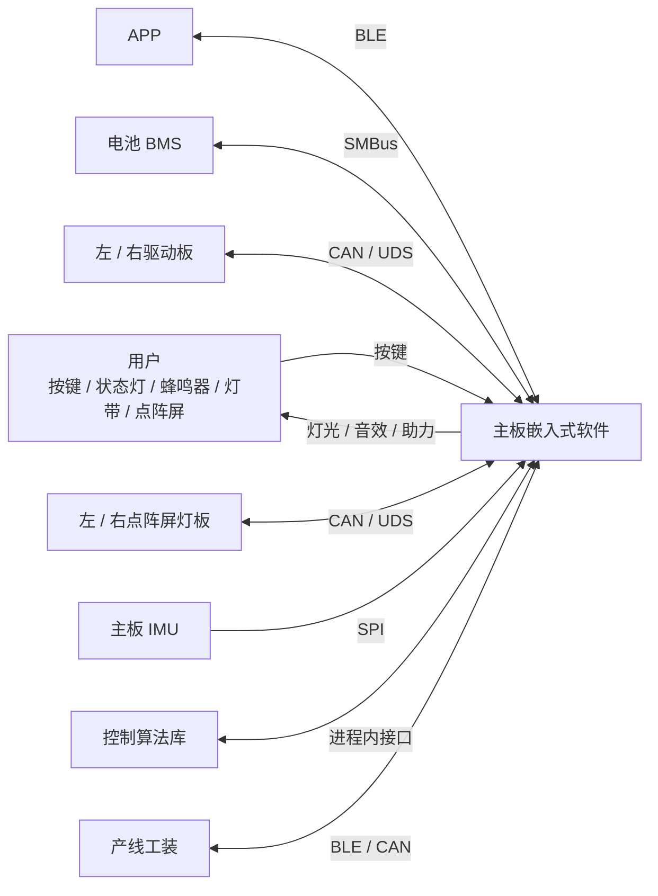

# 01-requirements.md —— RDH 主板嵌入式软件需求

> 角色：需求分析师 ｜ 依据：RDH嵌入式软件需求文档（DVT）V1.11 ｜ 版本：r1 ｜ 状态：待确认
> 本文件按 SWE.1 软件需求分析组织：概述 → 软件需求 → 追溯分析；变更历史见文首表格。
> 只写软件要做什么（可观察行为与验收），不写实现。
> 对外命令、格式、错误码属于软件需求的输入 / 输出；部署形态、模块、内部帧格式属于实现选择，写进 02/03。

**变更历史**

| 版本 | 状态 | 变更内容 | 变更日期 | 更改人 | 批准人 |
| --- | --- | --- | --- | --- | --- |
| r1 | 草稿 | 建档，按 DVT V1.11 主板软件需求整理 | 2026-11-18 | 需求分析师（AI 起草） | 项目组 |

## 1 概述

### 1.1 目的

定义 RDH DVT 版本主板嵌入式软件的可观察行为与验收依据，作为架构、详细设计与实现阶段的唯一需求输入。读者为主板软件开发者、驱动板与点阵屏灯板接口负责人、APP 与算法库对接人、生产测试负责人。

### 1.2 适用范围

覆盖主板嵌入式软件对外的全部可观察能力：

- 与 APP 的 BLE 通信、设备配对与 APP 功能集。
- 设备激活、终身累计步数与助力模式配置。
- 主板、驱动板、点阵屏灯板的固件升级管理。
- 与左右驱动板的 CAN 交互、与主板 IMU 的 SPI 交互、与控制算法库的接口。
- 与电池 BMS 的 SMBus 交互与电池告警、保护。
- 系统状态管理、故障与保护、点阵屏显示控制、用户交互与反馈。
- 生产测试模式与设备性能约束。

不覆盖：

- 左右驱动板、左右点阵屏灯板的内部实现，以其自身规格为准。
- APP 端软件、控制算法库内部实现、生产测试工装的内部实现。
- BLE、CAN、UDS、SMBus 协议帧的逐字节定义，以引用协议文档为准。
- 模块划分、接口签名、任务与调度等实现选择，写进 02/03。

### 1.3 术语和缩略语

| 术语 / 缩略语 | 含义 |
| --- | --- |
| 主板 | RDH 主控板，系统管理与通信中心；本文件的软件对象 |
| 驱动板 | 左右两侧电机驱动板，通过 CAN 与主板交互 |
| 点阵屏灯板 | 左右关节点阵屏，CAN 从机，只按主板指令显示 |
| BMS | 电池管理系统，主板通过 SMBus 读取电池状态 |
| APP | 手机上位机应用，通过 BLE 与主板交互 |
| 有效出厂配置 | 以当前板型固件默认值为基线，由合法工厂分区字段逐项覆盖后的配置 |
| 工装标识 | 电池 BMS 工装专用寄存器中的 16 位临时标识，仅本次开机有效 |
| 台架 | 产线老化、测试用支架；台架身份由开机时读取的工装标识判定 |
| 未激活 | 出厂后未完成 APP 注册激活的状态，按非台架累计步数额度限制使用 |
| 助力模式 | 用户可选的助力策略，当前对外为舒适、运动、抗阻、安心、缓速 5 种 |
| 助力等级 | 模式内的助力强度档位，1～8 档，8 档为 100% |
| 暂停助力 | 助力运行停止但系统仍处于开机态，可恢复 |
| 穿戴异常 | 算法判定绑缚不正确等穿戴问题，可经电源键短按或 APP 重置解除 |
| OTA | 空中固件升级，含主板、驱动板、点阵屏灯板三条链路 |
| UDS / CanTP | 统一诊断服务与 CAN 传输协议，用于固件与动画数据的大块传输 |
| SMBus | 主板与电池 BMS 之间的系统管理总线 |

### 1.4 参考文档

| 文档 | 版本 | 说明 |
| --- | --- | --- |
| RDH嵌入式软件需求文档（DVT） | V1.11 | 本文件的需求来源与追溯对象 |
| RDH BLE 通信协议书 | v2.1 | BLE 帧结构、字段映射、指令与 Notify 定义 |
| RDH 产品需求文档 | — | 产品级需求与交互定义 |
| RD_09 定制电池需求书 / BQ40Z80 RS.pdf | — | BMS 字段、刷新频率与保护阈值 |
| RD_09 生产测试工装需求文档 | — | FCT 与整机老化的测试流程与判据 |
| 控制算法接口说明 | — | 算法输入输出的单位、参数范围与二进制接口 |
| 00-contract.md | 待建 | 项目长期治理规则 |

## 2 软件需求

### 2.1 软件需求简介

#### 2.1.1 软件需求清单

| 需求编号 | 软件需求描述 | 需求类别 | 来源 | 备注 |
| --- | --- | --- | --- | --- |
| REQ-MB-BLE-001 | BLE 通信 | 接口 | DVT V1.11 主板软件需求 | 面向 APP |
| REQ-MB-PAIR-001 | 设备配对管理 | 功能性 | DVT V1.11 主板软件需求 | — |
| REQ-MB-APP-001 | 上位机 APP 通信 | 接口 | DVT V1.11 主板软件需求 | — |
| REQ-MB-REGISTER-001 | 设备激活 | 功能性 | DVT V1.11 主板软件需求 | 保护类异常 |
| REQ-MB-STEP-001 | 终身累计步数记录 | 功能性 | DVT V1.11 主板软件需求 | — |
| REQ-MB-CONFIG-001 | 助力模式配置管理 | 功能性 | DVT V1.11 主板软件需求 | 5 种用户模式 |
| REQ-MB-OTA-001 | 主板固件升级 | 功能性 | DVT V1.11 主板软件需求 | AB 双分区 |
| REQ-MB-OTA-002 | 驱动板固件升级管理 | 功能性 | DVT V1.11 主板软件需求 | CAN/UDS |
| REQ-MB-OTA-003 | 点阵屏固件升级管理 | 功能性 | DVT V1.11 主板软件需求 | CAN/UDS |
| REQ-MB-MOTOR-001 | 电机通信与控制 | 接口 | DVT V1.11 主板软件需求 | 周期性 CAN |
| REQ-MB-IMU-001 | IMU 通信 | 接口 | DVT V1.11 主板软件需求 | SPI |
| REQ-MB-ALGO-001 | 控制算法接口 | 接口 | DVT V1.11 主板软件需求 | 进程内接口 |
| REQ-MB-BMS-001 | 电池 BMS 通信 | 接口 | DVT V1.11 主板软件需求 | SMBus |
| REQ-MB-DBG-001 | 调试接口 | 接口 | DVT V1.11 主板软件需求 | 仅开发联调 |
| REQ-MB-SYS-001 | 系统管理 | 功能性 | DVT V1.11 主板软件需求 | 开关机与默认值 |
| REQ-MB-FLT-001 | 故障与保护 | 功能性 | DVT V1.11 主板软件需求 | 分级处置 |
| REQ-MB-DISP-001 | 点阵屏控制 | 功能性 | DVT V1.11 主板软件需求 | 点阵屏为从机 |
| REQ-MB-PT-001 | 版本读取 | 接口 | DVT V1.11 生产测试需求 | — |
| REQ-MB-PT-002 | 配置写入 | 接口 | DVT V1.11 生产测试需求 | 有效出厂配置 |
| REQ-MB-PT-003 | 钟摆老化测试模式 | 功能性 | DVT V1.11 生产测试需求 | — |
| REQ-MB-PT-004 | 主板 FCT 测试模式 | 功能性 | DVT V1.11 生产测试需求 | 引用工装需求 |
| REQ-MB-PT-005 | 整机老化测试模式 | 功能性 | DVT V1.11 生产测试需求 | 引用工装需求 |
| REQ-MB-PT-006 | 电机编码器按键标定入口 | 功能性 | DVT V1.11 生产测试需求 | 工厂构建 |
| REQ-MB-PT-007 | 产线工装标识识别 | 功能性 | DVT V1.11 生产测试需求 | 无线扫描识别 |
| REQ-MB-UI-001 | 用户交互与反馈 | 功能性 | DVT V1.11 交互需求 | 按键、灯光、音效 |
| REQ-PERF-COMM-001 | 通信实时性 | 非功能性 | DVT V1.11 性能需求 | — |
| REQ-PERF-CTRL-001 | 控制链路性能 | 非功能性 | DVT V1.11 性能需求 | — |
| REQ-PERF-OTA-001 | OTA 升级性能与可靠性 | 非功能性 | DVT V1.11 性能需求 | — |
| REQ-PERF-FAULT-001 | 故障响应性能 | 非功能性 | DVT V1.11 性能需求 | — |
| REQ-PERF-POWER-001 | 休眠与低功耗 | 非功能性 | DVT V1.11 性能需求 | — |
| REQ-PERF-FOC-001 | 驱动器 FOC 性能 | 非功能性 | DVT V1.11 性能需求 | 约束驱动板侧 |

#### 2.1.2 软件需求之间的依赖关系

| 需求 | 依赖的需求 | 说明 |
| --- | --- | --- |
| REQ-MB-BLE-001 | 无 | 无线通道基础 |
| REQ-MB-PAIR-001 | REQ-MB-BLE-001 | 配对依赖广播与连接 |
| REQ-MB-APP-001 | REQ-MB-BLE-001、REQ-MB-PAIR-001 | APP 功能依赖连接与身份 |
| REQ-MB-REGISTER-001 | REQ-MB-ALGO-001 | 额度按算法步数计算 |
| REQ-MB-STEP-001 | REQ-MB-ALGO-001 | 步数取自算法输出 |
| REQ-MB-CONFIG-001 | 无 | 配置独立生效 |
| REQ-MB-OTA-001 | REQ-MB-BLE-001 | 固件经 BLE 接收 |
| REQ-MB-OTA-002 | REQ-MB-OTA-001 | 复用升级会话与结果上报约束 |
| REQ-MB-OTA-003 | REQ-MB-OTA-001 | 复用升级会话与结果上报约束 |
| REQ-MB-MOTOR-001 | REQ-MB-ALGO-001、REQ-MB-FLT-001 | 控制量来自算法，异常按故障处置 |
| REQ-MB-IMU-001 | 无 | 传感器独立采集 |
| REQ-MB-ALGO-001 | REQ-MB-MOTOR-001、REQ-MB-IMU-001、REQ-MB-CONFIG-001 | 算法输入来自电机、IMU 与模式配置 |
| REQ-MB-BMS-001 | REQ-MB-FLT-001、REQ-MB-SYS-001 | 电池异常进入故障与开关机流程 |
| REQ-MB-DBG-001 | 无 | 调试能力独立 |
| REQ-MB-SYS-001 | REQ-MB-CONFIG-001、REQ-MB-FLT-001 | 开关机与模式、故障状态协同 |
| REQ-MB-FLT-001 | REQ-MB-MOTOR-001、REQ-MB-BMS-001、REQ-MB-ALGO-001、REQ-MB-OTA-001 | 聚合各来源故障 |
| REQ-MB-DISP-001 | REQ-MB-SYS-001、REQ-MB-CONFIG-001 | 显示随系统与模式状态切换 |
| REQ-MB-PT-001 | 无 | 产线读取入口 |
| REQ-MB-PT-002 | 无 | 产线写入入口 |
| REQ-MB-PT-003 | REQ-MB-MOTOR-001 | 位置环经电机链路执行 |
| REQ-MB-PT-004 | 无 | 测试模式入口 |
| REQ-MB-PT-005 | 无 | 测试模式入口 |
| REQ-MB-PT-006 | REQ-MB-DBG-001 | 生命周期状态可经调试通道查询 |
| REQ-MB-PT-007 | REQ-MB-BLE-001 | 标识影响 Scan Response |
| REQ-MB-UI-001 | REQ-MB-SYS-001、REQ-MB-FLT-001、REQ-MB-CONFIG-001、REQ-MB-DISP-001 | 反馈随系统、故障、模式与显示状态 |
| REQ-PERF-COMM-001 | REQ-MB-MOTOR-001、REQ-MB-BLE-001 | 约束 CAN 与 BLE 通信 |
| REQ-PERF-CTRL-001 | REQ-MB-ALGO-001 | 约束采集到算法的控制链路 |
| REQ-PERF-OTA-001 | REQ-MB-OTA-001 | 约束升级时长与可恢复性 |
| REQ-PERF-FAULT-001 | REQ-MB-FLT-001 | 约束故障响应时间与反馈 |
| REQ-PERF-POWER-001 | REQ-MB-SYS-001 | 约束休眠与唤醒功耗 |
| REQ-PERF-FOC-001 | REQ-MB-MOTOR-001 | 约束驱动板 FOC 反馈能力 |

### 2.2 交互框图

主板是系统管理与通信中心：向下通过 CAN 管理左右驱动板与左右点阵屏灯板，通过 SMBus 读取电池 BMS，通过 SPI 读取主板 IMU；向上通过 BLE 与 APP 交互；同时在进程内调用控制算法库；产线工装经 BLE 或 CAN 访问主板的生产测试能力。

输入与输出：

- 输入：用户按键、APP 的 BLE 指令、电池 BMS 状态、驱动板电机数据与按键事件、IMU 数据、算法输出、产线工装指令。
- 输出：电机控制量、状态灯与背部灯带、蜂鸣器、点阵屏动画指令、APP 状态上报与故障上报、OTA 结果、生产测试结果。

### 2.3 软件需求

#### 2.3.1 蓝牙、配对与 APP 通信

**[REQ-MB-BLE-001] BLE 通信**

**需求编号**：REQ-MB-BLE-001 ｜ **需求类别**：接口 ｜ **来源**：DVT V1.11 主板软件需求

**描述**：主板应通过 BLE 与 APP 通信，协议以 RDH BLE 通信协议书为准，作为设备控制与状态上报的无线通道。

**验证准则**：

- 主广播包应携带固定 12 字节 Service Data，至少包含服务 UUID 短格式、BLE 产品 ID、协议版本、BLE MAC 地址和配对标志，使扫描端能识别设备类型。
- 广播信息应包含设备唯一标识，至少为 MAC 地址或协议约定的唯一标识。
- 广播信息应能区分设备当前状态：配对模式与普通模式。
- BLE 服务 UUID、BLE 产品 ID、握手密钥和广播设备名应来自有效出厂配置，不得在固件中硬编码。
- 广播设备名应仅放在 Scan Response 中，扫描端使用主动扫描可获取；完整设备名应可通过 GATT Device Name 特征读取。
- 识别到有效工装标识时，Scan Response 设备名应追加四位大写十六进制后缀；普通电池或读取失败时保持原设备名。
- 应实现 Control Characteristic 与 OTA Characteristic。
- APP 连接后应可读取当前模式、助力等级、助力运行状态、已启用模式列表、各模式 LED 颜色与各模式最大助力等级。
- 嵌入式状态变化时，应通过 Notify 主动上报关键状态，至少包含当前模式、助力等级、助力运行/暂停状态、运动场景、配置变更结果与错误码。
- BLE 连接或断开不得直接导致电机助力异常中断，除非系统处于 OTA、配置写入或安全策略要求的场景。
- Notify 触发条件、节流策略和字段映射以 RDH BLE 通信协议书为准。

**依赖**：无

**[REQ-MB-PAIR-001] 设备配对管理**

**需求编号**：REQ-MB-PAIR-001 ｜ **需求类别**：功能性 ｜ **来源**：DVT V1.11 主板软件需求

**描述**：主板应支持设备配对模式和已配对设备身份管理，确保只有授权 APP 能控制设备。

**验证准则**：

- 设备开机状态下，连续长按电源键 5 s，主板应进入配对模式。
- 进入配对模式后，BLE 广播应携带配对模式标识，使未配对 APP 能够发现并发起配对。
- 配对成功后，主板应保存有效配对关系并自动退出配对模式；配对失败或连接中断时不得保存不完整的配对关系。
- 设备关机、配对超时或用户取消配对时，应退出配对模式。
- OTA、关机流程、测试模式或其它不允许用户配置的系统状态下，不应进入配对模式。
- 警告和故障状态下仍应允许进入配对模式，以便未配对 APP 连接排查。
- 故障状态下仍应允许关机和 OTA 升级；一旦进入关机或 OTA，应退出配对模式。
- 正常模式下，主板应仅允许已配对 APP 连接；未配对 APP 在设备未进入配对模式时不得获得控制权限。
- 配对关系应持久化保存，设备断电重启后继续有效。
- 单台设备最多保存 5 个配对身份，超出后应自动清理配对时间最久的身份。

**依赖**：REQ-MB-BLE-001

**[REQ-MB-APP-001] 上位机 APP 通信**

**需求编号**：REQ-MB-APP-001 ｜ **需求类别**：接口 ｜ **来源**：DVT V1.11 主板软件需求

**描述**：主板应通过 BLE 向 APP 提供设备控制与状态读取能力。

**验证准则**：

- 应支持设备配对、配对状态查询和解除配对。
- 应支持通过 APP 切换助力模式与调节助力等级。
- 应支持暂停助力和恢复助力。
- 应支持读取电量、步数、行走速度、版本信息和故障状态。
- 应支持 5 种用户助力模式（舒适、运动、抗阻、安心、缓速）的配置，包括模式启用/禁用、LED 指示灯颜色和每种模式最大助力等级。
- 应支持穿戴异常状态下的「重新执行穿戴检测」操作。
- 应支持读取出厂以来累计步数，返回存储状态字节与 uint32 步数。
- 应支持背部灯带开启/关闭设置。

**依赖**：REQ-MB-BLE-001、REQ-MB-PAIR-001

#### 2.3.2 设备激活与步数记录

**[REQ-MB-REGISTER-001] 设备激活**

**需求编号**：REQ-MB-REGISTER-001 ｜ **需求类别**：功能性 ｜ **来源**：DVT V1.11 主板软件需求

**描述**：设备出厂处于未激活状态，主板应支持 APP 注册激活，并按非台架累计步数额度限制未激活设备的使用。

**验证准则**：

- 未激活设备的使用限制按非台架累计行走步数计算，额度为工厂人工穿戴测试预留 1000 步与用户试用 3000 步之和（4000 步）；非台架累计步数严格超过 4000 步（即第 4001 步）时触发设备未激活锁定。
- 两部分额度共享，不分别计数。
- 台架身份复用开机时探测并缓存的 SMBus 工装标识；识别到有效工装标识时，算法步数只更新激活计数的采样基线，不消耗未激活额度。
- 普通电池、无效标识或标识读取失败时按非台架计步；上下台架需重新开机以刷新身份。
- 台架老化目标步数由工装独立配置，不参与固件未激活额度计算。
- 未激活累计步数应由主板自行记录并跨重启累计，按 100 步检查点保存到非易失存储，正常关机和主板 OTA 重启前补存。
- 计数记录不可用或持久化失败时应按锁定处理，不得重新获得试用额度。
- 触发未激活锁定后，主板应停止助力并将扭矩置零，但保留电机使能、不进入系统故障态。
- 锁定期间应仍可查询状态、进入配对、执行 OTA，并在激活后直接恢复用户操作。
- 未激活状态下应拒绝设置类操作（背部灯带开关、助力模式开关与自定义、点阵屏动画 ID）和助力启停、等级调节操作；调试类指令不受激活状态限制。
- 应支持 APP 通过 BLE 注册：APP 将服务端生成的凭证（raw ECDSA 签名，分包传输）发送至主板，主板应校验凭证，凭证仅能为单台设备激活。
- 激活生命周期标记应保存在独立工厂分区中，擦除运行期非易失存储不得使设备重新获得试用额度。
- 有效取消激活凭证应使设备从已激活回到锁定状态；重复激活和重复取消激活应为幂等操作。
- 激活成功后，主板应清除未激活锁定状态并允许用户操作，无需重启设备。

**依赖**：REQ-MB-ALGO-001

**[REQ-MB-STEP-001] 终身累计步数记录**

**需求编号**：REQ-MB-STEP-001 ｜ **需求类别**：功能性 ｜ **来源**：DVT V1.11 主板软件需求

**描述**：主板应记录自启用本功能以来的累计行走步数，用于售后统计和 APP 查询。

**验证准则**：

- 累计步数应取自算法输出的原始步数，跨重启自行累计；采样周期为 1 s，按 100 步检查点写入非易失存储。
- 台架老化、人工穿戴测试和用户使用的步数均应计入终身累计步数，不受未激活额度影响。
- 固件不保存老化目标；工装通过本轮结束值减去开始值统计本轮老化步数。
- 正常关机和主板 OTA 重启前应补存一次；写入失败时应限速重试（30 s），且不得阻塞实时任务。
- 存储记录应带完整性校验字段；记录缺失、非法或访问不可用时，应上报「计数记录不可用」状态并返回 0 步，不得重建为零值冒充真实步数。
- 首次启用本功能之前的历史步数无法补算，从启用时刻开始计数。
- 算法计数回退应视为算法复位，只更新基线不累计；总计数在 uint32 上限饱和。
- 调试用步数复位不得影响本累计值。

**依赖**：REQ-MB-ALGO-001

#### 2.3.3 助力配置与系统管理

**[REQ-MB-CONFIG-001] 助力模式配置管理**

**需求编号**：REQ-MB-CONFIG-001 ｜ **需求类别**：功能性 ｜ **来源**：DVT V1.11 主板软件需求

**描述**：主板应支持 5 种用户助力模式及其启用状态、最大助力等级和 LED 颜色的配置、持久化与约束。

**验证准则**：

- 应支持舒适、运动、抗阻、安心、缓速 5 种用户助力模式。
- 固件内部保留的其它模式（跑步、骑行、陡坡缓降、蹲起、左腿助力、右腿助力）对用户完全不可见：不出现在 APP 模式列表、模式开关和模式自定义配置中，不参与双击模式切换和开机首个模式选择，无对应按键手势，也不能成为当前助力模式或故障回切目标。
- 正式发布固件不应包含上述内部模式。
- 每种模式至少包含配置字段：启用状态（启用/禁用）、最大助力等级（1～8 档，8 档为 100%）、LED 指示灯颜色（RGB 三通道各 0～255）。
- 出厂默认启用 5 种用户模式，各模式默认最大助力等级为 8 档。
- 各模式均可被禁用，但至少要保留一种可用的模式。
- 设备端双击模式切换时，应仅在已启用模式范围内按舒适 → 运动 → 抗阻 → 安心 → 缓速的固定顺序循环切换，并跳过未启用模式。
- APP 请求切换到未启用模式时，主板应拒绝执行。
- 若 APP 禁用当前正在使用的模式，配置生效后主板应暂停助力，并切换到开机顺序中第一个仍开启的模式。
- 切换模式后，若当前助力等级高于目标模式最大助力等级，主板应自动将当前等级降低至该模式最大等级。
- 降低当前模式最大助力等级时，若当前等级高于新上限，主板应立即将当前等级降低至新上限。
- 切换模式或修改最大等级不得自动改变暂停/运行状态；禁用当前正在使用的模式时强制暂停，原处于暂停助力时处理完成后仍保持暂停。
- 模式颜色和最大助力等级应同时约束 APP 操作和设备按键操作。
- 模式配置应持久化保存在非易失性存储中，断电重启后继续生效。
- 配置数据应包含版本和完整性校验信息；读取到无效配置时，应恢复出厂默认配置并记录日志。
- 配置更新应具备原子性；写入失败时应继续使用更新前的有效配置。
- 主板 OTA 升级不应无故清除用户模式配置和配对关系；涉及配置格式升级时，应提供兼容或迁移策略。
- 生产测试或恢复出厂设置应能够恢复默认模式配置。
- 5 种用户模式的协议 ID、默认 LED 颜色与出厂默认启用状态如下：

| 模式 | 协议 ID | 默认 LED 颜色 | 出厂默认启用 |
| --- | --- | --- | --- |
| 舒适模式 | 0x61 | 绿色 RGB(0, 255, 0) | 是 |
| 运动模式 | 0x62 | 黄色 RGB(255, 255, 0) | 是 |
| 抗阻模式 | 0x63 | 蓝色 RGB(0, 0, 255) | 是 |
| 安心模式 | 0x67 | 橙色 RGB(255, 48, 0) | 是 |
| 缓速模式 | 0x6B | 青色 RGB(0, 255, 255) | 是 |

**依赖**：无

**[REQ-MB-SYS-001] 系统管理**

**需求编号**：REQ-MB-SYS-001 ｜ **需求类别**：功能性 ｜ **来源**：DVT V1.11 主板软件需求

**描述**：主板应统一管理系统状态、助力模式、助力等级、按键输入、APP 输入、故障状态、OTA 状态和用户反馈。

**验证准则**：

- 电池插入系统后，系统应默认进入休眠状态。
- 休眠状态下，短按左侧开关键应显示电池电量。
- 休眠状态下，短按左侧开关键后 500 ms 内再次按下并长按 2.5 s（自第二次按下起计），应启动开机流程。
- 开机完成后，应按舒适、运动、抗阻、安心、缓速的顺序进入首个已启用的助力模式，不记忆关机之前使用的助力模式。
- 开机完成后，助力默认等级为 25%，默认暂停助力，不记忆关机之前的助力等级。
- 开机状态下，短按左侧开关键后 500 ms 内再次按下并长按 2.5 s（自第二次按下起计），应启动关机流程。
- 故障状态下，电源键关机手势和 APP 关机命令仍应有效。
- 模式切换和助力等级调节应只在允许用户操作的系统状态下生效。

**依赖**：REQ-MB-CONFIG-001、REQ-MB-FLT-001

#### 2.3.4 固件升级

**[REQ-MB-OTA-001] 主板固件升级**

**需求编号**：REQ-MB-OTA-001 ｜ **需求类别**：功能性 ｜ **来源**：DVT V1.11 主板软件需求

**描述**：主板应支持通过 BLE 进行主板固件 OTA 升级。

**验证准则**：

- 应支持 AB 双分区升级。
- 应支持固件接收、完整性校验、重启切换和升级结果上报。
- 升级失败时应支持自动回滚或保持在可启动版本。
- 升级过程中应实时上报传输进度。
- 应定义断连、断电、校验失败、版本不匹配和写入失败时的系统行为。
- OTA 期间应限制与升级冲突的普通控制操作。
- 系统处于故障状态时，仍应允许启动 OTA 升级。

**依赖**：REQ-MB-BLE-001

**[REQ-MB-OTA-002] 驱动板固件升级管理**

**需求编号**：REQ-MB-OTA-002 ｜ **需求类别**：功能性 ｜ **来源**：DVT V1.11 主板软件需求

**描述**：主板应支持通过 BLE 接收左/右驱动板固件，并作为主站通过 CAN/UDS 控制驱动板完成升级。

**验证准则**：

- 升级链路应包括：APP 通过 BLE 将驱动板固件传输到主板；主板保存并校验固件大小、完整性、目标板类型和版本信息；主板通过 CAN/UDS 传输到目标驱动板；驱动板完成写入、校验、重启和结果上报。
- 应支持选择左驱动板或右驱动板。
- 升级失败、超时、目标板无响应、Flash 写入异常、校验失败等场景应有明确错误码和 APP 上报路径。

**依赖**：REQ-MB-OTA-001

**[REQ-MB-OTA-003] 点阵屏固件升级管理**

**需求编号**：REQ-MB-OTA-003 ｜ **需求类别**：功能性 ｜ **来源**：DVT V1.11 主板软件需求

**描述**：主板应支持通过 BLE 接收左/右点阵屏固件，并作为主站通过 CAN/UDS 控制点阵屏灯板完成升级。

**验证准则**：

- 升级链路应包括：APP 通过 BLE 将点阵屏固件传输到主板；主板保存并校验固件大小、完整性、目标板类型和版本信息；主板通过 CAN/UDS 传输到目标点阵屏灯板；灯板完成写入、校验、重启和结果上报。
- 应支持选择左侧或右侧点阵屏。
- 升级失败、超时、目标板无响应、Flash 写入异常、校验失败等场景应有明确错误码和 APP 上报路径。

**依赖**：REQ-MB-OTA-001

#### 2.3.5 运动控制与传感器接口

**[REQ-MB-MOTOR-001] 电机通信与控制**

**需求编号**：REQ-MB-MOTOR-001 ｜ **需求类别**：接口 ｜ **来源**：DVT V1.11 主板软件需求

**描述**：主板应通过 CAN 与左右驱动板周期性通信，完成电机数据采集、控制指令下发与安全控制。

**验证准则**：

- 应以不低于 500 Hz 的频率接收左右驱动板上报的电机端位置和电机端速度。
- 应以不低于 100 Hz 的频率接收左右驱动板上报的电机温度、系统状态和故障状态。
- 应以不低于 250 Hz 的频率向左右驱动板下发电机控制指令。
- 应支持控制左右电机使能和去使能。
- 在系统故障、OTA、关机、通信异常等场景下，应停止助力或进入安全控制行为。

**依赖**：REQ-MB-ALGO-001、REQ-MB-FLT-001

**[REQ-MB-IMU-001] IMU 通信**

**需求编号**：REQ-MB-IMU-001 ｜ **需求类别**：接口 ｜ **来源**：DVT V1.11 主板软件需求

**描述**：主板应通过 SPI 与主板 IMU 通信，周期性读取三轴加速度和三轴角速度，供控制算法与故障检测使用。

**验证准则**：

- 应周期性读取三轴加速度和三轴角速度。
- IMU 数据应提供给控制算法和系统故障检测使用。
- IMU 初始化失败、通信异常或数据异常时，主板应上报传感器相关故障并按故障策略处理。

**依赖**：无

**[REQ-MB-ALGO-001] 控制算法接口**

**需求编号**：REQ-MB-ALGO-001 ｜ **需求类别**：接口 ｜ **来源**：DVT V1.11 主板软件需求

**描述**：主板应提供控制算法运行所需的输入数据，并接收算法输出的控制量。

**验证准则**：

- 应向算法提供左右电机位置、左右电机速度、IMU 加速度、IMU 角速度、助力模式、助力等级和必要的控制参数。
- 应读取算法输出的左右电机控制量、穿戴检测结果、状态量和必要的诊断信息。
- 算法应以约定的故障码上报穿戴检测异常，至少区分速度环异常、能量异常和关节限位异常。
- 算法输入输出的单位、参数范围和二进制接口以控制算法接口说明为准。
- 算法异常、输出无效值、穿戴异常或控制环路异常时，主板应进入对应告警或故障处理路径。
- 算法库版本应可通过主板版本查询接口对 APP 上报。

**依赖**：REQ-MB-MOTOR-001、REQ-MB-IMU-001、REQ-MB-CONFIG-001

#### 2.3.6 电池管理

**[REQ-MB-BMS-001] 电池 BMS 通信**

**需求编号**：REQ-MB-BMS-001 ｜ **需求类别**：接口 ｜ **来源**：DVT V1.11 主板软件需求

**描述**：主板应通过 SMBus 与电池 BMS 通信，读取电池信息并据此完成开机检查、告警与故障保护。

**验证准则**：

- 通信协议以 BQ40Z80 RS.pdf 与电池需求书为准。
- 应周期性（当前为 1 s）读取并使用：SOC/剩余电量、电压、电流、温度、BatteryStatus 故障码（低 4 位）、满充容量与设计容量、循环次数及其它电池需求书要求的软件可见字段。
- 开机阶段应只读取 SOC 和 BatteryStatus 故障码，不读取电压、电流、温度和容量，避免非关键寄存器偶发失败阻止开机。
- SOC 与 BatteryStatus 读取应支持最多 3 次重试，间隔 10 ms。
- 持续通信失败、SOC ≤ 10% 或故障码非零时，应拒绝开机，显示对应电池提示后休眠。
- 运行期 SOC ≤ 25% 时，应上报低电量警告 0x31，实际下发扭矩乘以 0.5。
- V3 在本次开机内达到 25% 阈值即锁存半额输出，SOC 回升后不恢复全额，重新开机后再判断；V5 及以后版本使用实时 BMS SOC，回升至 25% 以上后解除降额。
- SOC ≤ 10% 时，应立即停止助力、扭矩置零，上报 0x32，提示结束后自动关机，并优先于 25% 降额。
- 告警提示应保持 10 s；SOC 仍处于对应区间时心跳应继续上报对应告警；降额锁存不使 SOC 回升后继续上报 0x31。
- BatteryStatus 低 4 位故障码连续 3 次有效采样非零，或电池包电压低于 16.8 V 或高于 30.0 V，应判定电池故障并锁存。
- 电压、电流、温度和 SOC 连续 5 次读取失败应判定 BMS 通信故障并锁存；锁存后不因总线恢复自动清除，需重启设备。
- 电池故障应停止助力、去使能电机、进入故障态并清除低电量告警位。

**依赖**：REQ-MB-FLT-001、REQ-MB-SYS-001

#### 2.3.7 故障与保护

**[REQ-MB-FLT-001] 故障与保护**

**需求编号**：REQ-MB-FLT-001 ｜ **需求类别**：功能性 ｜ **来源**：DVT V1.11 主板软件需求

**描述**：系统故障管理应覆盖检测、分级、处置、恢复、上报和记录。

**验证准则**：

- 主板应聚合主板、驱动板、电池 BMS、算法库和 OTA 流程中的故障。
- 警告等级别告警应提示用户，并保留助力。
- 故障等级应停止助力、去使能电机，并持续提示用户。
- 故障状态下仍应允许用户关机和 OTA 升级；进入关机或 OTA 后按对应流程处置，不得把升级或关机会话打回故障态。
- 故障状态变化应通过 BLE Notify 上报 APP。
- 关键故障应支持掉电保存或持久化日志，便于售后分析。
- 同时存在多个故障时，应按最高优先级故障进行用户反馈和系统处置；优先级由低到高为：低电量 25% 警告、低电量 10% 警告、设备未激活、电池故障、固件更新故障、穿戴异常、控制环路异常、传感器失效、电机故障、通信故障、过温异常、跌倒异常。
- 设备未激活属于保护类异常：只停止助力并将扭矩置零，保留电机使能且不进入系统故障态，激活后可直接恢复用户操作。
- 低电量告警应在提示 10 s 后自动清除；故障类异常在本次上电内锁存，仅穿戴异常可通过电源键短按或 APP 重置穿戴检测解除。
- 穿戴异常解除后，系统应清除穿戴告警、重新使能电机，并回到当前助力模式的暂停状态。

**依赖**：REQ-MB-MOTOR-001、REQ-MB-BMS-001、REQ-MB-ALGO-001、REQ-MB-OTA-001

#### 2.3.8 显示与调试

**[REQ-MB-DISP-001] 点阵屏控制**

**需求编号**：REQ-MB-DISP-001 ｜ **需求类别**：功能性 ｜ **来源**：DVT V1.11 主板软件需求

**描述**：主板应控制两侧关节点阵屏的显示。点阵屏灯板为从机，不保存当前播放动画 ID，动画 ID 由主板全权控制并持久化。

**验证准则**：

- 当前播放动画 ID 应仅保存在主板；整机使用同一个 ID，左右侧同步下发；单侧通信失败不影响另一侧。
- 主板应仅在 APP 设置点阵屏动画 ID（含 0x00 关闭）时将目标 ID 写入非易失存储；从未设置过时使用可配置的默认动画 ID（当前为 1）。
- APP 查询当前动画 ID 时，主板应返回已保存的目标 ID；0x00 仅表示目标为关闭，不表示通信失败导致的黑屏。
- 点阵屏上电默认息屏；主板在开机确认完成前（4 颗状态灯仍处于开机白灯进度）不得向点阵屏下发播放命令；此期间若收到 APP 设置，只更新存储，确认后再下发。
- 开机确认完成（4 颗状态灯由白灯切换为第一助力模式颜色）后，主板应按统一路径下发：先下发动画 ID，再下发静态/动态播放模式；目标为 0 时由灯板关屏并忽略走/停命令。
- CAN 协议应保持动画 ID 与播放模式两条独立命令，不合并。
- 暂停助力或任一助力模式的静止状态下，两侧屏幕显示对应动画的静态图案；任一已启用助力模式的非静止状态下，显示动态图案。
- 播放模式变化时应立即按「动画 ID → 播放模式」下发，并以秒级周期补发，供晚就绪或复位后的灯板恢复。
- 关机倒计时期间点阵屏保持当前画面；关机确认完成、4 颗状态灯全部熄灭时，主板应下发一次关闭（动画 ID = 0），停止周期下发后断电；无倒计时的关机路径在进入关机态时同样下发一次关闭。
- 点阵屏 CAN 通信失败不得上报系统通信故障，不得中断开机和助力。
- 点阵屏固件升级失败应按固件升级需求处理。
- 应预留传输新动画包至点阵屏的接口。

**依赖**：REQ-MB-SYS-001、REQ-MB-CONFIG-001

**[REQ-MB-DBG-001] 调试接口**

**需求编号**：REQ-MB-DBG-001 ｜ **需求类别**：接口 ｜ **来源**：DVT V1.11 主板软件需求

**描述**：主板应支持调试数据输出能力，用于开发、联调和问题定位，且不影响量产功能与安全行为。

**验证准则**：

- 应至少支持输出系统状态、关键传感器数据、左右电机状态、BLE 状态、CAN 状态、电池状态、故障码和 OTA 状态。
- 应支持通过 BLE 打印日志。
- 应支持查看左右侧扭矩曲线和左右侧驱动器位置曲线。
- 应支持查看左右侧驱动器 Q 轴电流曲线。
- 应支持读写算法参数，包括蹲起模式的线性助力刚度、助力启动位置和助力预载扭矩；该能力仅用于算法联调，不得为对应用户模式提供任何入口。
- 应支持查询电机编码器按键标定生命周期状态，并支持永久锁定按键标定入口。
- 调试类指令不应受设备激活状态限制；设备处于故障状态下仍应可执行调试查询与参数读写，仅受双层认证约束。

**依赖**：无

#### 2.3.9 生产测试

**[REQ-MB-PT-001] 版本读取**

**需求编号**：REQ-MB-PT-001 ｜ **需求类别**：接口 ｜ **来源**：DVT V1.11 生产测试需求

**描述**：生产测试工装应能读取主板及关联板卡的信息。

**验证准则**：

- 应能读取主板软件版本、主板硬件版本（格式为 Vn）、主板序列号、算法库版本、产品型号、产品序列号、BLE MAC 地址。
- 应能读取左右驱动板、左右点阵屏的软件版本和硬件版本（硬件版本格式为 Vn）。

**依赖**：无

**[REQ-MB-PT-002] 配置写入**

**需求编号**：REQ-MB-PT-002 ｜ **需求类别**：接口 ｜ **来源**：DVT V1.11 生产测试需求

**描述**：生产测试工装应能写入出厂配置，主板运行期使用由工厂分区覆盖后的有效出厂配置。

**验证准则**：

- 应能写入：主板硬件版本（Vn）、产品型号、BLE 广播设备名、BLE 服务 UUID、BLE 握手密钥、激活校验公钥、BLE 产品 ID、产品序列号（由工装经 CAN 写入运行期非易失存储，单板不超过 64 字节）、主板序列号。
- 出厂配置应保存在独立工厂分区。
- 运行期应使用「有效出厂配置」：以当前板型固件默认值为基线，仅由工厂分区中存在且合法的字段逐项覆盖。
- 字段缺失、长度非法或分区访问失败时应保持固件默认值，设备仍可正常启动。
- 生产测试或恢复出厂设置应能够恢复默认出厂配置。

**依赖**：无

**[REQ-MB-PT-003] 钟摆老化测试模式**

**需求编号**：REQ-MB-PT-003 ｜ **需求类别**：功能性 ｜ **来源**：DVT V1.11 生产测试需求

**描述**：应实现钟摆老化测试模式，通过位置环控制左右电机输出扭矩，主动模拟正常工况。

**验证准则**：

- 可通过外部接口控制系统进入和退出钟摆老化测试模式。
- 可设置最大角度、步频、扭矩等参数。

**依赖**：REQ-MB-MOTOR-001

**[REQ-MB-PT-004] 主板 FCT 测试模式**

**需求编号**：REQ-MB-PT-004 ｜ **需求类别**：功能性 ｜ **来源**：DVT V1.11 生产测试需求

**描述**：应实现主板 FCT 测试模式，检查各模块是否按预期正常工作并返回测试结果。

**验证准则**：

- 应能通过外部接口进入和退出 FCT 测试模式。
- 应返回各模块的检查结果与整体测试结论。
- 测试项与判据以 RD_09 生产测试工装需求文档为准。

**依赖**：无

**[REQ-MB-PT-005] 整机老化测试模式**

**需求编号**：REQ-MB-PT-005 ｜ **需求类别**：功能性 ｜ **来源**：DVT V1.11 生产测试需求

**描述**：应实现整机老化测试模式，检查各模块是否按预期正常工作并返回测试结果。

**验证准则**：

- 应能通过外部接口进入和退出整机老化测试模式。
- 应返回各模块的检查结果与整体测试结论。
- 测试项与判据以 RD_09 生产测试工装需求文档为准。

**依赖**：无

**[REQ-MB-PT-006] 电机编码器按键标定入口**

**需求编号**：REQ-MB-PT-006 ｜ **需求类别**：功能性 ｜ **来源**：DVT V1.11 生产测试需求

**描述**：应实现电机编码器按键标定入口，用于产线在无调试工具时触发左右电机编码器标定。

**验证准则**：

- 该功能应由固件编译配置（Kconfig）控制，工厂构建默认开启，正式发布构建应关闭；关闭后不编译该模块，按键行为与普通版本一致。
- 待机状态（助力暂停）下，长按助力减档键 3 s 后应播放 3 声倒计时提示音，倒计时结束后触发左右电机编码器标定；未完成长按即释放时保留原减档按键行为。
- 按键标定入口应具有可查询、可永久关闭的生命周期记录，保存在非易失存储中，由工厂烧录预置初始记录：OPEN（可触发）、TRIGGERED（已触发、待工装验证）、LOCKED（入口已永久关闭）、STORAGE_ERROR（记录缺失、非法或访问失败，入口按关闭处理）。
- 应支持通过认证 BLE 指令查询生命周期状态。
- 应支持在 OPEN 或 TRIGGERED 状态下永久锁定为 LOCKED，重复锁定返回成功；锁定后不提供重新开启入口。
- 锁定只关闭按键入口，不影响其他标定通道。
- 生命周期记录写入失败或记录异常时，按键入口应保持关闭，且不得影响整机其他功能。

**依赖**：REQ-MB-DBG-001

**[REQ-MB-PT-007] 产线工装标识识别**

**需求编号**：REQ-MB-PT-007 ｜ **需求类别**：功能性 ｜ **来源**：DVT V1.11 生产测试需求

**描述**：应支持产线通过无线扫描识别带工装的设备，便于老化、测试环节按设备定位。

**验证准则**：

- 开机确认后，主板应尝试从电池 BMS 的工装专用寄存器读取 16 位临时标识；读取失败时不影响电池故障判断和正常开机。
- 设备在台架上完成主板固件更新后，软件重启应提前读取工装标识；识别到有效标识时直接开机，无需按键操作，不再进入默认休眠。
- 普通电池、无效标识或读取失败时应仍按原有软件复位规则进入休眠；电池插入后的默认休眠和按键唤醒流程保持不变。
- 读到有效标识时，BLE Scan Response 设备名应在出厂设备名后追加 `-XXXX`（四位大写十六进制）。
- 主广播包和 12 字节 Service Data 内容应保持不变。
- 标识应仅在本次开机有效，不写入非易失存储；普通电池或读取失败时设备名保持原样。

**依赖**：REQ-MB-BLE-001

#### 2.3.10 用户交互与反馈

**[REQ-MB-UI-001] 用户交互与反馈**

**需求编号**：REQ-MB-UI-001 ｜ **需求类别**：功能性 ｜ **来源**：DVT V1.11 交互需求

**描述**：主板应把按键输入和系统状态转换为状态灯、蜂鸣器、背部灯带、点阵屏和 APP 上报等用户可感知的反馈。

**验证准则**：

- 按键应包含：左侧电机外壳开关键；右侧电机外壳助力加键、助力减键。
- 按键动作应包含：短按（按下到回弹不足 1 s，等待 500 ms 多击判定窗口）、长按（1 s 至 5 s）、持续长按（按住 5 s）、开机组合键、关机组合键、双击模式切换、工厂构建下的标定长按。
- 用户反馈通道应包含：右侧 4 颗状态 LED、蜂鸣器、背部两侧 LED 灯带、关节两侧点阵屏灯板、电机助力反馈、APP 状态上报。
- 开机：短按后白灯亮起且数量对应电量；长按 2.5 s 后白灯由 1 颗逐次递增至 4 颗，第 1 至 2 颗亮时系统上电，第 3 至 4 颗亮时自检，自检完成后切换为首个可用助力模式颜色。
- 关机：短按后白灯数量对应电量；长按 2.5 s 后白灯由 4 颗逐次递减至 1 颗再到全部熄灭后关机。
- 配对：4 颗状态 LED 应紫色呼吸，呼吸最低亮度 2%，完整周期约 2 s，背部灯带同步；配对成功后紫色闪烁 3 s（250 ms 翻转），再恢复当前助力状态显示。
- 助力等级：4 颗 LED 对应 25%、50%、75%、100% 等级；按键只支持 25% 步长调节；调节后小于 0 时保持当前等级并暂停助力；暂停时按加键或减键应恢复助力。
- 助力模式切换：双击短按开关机按键，在已启用模式内按固定顺序循环并跳过未启用模式；颜色由配置决定。
- 暂停/恢复助力：开机状态下单次短按电源键；暂停时使用当前模式颜色闪烁，恢复后显示当前模式颜色和助力等级。
- APP 连接：应紫色闪烁 3 s 后回到助力模式等级灯光；APP 断开连接无特殊灯光。
- 电量显示：4 颗白灯常亮分别表示 75%～100%、50%～74%、25%～49%、10%～24%；电量首次低于 25%、10% 阈值时 4 颗白灯全亮全灭交替 0.3 s；电池故障时 4 颗红灯闪烁；显示时长 3 s。
- 点阵屏：开机确认前两侧保持息屏；暂停或静止状态显示静态图案；非静止状态显示动态图案；跌倒异常时两侧动态播放 SOS 动画；关机倒计时保持当前画面，4 颗状态灯全部熄灭后关屏。
- 背部灯带：开机过程中逐颗点亮白灯，关机倒计时逐颗熄灭；除开关机进度外，颜色和亮灭应跟随 4 颗状态灯当前显示帧；用户可在 APP 关闭灯带，关闭后任何状态均熄灭。
- 异常灯效频率：低电量提醒亮 300 ms、灭 300 ms；3 Hz 亮约 167 ms、灭约 167 ms；故障红灯亮 200 ms、灭 200 ms；电池故障红灯约 3 Hz。
- 蜂鸣器故障脉冲音应仅用于固件更新故障、跌倒异常和设备未激活。

**依赖**：REQ-MB-SYS-001、REQ-MB-FLT-001、REQ-MB-CONFIG-001、REQ-MB-DISP-001

#### 2.3.11 性能需求

**[REQ-PERF-COMM-001] 通信实时性**

**需求编号**：REQ-PERF-COMM-001 ｜ **需求类别**：非功能性 ｜ **来源**：DVT V1.11 性能需求

**描述**：主板通信应满足电机控制、状态采集、故障检测与 APP 刷新的实时性要求。

**验证准则**：

- 主板与驱动板 CAN 通信应满足电机控制、状态采集和故障检测的实时性要求。
- 驱动板状态和电机数据上报应满足系统控制算法和故障检测需求。
- BLE 状态上报应满足 APP 用户界面及时刷新，且不得因高频 Notify 影响控制安全。

**依赖**：REQ-MB-MOTOR-001、REQ-MB-BLE-001

**[REQ-PERF-CTRL-001] 控制链路性能**

**需求编号**：REQ-PERF-CTRL-001 ｜ **需求类别**：非功能性 ｜ **来源**：DVT V1.11 性能需求

**描述**：从传感器与电机数据采集到算法调用、控制量下发的链路应满足助力控制稳定性要求。

**验证准则**：

- 控制算法运行频率应不低于 250 Hz。
- 主板采集传感器、电机数据、调用算法和下发控制量的链路应满足助力控制稳定性要求。
- 算法输入数据应保持左右电机、IMU、助力模式和助力等级的一致性。
- 控制链路发生数据超时、算法异常或输出无效时，系统应进入降级或故障处理路径。

**依赖**：REQ-MB-ALGO-001

**[REQ-PERF-OTA-001] OTA 升级性能与可靠性**

**需求编号**：REQ-PERF-OTA-001 ｜ **需求类别**：非功能性 ｜ **来源**：DVT V1.11 性能需求

**描述**：OTA 升级应在规定时长内完成并支持进度上报与失败恢复。

**验证准则**：

- 主板 OTA 和驱动板 OTA 应支持进度上报，使 APP 能显示升级进度。
- 主板固件升级应在 1 分钟内完成。
- 驱动板、灯板固件升级应在 30 s 内完成。
- 升级过程中发生断连、断电、校验失败、目标节点无响应或其它故障时，系统应保持可恢复能力。

**依赖**：REQ-MB-OTA-001

**[REQ-PERF-FAULT-001] 故障响应性能**

**需求编号**：REQ-PERF-FAULT-001 ｜ **需求类别**：非功能性 ｜ **来源**：DVT V1.11 性能需求

**描述**：故障检测到保护动作与用户反馈的时延应满足安全要求。

**验证准则**：

- 对影响运动安全的故障，系统应在 50 ms 内停止助力或进入保护状态。
- 故障触发后，LED、蜂鸣器和 APP 上报应按故障优先级及时反馈。

**依赖**：REQ-MB-FLT-001

**[REQ-PERF-POWER-001] 休眠与低功耗**

**需求编号**：REQ-PERF-POWER-001 ｜ **需求类别**：非功能性 ｜ **来源**：DVT V1.11 性能需求

**描述**：系统休眠状态应满足低功耗要求，且开关机与唤醒不造成异常耗电。

**验证准则**：

- 静态功耗应小于 100 uA。
- 电池插入后系统应默认进入休眠状态。
- 休眠状态下系统应仅保留必要的唤醒和电量显示能力。
- 开机、关机、休眠唤醒和电量显示不应造成异常耗电。

**依赖**：REQ-MB-SYS-001

**[REQ-PERF-FOC-001] 驱动器 FOC 性能**

**需求编号**：REQ-PERF-FOC-001 ｜ **需求类别**：非功能性 ｜ **来源**：DVT V1.11 性能需求

**描述**：驱动板 FOC 控制链路应满足产品助力控制对实时性、稳定性和安全性的要求。

**验证准则**：

- 电流采样、编码器更新、FOC 计算和 PWM 更新应在高频控制链路内稳定运行。
- 电流闭环应支持主板周期性控制指令输入，并在限幅和保护约束内平滑响应。
- 速度、位置、电流和温度反馈应满足控制算法和故障检测的刷新需求。
- FOC 控制频率、采样频率、闭环带宽、响应时间、允许抖动和测试方法应在驱动板软件设计说明书和测试用例中定义。

**依赖**：REQ-MB-MOTOR-001

## 3 追溯分析

### 3.1 系统需求与软件需求的追溯分析

| 系统需求编号 | 安全等级（如适用） | 软件需求编号 | 安全等级（如适用） |
| --- | --- | --- | --- |
| DVT V1.11 主板软件需求 BLE 通信 | 不适用 | REQ-MB-BLE-001 | 不适用 |
| DVT V1.11 主板软件需求 设备配对管理 | 不适用 | REQ-MB-PAIR-001 | 不适用 |
| DVT V1.11 主板软件需求 上位机 APP 通信 | 不适用 | REQ-MB-APP-001 | 不适用 |
| DVT V1.11 主板软件需求 设备激活 | 不适用 | REQ-MB-REGISTER-001 | 不适用 |
| DVT V1.11 主板软件需求 终身累计步数记录 | 不适用 | REQ-MB-STEP-001 | 不适用 |
| DVT V1.11 主板软件需求 助力模式配置管理 | 不适用 | REQ-MB-CONFIG-001 | 不适用 |
| DVT V1.11 主板软件需求 主板固件升级 | 不适用 | REQ-MB-OTA-001 | 不适用 |
| DVT V1.11 主板软件需求 驱动板固件升级管理 | 不适用 | REQ-MB-OTA-002 | 不适用 |
| DVT V1.11 主板软件需求 关节点阵屏固件升级管理 | 不适用 | REQ-MB-OTA-003 | 不适用 |
| DVT V1.11 主板软件需求 电机通信与控制 | 不适用 | REQ-MB-MOTOR-001 | 不适用 |
| DVT V1.11 主板软件需求 IMU 通信 | 不适用 | REQ-MB-IMU-001 | 不适用 |
| DVT V1.11 主板软件需求 控制算法接口 | 不适用 | REQ-MB-ALGO-001 | 不适用 |
| DVT V1.11 主板软件需求 电池 BMS 通信 | 不适用 | REQ-MB-BMS-001 | 不适用 |
| DVT V1.11 主板软件需求 调试接口 | 不适用 | REQ-MB-DBG-001 | 不适用 |
| DVT V1.11 主板软件需求 系统管理 | 不适用 | REQ-MB-SYS-001 | 不适用 |
| DVT V1.11 主板软件需求 故障与保护 | 不适用 | REQ-MB-FLT-001 | 不适用 |
| DVT V1.11 主板软件需求 点阵屏控制 | 不适用 | REQ-MB-DISP-001 | 不适用 |
| DVT V1.11 生产测试需求 版本读取 | 不适用 | REQ-MB-PT-001 | 不适用 |
| DVT V1.11 生产测试需求 配置写入 | 不适用 | REQ-MB-PT-002 | 不适用 |
| DVT V1.11 生产测试需求 钟摆老化测试模式 | 不适用 | REQ-MB-PT-003 | 不适用 |
| DVT V1.11 生产测试需求 主板 FCT 测试模式 | 不适用 | REQ-MB-PT-004 | 不适用 |
| DVT V1.11 生产测试需求 整机老化测试模式 | 不适用 | REQ-MB-PT-005 | 不适用 |
| DVT V1.11 生产测试需求 电机编码器按键标定入口 | 不适用 | REQ-MB-PT-006 | 不适用 |
| DVT V1.11 生产测试需求 产线工装标识识别 | 不适用 | REQ-MB-PT-007 | 不适用 |
| DVT V1.11 交互需求 按键与用户反馈 | 不适用 | REQ-MB-UI-001 | 不适用 |
| DVT V1.11 性能需求 通信实时性 | 不适用 | REQ-PERF-COMM-001 | 不适用 |
| DVT V1.11 性能需求 控制链路性能 | 不适用 | REQ-PERF-CTRL-001 | 不适用 |
| DVT V1.11 性能需求 OTA 升级性能与可靠性 | 不适用 | REQ-PERF-OTA-001 | 不适用 |
| DVT V1.11 性能需求 故障响应性能 | 不适用 | REQ-PERF-FAULT-001 | 不适用 |
| DVT V1.11 性能需求 休眠与低功耗 | 不适用 | REQ-PERF-POWER-001 | 不适用 |
| DVT V1.11 性能需求 驱动器 FOC 性能 | 不适用 | REQ-PERF-FOC-001 | 不适用 |

### 3.2 系统架构设计与软件需求的追溯分析

上游未提供与本软件对象对应的系统架构设计，架构落点由 02 阶段建立并在此补充回溯。

| 架构编号 | 安全等级（如适用） | 软件需求编号 | 安全等级（如适用） |
| --- | --- | --- | --- |
| 不适用 | 不适用 | 全部 31 条软件需求 | 不适用 |
