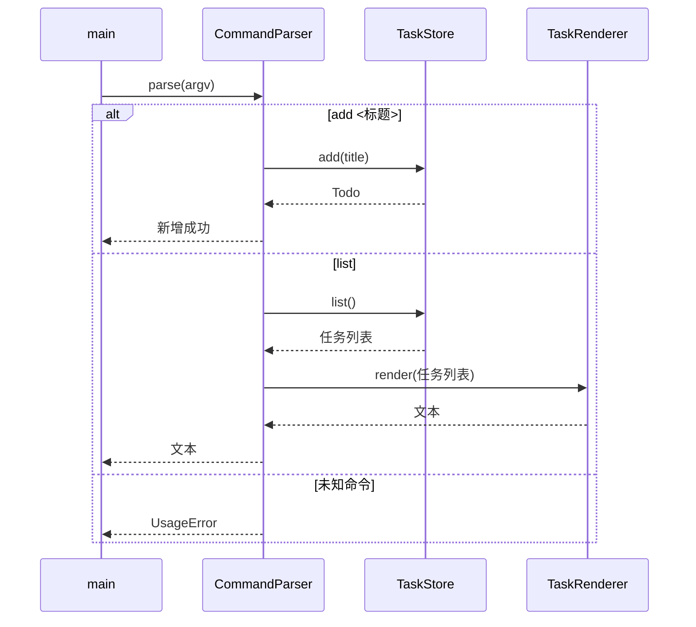
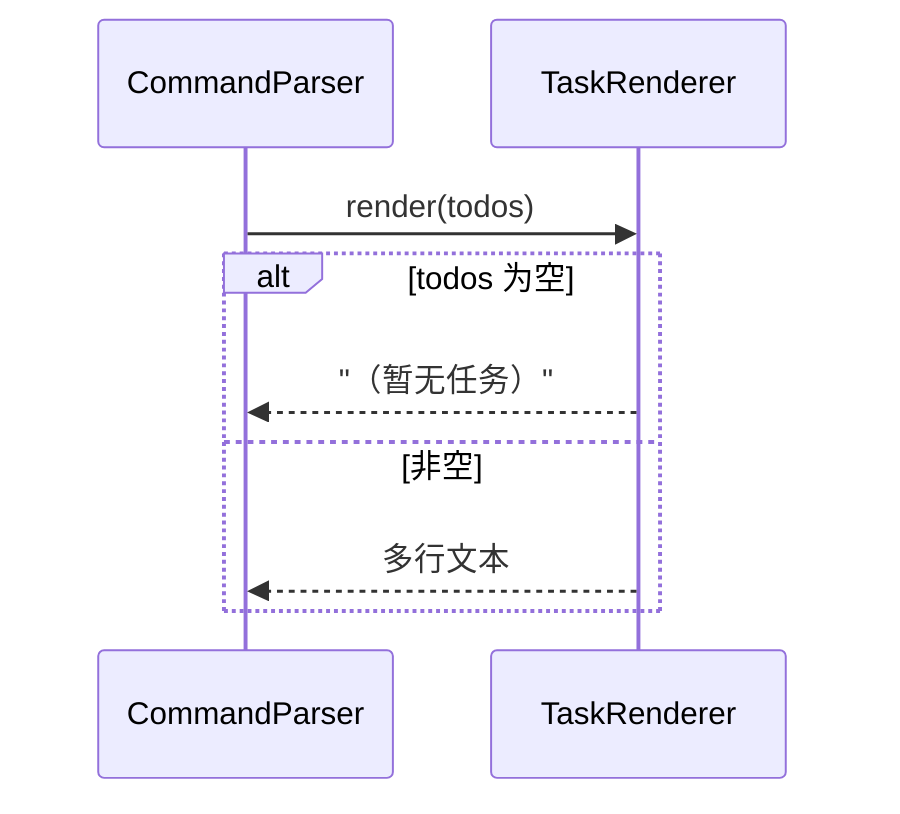
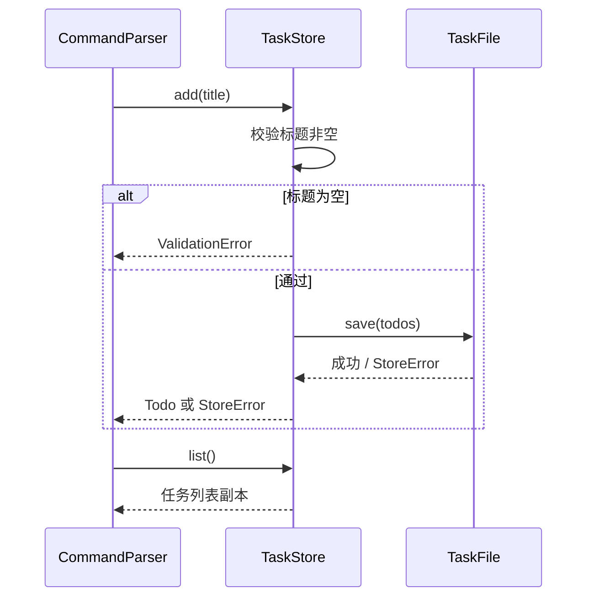
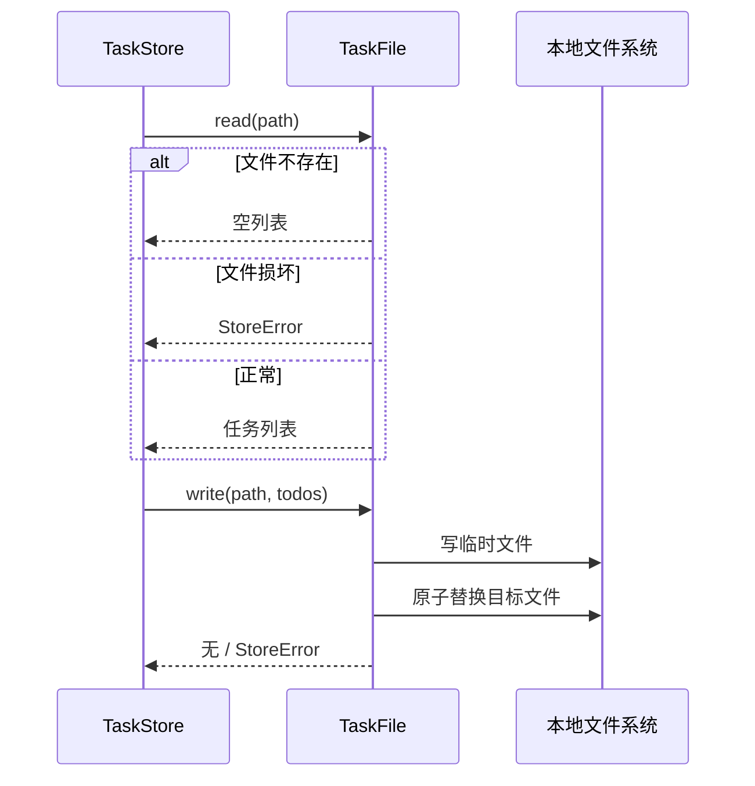
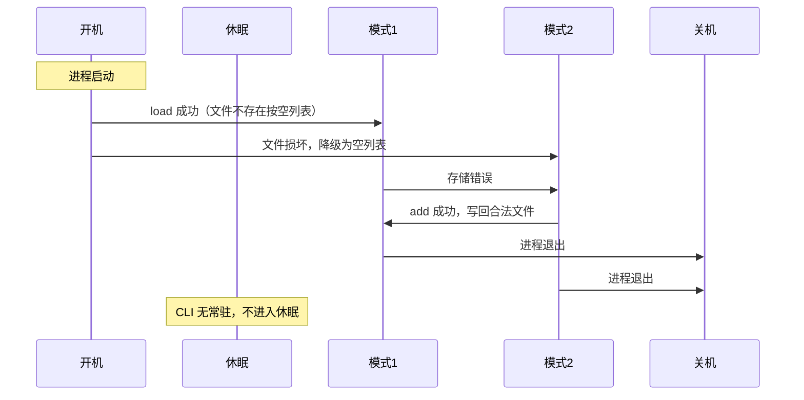

# 02-architecture.md —— Todo CLI 软件架构设计规范

> 角色：架构师 ｜ 依据：01-requirements.md ｜ 版本：v1.0 ｜ 状态：已确认

# 1 修订记录/Revision record

版本命名规则：vX.Y；内容变更 Y 加 1，批准发布 X 加 1、Y 归 0。

| 版本 | 状态 | 变更内容 | 变更日期   | 更改人   | 批准人   |
| ---- | ---- | -------- | ---------- | -------- | -------- |
| v1.0 | 已确认 | 建档     | 2026-11-19 | 示例用户 | 示例用户 |

# 2 简介

## 2.1 目的

定义 Todo CLI 的软件架构：软件分解（三层组件）、组件间接口与依赖、动态行为、资源消耗目标、调度与异常，作为软件详细设计的输入。

## 2.2 范围

覆盖 Todo CLI v1 的软件架构；不覆盖多用户、同步、图形界面。

## 2.3 术语和缩略语

| 术语/缩略语 | 解释 |
| ----------- | ---- |
| 应用层 | 面向用户的命令解析与结果呈现 |
| 中间层 | 业务数据持有与业务规则 |
| 驱动层 | 与外部环境（文件系统）打交道的适配层 |
| 组件 | 可独立命名、可独立交接给详细设计的软件单元 |
| SSR | 软件需求，编号见 01-requirements.md |

## 2.4 参考文档

| 文档编号 | 文档名称 | 版本 | 发布日期   |
| -------- | -------- | ---- | ---------- |
| —        | 01-requirements.md | v1.0 | 2026-11-19 |
| —        | 00-contract.md     | v1.0 | 2026-11-19 |

# 3 资源

> 软件运行与开发所依赖的环境基线。软件自身对这些资源的消耗上限在「5.5 资源消耗目标」。

## 3.1 硬件资源

| 资源   | 规格 / 容量 | 用途     | 约束 |
| ------ | ----------- | -------- | ---- |
| 宿主机 | x86_64 / ARM64 | 运行 CLI | 无特殊硬件依赖；单进程 |

## 3.2 软件环境

| 资源         | 版本 / 规格 | 用途     | 约束 |
| ------------ | ----------- | -------- | ---- |
| Python       | 3.x         | 运行时   | 仅标准库，无第三方依赖 |
| 本地文件系统 | 可读写工作目录 | 任务持久化 | 单进程访问；支持原子替换 |

## 3.3 外部系统与接口

无。本示例不连接外部系统，只读写本地 JSON 文件。

# 4 沟通计划

| 会议 / 评审 | 参与人 | 频率 | 输出 |
| ----------- | ------ | ---- | ---- |
| 架构评审 | 架构师、需求分析师、详细设计师 | 每次变更 | 评审记录 / 修改项 |

# 5 软件架构设计

## 5.1 软件描述

Todo CLI 是单进程命令行程序，按三层分解：

- 应用层：CommandParser 解析子命令与参数并分发；TaskRenderer 把任务列表格式化为文本。
- 中间层：TaskStore 持有任务集合、执行新增与列出的业务规则。
- 驱动层：TaskFile 负责 JSON 序列化、文件读写与原子替换。

CLI 入口（`src/main.py`）只做组装与错误码映射，不承载业务逻辑。依赖方向自应用层指向中间层、再指向驱动层，驱动层不反向依赖任何组件。

## 5.2 外部接口

| 接口ID     | 接口描述 | 发送方 | 接收方  | 格式 | 大小 | 分辨率 | 质量 | 信息 | 频率 | 约束条件 |
| ---------- | -------- | ------ | ------- | ---- | ---- | ------ | ---- | ---- | ---- | -------- |
| IF-EXT-001 | 用户命令 | 用户   | Todo CLI | 命令行文本 | 小 | 不适用 | 不适用 | 子命令与参数 | 每次调用 | 单次调用；未知命令返回非零退出码 |
| IF-EXT-002 | 命令结果 | Todo CLI | 用户   | 标准输出 / 标准错误文本 | 小 | 不适用 | 不适用 | 提示语与任务列表 | 每次调用 | 任务列表一行一条，脚本可解析 |

## 5.3 软件分解

### 5.3.1 数据定义

| No.   | 数据名称  | 使用范围 | 说明 |
| ----- | --------- | -------- | ---- |
| D-001 | todos.json | TaskFile、TaskStore | 唯一持久化数据，JSON 数组；TaskFile 是唯一读写者 |
| D-002 | Todo       | TaskStore、TaskRenderer | 任务记录，字段 id / title / done |

### 5.3.2 组件间接口

| 接口ID     | 接口描述 | 发送方 | 接收方 | 格式 | 大小 | 分辨率 | 质量 | 信息 | 频率 | 约束条件 |
| ---------- | -------- | ------ | ------ | ---- | ---- | ------ | ---- | ---- | ---- | -------- |
| IF-INT-001 | 解析并分发命令 | main | CommandParser | 函数调用 | 小 | 不适用 | 不适用 | argv 列表 | 每次启动 | 无状态；未知命令抛 UsageError |
| IF-INT-002 | 新增任务 | CommandParser | TaskStore | 函数调用 | 小 | 不适用 | 不适用 | 标题字符串 | 每条 add 命令 | 标题非空、去首尾空白 |
| IF-INT-003 | 列出任务 | CommandParser、TaskRenderer | TaskStore | 函数调用 | 小 | 不适用 | 不适用 | 无 | 每条 list 命令 | 返回副本，按 id 升序 |
| IF-INT-004 | 读取任务文件 | TaskStore | TaskFile | 函数调用 | 小 | 不适用 | 不适用 | 文件路径 | 每次启动 | 文件不存在视为空列表 |
| IF-INT-005 | 写入任务文件 | TaskStore | TaskFile | 函数调用 | 小 | 不适用 | 不适用 | 任务列表 | 每次变更后 | 原子替换，失败抛 StoreError |
| IF-INT-006 | 格式化任务列表 | CommandParser | TaskRenderer | 函数调用 | 小 | 不适用 | 不适用 | 任务列表 | 每条 list 命令 | 顺序与添加顺序一致 |

### 5.3.3 组件间依赖矩阵

●允许调用 ○受限调用 --不允许调用

|            | CommandParser | TaskRenderer | TaskStore | TaskFile |
| ---------- | ------------- | ------------ | --------- | -------- |
| CommandParser | --          | ●            | ●         | --       |
| TaskRenderer  | --          | --           | ●         | --       |
| TaskStore     | --          | --           | --        | ●        |
| TaskFile      | --          | --           | --        | --       |

### 5.3.4 应用层

#### 5.3.4.1 组件CommandParser定义

**覆盖需求**：SSR001、SSR002

##### 5.3.4.1.1 描述

解析命令行 argv，识别 `add <标题>` 与 `list` 两条子命令，把请求分发给 TaskStore，并在需要输出时调用 TaskRenderer。未知子命令或缺少参数时抛 UsageError，由入口映射为 EX-001。

##### 5.3.4.1.2 时序

##### 5.3.4.1.3 接口定义

| 函数名 | 功能 | 输入 | 输出 / 返回 | 错误 | 调用上下文 | 约束 |
| ------ | ---- | ---- | ----------- | ---- | ---------- | ---- |
| parse  | 解析并分发命令 | argv | 命令结果或提示文本 | 未知命令、缺参数 → UsageError | CLI 入口启动时 | 单次调用，无状态 |

#### 5.3.4.2 组件TaskRenderer定义

**覆盖需求**：SSR002

##### 5.3.4.2.1 描述

把任务列表格式化为文本：一行一条，含编号、标题、完成状态；空列表时返回空列表提示。只读数据，不修改任务，不访问文件。

##### 5.3.4.2.2 时序

##### 5.3.4.2.3 接口定义

| 函数名 | 功能 | 输入 | 输出 / 返回 | 错误 | 调用上下文 | 约束 |
| ------ | ---- | ---- | ----------- | ---- | ---------- | ---- |
| render | 格式化任务列表 | 任务列表 | 文本 | 无 | list 命令输出前 | 顺序与添加顺序一致，只读 |

### 5.3.5 中间层

#### 5.3.5.1 组件TaskStore定义

**覆盖需求**：SSR001、SSR002

##### 5.3.5.1.1 描述

持有内存任务集合，执行新增与列出的业务规则：新增时校验标题非空并分配自增 id，随后经 TaskFile 持久化；列出时返回按 id 升序的副本。是任务数据的唯一业务写者。

##### 5.3.5.1.2 时序

##### 5.3.5.1.3 接口定义

| 函数名 | 功能 | 输入 | 输出 / 返回 | 错误 | 调用上下文 | 约束 |
| ------ | ---- | ---- | ----------- | ---- | ---------- | ---- |
| add    | 新增任务并持久化 | 标题 | Todo | 标题为空 → ValidationError；写入失败 → StoreError | CommandParser 分发后 | 标题去首尾空白后非空 |
| list   | 返回全部任务 | 无 | 任务列表 | 无 | CommandParser 分发后 | 返回副本，按 id 升序 |
| load   | 从文件载入任务 | 无 | 任务列表 | 文件损坏 → StoreError；文件不存在 → 空列表 | CLI 入口启动时 | 只经 TaskFile 访问文件 |
| save   | 写回任务 | 任务列表 | 无 | 写入失败 → StoreError | 每次变更后 | 只经 TaskFile 访问文件 |

对外数据：D-002 Todo（id integer 自增唯一、title string 非空、done boolean）。

### 5.3.6 驱动层

#### 5.3.6.1 组件TaskFile定义

**覆盖需求**：SSR001、SSR002

##### 5.3.6.1.1 描述

承担 D-001 todos.json 的读写：读取时解析 JSON 数组并校验结构，写入时先写临时文件再原子替换，避免写一半留下损坏文件。是本地文件系统的唯一适配点，不含业务规则。

##### 5.3.6.1.2 时序

##### 5.3.6.1.3 接口定义

| 函数名 | 功能 | 输入 | 输出 / 返回 | 错误 | 调用上下文 | 约束 |
| ------ | ---- | ---- | ----------- | ---- | ---------- | ---- |
| read   | 读取并校验任务文件 | 路径 | 任务列表 | 结构不合法 → StoreError | TaskStore.load 内 | 文件不存在返回空列表 |
| write  | 原子写回任务文件 | 路径、任务列表 | 无 | 写入失败 → StoreError | TaskStore.save 内 | 临时文件 + 原子替换 |

## 5.4 动态行为

> 一张整体时序图，参与者是产品阶段；小节标题与表里的状态名都用图中的参与者名，顺序与图一致。CLI 进程不常驻，休眠阶段说明为不适用。

### 5.4.1 开机

| 状态 | 进入条件 | 期间动作 | 外部可见 | 退出 / 迁移 |
| --- | --- | --- | --- | --- |
| 开机 | 进程启动 | 调 `load(path)`；文件不存在按空列表，文件损坏降级为空列表并提示 | 启动提示 | 正常 → 模式1；文件损坏 → 模式2 |

### 5.4.2 休眠

| 状态 | 进入条件 | 期间动作 | 外部可见 | 退出 / 迁移 |
| --- | --- | --- | --- | --- |
| 休眠 | 不适用 | CLI 进程随一次调用结束，无常驻、无休眠状态 | 无 | 不迁移 |

### 5.4.3 模式1

| 状态 | 进入条件 | 期间动作 | 外部可见 | 退出 / 迁移 |
| --- | --- | --- | --- | --- |
| 模式1 | load 成功且文件正常 | 等待并执行一条命令：`add` 校验、追加、原子写；`list` 读取并打印 | 命令输出 | add 成功保持；存储错误 → 模式2；进程结束 → 关机 |

### 5.4.4 模式2

| 状态 | 进入条件 | 期间动作 | 外部可见 | 退出 / 迁移 |
| --- | --- | --- | --- | --- |
| 模式2 | 文件损坏或存储错误 | 降级为空列表继续；`list` 显示空列表；`add` 成功后原子覆盖写合法文件 | 降级提示 | add 成功 → 模式1；进程结束 → 关机 |

### 5.4.5 关机

| 状态 | 进入条件 | 期间动作 | 外部可见 | 退出 / 迁移 |
| --- | --- | --- | --- | --- |
| 关机 | 进程退出 | 不额外落盘（写入已在变更时完成），关闭文件句柄，返回退出码 0/1/2 | 退出码 | → 结束 |

## 5.5 资源消耗目标

| 资源编号 | 资源 | 上限 / 预算 | 依据 | 超限后果 | 验证 |
| -------- | ---- | ----------- | ---- | -------- | ---- |
| 5.5.1 | Flash | 不适用 | 非嵌入式产品 | 无 | 不验证 |
| 5.5.2 | RAM | 可忽略 | 单用户任务量，纯内存列表 | 无 | 不验证 |
| 5.5.3 | ROM | 不适用 | 非嵌入式产品 | 无 | 不验证 |
| 5.5.4 | EEPROM | 不适用 | 非嵌入式产品 | 无 | 不验证 |
| 5.5.5 | 时间限制 | 单条命令 < 100 ms | 本地 CLI 体验 | 用户感知变慢 | 手动计时 |
| 5.5.6 | 性能 | 1000 条任务内启动与列出 < 200 ms | 单用户规模 | 明显卡顿 | 手动计时 |

## 5.6 软件调度机制

### 5.6.1 任务

| 执行流 | 职责 | 优先级 / 并发度 | 时序约束 | 共享状态与同步 |
| ------ | ---- | --------------- | -------- | -------------- |
| 主流程 | 解析 → 读写 → 输出 | 无 | 无 | 无共享 |

### 5.6.2 中断

无。不注册信号处理器（Ctrl+C 由运行时默认终止）。

### 5.6.3 调度机制

单线程顺序执行：一条命令从解析到输出完成才处理下一条，无抢占、无并发、无锁。

## 5.7 异常清单

| 异常编号 | 异常代码 | 异常名称 | 关联组件 | 描述 | 措施 |
| -------- | -------- | -------- | -------- | ---- | ---- |
| EX-001 | E_USAGE | 用法错误 | CommandParser | 未知子命令或缺少参数 | 打印用法到标准错误并退出码 1 |
| EX-002 | E_VALID | 校验错误 | TaskStore | 标题为空或全空白 | 打印错误提示、不写文件，退出码 2 |
| EX-003 | E_STORE | 存储错误 | TaskFile、TaskStore | 文件损坏或写入失败 | 打印错误提示、保留原文件，退出码 2 |

## 5.8 假设和约束

| 类别 | 目标 / 假设 / 风险 | 如何验证 | 回退方式 |
| ---- | ------------------ | -------- | -------- |
| 并发 | 假设单进程访问；多进程同时写会互相覆盖 | 当前场景不验证 | 引入文件锁 |
| 数据规模 | 假设任务量在 1000 条以内 | 手动构造数据 | 改用增量写入 |
| 性能 | 无严格性能要求 | 5.5.5 手动计时 | 无 |
| 平台 | 假设 Python 3 标准库可用 | 启动即验证 | 无 |

# 6 生产、运行、服务和报废要求

## 6.1 生产

不适用。单机 CLI，无生产制造与批量烧录环节；发布物为源码与 `README.md`。

## 6.2 安装、调试和维护

| 阶段 | 要求 | 验证 |
| ---- | ---- | ---- |
| 安装 | 复制源码目录，`python src/main.py` 可直接运行 | 全新目录试跑 |
| 调试 | 设置 `TODO_FILE` 环境变量切换数据文件，互不污染 | 手动执行 |
| 维护 | JSON 文件损坏时删除即可重新开始；升级只增字段不改语义 | 手动执行 |

# 7 追溯分析

## 7.1 软件需求 → 架构元素

| 软件需求 | 组件 / 接口 | 覆盖说明 |
| -------- | ----------- | -------- |
| SSR001 | CommandParser（parse）、TaskStore（add/save）、TaskFile（write） | 解析命令、校验标题、追加并原子写回 |
| SSR002 | CommandParser（parse）、TaskStore（list/load）、TaskFile（read）、TaskRenderer（render） | 读取任务、按序格式化输出 |

## 7.2 架构元素 → 软件需求

| 架构元素 | 软件需求 | 说明 |
| -------- | -------- | ---- |
| 5.3.4.1 CommandParser | SSR001、SSR002 | 两条命令都经它解析 |
| 5.3.4.2 TaskRenderer | SSR002 | 列表输出 |
| 5.3.5.1 TaskStore | SSR001、SSR002 | 任务持有、校验与持久化编排 |
| 5.3.6.1 TaskFile | SSR001、SSR002 | 文件读写与原子替换 |

## 7.3 动态行为与需求

| 阶段 | 覆盖需求 | 说明 |
| ---- | -------- | ---- |
| 5.4.1 开机 | SSR002 | 载入既有任务，供列出 |
| 5.4.3 模式1 | SSR001、SSR002 | 执行 add 与 list |
| 5.4.4 模式2 | SSR001、SSR002 | 降级后仍可新增与列出 |
| 5.4.5 关机 | SSR001 | 退出码反映写入结果 |

# 8 附录

- 决策记录：驱动层独立为 TaskFile，使 TaskStore 不含文件格式知识，便于替换存储介质。
- 未决项：无。
