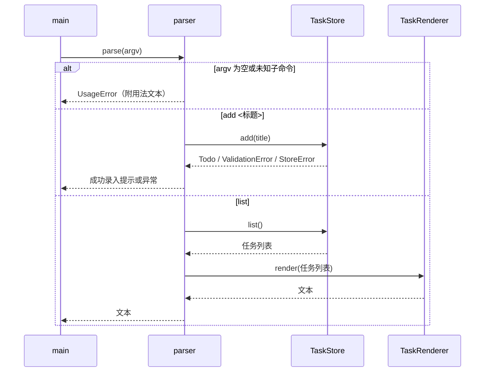

# 03-design-CommandParser.md —— CommandParser 软件详细设计规范

> 角色：详细设计师 ｜ 依据：02-architecture.md ｜ 版本：v1.0 ｜ 状态：已确认
> 一个组件一份：本文件只写 CommandParser（02 的 5.3.4.1），组件名与 02 一致。

# 1 修订记录/Revision record

版本命名规则：vX.Y；内容变更 Y 加 1，批准发布 X 加 1、Y 归 0。

| 版本 | 状态 | 变更内容 | 变更日期   | 更改人   | 批准人   |
| ---- | ---- | -------- | ---------- | -------- | -------- |
| v1.0 | 已确认 | 建档     | 2026-11-19 | 示例用户 | 示例用户 |

# 2 简介

## 2.1 目的

把 02 中 CommandParser 的接口展开到函数级：解析 argv、识别子命令、分发到 TaskStore / TaskRenderer。

## 2.2 范围

只覆盖命令解析与分发；不覆盖任务规则（TaskStore）、输出格式（TaskRenderer）与文件读写（TaskFile）。

## 2.3 术语和缩略语

| 术语/缩略语 | 解释 |
| ----------- | ---- |
| 子命令 | argv 第一个参数，`add` 或 `list` |
| 分发 | 把解析结果转成对下游组件的调用 |

## 2.4 参考文档

| 文档编号 | 文档名称 | 版本 | 发布日期 |
| -------- | -------- | ---- | -------- |
| — | 02-architecture.md | v1.0 | 2026-11-19 |
| — | 01-requirements.md | v1.0 | 2026-11-19 |

# 3 资源

## 3.1 角色

| 角色 | 关系 |
| ---- | ---- |
| main | 唯一调用方，启动时传入 argv |
| TaskStore | 被调用方，add / list |
| TaskRenderer | 被调用方，render |

## 3.2 相关接口

| 接口 | 方向 | 说明 |
| ---- | ---- | ---- |
| IF-INT-001 | 被调用 | main → parse |
| IF-INT-002 | 调用 | parse → TaskStore.add |
| IF-INT-003 | 调用 | parse → TaskStore.list |
| IF-INT-006 | 调用 | parse → TaskRenderer.render |

# 4 沟通计划

| 会议 / 评审 | 参与人 | 频率 | 输出 |
| ----------- | ------ | ---- | ---- |
| 详细设计评审 | 详细设计师、架构师、实现者 | 每次变更 | 评审记录 / 修改项 |

# 5 软件组件描述

## 5.1 功能描述

解析命令行参数：识别 `add <标题>` 与 `list`；`add` 把标题交给 TaskStore 并返回成功提示；`list` 从 TaskStore 取出任务、交给 TaskRenderer 格式化并返回文本；未知命令或缺少参数抛 UsageError。

## 5.2 组件交互

被 main 调用；调用 TaskStore 与 TaskRenderer；不直接访问文件，不自己格式化列表。

# 6 接口

## 6.1 数据结构

| 名称 | 类型 | 字段 | 说明 |
| ---- | ---- | ---- | ---- |
| 命令结果 | 记录 | 文本（string）、退出码（integer） | parse 的返回值，由 main 输出 |

## 6.2 变量

| 变量名 | 类型 | 作用域 | 初值 | 说明 |
| ------ | ---- | ------ | ---- | ---- |
| argv | array | 参数传入 | 无 | 不含程序名的参数列表 |

## 6.3 参数

| 参数名 | 描述 | 数据类型 | 值 | 单位 | 转化 / 约束 |
| ------ | ---- | -------- | -- | ---- | ----------- |
| argv | 命令行参数 | array | 长度 1 到 2 | 无 | 长度 0 → UsageError |
| title | 标题（add 时） | string | 非空 | 无 | 交给 TaskStore 再校验 |

## 6.4 外部函数定义

无。

# 7 软件组件设计

## 7.1 组件分解

| 软件单元 | 文件 / 类 | 职责 |
| -------- | --------- | ---- |
| parser | src/parser.py | 解析与分发 |

## 7.2 静态特性

### 7.2.1 框架图

```
parser.py
  ├─ parse → add
  ├─ parse → list → render
  └─ UsageError
```

### 7.2.2 函数列表

| 序号 | 函数名 | 描述 | 定义组件 | 调用组件 |
| ---- | ------ | ---- | -------- | -------- |
| 1 | parse | 解析 argv 并分发 | CommandParser | main |
| 2 | _usage | 返回用法文本 | CommandParser | parse |

### 7.2.3 函数关系

```
parse
  ├─ TaskStore.add → 成功提示
  ├─ TaskStore.list → TaskRenderer.render
  └─ _usage（未知命令 / 缺参数）
```

### 7.2.4 源代码文件清单

| 文件名称 | 描述 | 相对路径 |
| -------- | ---- | -------- |
| parser.py | 命令解析与分发 | src/parser.py |

## 7.3 动态特性

### 7.3.1 任务与中断

无。

### 7.3.2 定时器与事件

无。

### 7.3.3 调度方式

由 main 同步调用，一次进程只解析一条命令。

### 7.3.4 时序图



# 8 软件单元设计

## 8.1 代码生成配置

不适用。Python 源码直接运行。

## 8.2 软件单元parser

### 8.2.1 说明

`src/parser.py` 只有一个公开函数 `parse`，内部用 `_usage` 生成用法文本；不持有状态，不缓存数据。

### 8.2.2 函数设计

#### 8.2.2.1 函数parse

| 项目 | 内容 |
| ---- | ---- |
| 函数ID | F-301 |
| 函数名 | parse |
| 函数描述 | 解析 argv、分发到 TaskStore / TaskRenderer、返回文本与退出码 |
| 输入输出/IO | 输入：argv；输出：文本与退出码 |
| 参数 | argv：array，长度 1 到 2 |
| 类型 | 公开函数 |
| 描述 | argv 空、未知子命令、`add` 缺标题 → UsageError；下游 StoreError / ValidationError 原样上抛 |
| 返回值 | dict：text、exit_code |
| 全局变量 | 无 |
| 静态变量 | 无 |
| 程序流程图 | 判空 → 取子命令 → 分支 add / list → 组装返回 |

#### 8.2.2.2 函数_usage

| 项目 | 内容 |
| ---- | ---- |
| 函数ID | F-302 |
| 函数名 | _usage |
| 函数描述 | 返回固定用法文本 |
| 输入输出/IO | 输入：无；输出：string |
| 参数 | 无 |
| 类型 | 内部函数 |
| 描述 | 内容为 `用法: todo add <标题> | todo list`，不读环境 |
| 返回值 | string |
| 全局变量 | 无 |
| 静态变量 | 无 |
| 程序流程图 | 常量返回 |

**参数**：见 6.3。

**私有数据**：无（无状态组件）。

**状态与流程**：无状态机。

**动态特性**：见 7.3。

**错误处理**

| 错误编号 | 触发条件 | 处理 | 对外表现 |
| -------- | -------- | ---- | -------- |
| E-301 | argv 为空 | 打印用法 | UsageError（退出码 1） |
| E-302 | 未知子命令 | 打印用法 | UsageError（退出码 1） |
| E-303 | `add` 缺标题 | 打印用法 | UsageError（退出码 1） |

**不变量与约束**：解析不修改 argv；不吞掉下游异常。

# 9 可追溯性

| 软件架构 ID | 软件架构 ASIL | 软件详设 ID | 软件详设 ASIL |
| ----------- | ------------- | ----------- | ------------- |
| 5.3.4.1 CommandParser.parse | 不适用 | F-301 | 不适用 |
| 5.3.4.1 CommandParser（用法文本） | 不适用 | F-302 | 不适用 |

| 软件需求 | 软件详设 ID | 说明 |
| -------- | ----------- | ---- |
| SSR001 | F-301 | 分发 add 并返回成功提示 |
| SSR002 | F-301 | 分发 list 并返回渲染文本 |

# 10 附录

## 10.1 数据质量

| 数据 | 质量要求 | 校验 / 保障 | 失败处理 |
| ---- | -------- | ----------- | -------- |
| 命令文本（IF-EXT-001） | 完整、可识别 | 子命令白名单 + 参数个数校验 | 打印用法、退出码 1 |

## 10.2 交接给实现

- 实现顺序：先 `_usage`，再 `parse` 的两个分支。
- 必须遵守的约束：不访问文件、不格式化列表、错误交给 main 映射退出码。
- 未决项：无。
- 风险：新增子命令时容易漏改 `_usage`，需同步维护。
