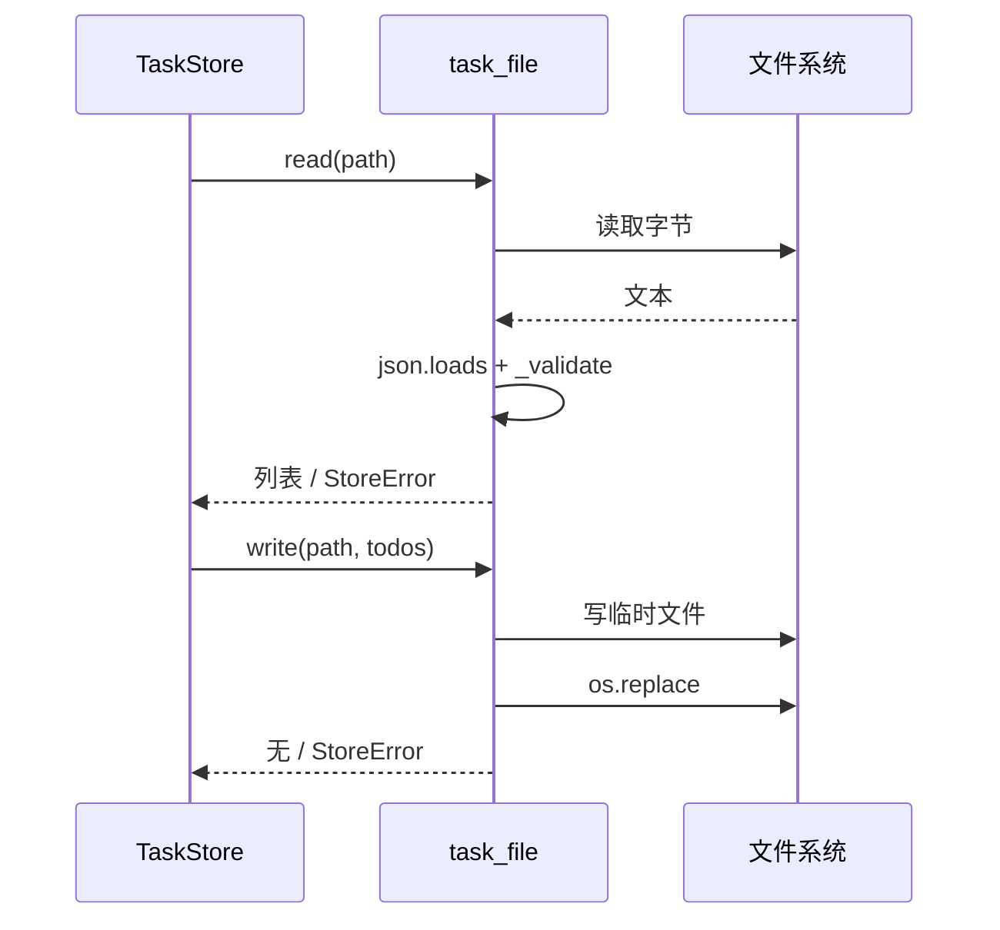

# 03-design-TaskFile.md —— TaskFile 软件详细设计规范

> 角色：详细设计师 ｜ 依据：02-architecture.md ｜ 版本：v1.0 ｜ 状态：已确认
> 一个组件一份：本文件只写 TaskFile（02 的 5.3.6.1），组件名与 02 一致。

# 1 修订记录/Revision record

版本命名规则：vX.Y；内容变更 Y 加 1，批准发布 X 加 1、Y 归 0。

| 版本 | 状态 | 变更内容 | 变更日期   | 更改人   | 批准人   |
| ---- | ---- | -------- | ---------- | -------- | -------- |
| v1.0 | 已确认 | 建档     | 2026-11-19 | 示例用户 | 示例用户 |

# 2 简介

## 2.1 目的

把 02 中 TaskFile 的接口展开到函数级：`todos.json` 的读取、校验、原子写入。

## 2.2 范围

只覆盖 TaskFile；不覆盖业务规则（TaskStore）、命令解析（CommandParser）与输出（TaskRenderer）。

## 2.3 术语和缩略语

| 术语/缩略语 | 解释 |
| ----------- | ---- |
| 单元 | 一个源代码文件 |
| 原子替换 | 先写临时文件，再用 rename 覆盖目标文件 |

## 2.4 参考文档

| 文档编号 | 文档名称 | 版本 | 发布日期 |
| -------- | -------- | ---- | -------- |
| — | 02-architecture.md | v1.0 | 2026-11-19 |
| — | 01-requirements.md | v1.0 | 2026-11-19 |

# 3 资源

## 3.1 角色

| 角色 | 关系 |
| ---- | ---- |
| TaskStore | 唯一调用方，只经本组件读写文件 |
| 本地文件系统 | 外部依赖，需支持 `os.replace` 原子替换 |

## 3.2 相关接口

| 接口 | 方向 | 说明 |
| ---- | ---- | ---- |
| IF-INT-004 | 被调用 | TaskStore.load → TaskFile.read |
| IF-INT-005 | 被调用 | TaskStore.save → TaskFile.write |

# 4 沟通计划

| 会议 / 评审 | 参与人 | 频率 | 输出 |
| ----------- | ------ | ---- | ---- |
| 详细设计评审 | 详细设计师、架构师、实现者 | 每次变更 | 评审记录 / 修改项 |

# 5 软件组件描述

## 5.1 功能描述

把任务列表与 JSON 文件互相转换：读取时解析并校验结构，结构不合法就报错而不是静默丢弃；写入时先写临时文件再原子替换，保证任何时刻磁盘上的文件要么是旧的完整版本、要么是新的完整版本。

## 5.2 组件交互

被 TaskStore 调用，不主动调用其他组件；不认识 Todo 的业务语义，只保证「一组字段相同的字典」能往返。

# 6 接口

## 6.1 数据结构

| 名称 | 类型 | 字段 | 说明 |
| ---- | ---- | ---- | ---- |
| 文件结构 | JSON 数组 | 元素为对象，字段 id / title / done | 磁盘格式，与 D-002 Todo 对齐 |

## 6.2 变量

| 变量名 | 类型 | 作用域 | 初值 | 说明 |
| ------ | ---- | ------ | ---- | ---- |
| path | string | 参数传入 | 无 | 目标文件路径 |

## 6.3 参数

| 参数名 | 描述 | 数据类型 | 值 | 单位 | 转化 / 约束 |
| ------ | ---- | -------- | -- | ---- | ----------- |
| path | 文件路径 | string | 非空 | 无 | 父目录必须存在 |
| todos | 任务列表 | array | 元素为 dict | 无 | 元素字段 id / title / done 齐全 |

## 6.4 外部函数定义

无。只用标准库 `json`、`os`、`tempfile`。

# 7 软件组件设计

## 7.1 组件分解

| 软件单元 | 文件 / 类 | 职责 |
| -------- | --------- | ---- |
| task_file | src/task_file.py | JSON 读写、校验、原子替换 |

## 7.2 静态特性

### 7.2.1 框架图

```
task_file.py
  ├─ read  → _validate
  └─ write → tempfile + os.replace
```

### 7.2.2 函数列表

| 序号 | 函数名 | 描述 | 定义组件 | 调用组件 |
| ---- | ------ | ---- | -------- | -------- |
| 1 | read | 读取并校验任务文件 | TaskFile | TaskStore |
| 2 | write | 原子写回任务文件 | TaskFile | TaskStore |
| 3 | _validate | 校验 JSON 结构 | TaskFile | read |

### 7.2.3 函数关系

```
read
  └─ _validate
write
  └─ (标准库 json / tempfile / os.replace)
```

### 7.2.4 源代码文件清单

| 文件名称 | 描述 | 相对路径 |
| -------- | ---- | -------- |
| task_file.py | JSON 读写与原子替换 | src/task_file.py |

## 7.3 动态特性

### 7.3.1 任务与中断

无。单进程同步调用，不占后台线程。

### 7.3.2 定时器与事件

无。

### 7.3.3 调度方式

由 TaskStore 在调用链内同步执行，无排队、无抢占。

### 7.3.4 时序图



# 8 软件单元设计

## 8.1 代码生成配置

不适用。Python 源码直接运行，无代码生成。

## 8.2 软件单元task_file

### 8.2.1 说明

`src/task_file.py` 提供两个公开函数 `read` / `write` 与一个内部校验函数 `_validate`；不含业务规则，不修改传入列表。

### 8.2.2 函数设计

#### 8.2.2.1 函数read

| 项目 | 内容 |
| ---- | ---- |
| 函数ID | F-101 |
| 函数名 | read |
| 函数描述 | 读取任务文件，解析 JSON 并校验结构；文件不存在返回空列表 |
| 输入输出/IO | 输入：path；输出：任务列表 |
| 参数 | path：string，非空 |
| 类型 | 公开函数 |
| 描述 | 文件不存在 → 返回 `[]`；解析失败或结构不合法 → 抛 StoreError |
| 返回值 | array（元素 dict：id、title、done） |
| 全局变量 | 无 |
| 静态变量 | 无 |
| 程序流程图 | 打开文件 → 读文本 → json.loads → _validate → 返回 |

#### 8.2.2.2 函数write

| 项目 | 内容 |
| ---- | ---- |
| 函数ID | F-102 |
| 函数名 | write |
| 函数描述 | 原子写回任务文件：写临时文件后 os.replace |
| 输入输出/IO | 输入：path、todos；输出：无 |
| 参数 | path：string；todos：array |
| 类型 | 公开函数 |
| 描述 | 先写 `path.tmp`，成功后再替换；任一步失败抛 StoreError 并清理临时文件 |
| 参数 | todos：array，元素字段齐全 |
| 返回值 | 无 |
| 全局变量 | 无 |
| 静态变量 | 无 |
| 程序流程图 | 序列化 → 写临时文件 → 刷新关闭 → os.replace → 异常时删除临时文件并抛错 |

#### 8.2.2.3 函数_validate

| 项目 | 内容 |
| ---- | ---- |
| 函数ID | F-103 |
| 函数名 | _validate |
| 函数描述 | 校验解析结果是否为合法任务数组 |
| 输入输出/IO | 输入：任意 JSON 值；输出：无（不合法抛错） |
| 参数 | data：任意 |
| 类型 | 内部函数 |
| 描述 | 必须是 list；每个元素必须是 dict 且含 id(int)、title(str 非空)、done(bool) |
| 参数 | data：array |
| 返回值 | 无 |
| 全局变量 | 无 |
| 静态变量 | 无 |
| 程序流程图 | 判类型 → 逐元素判字段 → 通过或抛 StoreError |

**参数**：见 6.3。

**私有数据**：无（无状态组件）。

**状态与流程**：无状态机，每次调用独立。

**动态特性**：见 7.3。

**错误处理**

| 错误编号 | 触发条件 | 处理 | 对外表现 |
| -------- | -------- | ---- | -------- |
| E-101 | JSON 解析失败 | 不修改文件 | StoreError |
| E-102 | 结构不合法（缺字段 / 类型错） | 不修改文件 | StoreError |
| E-103 | 写临时文件或替换失败 | 删除临时文件、保留原文件 | StoreError |

**不变量与约束**：写入失败不得破坏原文件；读取不修改文件；不修改传入列表。

# 9 可追溯性

| 软件架构 ID | 软件架构 ASIL | 软件详设 ID | 软件详设 ASIL |
| ----------- | ------------- | ----------- | ------------- |
| 5.3.6.1 TaskFile.read / write | 不适用 | F-101 / F-102 | 不适用 |
| 5.3.6.1 TaskFile（接口定义） | 不适用 | 6.1 数据结构、6.3 参数 | 不适用 |

| 软件需求 | 软件详设 ID | 说明 |
| -------- | ----------- | ---- |
| SSR001 | F-102、F-103 | 新增后落盘、写前结构校验 |
| SSR002 | F-101、F-103 | 启动载入、读取校验 |

# 10 附录

## 10.1 数据质量

| 数据 | 质量要求 | 校验 / 保障 | 失败处理 |
| ---- | -------- | ----------- | -------- |
| todos.json（D-001） | 完整性、一致性、可恢复 | 写入原子替换；读取时 _validate | 保留原文件并抛 StoreError |

## 10.2 交接给实现

- 实现顺序：先 write 再 read（先能安全落盘，再能读回）。
- 必须遵守的约束：唯一文件适配点、原子替换、错误一律 StoreError。
- 未决项：无。
- 风险：写入过程被强杀时临时文件残留，需在 read 路径上忽略 `*.tmp`。
