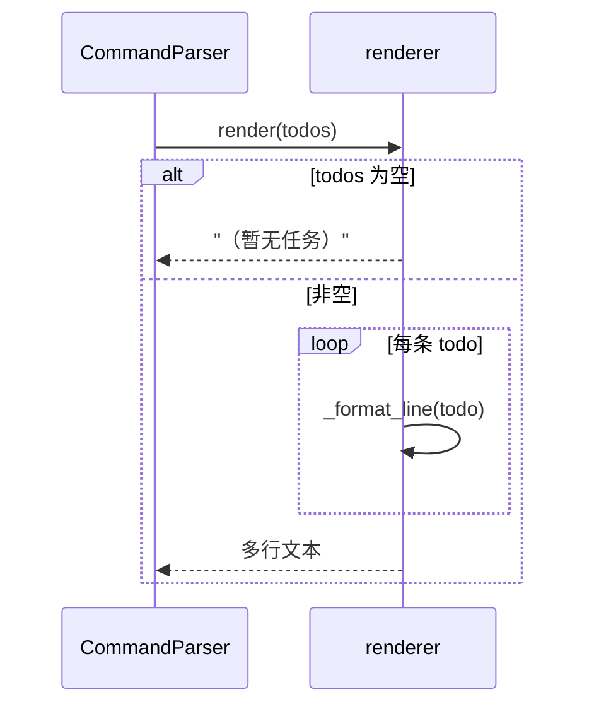

# 03-design-TaskRenderer.md —— TaskRenderer 软件详细设计规范

> 角色：详细设计师 ｜ 依据：02-architecture.md ｜ 版本：v1.0 ｜ 状态：已确认
> 一个组件一份：本文件只写 TaskRenderer（02 的 5.3.4.2），组件名与 02 一致。

# 1 修订记录/Revision record

版本命名规则：vX.Y；内容变更 Y 加 1，批准发布 X 加 1、Y 归 0。

| 版本 | 状态 | 变更内容 | 变更日期   | 更改人   | 批准人   |
| ---- | ---- | -------- | ---------- | -------- | -------- |
| v1.0 | 已确认 | 建档     | 2026-11-19 | 示例用户 | 示例用户 |

# 2 简介

## 2.1 目的

把 02 中 TaskRenderer 的接口展开到函数级：把任务列表格式化为可读文本。

## 2.2 范围

只覆盖输出格式化；不覆盖数据获取（TaskStore）与命令解析（CommandParser）。

## 2.3 术语和缩略语

| 术语/缩略语 | 解释 |
| ----------- | ---- |
| 渲染 | 把结构化任务列表转成多行文本 |
| 完成标记 | 已完成输出 `[x]`，未完成输出 `[ ]` |

## 2.4 参考文档

| 文档编号 | 文档名称 | 版本 | 发布日期 |
| -------- | -------- | ---- | -------- |
| — | 02-architecture.md | v1.0 | 2026-11-19 |
| — | 01-requirements.md | v1.0 | 2026-11-19 |

# 3 资源

## 3.1 角色

| 角色 | 关系 |
| ---- | ---- |
| CommandParser | 唯一调用方 |

## 3.2 相关接口

| 接口 | 方向 | 说明 |
| ---- | ---- | ---- |
| IF-INT-003 | 调用 | 只读 TaskStore.list 的返回值，不自行调用 TaskStore |
| IF-INT-006 | 被调用 | CommandParser → render |

# 4 沟通计划

| 会议 / 评审 | 参与人 | 频率 | 输出 |
| ----------- | ------ | ---- | ---- |
| 详细设计评审 | 详细设计师、架构师、实现者 | 每次变更 | 评审记录 / 修改项 |

# 5 软件组件描述

## 5.1 功能描述

把任务列表转成文本：一行一条，格式为 `编号. [标记] 标题`；空列表返回固定提示「（暂无任务）」。纯函数，不修改输入、不访问文件、不做 IO。

## 5.2 组件交互

只被 CommandParser 调用；不调用任何其他组件。

# 6 接口

## 6.1 数据结构

| 名称 | 类型 | 字段 | 说明 |
| ---- | ---- | ---- | ---- |
| Todo（D-002） | 记录 | id、title、done | 输入元素，只读 |

## 6.2 变量

| 变量名 | 类型 | 作用域 | 初值 | 说明 |
| ------ | ---- | ------ | ---- | ---- |
| lines | array | 函数内 | [] | 逐行累积的输出 |

## 6.3 参数

| 参数名 | 描述 | 数据类型 | 值 | 单位 | 转化 / 约束 |
| ------ | ---- | -------- | -- | ---- | ----------- |
| todos | 任务列表 | array | 可为空 | 无 | 只读，不修改元素 |

## 6.4 外部函数定义

无。

# 7 软件组件设计

## 7.1 组件分解

| 软件单元 | 文件 / 类 | 职责 |
| -------- | --------- | ---- |
| renderer | src/renderer.py | 列表文本渲染 |

## 7.2 静态特性

### 7.2.1 框架图

```
renderer.py
  └─ render → (_format_line per todo)
```

### 7.2.2 函数列表

| 序号 | 函数名 | 描述 | 定义组件 | 调用组件 |
| ---- | ------ | ---- | -------- | -------- |
| 1 | render | 渲染任务列表 | TaskRenderer | CommandParser |
| 2 | _format_line | 渲染单条任务 | TaskRenderer | render |

### 7.2.3 函数关系

```
render
  └─ _format_line（逐条）
```

### 7.2.4 源代码文件清单

| 文件名称 | 描述 | 相对路径 |
| -------- | ---- | -------- |
| renderer.py | 列表文本渲染 | src/renderer.py |

## 7.3 动态特性

### 7.3.1 任务与中断

无。

### 7.3.2 定时器与事件

无。

### 7.3.3 调度方式

同步调用，一次渲染全部任务。

### 7.3.4 时序图



# 8 软件单元设计

## 8.1 代码生成配置

不适用。Python 源码直接运行。

## 8.2 软件单元renderer

### 8.2.1 说明

`src/renderer.py` 提供 `render` 与内部 `_format_line`；输入输出之间无状态，不在模块级缓存任何东西。

### 8.2.2 函数设计

#### 8.2.2.1 函数render

| 项目 | 内容 |
| ---- | ---- |
| 函数ID | F-401 |
| 函数名 | render |
| 函数描述 | 把任务列表渲染为多行文本 |
| 输入输出/IO | 输入：todos；输出：string |
| 参数 | todos：array，元素为 Todo |
| 类型 | 公开函数 |
| 描述 | 空列表返回「（暂无任务）」；非空按输入顺序逐条渲染并换行拼接 |
| 返回值 | string |
| 全局变量 | 无 |
| 静态变量 | 无 |
| 程序流程图 | 判空 → 逐条 _format_line → 换行拼接 |

#### 8.2.2.2 函数_format_line

| 项目 | 内容 |
| ---- | ---- |
| 函数ID | F-402 |
| 函数名 | _format_line |
| 函数描述 | 格式化单条任务 |
| 输入输出/IO | 输入：todo；输出：string |
| 参数 | todo：dict，含 id / title / done |
| 类型 | 内部函数 |
| 描述 | 输出 `{id}. [x| ] {title}`；只读 todo |
| 返回值 | string |
| 全局变量 | 无 |
| 静态变量 | 无 |
| 程序流程图 | 取字段 → 选标记 → 拼串 |

**参数**：见 6.3。

**私有数据**：无（无状态组件）。

**状态与流程**：无状态机。

**动态特性**：见 7.3。

**错误处理**

| 错误编号 | 触发条件 | 处理 | 对外表现 |
| -------- | -------- | ---- | -------- |
| E-401 | 元素缺字段 | 抛 KeyError，由 main 兜底为内部错误 | 退出码 2 |
| E-402 | 空列表 | 返回固定提示 | 退出码 0 |

**不变量与约束**：不修改输入列表与元素；输出行数与任务数一致（空列表为 1 行提示）。

# 9 可追溯性

| 软件架构 ID | 软件架构 ASIL | 软件详设 ID | 软件详设 ASIL |
| ----------- | ------------- | ----------- | ------------- |
| 5.3.4.2 TaskRenderer.render | 不适用 | F-401 | 不适用 |
| 5.3.4.2 TaskRenderer（单条格式） | 不适用 | F-402 | 不适用 |

| 软件需求 | 软件详设 ID | 说明 |
| -------- | ----------- | ---- |
| SSR002 | F-401、F-402 | 按添加顺序输出编号、标题与完成状态 |

# 10 附录

## 10.1 数据质量

| 数据 | 质量要求 | 校验 / 保障 | 失败处理 |
| ---- | -------- | ----------- | -------- |
| 输出文本（IF-EXT-002） | 可读、顺序稳定 | 按输入顺序渲染 | 空列表给固定提示 |

## 10.2 交接给实现

- 实现顺序：先 `_format_line`，再 `render`。
- 必须遵守的约束：纯函数、不访问文件、不调用 TaskStore。
- 未决项：无。
- 风险：将来加「只看未完成」筛选时，顺序规则必须仍与添加顺序一致。
