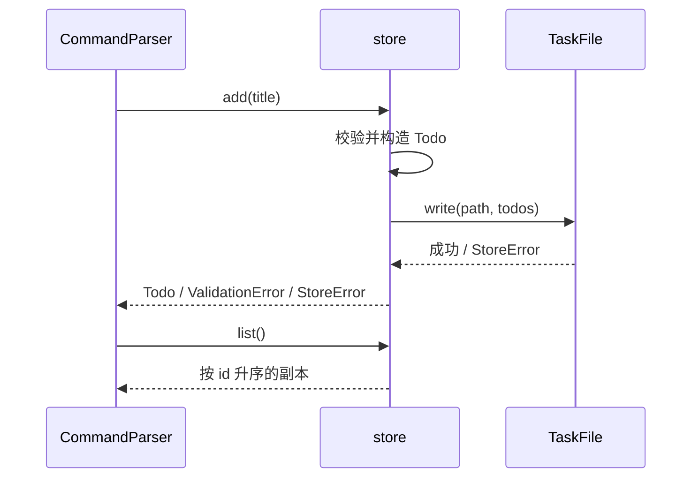

# 03-design-TaskStore.md —— TaskStore 软件详细设计规范

> 角色：详细设计师 ｜ 依据：02-architecture.md ｜ 版本：v1.0 ｜ 状态：已确认
> 一个组件一份：本文件只写 TaskStore（02 的 5.3.5.1），组件名与 02 一致。

# 1 修订记录/Revision record

版本命名规则：vX.Y；内容变更 Y 加 1，批准发布 X 加 1、Y 归 0。

| 版本 | 状态 | 变更内容 | 变更日期   | 更改人   | 批准人   |
| ---- | ---- | -------- | ---------- | -------- | -------- |
| v1.0 | 已确认 | 建档     | 2026-11-19 | 示例用户 | 示例用户 |

# 2 简介

## 2.1 目的

把 02 中 TaskStore 的接口展开到函数级：持有任务集合、执行新增与列出的业务规则、编排持久化。

## 2.2 范围

只覆盖 TaskStore；不覆盖命令解析、输出格式化与文件格式。

## 2.3 术语和缩略语

| 术语/缩略语 | 解释 |
| ----------- | ---- |
| 单元 | 一个源代码文件 |
| 业务写者 | 唯一允许修改任务集合语义的组件 |

## 2.4 参考文档

| 文档编号 | 文档名称 | 版本 | 发布日期 |
| -------- | -------- | ---- | -------- |
| — | 02-architecture.md | v1.0 | 2026-11-19 |
| — | 01-requirements.md | v1.0 | 2026-11-19 |

# 3 资源

## 3.1 角色

| 角色 | 关系 |
| ---- | ---- |
| CommandParser | 调用方，调用 add / list |
| TaskFile | 被调用方，read / write |
| main | 启动时调用 load |

## 3.2 相关接口

| 接口 | 方向 | 说明 |
| ---- | ---- | ---- |
| IF-INT-002 | 被调用 | CommandParser → add |
| IF-INT-003 | 被调用 | CommandParser / TaskRenderer → list |
| IF-INT-004 | 调用 | load → TaskFile.read |
| IF-INT-005 | 调用 | save → TaskFile.write |

# 4 沟通计划

| 会议 / 评审 | 参与人 | 频率 | 输出 |
| ----------- | ------ | ---- | ---- |
| 详细设计评审 | 详细设计师、架构师、实现者 | 每次变更 | 评审记录 / 修改项 |

# 5 软件组件描述

## 5.1 功能描述

持有内存任务集合，提供新增、列出、载入、写回。新增时校验标题、分配自增 id 并持久化；列出时返回按 id 升序的副本；是任务数据的唯一业务写者。

## 5.2 组件交互

被 CommandParser 与 main 调用；自身只调用 TaskFile 读写文件，不调用 TaskRenderer。

# 6 接口

## 6.1 数据结构

| 名称 | 类型 | 字段 | 说明 |
| ---- | ---- | ---- | ---- |
| Todo（D-002） | 记录 | id：integer 自增唯一；title：string 非空；done：boolean | 任务记录 |

## 6.2 变量

| 变量名 | 类型 | 作用域 | 初值 | 说明 |
| ------ | ---- | ------ | ---- | ---- |
| todos | array | 实例内 | [] | 内存任务集合 |
| path | string | 实例内 | 环境变量 `TODO_FILE` 或默认 `todos.json` | 持久化文件路径 |

## 6.3 参数

| 参数名 | 描述 | 数据类型 | 值 | 单位 | 转化 / 约束 |
| ------ | ---- | -------- | -- | ---- | ----------- |
| title | 任务标题 | string | 非空 | 无 | 去首尾空白后校验非空 |

## 6.4 外部函数定义

无。

# 7 软件组件设计

## 7.1 组件分解

| 软件单元 | 文件 / 类 | 职责 |
| -------- | --------- | ---- |
| store | src/store.py | 任务集合与业务规则 |

## 7.2 静态特性

### 7.2.1 框架图

```
store.py
  ├─ add  → save
  ├─ list
  ├─ load
  └─ save
```

### 7.2.2 函数列表

| 序号 | 函数名 | 描述 | 定义组件 | 调用组件 |
| ---- | ------ | ---- | -------- | -------- |
| 1 | add | 新增任务并持久化 | TaskStore | CommandParser |
| 2 | list | 返回全部任务 | TaskStore | CommandParser / TaskRenderer |
| 3 | load | 从文件载入任务 | TaskStore | main |
| 4 | save | 写回任务 | TaskStore | add |

### 7.2.3 函数关系

```
add
  └─ save
save
  └─ TaskFile.write
load
  └─ TaskFile.read
```

### 7.2.4 源代码文件清单

| 文件名称 | 描述 | 相对路径 |
| -------- | ---- | -------- |
| store.py | 任务集合与业务规则 | src/store.py |

## 7.3 动态特性

### 7.3.1 任务与中断

无。单进程、无后台任务。

### 7.3.2 定时器与事件

无。

### 7.3.3 调度方式

每次命令顺序执行；写操作同步阻塞到落盘完成。

### 7.3.4 时序图



# 8 软件单元设计

## 8.1 代码生成配置

不适用。Python 源码直接运行。

## 8.2 软件单元store

### 8.2.1 说明

`src/store.py` 用一个类持有 `todos` 与 `path`，对外暴露 `add` / `list` / `load` / `save`；所有文件访问都委托给 TaskFile。

### 8.2.2 函数设计

#### 8.2.2.1 函数add

| 项目 | 内容 |
| ---- | ---- |
| 函数ID | F-201 |
| 函数名 | add |
| 函数描述 | 校验标题、构造 Todo、追加到集合并持久化 |
| 输入输出/IO | 输入：title；输出：新建的 Todo |
| 参数 | title：string，去首尾空白后非空 |
| 类型 | 公开函数 |
| 描述 | 标题为空 → ValidationError 且不写文件；写入失败 → StoreError，内存集合回滚 |
| 返回值 | dict：id / title / done |
| 全局变量 | 无 |
| 静态变量 | 无 |
| 程序流程图 | 校验 → 生成 id → 追加 → save → 返回；失败时回滚 |

#### 8.2.2.2 函数list

| 项目 | 内容 |
| ---- | ---- |
| 函数ID | F-202 |
| 函数名 | list |
| 函数描述 | 返回按 id 升序的任务副本 |
| 输入输出/IO | 输入：无；输出：任务列表 |
| 参数 | 无 |
| 类型 | 公开函数 |
| 描述 | 返回新列表，调用方修改不影响内部集合；只读，不触碰文件 |
| 返回值 | array |
| 全局变量 | 无 |
| 静态变量 | 无 |
| 程序流程图 | 复制 → 按 id 排序 → 返回 |

#### 8.2.2.3 函数load

| 项目 | 内容 |
| ---- | ---- |
| 函数ID | F-203 |
| 函数名 | load |
| 函数描述 | 经 TaskFile.read 载入任务到内存 |
| 输入输出/IO | 输入：无；输出：任务列表 |
| 参数 | 无 |
| 类型 | 公开函数 |
| 描述 | 文件不存在按空列表；StoreError 原样上抛，由 main 决定降级 |
| 返回值 | array |
| 全局变量 | 无 |
| 静态变量 | 无 |
| 程序流程图 | TaskFile.read → 赋值 todos → 返回 |

#### 8.2.2.4 函数save

| 项目 | 内容 |
| ---- | ---- |
| 函数ID | F-204 |
| 函数名 | save |
| 函数描述 | 经 TaskFile.write 原子写回当前集合 |
| 输入输出/IO | 输入：无（写自身集合）；输出：无 |
| 参数 | 无 |
| 类型 | 公开函数 |
| 描述 | 写入失败 StoreError 上抛；调用方负责回滚内存 |
| 返回值 | 无 |
| 全局变量 | 无 |
| 静态变量 | 无 |
| 程序流程图 | TaskFile.write(path, todos) → 返回或抛错 |

**参数**：见 6.3。

**私有数据**

| 字段 | 类型 | 取值域 / 约束 | 说明 |
| ---- | ---- | ------------- | ---- |
| todos | array | 元素为 Todo | 内存任务集合 |
| path | string | 非空 | 持久化文件路径 |

**状态与流程**：无状态机，每次命令独立读写。

**动态特性**：见 7.3。

**错误处理**

| 错误编号 | 触发条件 | 处理 | 对外表现 |
| -------- | -------- | ---- | -------- |
| E-201 | 标题为空或全空白 | 不写入、不分配 id | ValidationError |
| E-202 | TaskFile 报告结构损坏 | 内存保持空列表，交由 main 降级 | StoreError |
| E-203 | TaskFile 写入失败 | 回滚刚追加的记录 | StoreError |

**不变量与约束**：id 唯一且递增；title 非空；写失败后内存与磁盘一致。

# 9 可追溯性

| 软件架构 ID | 软件架构 ASIL | 软件详设 ID | 软件详设 ASIL |
| ----------- | ------------- | ----------- | ------------- |
| 5.3.5.1 TaskStore.add / list / load / save | 不适用 | F-201 / F-202 / F-203 / F-204 | 不适用 |
| 5.3.5.1 TaskStore（接口定义） | 不适用 | 6.1 数据结构、6.2 变量、6.3 参数 | 不适用 |

| 软件需求 | 软件详设 ID | 说明 |
| -------- | ----------- | ---- |
| SSR001 | F-201、F-204 | 校验、分配 id、追加并保存 |
| SSR002 | F-202、F-203 | 载入与按序列出 |

# 10 附录

## 10.1 数据质量

| 数据 | 质量要求 | 校验 / 保障 | 失败处理 |
| ---- | -------- | ----------- | -------- |
| todos.json（D-001） | 完整性、一致性、持久化、可恢复 | 委托 TaskFile 原子写与读取校验 | 保留原文件并提示 |

## 10.2 交接给实现

- 实现顺序：先 load / save，再 add / list。
- 必须遵守的约束：唯一业务写者、写失败回滚、错误类型见 8.2.2。
- 未决项：无。
- 风险：多进程并发写会覆盖，当前单进程场景接受。
