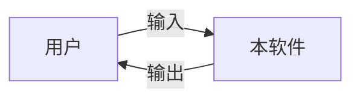

> 角色：需求分析师 ｜ 依据：需求来源（用户 / 系统需求） ｜ 版本：v1.0 ｜ 状态：待确认

# 1 修订记录/Revision record

1．	版本命名规则，vX.Y，如初版发布为v1.0
Version naming rules, vX.Y. For example, the first version released is v1.0.

2．	文档内容变更，Date应为变更日期；版本号X维持不变，Y增加1，如v1.1；
If the content of the document has changed, Date shall be the date of the change; and the version number X shall remain unchanged and Y shall increase by 1, such as v1.1.

3．	文档内容通过批准，Date为 批准日期；版本号X增加1，Y降为0，如v2.0；
If the document update is approved, Date shall be the approval date; version number X shall be increased by 1, and Y shall be decreased to 0, e.g. v2.0.

| 版本 | 状态 | 变更内容 | 变更日期            | 更改人 | 批准人 |
| ---- | ---- | -------- | ------------------- | ------ | ------ |
| r1   | 草稿 | 建档     | <YYYY-MM-DD></yyyy> | <名字> | <名字> |

# 2 概述

## 2.1 目的

本文档的目的是描述软件需求规格书（含软件安全要求），包括功能需求、非功能需求和接口需求。软件需求规格书可以作为进一步软件架构设计的输入。

## 2.2 适用范围

本文件适用于xx项目的xx型号的产品的软件需求的定义。

## 2.3 术语和缩略语

| 术语/缩略语 | 解释 |
| ----------- | ---- |
|             |      |

## 2.4 参考文档

| 文档编号 | 文档名称 | 版本 | 发布日期 |
| -------- | -------- | ---- | -------- |
|          |          |      |          |

# 3 软件需求

## 3.1 软件需求简介

### 3.1.1 软件需求清单

| 软件需求ID | 软件需求 描述 | 备注 |
| ---------- | ------------- | ---- |
|            |               |      |
|            |               |      |
| ………     | ………        | …… |

### 3.1.2 软件需求之间的依赖关系(适用于含功能安全的需求点)

|       | SSR_1 | SSR_2 | SSR_3 | SSR_4 | SSR_5 | …… |
| ----- | ----- | ----- | ----- | ----- | ----- | ---- |
| SSR_1 |       |       |       |       |       |      |
| SSR_2 |       |       | ●    |       | ●    |      |
| SSR_3 |       |       |       |       |       |      |
| SSR_4 |       | ●    |       |       |       |      |
| SSR_5 | ●    |       |       |       |       |      |

## 3.2 交互框图

用一段话或框图描述软件与外部（用户 / 设备 / 上游系统）的交互关系，以及输入输出分别是什么、由谁提供、给谁使用。
框图按项目习惯使用 Mermaid、PlantUML 或图片；只画边界和流向，不画内部模块。

## 3.3 软件需求

### 3.3.1 软件需求1

| 需求 ID                         | SSR001                                                                                                                                         |
| ------------------------------- | ---------------------------------------------------------------------------------------------------------------------------------------------- |
| 需求描述                        |                                                                                                                                                |
| 需求类别                        | 功能性、非功能性、接口、标题/Title、信息/Information                                                                                           |
| 目标阶段                        |                                                                                                                                                |
| ASIL等级                        | ASIL x                                                                                                                                         |
| 优先级                          | 高、中、低                                                                                                                                     |
| 复杂度                          | 高、中、低                                                                                                                                     |
| 来源于                          | TSR ID和ASIL等级，例如TSR001[ASIL B]                                                                                                           |
| 需求分析                        | 技术可行性：                                                                                                                                   |
| 需求分析                        | 可验证性：有验证方法就代表具备可验证性，此处可直接描述“可验证”                                                                               |
| 需求分析                        | 成本进度分析：                                                                                                                                 |
| 需求分析                        | 运行环境分析：                                                                                                                                 |
| 验证准则                        |                                                                                                                                                |
| 验证方法                        | 评审、测试、仿真、分析……                                                                                                                     |
| 需求状态                        | 建议的、假设的、接受的、经评审的；新建/Initial、评审中/In Review、已评审/Reviewed、已批准/Approved、已实现/Implemented、测试通过/Tested&Passed |
| 其他                            |                                                                                                                                                |
| UML图（用例、活动图、状态图等） |                                                                                                                                                |

### 3.3.2 软件需求2

| 需求 ID                         | SSR002                                                                                                                                         |
| ------------------------------- | ---------------------------------------------------------------------------------------------------------------------------------------------- |
| 需求描述                        |                                                                                                                                                |
| 需求类别                        | 功能性、非功能性、接口、标题/Title、信息/Information                                                                                           |
| 目标阶段                        |                                                                                                                                                |
| ASIL等级                        | ASIL x                                                                                                                                         |
| 优先级                          | 高、中、低                                                                                                                                     |
| 复杂度                          | 高、中、低                                                                                                                                     |
| 来源于                          | TSR ID和ASIL等级，例如TSR001[ASIL B]                                                                                                           |
| 需求分析                        | 技术可行性：                                                                                                                                   |
| 需求分析                        | 可验证性：                                                                                                                                     |
| 需求分析                        | 成本进度分析：                                                                                                                                 |
| 需求分析                        | 运行环境分析：                                                                                                                                 |
| 验证准则                        |                                                                                                                                                |
| 验证方法                        | 评审、测试、仿真、分析……                                                                                                                     |
| 需求状态                        | 建议的、假设的、接受的、经评审的；新建/Initial、评审中/In Review、已评审/Reviewed、已批准/Approved、已实现/Implemented、测试通过/Tested&Passed |
| 其他                            |                                                                                                                                                |
| UML图（用例、活动图、状态图等） |                                                                                                                                                |

### 3.3.3 软件需求3

……

# 4 追溯分析

## 4.1 系统需求与软件需求的追溯分析

| 系统需求（含TSR）ID | 系统需求 ASIL | 软件需求 ID | 软件需求 ASIL |
| ------------------- | ------------- | ----------- | ------------- |
|                     |               |             |               |
|                     |               |             |               |
|                     |               |             |               |
|                     |               |             |               |
|                     |               |             |               |

## 4.2 系统架构设计与软件需求的追溯分析

| 系统架构设计 ID | 系统架构 ASIL | 软件需求 ID | 软件需求 ASIL |
| --------------- | ------------- | ----------- | ------------- |
|                 |               |             |               |
|                 |               |             |               |
|                 |               |             |               |
|                 |               |             |               |
|                 |               |             |               |
