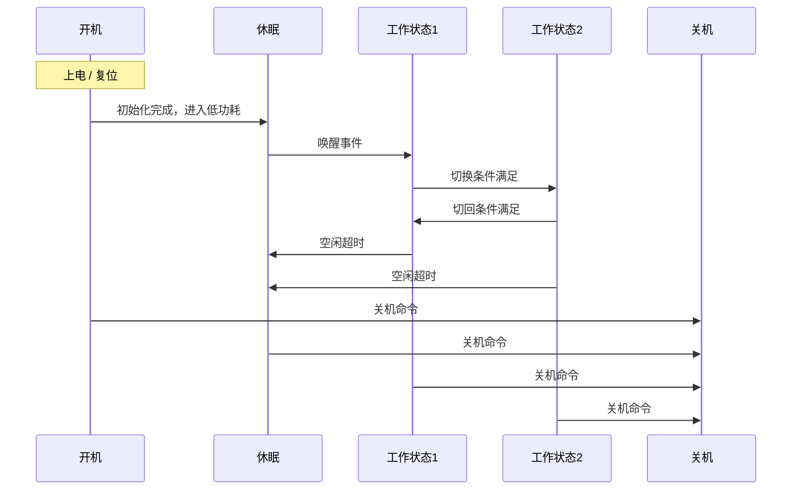

> 角色：架构师 ｜ 依据：01-requirements.md ｜ 版本：v1.0 ｜ 状态：待确认

# 1 修订记录/Revision record

1．	版本命名规则，vX.Y，如初版发布为v1.0
Version naming rules, vX.Y. For example, the first version released is v1.0.

2．	文档内容变更，Date应为变更日期；版本号X维持不变，Y增加1，如v1.1；
If the content of the document has changed, Date shall be the date of the change; and the version number X shall remain unchanged and Y shall increase by 1, such as v1.1.

3．	文档内容通过批准，Date为 批准日期；版本号X增加1，Y降为0，如v2.0；
If the document update is approved, Date shall be the approval date; version number X shall be increased by 1, and Y shall be decreased to 0, e.g. v2.0.

| 版本 | 状态 | 变更内容 | 变更日期            | 更改人 | 批准人 |
| ---- | ---- | -------- | ------------------- | ------ | ------ |
| r1   | 草稿 | 建档     | <YYYY-MM-DD></yyyy> | <名字> | <名字> |

# 2 简介/INTRODUCTION

<这里简要地介绍要描述的对象，包括文件的目的、背景和文件所服务的读者。>
< This process briefly introduces the object to be described, including the purpose of document the background and the readers served by the document. >

## 2.1 目的/Purpose

<详细描述本文件的目的。>
<Describe the purpose of this document in detail.></describe>

本文档描述了软件架构设计，主要目的是为了描述：软件描述、外部接口、软件分解、动态行为、资源消耗目标。确保产品软件架构设计符合A-SPICE软件开发以及ISO 26262系列标准要求内容和目标，以指导后续软件的开发，包括软件单元设计和实现。

This document describes the software architecture design with the main purpose of describing: software description, external interfaces, software decomposition, dynamic behavior, and resource consumption goals.

## 2.2 范围/Scope

＜详细描述本文件的范围。＞
＜Detailed describe the scope of this document.＞

e.g.,

This document only applies to software architectural design process of #Project.

本文档仅适用于[项目]中的软件架构设计流程。

## 2.3 术语、定义和缩略语/ Terms, definitions and Abbreviations

<列出文件中出现的所有缩略语。>
<List all abbreviations that appear in the document.></list>

| 缩略语Abbreviation | 解释Explanation |
| ------------------ | --------------- |
| PM                 | Project Manager |
|                    |                 |

## 2.4 参考/References

<列出所有参考文件及其位置。>
<List all reference documents and their locations.></list>

| No. | 工作产品名 Work Product Name | 版本 Version | 发布日期 Release date | 位置 Location |
| --- | ---------------------------- | ------------ | --------------------- | ------------- |
| 1   | Project Plan                 |              |                       | …\man.3      |
|     |                              |              |                       |               |
|     |                              |              |                       |               |
|     |                              |              |                       |               |
|     |                              |              |                       |               |

# 3 资源/RESOURCE

参见“软件资源管理表”中SWE.2章节内容

# 4 沟通计划/COMMUNICATION PLAN

参见“软件沟通管理计划”中SWE.2章节内容

# 5 软件架构设计/ SOFTWARE ARCHITECTURAL DESIGN

<作为软件架构的顶层设计，本章用于规范和指导软件架构设计工作。>
<As the top-level design of software architecture, this chapter is used to standardize and guide the software architectural design work.>

## 5.1 软件描述/Software Description

<本章主要用于描述软件的主要功能>。
<This chapter is mainly used to describe the main function of software.></this>

## 5.2 外部接口/External Interface

<本章主要用于描述微型控制单元的外部接口。>
<This chapter is mainly used to describe the external interfaces of the micro control unit. ></this>.

## 5.3 软件分解/Software Decomposition

<本章用于描述软件架构的分解结构。它可以包括以下几个方面。如： This chapter describes the breakdown structure of software architecture. It can include the following aspects. Such as

层描述和软件层之间的关系。The relationship between the layer description and the software layer

各层上的组件部署。Component deployment at each layer

软件组件之间的关系（低至最低级别）。> Relationships between software components (down to the lowest level)

<This chapter is used to describe the decomposition structure of software architecture. It could include the following aspects: E.g., 本章描述了软件架构的分解结构。它可以包括以下几个方面

Layer description and relationship between software layers. 层描述和软件层之间的关系

Components deployment on each layer. 每层的组件部署

Relationship between software components(down to the lowest level). > 软件组件之间的关系(一直到最底层)

层级结构图Layer structure view:

组件结构图Components structure view:

### 5.3.1 数据定义

定义软件使用的全局数据

| No. | 数据名称 | 使用范围（使用该数据的组件） |
| --- | -------- | ---------------------------- |
|     |          |                              |
|     |          |                              |
|     |          |                              |
|     |          |                              |

### 5.3.2 组件间的接口设计

| 接口ID | 描述 | 发送方 | 接收方 | 格式 | 大小 | 分辨率 | 质量 | 信息 | 频率 | 约束条件 |
| ------ | ---- | ------ | ------ | ---- | ---- | ------ | ---- | ---- | ---- | -------- |
|        |      |        |        |      |      |        |      |      |      |          |
|        |      |        |        |      |      |        |      |      |      |          |
|        |      |        |        |      |      |        |      |      |      |          |

### 5.3.3 组件间的依赖关系

|       | 组件1 | 组件2 | 组件3 | 组件4 | …… |  |
| ----- | ----- | ----- | ----- | ----- | ---- | - |
| 组件1 |       | ●    | ○    | ○    |      |  |
| 组件2 | --    |       | ○    | ●    |      |  |
| 组件3 | --    | ●    |       |       |      |  |
| 组件4 | --    | --    | ●    |       |      |  |
| ……  |       |       |       |       |      |  |

●允许使用

○限制使用

--不允许使用

### 5.3.4 应用层组件定义Application Layer Component Definition

<本章主要描述应用层组件的定义。>
<This chapter mainly describes the Application Layer Component definition. ></this>

#### 5.3.4.1 组件XXX定义/Component xxx Definition

**覆盖需求**：SSR001

<本节定义了XXX组件的功能、时序和接口。 >
<This section defines the function, sequence and interface of the XXX Component. >

##### 5.3.4.1.1 描述/Description

<本节详细定义了组件XXX的功能。>
<This section defines the function of Component XXX in detail. ></this>

##### 5.3.4.1.2 时序/Sequence

<本节将通过绘制顺序图来描述外部组件和组件XX之间的交互过程。>
<This section will describe the interaction process between the external Component and Component XX by drawing a sequence diagram.></this>

E.g.,

##### 5.3.4.1.3 接口定义/Interface Definition

<本节需要详细描述组件XX的所有外部接口。>
< This section needs to describe all external interfaces of Component XX in detail.>

E.g.,

### 5.3.5 中间层组件定义/Middle Layer Component Definition

<本节主要介绍中间层组件的定义。>
<This chapter mainly describes the Middle Layer Component definition.></this>

#### 5.3.5.1 组件XXX定义/Component xxx Definition

**覆盖需求**：SSR002

<本节定义了XXX组件的功能、时序和接口。 >
<This section defines the function, sequence and interface of the XXX Component. >

##### 5.3.5.1.1 描述/Description

<本节详细定义了组件XXX的功能。>
<This section defines the function of Component XXX in detail. ></this>

##### 5.3.5.1.2 时序/Sequence

<本节将通过绘制顺序图来描述外部组件和组件XXX之间的交互过程。
<This section will describe the interaction process between the external Component and Component XXX by drawing a sequence diagram.></this>.

##### 5.3.5.1.3 接口定义/Interface Definition

<本节需要详细描述组件XX的所有外部接口。>
<This section needs to describe all external interfaces of Component XX in detail. ></this>

### 5.3.6 驱动层组件定义/Driver Layer Component Definition

<本节定义了XXX组件的功能、时序和接口。 >
<This section defines the function, sequence and interface of the XXX Component. >

#### 5.3.6.1 组件XXX定义/Component XXX Definition

**覆盖需求**：SSR001

<本节定义了XXX组件的功能、顺序和接口。>
< This section defines the function, sequence and interface of the XXX Component.>.

##### 5.3.6.1.1 描述/Description

<本节详细定义了组件XXX的功能。>
<This section defines the function of Component XXX in detail. ></this>

##### 5.3.6.1.2 时序/Sequence

<本节将通过绘制顺序图来描述外部组件和组件XXX之间的交互过程。>
<This section will describe the interaction process between the external Component and Component XXX by drawing a sequence diagram.></this>

##### 5.3.6.1.3 接口定义/Interface Definition

<本节需要详细描述组件XXX的所有外部接口>。
<This section needs to describe all external interfaces of Component XXX in detail></this>

## 5.4 动态行为/Dynamic behavior

<本章主要介绍软件的动态行为。软件的动态行为是指软件元素在特定情况下相互作用的过程。常见的动态行为包括：启动、关闭和工作状态。>
<This chapter mainly describes the dynamic behavior of software. The dynamic behavior of software refers to the process that software elements act on each other in a specific scenario. Common dynamic behaviors include: start up, shutdown and work state.>

> 一张整体时序图，覆盖整个产品：开机 → 休眠 → 工作状态 → 关机。
> 图下面按阶段逐个解释：怎么进入、期间做什么、外部看到什么、怎么退出或迁移。
> 每个参与者一个小节，顺序与图一致；小节标题和表里的状态名都用图中的参与者名。
> 工作状态可能不止一个，按产品实际情况列。
> **整体时序图（sequenceDiagram）**

#### 5.4.1 开机

> 上电自检、加载配置、初始化各模块；失败走复位。

| 状态 | 进入条件    | 期间动作                     | 外部可见       | 退出 / 迁移                      |
| ---- | ----------- | ---------------------------- | -------------- | -------------------------------- |
| 开机 | 上电 / 复位 | 自检、加载配置、初始化各模块 | <灯 / 屏 / 无> | 初始化完成 → 休眠；失败 → 复位 |

#### 5.4.2 休眠

> 初始化完成后进入低功耗，等唤醒事件或关机命令。

| 状态 | 进入条件   | 期间动作             | 外部可见      | 退出 / 迁移                             |
| ---- | ---------- | -------------------- | ------------- | --------------------------------------- |
| 休眠 | 初始化完成 | 低功耗等待，外设关闭 | <灯灭 / 屏灭> | 唤醒事件 → 工作状态1；关机命令 → 关机 |

#### 5.4.3 工作状态1

> 怎么进入、期间做什么、外部看到什么、怎么退出。

| 状态      | 进入条件          | 期间动作 | 外部可见   | 退出 / 迁移 |
| --------- | ----------------- | -------- | ---------- | ----------- |
| 工作状态1 | <唤醒 / 进入条件> | <做什么> | <看到什么> | <迁移到哪>  |

#### 5.4.4 工作状态2

> 同上；没有第二个工作状态就删掉这一节，同时删掉图里的参与者。

| 状态      | 进入条件   | 期间动作 | 外部可见   | 退出 / 迁移 |
| --------- | ---------- | -------- | ---------- | ----------- |
| 工作状态2 | <切换条件> | <做什么> | <看到什么> | <迁移到哪>  |

#### 5.4.5 关机

> 正常关机与异常关机分开写；保存什么、关什么写具体。

| 状态 | 进入条件                     | 期间动作                         | 外部可见    | 退出 / 迁移    |
| ---- | ---------------------------- | -------------------------------- | ----------- | -------------- |
| 关机 | 关机命令 / 掉电检测 / 看门狗 | <落盘、关闭外设；异常时紧急保存> | <提示 / 无> | → 断电 / 复位 |

<This section describes the work state.></this>

## 5.5 资源消耗目标/Resource consumption Objectives

<本章用于定义每个组件的资源消耗。包括存储介质，如ROM、RAM、外部/内部EEPROM、Flash等。>
<This chapter is used to define resource consumption of each component. Including storage media such as ROM,RAM, external/internal EEPROM, flash ,etc.>

### 5.5.1 闪存地址分配/Flash Address Assignment

<本节介绍闪存的分配。>
<This section describes the allocation of flash. ></this>

| No. | 名称 Name | 起始地址 Starting Address | 容量 Capacity | 描述 Description |
| --- | --------- | ------------------------- | ------------- | ---------------- |
|     |           |                           |               |                  |
|     |           |                           |               |                  |

### 5.5.2 RAM地址分配/RAM Address Assignment

<本节描述了RAM的分配。>
<This section describes the allocation of RAM. ></this>

| No. | 名称 Name | 起始地址 Starting Address | 容量 Capacity | 描述 Description |
| --- | --------- | ------------------------- | ------------- | ---------------- |
|     |           |                           |               |                  |
|     |           |                           |               |                  |
|     |           |                           |               |                  |

### 5.5.3 ROM地址分配/ROM Address Assignment

<本节描述了ROM的分配。>
< This section describes the allocation of ROM.>

| No. | 名称 Name | 起始地址 Starting Address | 容量 Capacity | 描述 Description |
| --- | --------- | ------------------------- | ------------- | ---------------- |
|     |           |                           |               |                  |
|     |           |                           |               |                  |

### 5.5.4 EEPROM地址分配/EEPROM Address Assignment

<本节描述了EEPROM的分配。>
<This section describes the allocation of EEPROM.></this>

| No. | 名称 Name | 起始地址 Starting Address | 容量 Capacity | 描述 Description |
| --- | --------- | ------------------------- | ------------- | ---------------- |
|     |           |                           |               |                  |
|     |           |                           |               |                  |
|     |           |                           |               |                  |
|     |           |                           |               |                  |

### 5.5.5 时间限制设计

| xxx时间限制  | xxx时间限制 |
| ------------ | ----------- |
| 时间限制描述 |             |
| 性能估算     |             |
| 设计描述     |             |
| 备注         |             |

### 5.5.6 性能/Performance

<此部分用于定义每个组件的 CPU负载。>
<This section is used to define CPU load of each component. ></this>

| No. | 名称 Name | CPU负载 CPU load |
| --- | --------- | ---------------- |
|     |           |                  |
|     |           |                  |
|     |           |                  |

## 5.6 软件调度机制/Software Scheduling Mechanism

<本章用于描述考虑任务优先级、中断信号和调度机制的软件调度机制。>
<This chapter is used to describe software scheduling mechanism considering task priority, interrupt signal and schedule mechanism.>

### 5.6.1 任务/Task

| No. | 名称 Name | 类别 Type | 任务 Task | 周期 Cycle period | 偏移量 Offset | 触发事件 Trigger Event |
| --- | --------- | --------- | --------- | ----------------- | ------------- | ---------------------- |
|     |           |           |           |                   |               |                        |
|     |           |           |           |                   |               |                        |
|     |           |           |           |                   |               |                        |

### 5.6.2 中断/Interrupt

| No. | 中断名称 Interrupt Name | 中断类别 Interrupt Category | 嵌套 Nesting | 资源编号 Source Number | 优先级 Priority | 特殊功能名称 Special Function Name |
| --- | ----------------------- | --------------------------- | ------------ | ---------------------- | --------------- | ---------------------------------- |
|     |                         |                             |              |                        |                 |                                    |
|     |                         |                             |              |                        |                 |                                    |
|     |                         |                             |              |                        |                 |                                    |

### 5.6.3 调度机制/Scheduler mechanism

<本节用于描述任务和中断的软件调度机制。>
<This section is used to describe software scheduling mechanism for tasks and interrupts.></this>

## 5.7 异常清单

| No. | 异常代码 | 异常名称 | 关联的组件 | 描述 | 措施 |
| --- | -------- | -------- | ---------- | ---- | ---- |
|     |          |          |            |      |      |
|     |          |          |            |      |      |

## 5.8 假设和约束

描述软件架构设计的假设和约束条件。

例如:硬件限制:FlashROM:512KB, RAM:32K，数据Flash:32K

# 6 生产、运行、服务和报废要求（仅ASIL要求）

## 6.1 对生产的要求

## 6.2 对安装、调试和维护的要求

# 7 追溯分析

| 软件需求 | 软件需求 | 软件架构 |      |
| -------- | -------- | -------- | ---- |
| ID       | ASIL     | 组件ID   | ASIL |
|          |          |          |      |
|          |          |          |      |

| 软件需求 | 软件需求 | 软件架构                                   | 软件架构                                   | 软件架构 |
| -------- | -------- | ------------------------------------------ | ------------------------------------------ | -------- |
| ID       | ASIL     | NO.                                        | NO.                                        | ASIL     |
|          |          | 5.2 外部接口/External Interface            | 5.2 外部接口/External Interface            |          |
|          |          | 5.3.1 数据定义                             | 5.3.1 数据定义                             |          |
|          |          | 5.3.2组件间的接口设计                      | 接口ID1                                    |          |
|          |          | 5.3.2组件间的接口设计                      | 接口ID2                                    |          |
|          |          | 5.3.2组件间的接口设计                      | 接口ID3                                    |          |
|          |          | 5.3.2组件间的接口设计                      | ..........                                 |          |
|          |          | 5.3.3 组件间的依赖关系                     | 5.3.3 组件间的依赖关系                     |          |
|          |          | 5.3.4.1.2时序                              | 5.3.4.1.2时序                              |          |
|          |          | 5.3.4.2.2 时序                             | 5.3.4.2.2 时序                             |          |
|          |          | 5.3.4.3.2 时序                             | 5.3.4.3.2 时序                             |          |
|          |          | .........                                  | .........                                  |          |
|          |          | 5.4.1 开机                                 | 5.4.1 开机                                 |          |
|          |          | 5.4.5 关机                                 | 5.4.5 关机                                 |          |
|          |          | 5.4.3 工作状态1                             | 5.4.3 工作状态1                             |          |
|          |          | 5.5.1 闪存地址分配                         | 5.5.1 闪存地址分配                         |          |
|          |          | 5.5.2 RAM地址分配                          | 5.5.2 RAM地址分配                          |          |
|          |          | 5.5.3 ROM地址分配                          | 5.5.3 ROM地址分配                          |          |
|          |          | 5.5.4 EEPROM地址分配                       | 5.5.4 EEPROM地址分配                       |          |
|          |          | 5.5.5 时间限制设计                         | 5.5.5 时间限制设计                         |          |
|          |          | 5.5.6 性能/Performance                     | 5.5.6 性能/Performance                     |          |
|          |          | 5.6 软件调度机制                           | 5.6 软件调度机制                           |          |
|          |          | 5.6.1 任务/Task                            | 5.6.1 任务/Task                            |          |
|          |          | 5.6.2 中断/Interrupt                       | 5.6.2 中断/Interrupt                       |          |
|          |          | 5.6.3 调度机制/Scheduler mechanism         | 5.6.3 调度机制/Scheduler mechanism         |          |
|          |          | 5.7 异常清单                               | 5.7 异常清单                               |          |
|          |          | 6 生产、运行、服务和报废要求（仅ASIL要求） | 6 生产、运行、服务和报废要求（仅ASIL要求） |          |
|          |          | 6.1 对生产的要求                           | 6.1 对生产的要求                           |          |
|          |          | 6.2 对安装、调试和维护的要求               | 6.2 对安装、调试和维护的要求               |          |
|          |          |                                            |                                            |          |

# 8 附录/APPENDIXES

编译参数/应用参数描述如下：

Compile parameters/ Application parameters are described as below:
